# Diseño, Proyecto 4 Regulador PR

> Documento consolidado basado en la rama `doc/diseno_cuarto_nivel` (commit `a07747b`), con las correcciones de fallas y sincronización incorporadas. Reúne los diagramas de nivel 1 a 3 y las fichas de cuarto nivel. Los archivos individuales son la fuente de cada sección.

## Contenido

- [Nivel 1](#nivel-1)
- [Nivel 2](#nivel-2)
- [Nivel 3](#nivel-3)
- [block_design](#block_design)
- [periferico_pwm](#periferico_pwm)
- [interfaz_axi_pwm](#interfaz_axi_pwm)
- [nucleo_pwm](#nucleo_pwm)
- [envoltura_xadc](#envoltura_xadc)
- [drivers](#drivers)
- [control_principal](#control_principal)
- [lazo_control](#lazo_control)
- [ref_senoidal](#ref_senoidal)
- [pr_discreto](#pr_discreto)
- [supervisor_falla](#supervisor_falla)
- [buffer_muestras](#buffer_muestras)
- [exportador_uart](#exportador_uart)
- [receptor_pc](#receptor_pc)
- [Integración con la etapa de potencia](#integración-con-la-etapa-de-potencia)

---

<!-- Fuente: docs/diseño/diagramas/nivel01.md -->

# Nivel 1

## Diagrama de primer nivel

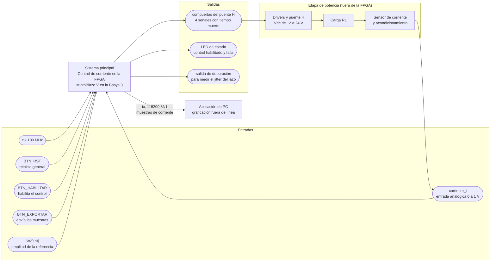

## Objetivos

- Regular la corriente de un inversor monofásico en puente H sobre una carga RL, de forma que siga una referencia sinusoidal de 50 Hz con amplitudes de 0,2, 0,5 y 1,0 A pico.
- Ejecutar el regulador proporcional-resonante como una tarea periódica en un MicroBlaze V, con una base de tiempo determinista dada por un temporizador con interrupción.
- Generar la modulación PWM unipolar con tiempo muerto mediante un periférico propio con interfaz AXI4-Lite, y adquirir la corriente con el XADC sincronizado con el período de conmutación.
- Guardar las muestras de corriente en un buffer circular y enviarlas a la PC por UART al presionar un botón, sin afectar la ejecución del lazo.

## Descripciones

### Entradas

- `clk`, reloj de 100 MHz de la Basys 3, pin W5. Es el único reloj que entra al sistema.
- `BTN_RST`, reinicio general del sistema. El botón y el pin se definen en `basys3.xdc`.
- `BTN_HABILITAR`, habilita o deshabilita el control. Mientras no se presione, las compuertas se quedan apagadas.
- `BTN_EXPORTAR`, pide al sistema enviar por UART el histórico de muestras guardado en memoria.
- `SW[1:0]`, switches `SW0` y `SW1` de la Basys 3 que eligen la amplitud pico de la referencia, 0 A, 0,2 A, 0,5 A o 1,0 A. Se pueden mover con el control andando, que es lo que pide el ensayo de cambio de amplitud.
- `corriente_i`, entrada analógica de 0 a 1 V hacia el XADC, por el Pmod JXADC. Llega ya acondicionada desde el sensor, con un offset para representar corriente alterna en un rango unipolar.

Los botones y los pines concretos de cada entrada están por confirmar, y su nombre es provisional hasta que se asigne el `.xdc`.

### Salidas

- `tx`, línea serial hacia la aplicación de PC por el puente USB-UART, pin A18. Lleva las muestras de corriente guardadas, a 115200 baudios.
- `compuerta_a_alta`, `compuerta_a_baja`, `compuerta_b_alta` y `compuerta_b_baja`, las cuatro señales hacia los drivers del puente H. Cada pierna tiene un par complementario con tiempo muerto. Los nombres son provisionales hasta que el diseño del periférico PWM los fije.
- `led[1:0]`, un LED para control habilitado y otro para falla.
- Una salida de depuración que se levanta al entrar a la rutina de interrupción del lazo y se baja al salir, para medir el período y el jitter con el osciloscopio.

La PC no manda comandos en este proyecto, solo recibe, así que `rx` no se usa en este nivel.

### Elementos externos

La etapa de potencia no está dentro de la FPGA. Los drivers de compuerta y el puente H reciben las cuatro señales de la FPGA y aplican la tensión sobre la carga RL. La corriente de la carga la mide el sensor, que la lleva al rango de 0 a 1 V y cierra el lazo hacia `corriente_i`. La definición y construcción de esta etapa es de PEDP, y la frontera con la FPGA son las cuatro compuertas y la entrada analógica, con la etapa de potencia aislada de la Basys 3.

La aplicación de PC es otro elemento externo. Recibe las muestras por el puerto serial y las grafica fuera de línea, sin intervenir en el control.

### Funcionamiento general

Al arrancar, el MicroBlaze V configura el temporizador, el PWM, la interfaz del ADC, el UART y el GPIO, fija los parámetros iniciales (referencia de corriente, frecuencia de conmutación, ciclo de trabajo de arranque) y se queda esperando la interrupción periódica.

En cada interrupción, el procesador hace siempre lo mismo y en el mismo orden. Inicia o captura la conversión del ADC y valida que haya un dato nuevo. Lee la muestra de corriente y calcula la acción del regulador PR. Escribe el nuevo `duty_ref` en el periférico PWM, y guarda la muestra en el buffer circular. Esa secuencia es la que mantiene el lazo determinista.

El periférico PWM convierte `duty_ref` en las cuatro compuertas con modulación unipolar y tiempo muerto. Además emite un disparo hacia el ADC en un instante fijo del período de conmutación, para muestrear la corriente en el centro del pulso y no ver el rizado.

Al presionar `BTN_EXPORTAR`, el lazo principal, fuera de la rutina de interrupción, recorre el buffer y manda las muestras por `tx`. Mientras tanto la interrupción sigue ejecutando el control con su temporización normal.

Si la corriente medida supera el límite configurado, el sistema baja las compuertas, enciende el LED de falla y deja de aplicar tensión a la carga.

En este nivel se muestran las relaciones con el exterior de la FPGA y con la etapa de potencia. La organización interna del sistema se desarrolla en el nivel 2.

---

<!-- Fuente: docs/diseño/diagramas/nivel02.md -->

# Nivel 2

## Diagrama de segundo nivel

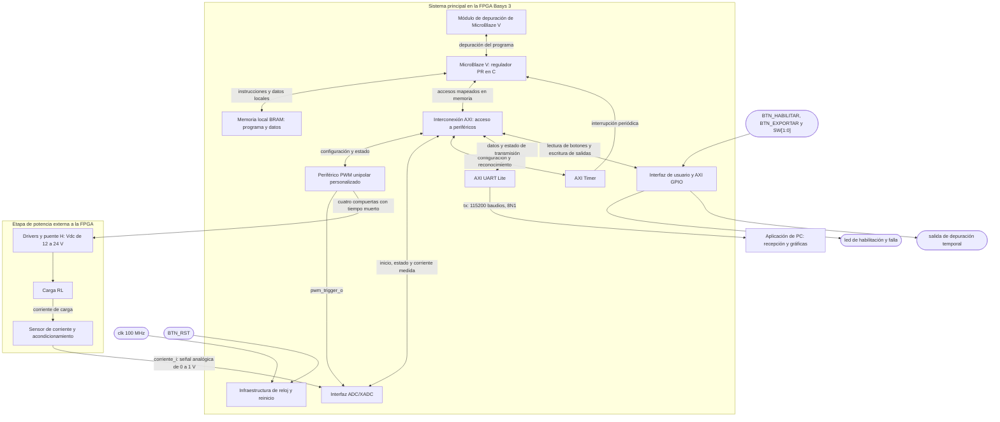

## Objetivos

- Subdividir el sistema principal del nivel 1 en el procesador, la memoria, la infraestructura de reloj y reinicio, la interconexión y los periféricos que lo componen.
- Distinguir los accesos del procesador a la memoria local de los accesos a los periféricos mapeados en memoria mediante AXI.
- Mostrar que el cálculo del regulador PR corresponde al software del MicroBlaze V, mientras que el PWM y la adquisición ejecutan las funciones físicas de actuación y medición.
- Identificar el recorrido de la interrupción periódica y la conexión de sincronización entre el PWM y el ADC, necesarias para coordinar el lazo de control.
- Conservar las entradas y salidas del nivel 1 y delimitar la FPGA, la etapa de potencia y la aplicación de PC.
- Establecer la función, las entradas y las salidas de cada bloque sin desarrollar todavía su organización interna.

## Descripciones

La plataforma es la Basys 3. El sistema recibe un único reloj externo de 100 MHz y mantiene al MicroBlaze V a esa frecuencia, con 32 KB de memoria local BRAM y sin caché. La memoria local contiene tanto el programa como los datos de trabajo; no se proponen una ROM y una RAM independientes como las del procesador uniciclo de los proyectos anteriores.

El reloj y los reinicios correspondientes llegan a los bloques internos, pero sus conexiones repetidas se omiten en el diagrama para que puedan distinguirse los caminos de información. El bloque de infraestructura representa esa distribución. Las interrupciones y el disparo de adquisición son eventos de control; no se utilizan como relojes de los módulos.

Cada flecha bidireccional entre la interconexión y un periférico representa su interfaz de acceso a registros. Los nombres externos y los nombres funcionales de conexión se mantienen de acuerdo con el nivel 1; los puertos concretos de las envolturas propias se fijarán durante su implementación. Este documento plantea la arquitectura y no presenta esos bloques como ya implementados o validados.

### Bloque 1: Infraestructura de reloj y reinicio

Recibe el reloj de la placa y el botón de reinicio general, y proporciona las condiciones de reloj y reset que necesita el sistema embebido. Su función es que el procesador, las memorias y los periféricos arranquen de forma coordinada, con las compuertas del puente H apagadas hasta que el software complete la configuración y habilite el control.

El reloj de funcionamiento del procesador y del bus es de 100 MHz. La temporización interna de conversión del XADC se configura a partir de esta infraestructura de acuerdo con las necesidades de adquisición. No se introduce un segundo reloj externo ni se fija aquí una primitiva PLL o MMCM concreta: esa selección pertenece a la integración del Block Design.

El reinicio del sistema y el paro del control tienen funciones diferentes. `BTN_RST` reinicia la plataforma; `BTN_HABILITAR` solicita habilitar o deshabilitar la actuación mediante el programa. La liberación del reset debe ser compatible con el dominio de reloj de cada IP y con la polaridad de su entrada de reinicio.

- **Entradas:** `clk` de 100 MHz, asociado al pin W5 en el nivel 1, y `BTN_RST`.
- **Salidas:** reloj del sistema y señales de reinicio hacia MicroBlaze V, memoria, interconexión y periféricos.

### Bloque 2: Procesador MicroBlaze V

Ejecuta el programa en C que configura los periféricos y realiza el control de corriente. La rutina periódica lee una muestra válida del ADC, la convierte a corriente con la calibración del sensor, genera la referencia sinusoidal, calcula el regulador PR y escribe la nueva orden de modulación en el PWM. La referencia es de 50 Hz y debe permitir los ensayos de 0,2, 0,5 y 1,0 A pico.

El PR es una función del programa, no un módulo adicional de hardware. Del mismo modo, la gestión de la habilitación, la detección de fallas a partir de la corriente medida, el almacenamiento del histórico y la organización de la exportación pertenecen al software. El ADC entrega la medición y el PWM ejecuta la actuación solicitada; ninguno de esos periféricos sustituye el cálculo del controlador.

El procesador atiende la interrupción periódica del Timer, que llega directo a su entrada de interrupción. La transmisión del histórico se realiza fuera de esa rutina para conservar el plazo del control. Esto exige que el programa no bloquee la atención de la interrupción mientras espera espacio en la UART.

- **Entradas:** reloj y reinicio, instrucciones y datos leídos de la memoria local, respuestas de los periféricos mediante AXI y solicitud de interrupción desde el AXI Timer.
- **Salidas:** solicitudes de acceso a memoria local, lecturas y escrituras a los periféricos mediante AXI y comunicaciones con el módulo de depuración.

### Bloque 3: Memoria local BRAM

Almacena el programa C, las variables, la pila, los estados del regulador PR y el buffer circular de muestras. La capacidad indicada para la memoria local es de 32 KB. El reparto de esa capacidad entre código y datos se verificará al enlazar la aplicación; el buffer no dispone de los 32 KB completos para su uso exclusivo.

El procesador accede a esta memoria por la infraestructura local del subsistema MicroBlaze V. Por ello el diagrama separa su conexión de los accesos AXI a periféricos. Esta distinción evita interpretar que cada lectura de instrucciones o cada escritura al buffer tiene que pasar por el mismo camino de configuración del PWM.

El MicroBlaze V se configura sin caché de instrucciones ni de datos. Una caché solo guarda copias de lo que el procesador lee por sus puertos AXI de memoria, y aquí el programa y los datos se leen por el bus local desde esta BRAM, que ya responde en un ciclo, así que no tendría nada que guardar. Para que aportara habría que mover el programa a una memoria más lenta por AXI, y los fallos de caché harían variar el tiempo de servicio de la rutina periódica, que es el jitter del lazo.

- **Entradas:** solicitudes de lectura o escritura del procesador, direcciones y datos de escritura a través de la interfaz de memoria local.
- **Salidas:** instrucciones y datos leídos hacia el procesador.

### Bloque 4: Módulo de depuración

Permite desarrollar y depurar la aplicación del MicroBlaze V desde las herramientas de la plataforma. Proporciona acceso de desarrollo al procesador para cargar y comprobar el programa, inspeccionar su ejecución y localizar problemas durante la integración.

Se utilizará el módulo compatible con MicroBlaze V que corresponda a la versión de Vivado/Vitis del proyecto. Este enlace de desarrollo es independiente de la UART utilizada para exportar muestras. La aplicación de PC no utiliza la depuración para intervenir en el lazo.

- **Entradas:** solicitudes de las herramientas de desarrollo y respuestas del procesador.
- **Salidas:** señales de control y acceso de depuración hacia el procesador, y respuestas hacia las herramientas.

### Bloque 5: Interconexión AXI

Conecta el procesador con los periféricos y encamina cada acceso al destino indicado por su dirección. MicroBlaze V realiza lecturas y escrituras mapeadas en memoria; la interconexión selecciona el periférico y devuelve sus datos y respuestas.

Los periféricos de control se exponen mediante AXI4-Lite. La conexión entre el maestro del procesador y los puertos de las IP se resolverá con la infraestructura AXI del Block Design, incluyendo las adaptaciones que requiera la configuración elegida. No se añade un Address Translator propio como el de los proyectos anteriores: la selección de destinos pertenece a esta infraestructura.

Las direcciones base se asignarán con el Address Editor y se utilizarán desde los controladores C generados o desarrollados para la plataforma. En este nivel se define qué bloques son accesibles y para qué se utilizan; no se inventa un mapa de direcciones ya implementado.

- **Entradas:** solicitudes de lectura y escritura del procesador y datos, estados y respuestas de los periféricos.
- **Salidas:** accesos al PWM, ADC/XADC, Timer, UART y GPIO, y respuestas de esos accesos hacia el procesador.

### Bloque 6: Periférico PWM unipolar personalizado

Recibe la orden de modulación que calcula el procesador y genera las cuatro señales de compuerta del puente H. Cada pierna tiene una salida alta y una baja, complementarias con el tiempo muerto necesario para evitar que ambos transistores de esa pierna conduzcan simultáneamente.

Este es el periférico personalizado obligatorio del proyecto. Se desarrolla en SystemVerilog con interfaz AXI4-Lite y permite configurar la habilitación, seleccionar al menos tres frecuencias de conmutación y establecer la referencia de modulación. También permite consultar si el generador está funcionando. El tiempo muerto es configurable como parámetro de la IP, que se fija al armar el Block Design, y no ocupa un registro AXI. La orden de modulación se limita al rango admisible antes de aplicarla.

El procesador entrega una referencia de modulación, no una corriente medida ni la señal física de compuerta. El PWM se encarga de convertir esa orden en conmutaciones con la temporización apropiada. La referencia se escribe en Q2.14 con signo, de -1 a +1 como fracción de Vdc. La relación con los ciclos de trabajo se desarrolla en [`nucleo_pwm`](modulos/nucleo_pwm.md).

El bloque genera además `pwm_trigger_o`, conectado directamente a la interfaz de adquisición. Este evento permite muestrear en una fase definida del período de conmutación, sin que el instante de muestreo dependa de cuándo el procesador alcance una instrucción de inicio. La fase se debe elegir y verificar considerando los flancos del puente, el tiempo muerto y el acondicionamiento; la sincronización no implica por sí sola una medición libre de rizado.

- **Entradas:** reloj, reinicio y accesos AXI4-Lite con habilitación, frecuencia y referencia de modulación.
- **Salidas:** respuestas de lectura y estado hacia AXI, `pwm_trigger_o` hacia ADC/XADC, y `compuerta_a_alta`, `compuerta_a_baja`, `compuerta_b_alta` y `compuerta_b_baja` hacia los drivers.

Las compuertas deben permanecer apagadas durante el reinicio, antes de habilitar el control y cuando el sistema ordene la deshabilitación por falla. El diseño interno de los comparadores y del tiempo muerto se desarrolla en niveles posteriores.

### Bloque 7: Interfaz ADC/XADC

Adquiere la señal analógica de corriente ya acondicionada al intervalo de 0 a 1 V. Se propone utilizar el XADC de la FPGA configurado mediante el asistente de Vivado y una envoltura de adquisición que exponga al procesador la configuración, el estado y el dato convertido mediante AXI4-Lite.

La interfaz admite dos fuentes de inicio: una orden del software para configuración o diagnóstico, y `pwm_trigger_o` para adquisición sincronizada durante el control. También informa si existe una nueva muestra disponible. Así el programa puede distinguir un dato reciente de la lectura repetida del resultado anterior.

El nombre `corriente_i` representa la magnitud analógica que atraviesa la frontera del nivel 1. Su conexión física se realizará al par de entrada del canal XADC seleccionado en JXADC, con la referencia y los límites eléctricos correspondientes. No se trata de una entrada digital que contenga directamente un número en amperios.

El dato convertido representa la tensión de salida del sensor. El software aplica el offset y la ganancia medidos para recuperar la corriente con signo. Estos parámetros se coordinan con PEDP porque la corriente de la carga es alterna, mientras que la entrada analógica se utiliza en un rango unipolar.

- **Entradas:** señal analógica `corriente_i` desde el acondicionamiento, `pwm_trigger_o`, reloj, reinicio y órdenes/configuración por AXI4-Lite.
- **Salidas:** muestra digital de corriente y estado de disponibilidad y adquisición, legibles por el procesador mediante AXI4-Lite.

La coordinación del Timer y el muestreo debe asegurar que la rutina encuentre un resultado nuevo dentro del plazo de control. La latencia de conversión y el instante exacto de lectura se especificarán y medirán durante la integración.

### Bloque 8: AXI Timer

Establece la base de tiempo periódica con la que se ejecuta el regulador PR. El procesador configura el período y habilita su interrupción. Cada vencimiento activa la entrada de interrupción del procesador, evitando que la periodicidad del control dependa de un retardo implementado en el lazo principal del programa.

El período del control se selecciona junto con la frecuencia de conmutación y la estrategia de adquisición. No se presupone que dos periféricos queden alineados por el hecho de configurarlos uno después de otro: debe establecerse una coordinación temporal que relacione el disparo del PWM, la disponibilidad del ADC y la actualización de la actuación.

El Timer determina cuándo se atiende el cálculo; el PWM determina el instante de muestreo mediante su disparo. La latencia entre la solicitud de interrupción y la ejecución de la rutina se deberá medir, incluyendo la operación simultánea de la exportación UART.

- **Entradas:** reloj, reinicio y accesos AXI para configurar el período, habilitar el conteo y reconocer la interrupción.
- **Salidas:** solicitud periódica de interrupción hacia MicroBlaze V y respuestas de lectura/estado hacia el procesador mediante AXI.

La salida de interrupción del Timer se conecta directo a la entrada de interrupción del MicroBlaze V, que tiene una sola. El Timer es la única fuente de interrupción del sistema, porque la UART y el GPIO se atienden en el programa principal, así que no se usa un AXI Interrupt Controller. Con una sola fuente, el controlador solo agregaría latencia a la entrada de la rutina periódica, ya que su manejador lee sus registros para identificar la entrada que pidió atención antes de llamar a la rutina.

### Bloque 9: AXI UART Lite

Transmite los bytes del histórico almacenado hacia la aplicación de PC. El procesador prepara los datos y los entrega al periférico; UART Lite realiza la temporización de la comunicación serie a 115200 baudios, con 8 bits de datos, sin paridad y un bit de parada.

El periférico no decide qué muestras exportar ni interpreta la referencia de corriente. La organización del histórico, el orden de las muestras y la información necesaria para reconstruir su escala temporal pertenecen al programa y al formato de exportación.

La transmisión se atiende fuera de la interrupción del regulador. Debe permitir que el Timer siga siendo atendido mientras la UART entrega los bytes al ritmo del enlace. El histórico que se está enviando debe mantenerse coherente aunque el control continúe registrando muestras; el mecanismo de gestión del buffer se concretará en el diseño del software.

- **Entradas:** reloj, reinicio y accesos AXI con configuración y datos a transmitir.
- **Salidas:** estado de transmisión hacia el procesador y `tx` hacia el puente USB-UART de la Basys 3, asociado al pin A18 en el nivel 1.

La comunicación de la aplicación es de la FPGA hacia la PC. No se incorpora una entrada `rx` de comandos a la interfaz del proyecto. Si la IP dispone de recepción, esa función queda sin utilizar en esta arquitectura.

### Bloque 10: Interfaz de usuario y AXI GPIO

Recoge `BTN_HABILITAR`, `BTN_EXPORTAR` y los switches `SW[1:0]`, y permite al software actualizar los LEDs de habilitación y falla y la salida de depuración temporal. El bloque agrupa el AXI GPIO y el acondicionamiento digital necesario para obtener eventos de botón utilizables por el programa.

`BTN_HABILITAR` solicita habilitar o deshabilitar la actuación. `BTN_EXPORTAR` solicita transmitir el histórico. `SW[1:0]` elige la amplitud de la referencia. La interpretación de ambos eventos corresponde al software; GPIO comunica las entradas y mantiene las salidas que le indique el procesador. El reinicio general `BTN_RST` se atiende en la infraestructura de reset, no como un comando que dependa de que el programa esté ejecutándose.

Los switches son niveles estables y llegan por el mismo GPIO, pero no necesitan detección de flancos. Los botones requieren tratamiento del rebote y de su llegada desde el exterior del dominio síncrono. En este nivel se establece esa necesidad sin abrir todavía el bloque en sincronizadores, contadores o detectores de flanco.

El LED de habilitación debe representar el estado efectivo del control, y el LED de falla, la condición detectada por el sistema. La salida de depuración se activa al entrar a la rutina periódica y se desactiva al salir. Su duración y repetición permiten medir el tiempo de servicio y la variación temporal de atención; no sustituyen la comprobación del instante de adquisición del XADC.

- **Entradas:** `BTN_HABILITAR`, `BTN_EXPORTAR`, `SW[1:0]`, reloj, reinicio y accesos AXI de lectura/escritura desde el procesador.
- **Salidas:** estado de botones y switches hacia el procesador mediante AXI, `led[1:0]` hacia la placa y salida de depuración hacia el punto de medición.

La cantidad de instancias o canales GPIO se fijará al integrar el Block Design, según las entradas y salidas requeridas. El bloque del diagrama representa esa función completa.

### Elemento externo: Etapa de potencia y medición

Los drivers reciben las cuatro compuertas de la FPGA y accionan el puente H alimentado entre 12 y 24 V DC. El puente aplica la tensión a la carga RL. El sensor mide la corriente de esa carga y el acondicionamiento la lleva al rango de entrada del XADC, cerrando el camino de realimentación.

El dimensionamiento de la carga, los MOSFET, los drivers, el tiempo muerto, el sensor y las protecciones se coordina con PEDP. La frontera funcional con la FPGA está formada por las cuatro señales de compuerta y la entrada analógica, con la etapa de potencia aislada de la Basys 3. Las salidas lógicas de la placa deben ser compatibles con las entradas del circuito de accionamiento seleccionado.

La detección por software de sobrecorriente requiere una muestra válida y la atención del procesador; no se considera una protección instantánea frente a un cortocircuito. La protección física y el apagado de los drivers deben definirse con la etapa de potencia. Desactivar las compuertas tampoco significa que la corriente de la inductancia desaparezca de inmediato.

### Elemento externo: Aplicación de PC

Recibe el histórico por el enlace USB-UART, reconstruye las muestras en su orden temporal y grafica la corriente fuera de línea. Debe conocer el período de registro y la calibración utilizada, o recibir los datos ya escalados junto con la información temporal necesaria.

La PC no calcula el PR ni determina el instante de muestreo. Tampoco envía comandos de habilitación o referencias mediante UART. El control permanece en la FPGA y puede continuar ejecutándose durante la transmisión del histórico.

### Interfaz principal

| Conexión | Información que transporta | Función |
| --- | --- | --- |
| Reloj y reinicio hacia los bloques | Reloj del sistema y resets correspondientes | Coordinar operación y arranque de la plataforma. |
| MicroBlaze V ↔ memoria local | Direcciones, instrucciones y datos | Ejecutar el programa y conservar estados, pila e histórico. |
| Módulo de depuración ↔ MicroBlaze V | Solicitudes y respuestas de desarrollo | Cargar y depurar la aplicación. |
| MicroBlaze V ↔ interconexión AXI | Accesos mapeados en memoria | Configurar los periféricos y leer sus datos/estados. |
| Interconexión AXI ↔ PWM | Habilitación, frecuencia, modulación y estado | Controlar la actuación del puente. |
| Interconexión AXI ↔ ADC/XADC | Inicio por software, configuración, muestra y disponibilidad | Obtener la medición digital de corriente. |
| Interconexión AXI ↔ Timer | Configuración, estado y reconocimiento de la interrupción | Establecer la rutina periódica. |
| Interconexión AXI ↔ UART | Bytes a transmitir y estado del transmisor | Exportar el histórico. |
| Interconexión AXI ↔ GPIO | Botones, LEDs y salida de depuración | Atender la interfaz de usuario y la medición temporal. |
| Timer → MicroBlaze V | Solicitud de interrupción periódica | Iniciar la rutina del regulador. |
| PWM → ADC/XADC | `pwm_trigger_o` | Sincronizar la adquisición con la conmutación. |
| PWM → drivers del puente H | Cuatro señales de compuerta con tiempo muerto | Aplicar la orden de modulación a la etapa de potencia. |
| Sensor y acondicionamiento → ADC/XADC | `corriente_i`, analógica de 0 a 1 V | Realimentar la corriente de carga. |
| UART → aplicación de PC | `tx`, 115200 baudios, 8N1 | Entregar las muestras para análisis fuera de línea. |

La interfaz AXI4-Lite de los periféricos utiliza accesos de lectura y escritura con datos de 32 bits. Los registros concretos, sus offsets y la semántica detallada de los campos se documentarán en el diseño de cada periférico. En el Block Design las direcciones base deberán ser únicas y coincidir con las utilizadas por el software.

## Funcionamiento general

Al arrancar, la infraestructura de reset mantiene el sistema en una condición definida y el PWM deja las compuertas apagadas. MicroBlaze V inicia el programa, configura el Timer y su interrupción, prepara el ADC/XADC, establece la configuración del PWM y habilita UART y GPIO. También inicializa el controlador PR y el buffer circular antes de aceptar la habilitación del control.

Durante la operación, el PWM genera el disparo de adquisición en una fase definida de la conmutación. El XADC realiza la conversión y la interfaz publica la nueva muestra. La interrupción del Timer activa la rutina periódica. El programa comprueba que haya una medición válida, obtiene la corriente con signo y calcula el error respecto de la referencia sinusoidal de 50 Hz. Con ese error actualiza el PR y escribe la nueva orden de modulación al periférico PWM.

El periférico transforma la orden en las cuatro compuertas y aplica el tiempo muerto entre las señales de cada pierna. La tensión del puente modifica la corriente de la carga RL; el sensor vuelve a medirla y completa el lazo. La selección del instante de muestreo y de actualización debe considerar la latencia del ADC y del cálculo, y el retardo resultante debe formar parte de la validación del controlador.

Cada iteración conserva la muestra en memoria. Cuando se presiona `BTN_EXPORTAR`, el programa principal prepara y transmite el histórico mediante UART, mientras la interrupción conserva su prioridad y periodicidad. La organización del buffer debe evitar que una muestra sea modificada durante su exportación o que se mezclen partes de históricos distintos.

Cuando se solicita deshabilitar el control o se detecta una falla, el programa ordena apagar la actuación y actualiza los LEDs. `BTN_RST` reinicia el sistema completo y devuelve la ejecución a la inicialización. La aplicación de PC interviene únicamente en la recepción y representación de los datos.

Las frecuencias de conmutación, el período de control, la fase de muestreo, el tiempo muerto, las ganancias del PR, el formato de la referencia de modulación, el tamaño del histórico y los pines aún no asignados se definirán junto con PEDP y la integración del sistema. Este segundo nivel establece los bloques y sus responsabilidades; la estructura interna y las pruebas de implementación se desarrollan en los niveles siguientes.

---

<!-- Fuente: docs/diseño/diagramas/nivel03.md -->

# Nivel 3

## Software del MicroBlaze V

El bloque 2 del nivel 2 ejecuta todo el programa en C. Acá se abre en nueve módulos con nombre. Ocho viven en el MicroBlaze V y uno, `receptor_pc`, corre en la computadora. El objetivo, las entradas, las salidas y el funcionamiento de cada uno están en su propio archivo de `docs/diseño/modulos/`, que en el nivel 4 se completa con el detalle.

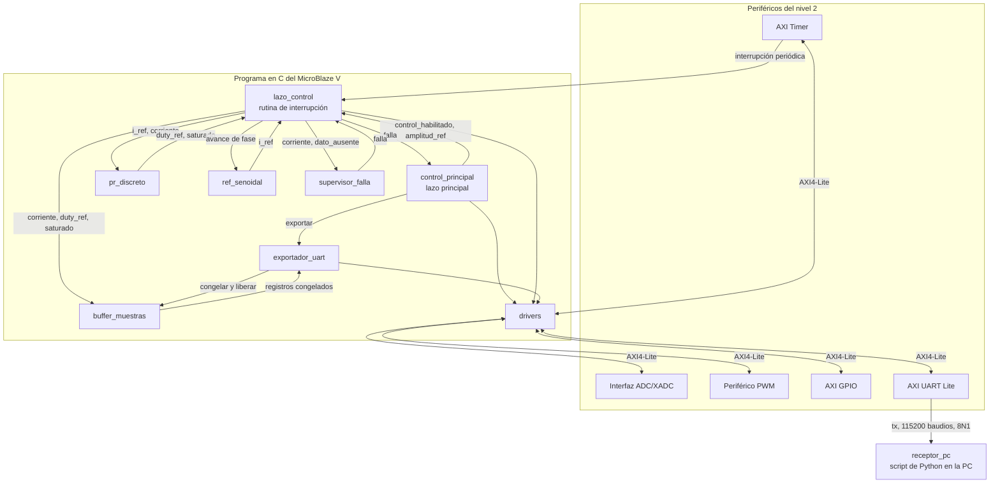

### Módulos

- [`control_principal`](modulos/control_principal.md), arranque del sistema, botones, switches de amplitud, LEDs y pedido de exportación.
- [`lazo_control`](modulos/lazo_control.md), rutina de interrupción del Timer con una iteración del control.
- [`pr_discreto`](modulos/pr_discreto.md), ecuación en diferencias del PR con saturación y anti-windup.
- [`ref_senoidal`](modulos/ref_senoidal.md), referencia sinusoidal de 50 Hz.
- [`drivers`](modulos/drivers.md), única capa que toca registros de periféricos.
- [`buffer_muestras`](modulos/buffer_muestras.md), histórico circular en la BRAM local.
- [`exportador_uart`](modulos/exportador_uart.md), envío del histórico sin bloquear el lazo principal.
- [`supervisor_falla`](modulos/supervisor_falla.md), apagado del puente por sobrecorriente o falta de dato.
- [`receptor_pc`](modulos/receptor_pc.md), recepción y gráficas en la computadora.

### Contextos de ejecución

El programa tiene dos contextos. `lazo_control` corre dentro de la interrupción del Timer y es lo único con plazo fijo, junto con lo que llama (`ref_senoidal`, `pr_discreto`, `supervisor_falla` y la escritura en `buffer_muestras`). `control_principal` y `exportador_uart` corren en el lazo principal, que nunca bloquea y puede ser interrumpido en cualquier punto. Ningún acceso que espere a un periférico lento, como la UART, entra a la interrupción.

Los dos contextos comparten pocas variables, cada una de 32 bits y declarada `volatile`, con un solo escritor. `control_principal` escribe `control_habilitado` y `amplitud_ref`, y la interrupción solo las lee. La interrupción escribe `falla` y el lazo principal solo la lee. La secuencia que vuelve a comprobar `falla` y escribe `enable = 1` se protege como una unidad en [control principal](modulos/control_principal.md).

## Periférico PWM

El bloque 6 del nivel 2 se abre en dos módulos de SystemVerilog dentro de `periferico_pwm`, que es el módulo superior que se empaqueta como IP. `interfaz_axi_pwm` atiende el bus y guarda los registros, y `nucleo_pwm` genera la portadora, las compuertas y el disparo del ADC. Van en archivos separados para que cada uno se trabaje en su rama sin pisarse.

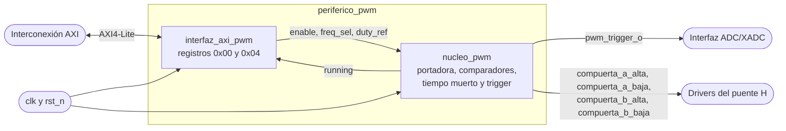

### Módulos

- `interfaz_axi_pwm`, esclavo AXI4-Lite con el registro de control y estado y el de `duty_ref`.
- [`nucleo_pwm`](modulos/nucleo_pwm.md), portadora triangular, modulación unipolar, tiempo muerto y `pwm_trigger_o`.

### Registros

- `0x00`, control y estado. `enable` en el bit 0, `freq_sel` en los bits [2:1] y `running` en el bit 3, de solo lectura.
- `0x04`, `duty_ref` en los bits [15:0], en Q2.14 con signo.

### Reparto de funciones

La interfaz guarda lo que escribe el software y lo pasa tal cual al núcleo. Los registros sombra, la saturación de `duty_ref` y la espera al valle están en el núcleo, así que la interfaz no necesita saber nada de la portadora. `running` va en sentido contrario, lo produce el núcleo y la interfaz solo lo expone en lectura.

El tiempo muerto no pasa por la interfaz. Es el `parameter` `DEAD_TIME_CICLOS` de `nucleo_pwm`, que `periferico_pwm` expone como parámetro de la IP para fijarlo al armar el Block Design.

Los dos módulos usan el reloj y el reinicio del bus, así que no hay cruce de dominios de reloj entre la interfaz y el núcleo.

## Plataforma del MicroBlaze V

Los bloques 1, 3, 4, 5, 7, 8, 9 y 10 del nivel 2 son casi todos IP de Xilinx. Abrirlos es decir qué instancias del Block Design los forman, cómo se conectan y con qué configuración. Hay lógica propia en dos lugares, los dos `debounce` del bloque 10 y `envoltura_xadc` del bloque 7, que tiene su propio archivo en `docs/diseño/modulos/`.

El reloj de 100 MHz llega a todas las instancias. Igual que en el nivel 2, esas conexiones se omiten en el diagrama, salvo la que entra al Processor System Reset.

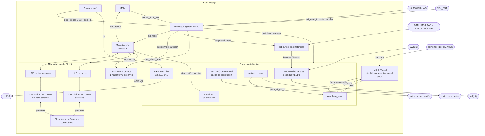

### Bloque 1, reloj y reinicio

El reloj de W5 entra directo al Block Design, sin Clocking Wizard. El procesador, el bus, el PWM, el Timer y el `DCLK` del XADC corren a los mismos 100 MHz del oscilador, así que no hay otra frecuencia que generar. Con un solo reloj, además, el Timer y la portadora del PWM cuentan exactamente los mismos ciclos.

Los reinicios salen de un Processor System Reset, que los sincroniza con el reloj y los entrega en la polaridad que pide cada destino [1]. `BTN_RST` llega a `ext_reset_in`, configurada activa en alto porque los botones de la Basys 3 dan alto solo mientras se presionan [2]. `Debug_SYS_Rst` del MDM llega a `mb_debug_sys_rst`, que es siempre activa en alto. Así, cargar un programa desde Vitis reinicia también los periféricos, y el PWM no sigue conmutando con la configuración del programa anterior mientras arranca el nuevo.

Las otras dos entradas van a un Constant en 1. `dcm_locked` va en alto porque no hay un generador de reloj al que esperar [1, p. 9], y `aux_reset_in` no se usa y queda con su polaridad activa en bajo, así que el 1 es su nivel inactivo.

Mientras la FPGA se configura todavía no hay diseño que maneje los pines. En la Basys 3 `PUDC_B` está en alto por una resistencia a 3,3 V, así que los pines de usuario quedan en alta impedancia y sin pull-ups internos [3]. En ese intervalo las compuertas las mantiene apagadas el pull-down entre base y emisor del transistor que maneja el LED del aislamiento (`potencia/diseno_puente_h.md`).

- Entradas, `clk` de 100 MHz en W5, `BTN_RST` y `Debug_SYS_Rst` del MDM.
- Salidas, el reloj del sistema y cinco reinicios.
  - `mb_reset`, activo en alto, hacia el MicroBlaze V.
  - `bus_struct_reset`, activo en alto, hacia los dos LMB.
  - `interconnect_aresetn`, activo en bajo, hacia la interconexión AXI.
  - `peripheral_aresetn`, activo en bajo, hacia los seis esclavos AXI4-Lite, incluidos `periferico_pwm` y `envoltura_xadc`.
  - `peripheral_reset`, activo en alto, hacia los dos `debounce`.

### Bloque 3, memoria local BRAM

La memoria local tiene dos buses LMB, uno de instrucciones y otro de datos, cada uno con su controlador LMB BRAM, y un Block Memory Generator de doble puerto con los 32 KB. El controlador de instrucciones usa el puerto A y el de datos el puerto B, así que el procesador puede buscar una instrucción y acceder a un dato en el mismo ciclo. Los 32 KB ocupan 8 de los 50 bloques RAMB36 de la XC7A35T [4].

El MicroBlaze V va sin caché, por la razón que da el bloque 3 del nivel 2.

- Entradas, accesos del MicroBlaze V por los dos LMB y `bus_struct_reset`.
- Salidas, instrucciones y datos leídos hacia el procesador.

### Bloque 4, módulo de depuración

El MDM se conecta al MicroBlaze V por su interfaz de depuración. Por ahí Vitis carga y depura el programa a través del JTAG del USB de la Basys 3. No es maestro AXI, así que no aparece en la interconexión. Su salida `Debug_SYS_Rst` va al Processor System Reset del bloque 1.

- Entradas, el JTAG del USB y las respuestas del procesador.
- Salidas, la interfaz de depuración hacia el MicroBlaze V y `Debug_SYS_Rst`.

### Bloque 5, interconexión AXI

Tiene un solo maestro, `M_AXI_DP`, el puerto de datos para periféricos del MicroBlaze V, y seis esclavos AXI4-Lite.

- `periferico_pwm`
- `envoltura_xadc`
- AXI Timer
- AXI UART Lite
- AXI GPIO de entradas y LEDs
- AXI GPIO de la salida de depuración

Las instrucciones y los datos de la BRAM van por LMB y no pasan por acá.

La rutina periódica hace entre cinco y seis accesos AXI por iteración (depuración, reconocimiento del Timer, dato y contador del ADC en una sola lectura, `duty_ref` y depuración otra vez), y el presupuesto temporal del control debe incluir la latencia de la interconexión. Se usa un AXI SmartConnect, la IP que coloca Connection Automation de Vivado. Con seis esclavos AXI4-Lite atiende una transacción a la vez, igual que AXI Interconnect [5], [6]. Las direcciones base las asigna el Address Editor, y el mapa está en [`block_design`](modulos/block_design.md).

- Entradas, accesos de `M_AXI_DP`, respuestas de los esclavos e `interconnect_aresetn`.
- Salidas, accesos hacia los seis esclavos y respuestas hacia el procesador.

### Bloque 7, interfaz ADC/XADC

Se arma con dos instancias, un XADC Wizard y `envoltura_xadc`.

El XADC Wizard va sin interfaz AXI, en modo por eventos y con canal único [7]. En modo por eventos cada conversión arranca con un flanco en `CONVST`. El modo continuo muestrea a su propio ritmo, sin relación con la portadora, y la muestra podría caer en cualquier punto del período, incluso en una conmutación. Con una sola señal analógica el secuenciador no hace falta, y el dato queda siempre en el mismo registro de estado.

`envoltura_xadc` es esclava AXI4-Lite de la interconexión y maestra del puerto DRP del wizard. Un bit de su registro de control elige si `CONVST` lo dispara `pwm_trigger_o` o el inicio por software, y la fuente que no está elegida se ignora. Al fin de cada conversión lee el registro de estado del canal por el DRP y publica el dato junto con un contador de conversiones, que el software compara con su lectura anterior para saber si hay dato nuevo. El detalle está en [`envoltura_xadc`](modulos/envoltura_xadc.md).

El wizard queda como instancia aparte, fuera de la envoltura, para que el testbench de la envoltura use un modelo simple de los puertos DRP y de conversión, sin simular la primitiva analógica.

- Entradas, `corriente_i` por el par Vaux del canal del JXADC, `pwm_trigger_o` de `periferico_pwm`, accesos AXI4-Lite y `peripheral_aresetn`.
- Salidas, el dato y el contador de conversiones hacia el procesador por AXI4-Lite.

### Bloque 8, AXI Timer

Va con un solo contador, el 0, y el Timer 2 desactivado [8]. El modo de generación, la cuenta hacia abajo, la recarga automática y la interrupción los configura `drivers` con el Timer detenido. [Control principal](modulos/control_principal.md) arranca la cuenta después de usar una publicación del XADC como referencia de fase.

Su salida de interrupción va directo a la entrada de interrupción del MicroBlaze V, configurada por nivel. La salida del Timer se queda en alto hasta que el software la limpia, y con una entrada por nivel la rutina tiene que limpiarla antes de terminar o la interrupción vuelve a dispararse [9]. `lazo_control` la reconoce en el paso 2, que se ejecuta en todas las iteraciones, también cuando no hay dato nuevo.

- Entradas, accesos AXI4-Lite y `peripheral_aresetn`.
- Salidas, la interrupción hacia el MicroBlaze V.

### Bloque 9, AXI UART Lite

La velocidad de 115200 baudios, los 8 bits de datos y la falta de paridad son parámetros de la IP, fijos al sintetizar [10]. El software solo entrega bytes.

`rx` va al Constant en 1, el nivel de reposo de una línea serie. En 0 el receptor vería un bit de inicio permanente y marcaría errores de trama.

- Entradas, accesos AXI4-Lite, `peripheral_aresetn` y `rx` en 1.
- Salidas, `tx` hacia el puente USB-UART en A18.

### Bloque 10, interfaz de usuario y AXI GPIO

Se arma con dos AXI GPIO y dos instancias de `debounce`.

- El GPIO de dos canales tiene el canal 1 de entrada, con cuatro bits (`BTN_HABILITAR` y `BTN_EXPORTAR` filtrados, y `SW[1:0]`), y el canal 2 de salida, con `led[1:0]`.
- El GPIO de un canal tiene un bit de salida, la salida de depuración.

La salida de depuración la escribe solo la rutina periódica y los LEDs solo el lazo principal. En instancias distintas, cada registro de datos tiene un solo escritor, y una lectura y escritura del lazo principal interrumpida a la mitad no puede pisar lo que dejó la rutina.

Los botones pasan por un antirrebote en hardware antes del GPIO. El manual de la Basys 3 describe para los botones solo resistencias en serie y el nivel bajo en reposo, sin filtro [2], y el contacto rebota durante algunos milisegundos al presionar. Como `control_principal` alterna el control en cada flanco de subida de `BTN_HABILITAR`, cada rebote que llegara al software lo cambiaría de estado otra vez.

`debounce` se reutiliza del Proyecto 2 (`src/design/debounce.sv`) y va una instancia por botón, entre el pin y el canal 1. Dos flip-flops en cadena sincronizan el botón con el reloj. Un contador vuelve a cero cada vez que la entrada cambia, y la salida copia la entrada recién cuando el contador enciende su bit más alto. Con `N = 21` eso son 2^20 ciclos, unos 10,5 ms de entrada estable a 100 MHz. Su reinicio es activo en alto, por eso va a `peripheral_reset`. Entra al Block Design como módulo RTL. Los switches no pasan por `debounce` porque `control_principal` los lee como niveles.

El orden de los bits en cada canal se fija en el Block Design (#15), y `drivers` lo toma de ahí.

- Entradas, `BTN_HABILITAR`, `BTN_EXPORTAR`, `SW[1:0]`, accesos AXI4-Lite, `peripheral_aresetn` y `peripheral_reset`.
- Salidas, `led[1:0]`, la salida de depuración, y el estado de botones y switches hacia el procesador por AXI4-Lite.

### Referencias

[1] AMD, "Processor System Reset Module v5.0 LogiCORE IP Product Guide," PG164, nov. 2015.

[2] Digilent, "Basys 3 Reference Manual." [En línea]. Disponible en https://digilent.com/reference/programmable-logic/basys-3/reference-manual

[3] AMD, "7 Series FPGAs Configuration User Guide," UG470.

[4] AMD, "7 Series FPGAs Data Sheet: Overview," DS180.

[5] AMD, "AXI Interconnect LogiCORE IP Product Guide," PG059, v2.1, dic. 2025.

[6] AMD, "SmartConnect LogiCORE IP Product Guide," PG247, v1.0, jun. 2026.

[7] AMD, "7 Series FPGAs and Zynq-7000 SoC XADC Dual 12-Bit 1 MSPS Analog-to-Digital Converter User Guide," UG480.

[8] AMD, "AXI Timer LogiCORE IP Product Guide," PG079.

[9] AMD, "MicroBlaze V Processor Reference Guide," UG1629, sección External Interrupt.

[10] AMD, "AXI UART Lite LogiCORE IP Product Guide," PG142.

---

<!-- Fuente: docs/diseño/modulos/block_design.md -->

# block_design

## a) Nombre del módulo

`block_design`, el Block Design `sistema` del proyecto de Vivado 2026.1 para la XC7A35T-1CPG236 de la Basys 3. Se exporta con `write_bd_tcl` a `src/bd/sistema.tcl`, y el proyecto se regenera desde ahí en `vivado/`, que no se versiona. Junta en una sola integración los bloques 1, 3, 4, 5, 6, 7, 8, 9 y 10 del [nivel 2](diagramas/nivel02.md), abiertos en la plataforma del [nivel 3](diagramas/nivel03.md).

## b) Diagrama modular

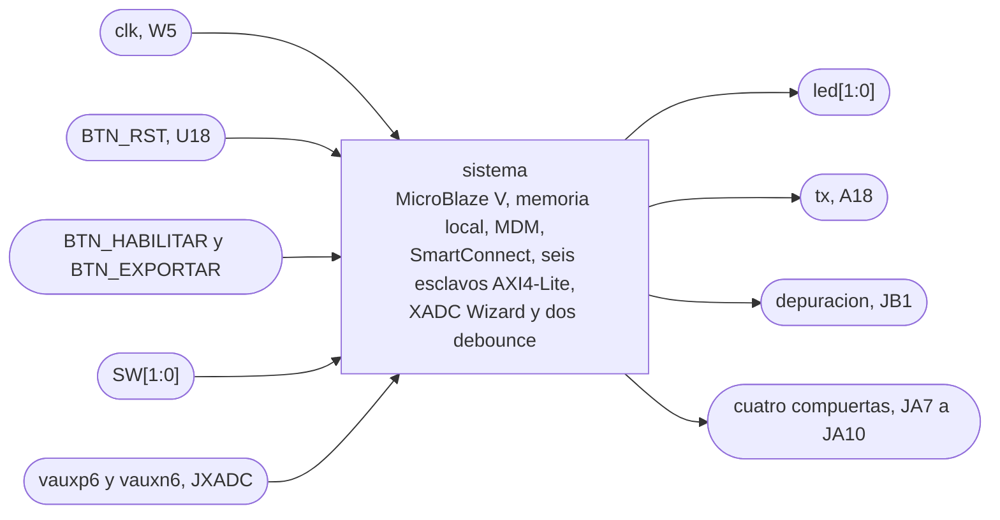

## c) Objetivo del módulo

Fija cómo se arman e interconectan las instancias de la plataforma, con su configuración, el mapa de direcciones, la interrupción, el reloj y los reinicios, y qué pin de la Basys 3 le toca a cada puerto externo. Es la base de `src/bd/sistema.tcl`, de `basys3.xdc` y del `.xsa` sobre el que se arma la plataforma de Vitis.

## d) Entradas

- `clk`, reloj de 100 MHz del oscilador de la placa.
- `BTN_RST`, botón de reinicio del sistema, activo en alto.
- `BTN_HABILITAR` y `BTN_EXPORTAR`, botones sin filtrar, activos en alto.
- `SW[1:0]`, switches de selección de la amplitud de la referencia.
- `vauxp6` y `vauxn6`, el par analógico de `corriente_i` por el canal XA1 del JXADC.

## e) Salidas

- `led[1:0]`, `led[0]` para control habilitado y `led[1]` para falla, como fija [`control_principal`](modulos/control_principal.md).
- `tx`, la línea serie hacia el puente USB-UART.
- `depuracion`, la salida de depuración que escribe la rutina periódica, para medir período y jitter con el osciloscopio.
- `compuerta_a_alta`, `compuerta_a_baja`, `compuerta_b_alta` y `compuerta_b_baja`, de [`periferico_pwm`](modulos/periferico_pwm.md), hacia el aislamiento de las compuertas.

## f) Explicación de la relación con otros módulos

El Block Design contiene a [`periferico_pwm`](modulos/periferico_pwm.md) y a [`envoltura_xadc`](modulos/envoltura_xadc.md) como IP empaquetadas, y a los dos `debounce` como módulos RTL. Fija los parámetros de `periferico_pwm` y conecta su `pwm_trigger_o` a la envoltura.

Del lado del software, el `.xsa` le entrega a Vitis la configuración del procesador y el mapa de direcciones. [`drivers`](modulos/drivers.md) toma las direcciones base de `xparameters.h`, donde cada macro lleva el nombre de su instancia, y el orden de los bits de los GPIO de h.6.

Del lado de potencia, las cuatro compuertas salen por JA hacia la cadena de aislamiento de `potencia/diseno_puente_h.md`, que también toma de JA los 3,3 V y el GND para los LED de los VO3120.

## g) Explicación de funcionamiento

Al soltar `BTN_RST`, o al terminar un reinicio pedido por el MDM, el Processor System Reset libera los reinicios en orden. Primero salen la interconexión y los LMB, 16 ciclos después los periféricos y otros 16 ciclos después el procesador [1, p. 9]. Así, cuando el MicroBlaze V hace su primer acceso, todos los esclavos ya están fuera de reinicio. Durante el reinicio `periferico_pwm` mantiene las cuatro compuertas en bajo.

El procesador busca instrucciones y datos en la memoria local de 32 KB por los dos LMB, y llega a los seis periféricos por `M_AXI_DP` a través del SmartConnect. El AXI Timer interrumpe al procesador directo, sin controlador de interrupciones. Todo corre con el mismo reloj de 100 MHz.

## h) Diseño

### h.1) Instancias y configuración

- `microblaze_riscv_0`, MicroBlaze V a 100 MHz, sin caché, con el puerto AXI de periféricos (`M_AXI_DP`) habilitado. La razón de ir sin caché está en el bloque 3 del [nivel 2](diagramas/nivel02.md).
- `microblaze_riscv_0_local_memory`, memoria local de 32 KB con un LMB de instrucciones y otro de datos, como el bloque 3 de `nivel03.md`.
- `mdm_1`, módulo de depuración en modo Enabled, solo depuración. La salida serie del sistema va por la UART Lite, así que el MDM no lleva UART por JTAG.
- Processor System Reset, con `ext_reset_in` activo en alto (External Reset Logic Level en 1 [1, p. 16]).
- Un Constant de un bit en 1, para `dcm_locked` y `aux_reset_in` del Processor System Reset y para `rx` de la UART Lite.
- AXI SmartConnect, con un esclavo (`M_AXI_DP`) y seis maestros, uno por periférico.
- `axi_timer_0`, AXI Timer con el Timer 2 desactivado y 32 bits.
- `axi_uartlite_0`, AXI UART Lite a 115200 baudios, 8 bits de datos y sin paridad.
- `axi_gpio_0`, AXI GPIO de dos canales. El canal 1 tiene 4 bits de entrada y el canal 2 tiene 2 bits de salida.
- `axi_gpio_1`, AXI GPIO de un canal con 1 bit de salida.
- `periferico_pwm`, con `DEAD_TIME_CICLOS = 100` y `PRECARGA_CICLOS = 7000` de `potencia/diseno_puente_h.md`, y `MAX_FREQ_00 = 5000`, `MAX_FREQ_01 = 2500`, `MAX_FREQ_10 = 1250` y `MAX_FREQ_11 = 2500` de la tabla de `freq_sel` de [`nucleo_pwm`](modulos/nucleo_pwm.md).
- `envoltura_xadc`.
- XADC Wizard sin interfaz AXI, con interfaz DRP, modo por eventos, canal único en VAUX6, entrada unipolar, `DCLK` de 100 MHz y divisor del reloj del ADC en 4, como fija h.6 de [`envoltura_xadc`](modulos/envoltura_xadc.md).
- Dos instancias de `debounce` (`src/design/debounce.sv`, `N = 21`), una para `BTN_HABILITAR` y otra para `BTN_EXPORTAR`.
- Un Concat que arma el bus de 4 bits del canal 1 de `axi_gpio_0` (h.6).

### h.2) Mapa de direcciones

El MicroBlaze V tiene dos espacios de 32 bits, uno de datos y otro de instrucciones. Los dos ven la misma BRAM en `0x0000_0000`, cada uno por su LMB. Los periféricos están solo en el espacio de datos.

| Instancia | Base | Rango | Dirección alta |
|---|---|---|---|
| Memoria local (LMB de instrucciones y de datos) | `0x0000_0000` | 32K | `0x0000_7FFF` |
| `axi_gpio_0` | `0x4000_0000` | 64K | `0x4000_FFFF` |
| `axi_gpio_1` | `0x4001_0000` | 64K | `0x4001_FFFF` |
| `axi_uartlite_0` | `0x4060_0000` | 64K | `0x4060_FFFF` |
| `axi_timer_0` | `0x41C0_0000` | 64K | `0x41C0_FFFF` |
| `periferico_pwm` | la del Address Editor | 4K | base + `0xFFF` |
| `envoltura_xadc` | la del Address Editor | 4K | base + `0xFFF` |

Las bases de los periféricos de Xilinx son las que asigna el Address Editor. Las de `periferico_pwm` y `envoltura_xadc` también las asigna el Address Editor al agregarlas, alineadas a su rango. El software no escribe ninguna dirección a mano, sino que las toma de `xparameters.h`, así que el valor de cada base solo tiene que quedar fijo en `src/bd/sistema.tcl`.

Cada IP propia usa 8 bytes, con dos registros en `0x00` y `0x04`, y se le da un segmento de 4K. Con AXI Interconnect un esclavo AXI4-Lite puede tener un rango menor a 4K solo si todos los esclavos de esa interconexión son AXI4-Lite, y con 4K o más no hay restricción [3]. SmartConnect no fija un rango mínimo por segmento [2, Features]. Con 4K el segmento sirve con cualquiera de las dos.

Las dos IP decodifican 4 bits de dirección y eligen el registro con los bits `[3:2]`, así que dentro de su segmento los dos registros se repiten cada 16 bytes, y un acceso a `base + 0x10` llega al registro de `0x00`. Un acceso fuera de todos los segmentos no llega a ningún esclavo, y el SmartConnect responde con DECERR [2, Address Decode].

### h.3) Interrupción

La salida `interrupt` de `axi_timer_0` va directo a la entrada `Interrupt` del MicroBlaze V, con sensibilidad `LEVEL_HIGH`. No hay AXI Interrupt Controller, por la razón que da el bloque 8 de `nivel03.md` [6].

### h.4) Reloj y reinicios

`clk` entra de W5 directo al Block Design, sin Clocking Wizard, y llega a todas las instancias, incluido el `dclk_in` del XADC Wizard.

Conexiones del Processor System Reset.

- `slowest_sync_clk` a `clk`.
- `ext_reset_in` a `BTN_RST`, activo en alto.
- `mb_debug_sys_rst` a `Debug_SYS_Rst` de `mdm_1`, para que cargar un programa desde Vitis reinicie también los periféricos.
- `dcm_locked` y `aux_reset_in` al Constant en 1.
- `mb_reset` al MicroBlaze V.
- `bus_struct_reset` a los dos LMB.
- `interconnect_aresetn` al `aresetn` del SmartConnect.
- `peripheral_aresetn` a los seis esclavos AXI4-Lite.
- `peripheral_reset` a los dos `debounce`.

Al liberar el reinicio, `bus_struct_reset` e `interconnect_aresetn` salen primero, `peripheral_reset` y `peripheral_aresetn` 16 ciclos después, y `mb_reset` otros 16 ciclos después [1, p. 9]. El SmartConnect va en `interconnect_aresetn`, la salida que PG164 destina a la interconexión, y queda listo antes que los esclavos.

### h.5) Memoria

Los 32 KB de la memoria local alcanzan para el programa y los datos, y el procesador va sin caché. El programa se carga por el MDM desde Vitis.

### h.6) Bits de los GPIO

Canal 1 de `axi_gpio_0`, entradas.

- Bit 0, `BTN_HABILITAR` filtrado por su `debounce`.
- Bit 1, `BTN_EXPORTAR` filtrado por su `debounce`.
- Bits 2 y 3, `SW[1:0]`, con `SW0` en el bit 2 y `SW1` en el bit 3.

Los switches quedan juntos y en orden, así que la amplitud se lee como `(entradas >> 2) & 0x3`.

Canal 2 de `axi_gpio_0`, salidas.

- Bit 0, `led[0]`, en LD0.
- Bit 1, `led[1]`, en LD1.

Canal 1 de `axi_gpio_1`, salida.

- Bit 0, `depuracion`.

### h.7) Pines

Todos los pines digitales van en LVCMOS33. Los pines del paquete salen del archivo maestro de restricciones de Digilent [4], y los de JXADC del esquemático de la placa [5].

- `clk` en W5.
- `BTN_RST` en U18 (BTNC).
- `BTN_HABILITAR` en T18 (BTNU).
- `BTN_EXPORTAR` en U17 (BTND).
- `SW[0]` en V17 y `SW[1]` en V16.
- `led[0]` en U16 (LD0) y `led[1]` en E19 (LD1).
- `tx` en A18.
- `depuracion` en A14 (JB1).
- `compuerta_a_alta` en G3 (JA10).
- `compuerta_a_baja` en H2 (JA9).
- `compuerta_b_alta` en K2 (JA8).
- `compuerta_b_baja` en H1 (JA7).
- `vauxp6` en J3 (XA1_P) y `vauxn6` en K3 (XA1_N).

Las cuatro compuertas quedan en la fila de abajo de JA, junto al GND (pin 11) y los 3,3 V (pin 12) de la misma fila, que van a la cadena de aislamiento. La salida de depuración va en otro conector, así la punta del osciloscopio no se conecta en el conector que maneja el aislamiento. JC queda libre.

## i) Diagrama esquemático detallado del diseño

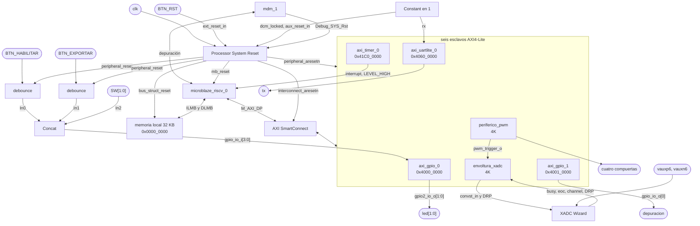

## j) Diagrama completo de conexiones eléctricas del diseño

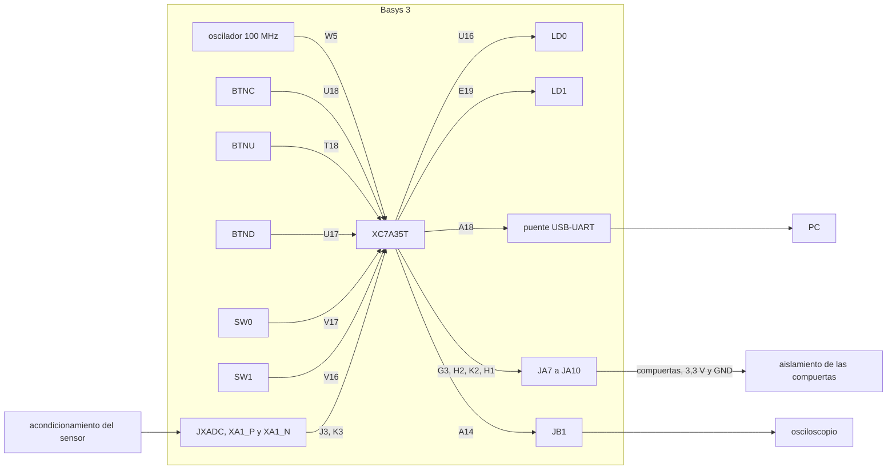

## Referencias

[1] AMD, "Processor System Reset Module v5.0 LogiCORE IP Product Guide," PG164, nov. 2015.

[2] AMD, "SmartConnect LogiCORE IP Product Guide," PG247, v1.0, jun. 2026.

[3] AMD, "Vivado Design Suite User Guide: Designing IP Subsystems Using IP Integrator," UG994, sección Addressing Structure.

[4] Digilent, "Basys-3-Master.xdc," archivo maestro de restricciones de la Basys 3. [En línea]. Disponible en https://github.com/Digilent/digilent-xdc

[5] Digilent, "Basys 3 FPGA Board Schematic," rev. D.

[6] AMD, "MicroBlaze V Processor Reference Guide," UG1629, sección External Interrupt.

---

<!-- Fuente: docs/diseño/modulos/periferico_pwm.md -->

# periferico_pwm

## a) Nombre del módulo

`periferico_pwm`, previsto en `src/design/periferico_pwm.sv`. Es el módulo superior del PWM personalizado y la entidad que se empaquetará como IP para el Block Design.

Integra [`interfaz_axi_pwm`](modulos/interfaz_axi_pwm.md), desarrollada como parte de la Persona B, y [`nucleo_pwm`](modulos/nucleo_pwm.md), cuya generación de PWM corresponde a la Persona A. La ficha define la integración para la entrega de diseño; el empaquetado real y su comprobación se realizarán durante la implementación.

## b) Diagrama modular

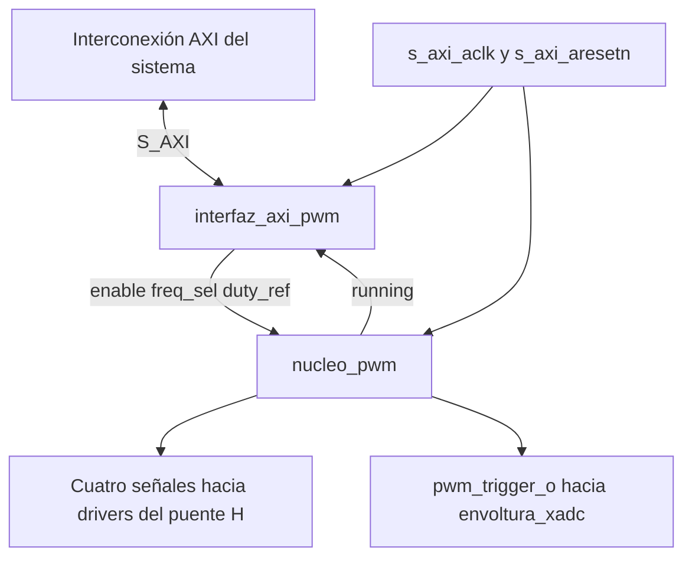

El diagrama abre la IP en sus dos módulos. No añade un procesador ni una segunda interconexión dentro del periférico.

## c) Objetivo del módulo

Presentar al sistema una única IP AXI4-Lite que reciba la referencia de modulación y produzca cuatro señales PWM unipolares con tiempo muerto y un trigger de adquisición. La envoltura reúne conexiones, reloj, reset y parámetros sin duplicar las funciones internas.

## d) Entradas

| Grupo | Señales | Propósito |
|---|---|---|
| Reloj | `s_axi_aclk` | Reloj común de 100 MHz |
| Reset | `s_axi_aresetn` | Reset de periféricos activo en bajo |
| Dirección de escritura | `s_axi_awaddr[3:0]`, `s_axi_awprot[2:0]`, `s_axi_awvalid` | Canal AW |
| Dato de escritura | `s_axi_wdata[31:0]`, `s_axi_wstrb[3:0]`, `s_axi_wvalid` | Canal W |
| Aceptación de confirmación | `s_axi_bready` | Finaliza la respuesta B |
| Dirección de lectura | `s_axi_araddr[3:0]`, `s_axi_arprot[2:0]`, `s_axi_arvalid` | Canal AR |
| Aceptación de dato | `s_axi_rready` | Finaliza la respuesta R |

Los nombres de reloj de la envoltura se adaptan internamente a `clk` y `rst_n`, usados por los dos módulos. No se introducen nuevos relojes ni conversiones de dominio.

## e) Salidas

| Grupo | Señales | Propósito |
|---|---|---|
| Aceptación de escritura | `s_axi_awready`, `s_axi_wready` | Handshakes AW y W |
| Respuesta de escritura | `s_axi_bresp[1:0]`, `s_axi_bvalid` | Canal B |
| Aceptación de lectura | `s_axi_arready` | Handshake AR |
| Respuesta de lectura | `s_axi_rdata[31:0]`, `s_axi_rresp[1:0]`, `s_axi_rvalid` | Canal R |
| Pierna A | `compuerta_a_alta`, `compuerta_a_baja` | Señales lógicas hacia sus drivers |
| Pierna B | `compuerta_b_alta`, `compuerta_b_baja` | Señales lógicas hacia sus drivers |
| Sincronización | `pwm_trigger_o` | Pulso registrado hacia la adquisición XADC |

Las salidas de compuerta son señales de control de nivel lógico; el accionamiento eléctrico de los MOSFET se realiza mediante los drivers de potencia.

## f) Relación con otros módulos

La interconexión AXI encamina los accesos del procesador a la IP. `interfaz_axi_pwm` conserva la configuración y lee el estado; `nucleo_pwm` transforma esa orden en compuertas y trigger. La envoltura conecta ambos.

`pwm_trigger_o` se conecta directamente a la envoltura de adquisición. Las cuatro compuertas se llevan a puertos externos del sistema y a los pines definidos por la integración de la Basys 3. La selección y asignación de esos pines corresponde al Block Design y a los constraints.

Los drivers C utilizan los offsets del periférico respecto de la dirección base asignada por Vivado. No se fija en esta ficha una base absoluta ni se añade un Address Translator propio.

## g) Funcionamiento

Tras el reset, la interfaz solicita `enable=0`, `freq_sel=01` y `duty_ref=0`; el núcleo mantiene las cuatro compuertas apagadas. La portadora y el trigger pueden seguir funcionando con el puente deshabilitado, según la especificación del núcleo, para permitir adquirir corriente sin energizarlo.

Al escribir `duty_ref`, la interfaz confirma el almacenamiento y el núcleo calcula y limita la referencia antes de cargar sus registros sombra. Al habilitar, `running` refleja la entrada efectiva en operación en la frontera de período definida. La lectura de `running` llega por AXI; no se convierte en un pin adicional obligatorio de la IP.

La envoltura no tiene una máquina de estados propia. Su control resulta de las máquinas AXI de la interfaz y de las máquinas de habilitación y tiempo muerto del núcleo.

## h) Diseño

### h.1 Distribución de responsabilidades internas

| Función | Módulo que la realiza |
|---|---|
| Protocolo AXI4-Lite y captura de AW y W | `interfaz_axi_pwm` |
| Registros solicitados de configuración | `interfaz_axi_pwm` |
| Instantánea de lectura de `running` | `interfaz_axi_pwm`, utilizando el estado del núcleo |
| Saturación efectiva de la referencia | `nucleo_pwm` |
| Portadora, comparadores y registros sombra | `nucleo_pwm` |
| Precarga, tiempo muerto, compuertas y trigger | `nucleo_pwm` |
| Conexiones, exposición de parámetros y frontera IP | `periferico_pwm` |

Esta separación conserva el reparto del nivel 3 y evita dos versiones diferentes de la misma lógica de saturación o actualización.

### h.2 Conexiones internas

| Origen | Destino | Señal |
|---|---|---|
| `s_axi_aclk` | `interfaz_axi_pwm.clk`, `nucleo_pwm.clk` | Reloj común |
| `s_axi_aresetn` | `interfaz_axi_pwm.rst_n`, `nucleo_pwm.rst_n` | Reset común |
| `interfaz_axi_pwm.enable` | `nucleo_pwm.enable` | 1 bit |
| `interfaz_axi_pwm.freq_sel` | `nucleo_pwm.freq_sel` | 2 bits |
| `interfaz_axi_pwm.duty_ref` | `nucleo_pwm.duty_ref` | 16 bits con signo |
| `nucleo_pwm.running` | `interfaz_axi_pwm.running` | 1 bit |
| Salidas registradas del núcleo | Puertos externos homónimos de la IP | Cuatro compuertas y trigger |

El signo de `duty_ref` debe conservarse tanto en la declaración interna como al conectarlo al núcleo. La envoltura no cambia su escala ni invierte su signo.

### h.3 Parámetros expuestos por la IP

| Parámetro | Valor en el Block Design | Uso |
|---|---:|---|
| `DEAD_TIME_CICLOS` | 100 | Tiempo muerto final de 1 µs a 100 MHz |
| `PRECARGA_CICLOS` | 7000 | Precarga de los capacitores de bootstrap durante 70 µs a 100 MHz |
| `MAX_FREQ_00` | 5000 | 10 kHz a 100 MHz |
| `MAX_FREQ_01` | 2500 | 20 kHz a 100 MHz |
| `MAX_FREQ_10` | 1250 | 40 kHz a 100 MHz |
| `MAX_FREQ_11` | 2500 | Código alternativo equivalente a 20 kHz |

La [sección h.1 del Block Design](modulos/block_design.md#h1-instancias-y-configuración) fija los seis valores de la instancia. La sección [Tiempo muerto](https://github.com/Taller-de-diseno-digital-GR01/Proyecto-4-Regulador-PR/blob/08f6ac7c8c3c1e5ac408df8e93421b7c671e3ce0/potencia/diseno_puente_h.md#tiempo-muerto) justifica los 100 ciclos a partir de un peor caso de 813 ns en la cadena de compuertas, con 187 ns de margen. La sección [Precarga en el arranque](https://github.com/Taller-de-diseno-digital-GR01/Proyecto-4-Regulador-PR/blob/08f6ac7c8c3c1e5ac408df8e93421b7c671e3ce0/potencia/diseno_puente_h.md#precarga-en-el-arranque) obtiene aproximadamente 68 µs para 5τ del RC de bootstrap en el peor caso de tolerancias y fija la precarga en 70 µs. Ambos valores se pasan como parámetros al núcleo, que usa `PRECARGA_CICLOS` en el estado `PRECARGA`.

La frecuencia se calcula como `f_clk/(2·MAX)`, siempre que el contador implementado tenga exactamente ese período. En el núcleo actual `MAX_FREQ_00` debe ser el mayor porque fija el ancho de portadora. Las configuraciones de prueba deben respetar esa restricción y usar valores positivos de `MAX`. Un cambio del reloj requiere recalcular `MAX` y los ciclos de tiempo muerto y precarga para mantener las duraciones especificadas.

### h.4 Registros visibles y actualización

La especificación completa de los registros y de sus efectos laterales está en [`interfaz_axi_pwm.md`](modulos/interfaz_axi_pwm.md). Esta envoltura no añade registros:

- `0x00`: habilitación, selección de frecuencia y estado `running`.
- `0x04`: referencia solicitada Q2.14 en los 16 bits bajos.

La interfaz ofrece la orden registrada al núcleo. La tubería del núcleo calcula referencias y las copia a los registros activos en el valle. Una escritura cercana al valle puede quedar para un período posterior según la latencia documentada en el núcleo. Los valores de frecuencia y referencias deben llegar juntos a los registros sombra para no producir un período con escalas mezcladas.

La orden `enable=0` se aplica en el valle siguiente según el diseño actual. El apagado por falla y las protecciones deben tener en cuenta esa demora; la envoltura no añade una desconexión inmediata que el núcleo no tenga.

### h.5 Contrato de empaquetado previsto

La IP se denominará `periferico_pwm`, con una interfaz esclava `S_AXI`, datos de 32 bits y direcciones locales de 4 bits. Reloj y reset se asociarán explícitamente a esa interfaz; el reset se declarará activo en bajo y el reloj nominal será 100 MHz.

Se incluirán como fuentes de síntesis la envoltura, la interfaz y el núcleo. Los bancos de prueba pertenecen al grupo de simulación y no a la lógica sintetizable. Los seis parámetros de la tabla anterior se publicarán con descripción y restricciones coherentes con el núcleo.

El Address Editor asignará una base alineada al segmento de 4 KiB, que abarca desde la base hasta `base + 0xFFF`, según la [sección h.2 del Block Design](modulos/block_design.md#h2-mapa-de-direcciones). El software usa esa base desde `xparameters.h` y accede a los registros en `0x00` y `0x04`. Como la interfaz decodifica los cuatro bits bajos del offset, los dos registros se repiten cada 16 bytes dentro del segmento.

Durante la implementación se comprobará que Vivado reconoce todos los canales AXI y las asociaciones de reloj/reset. En la entrega actual se presenta este contrato de integración; no se afirma que exista ya un paquete `component.xml`, un `.xsa` o un Block Design validado.

### h.6 Estrategia de verificación

El [plan de verificación del PWM](plan_verificacion_pwm.md) detalla los estímulos, resultados esperados y pruebas de integración en FPGA.

El banco de pruebas se conectará al nivel de `periferico_pwm`, realizará transacciones AXI y observará compuertas y trigger. Así se verificará la relación entre escrituras, estado y actuación real, además de probar por separado la interfaz.

Se cubrirán reset, contrapresión, escrituras parciales, saturación, frecuencias, actualización en valle, no solapamiento y tiempo muerto. En cada arranque se comprobará que las dos compuertas bajas permanezcan encendidas durante los 7000 ciclos de precarga y que las altas permanezcan apagadas durante la precarga y el tiempo muerto posterior. La simulación temporizada posterior utilizará la implementación y su SDF con un banco compatible; sus resultados corresponden a una etapa posterior.

## i) Diagrama esquemático detallado del diseño

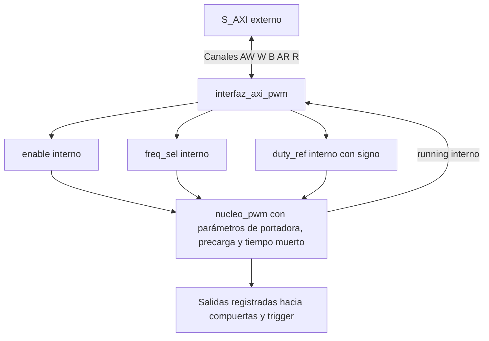

No hay lógica combinacional adicional entre las salidas registradas del núcleo y los puertos de salida de la envoltura.

## j) Conexiones eléctricas del sistema

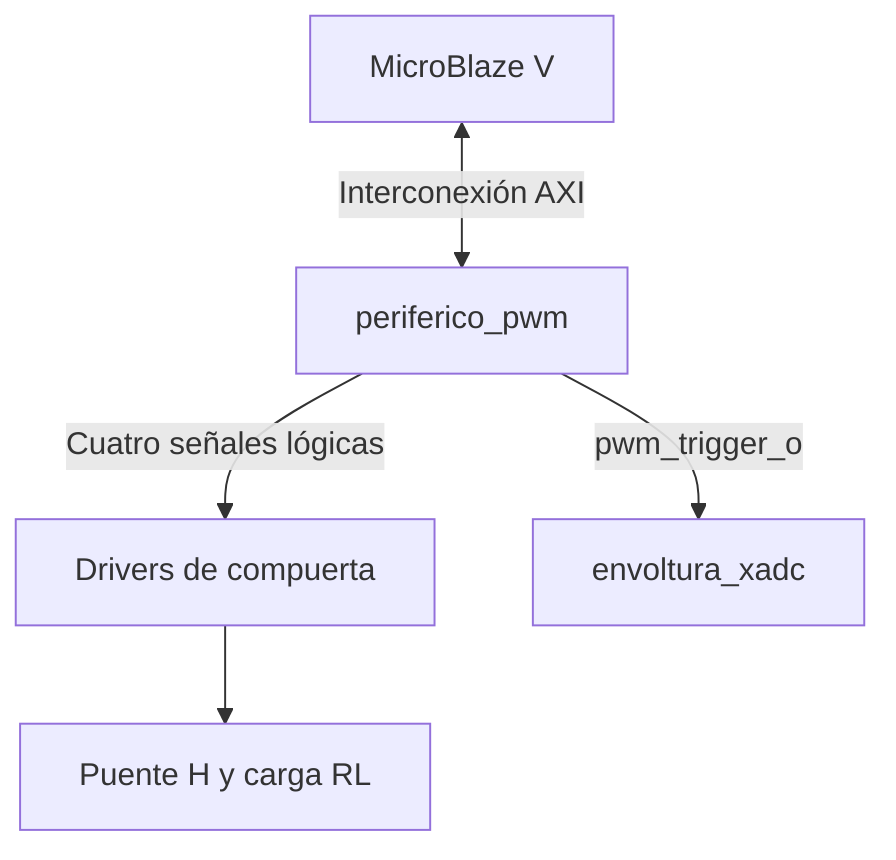

Las compuertas se asignan a pines de la Basys 3 con el estándar eléctrico y polaridad acordados con la etapa de potencia. Los drivers deben ser compatibles con el nivel lógico seleccionado. No se conectan las salidas de la FPGA directamente como accionamiento de potencia de los MOSFET.

La asignación de pines está en la [sección h.7 del Block Design](modulos/block_design.md#h7-pines). La adquisición analógica y su acondicionamiento pertenecen al camino XADC.

## Referencias

- [Nivel 3 del sistema](diagramas/nivel03.md), [`nucleo_pwm`](modulos/nucleo_pwm.md) y [`interfaz_axi_pwm`](modulos/interfaz_axi_pwm.md).
- Instructivo del proyecto, secciones 4.2.2, 4.2.3 y 7.
- AMD, [Vivado Creating and Packaging Custom IP UG1118](https://docs.amd.com/r/en-US/ug1118-vivado-creating-packaging-custom-ip/Packaging-Your-Current-Project), empaquetado y asociaciones de interfaces. Aplicar el flujo de la versión Vivado 2025.1 utilizada por el proyecto.

---

<!-- Fuente: docs/diseño/modulos/interfaz_axi_pwm.md -->

# interfaz_axi_pwm

## a) Nombre del módulo

`interfaz_axi_pwm`, previsto en `src/design/interfaz_axi_pwm.sv`. Es el esclavo AXI4-Lite que forma parte de [`periferico_pwm`](modulos/periferico_pwm.md), junto con [`nucleo_pwm`](modulos/nucleo_pwm.md), de acuerdo con el [nivel 3](diagramas/nivel03.md).

Esta ficha especifica el diseño para la entrega documental. Las decisiones de reset, lectura de referencia y transacciones que se detallan aquí completan la descripción general del repositorio; deben mantenerse iguales al implementar el RTL y los drivers. No representa una implementación ni pruebas ya ejecutadas.

## b) Diagrama modular

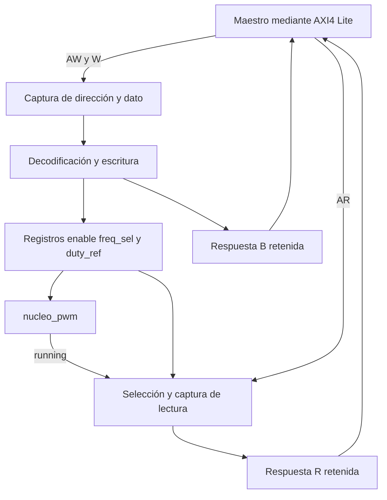

`clk` y `rst_n` llegan a toda la lógica. Se omiten sus conexiones repetidas en el diagrama.

## c) Objetivo del módulo

Traducir accesos de lectura y escritura del MicroBlaze V en registros de configuración del PWM y devolver su estado de operación. Conserva dirección y dato aunque lleguen en ciclos distintos y mantiene cada respuesta hasta que el maestro la acepte.

La interfaz entrega una orden de modulación al núcleo. La generación de compuertas, saturación efectiva, registros sombra, tiempo muerto y trigger pertenecen a `nucleo_pwm`.

## d) Entradas

Todos los puertos digitales se muestrean en el flanco ascendente de `clk`.

| Señal | Ancho | Función |
|---|---:|---|
| `clk` | 1 | Reloj común de 100 MHz |
| `rst_n` | 1 | Reset activo en bajo, aplicado de forma síncrona a la lógica interna |
| `s_axi_awaddr` | 4 | Offset en bytes de escritura dentro del periférico |
| `s_axi_awprot` | 3 | Atributos AXI de protección; se aceptan sin aplicar restricciones adicionales |
| `s_axi_awvalid` | 1 | Dirección de escritura válida |
| `s_axi_wdata` | 32 | Dato de escritura |
| `s_axi_wstrb` | 4 | Habilitación de escritura por byte |
| `s_axi_wvalid` | 1 | Dato de escritura válido |
| `s_axi_bready` | 1 | Maestro dispuesto a aceptar la respuesta de escritura |
| `s_axi_araddr` | 4 | Offset en bytes de lectura |
| `s_axi_arprot` | 3 | Atributos de lectura; se aceptan sin restricciones adicionales |
| `s_axi_arvalid` | 1 | Dirección de lectura válida |
| `s_axi_rready` | 1 | Maestro dispuesto a aceptar el dato de lectura |
| `running` | 1 | Estado efectivo del generador, producido por `nucleo_pwm` |

`AWPROT` y `ARPROT` se exponen para describir la interfaz AXI completa que se agrupará en la IP. No controlan el accionamiento del puente.

## e) Salidas

| Señal | Ancho | Función |
|---|---:|---|
| `s_axi_awready` | 1 | Puede aceptar una dirección de escritura |
| `s_axi_wready` | 1 | Puede aceptar un dato de escritura |
| `s_axi_bresp` | 2 | Respuesta de escritura, `OKAY = 00` |
| `s_axi_bvalid` | 1 | Respuesta de escritura pendiente |
| `s_axi_arready` | 1 | Puede aceptar una dirección de lectura |
| `s_axi_rdata` | 32 | Instantánea del registro leído |
| `s_axi_rresp` | 2 | Respuesta de lectura, `OKAY = 00` |
| `s_axi_rvalid` | 1 | Dato de lectura pendiente |
| `enable` | 1 | Solicitud de habilitación hacia el núcleo |
| `freq_sel` | 2 | Código de frecuencia hacia el núcleo |
| `duty_ref` | 16 con signo | Referencia solicitada en Q2.14 hacia el núcleo |

No se producen señales físicas de compuerta en este módulo.

## f) Relación con otros módulos

`periferico_pwm` conecta el esclavo al bus y une las salidas `enable`, `freq_sel` y `duty_ref` a las entradas homónimas de `nucleo_pwm`. El núcleo devuelve `running`. Ambos utilizan el mismo reloj y reset; no hay un cruce de dominio en esta conexión.

Los drivers C acceden a las direcciones base asignadas por Vivado más los offsets de esta ficha. La interfaz no conoce el algoritmo PR, los amperios de referencia ni la dirección base que tendrá la IP en el sistema.

La interfaz cambia sus registros cuando completa una escritura. El núcleo consume la configuración en su frontera de actualización. Una respuesta AXI confirma la escritura del registro, no que el nuevo PWM ya se haya aplicado.

## g) Funcionamiento

Una escritura tiene tres partes: dirección por AW, datos por W y confirmación por B. La interfaz guarda AW y W independientemente. Cuando dispone de ambos, aplica una única escritura al registro y genera una respuesta. Mientras esa respuesta no sea aceptada, no comienza otra escritura.

Una lectura acepta una dirección por AR, captura el valor seleccionado y lo devuelve por R. El dato capturado no cambia aunque el registro original o `running` cambien mientras el maestro mantenga `RREADY` en cero.

Los caminos de lectura y escritura trabajan en paralelo. Se permite una escritura pendiente y una lectura pendiente, pero no varias transacciones pendientes del mismo tipo. Esta capacidad es suficiente para la configuración y actualización periódica del PWM sin complicar el diseño con colas.

## h) Diseño

### h.1 Mapa de registros

| Offset | Registro | Campo | Acceso | Valor tras reset |
|---|---|---|---|---|
| `0x00` | Control y estado | `[0] enable` | R/W | 0 |
| `0x00` | Control y estado | `[2:1] freq_sel` | R/W | `01` |
| `0x00` | Control y estado | `[3] running` | RO | Estado del núcleo, inicialmente 0 |
| `0x00` | Control y estado | `[31:4]` reservados | Lectura cero | 0 |
| `0x04` | Referencia | `[15:0] duty_ref` | R/W | 0 |
| `0x04` | Referencia | `[31:16]` reservados | Lectura cero | 0 |

Se propone `freq_sel = 01` tras reset para solicitar la frecuencia nominal de 20 kHz de la tabla existente. Con `enable = 0`, esto no habilita el puente. La lectura inicial de `0x00` es `0x00000002` una vez que `running` está en cero. Este valor de reset se incorpora a la especificación de drivers y no se presenta como un requisito impuesto por el instructivo.

El bit `running` se toma del núcleo al capturar la lectura; no existe un registro R/W que permita al software forzarlo. Escribir un 1 en el bit 3 no cambia el estado efectivo del PWM.

### h.2 Frecuencia y referencia con signo

La tabla proviene de `nucleo_pwm.md`:

| `freq_sel` | Frecuencia por transistor | MAX de la portadora |
|---|---:|---:|
| `00` | 10 kHz | 5000 |
| `01` | 20 kHz | 2500 |
| `10` | 40 kHz | 1250 |
| `11` | 20 kHz | 2500 |

La interfaz conserva el código escrito. Si se escribe `11`, la lectura devuelve `11` y el núcleo lo interpreta como 20 kHz. La autorización de operar el lazo cerrado solo con `01` pertenece al software del sistema, según el diseño actual.

`duty_ref` se interpreta en complemento a dos y Q2.14, con escala de 1/16384. Su rango representable es de -2 a 2 menos un LSB; su rango admisible de modulación es de -1 a +1.

| Referencia | Patrón de 16 bits | Índice pedido |
|---|---|---:|
| Cero | `0x0000` | 0 |
| Positiva intermedia | `0x2000` | +0,5 |
| Negativa intermedia | `0xE000` | -0,5 |
| Límite positivo | `0x4000` | +1 |
| Límite negativo | `0xC000` | -1 |

La saturación se realiza en el núcleo antes de escalar a la portadora. Debe hacerse con operaciones de signo y ancho suficientes para que valores extremos como `0x8000` no desborden durante una negación o escalado.

**Semántica de lectura elegida:** la interfaz conserva y devuelve los 16 bits de la orden solicitada, incluso si están fuera del rango admisible. El núcleo utiliza la versión saturada. Por ejemplo, escribir `0x7FFF` permite leer `0x00007FFF` en `0x04`, mientras la modulación efectiva se limita a +1. La lectura no informa la referencia activa de los registros sombra.

Esta decisión mantiene la saturación y los registros sombra en el núcleo, como establece el nivel 3. Si el equipo prefiere lectura del valor limitado, debe cambiar de forma consistente esta ficha, la conexión con el núcleo, los drivers y los casos de verificación.

### h.3 Escrituras parciales y direcciones

`WSTRB[n]` habilita el byte n de WDATA. Los bytes deshabilitados conservan su valor previo.

- En `0x00`, solo `WSTRB[0]` puede cambiar `enable` y `freq_sel`. `running` y los bits reservados se ignoran al escribir.
- En `0x04`, `WSTRB[0]` actualiza los bits `[7:0]` y `WSTRB[1]` los bits `[15:8]`. `WSTRB[3:2]` no tienen efecto.
- Con `WSTRB = 0000`, la transacción se confirma y ningún registro cambia.
- Las direcciones se comparan completas dentro de los cuatro bits de offset. Solo `0x0` y `0x4` seleccionan registros; `0x8` no debe convertirse en un alias de `0x0`.
- Para offsets sin registro o no alineados a palabra: lectura cero, escritura sin efecto y respuesta `OKAY`. Es una política local elegida para esta IP, no una regla general de AXI.

La combinación de bytes se efectúa antes de interpretar `duty_ref` con signo. Escribir solo un byte puede cambiar considerablemente el valor solicitado; el driver normal utilizará una escritura completa de los 16 bits bajos.

### h.4 Registros internos

| Registro | Ancho | Propósito |
|---|---:|---|
| `enable_reg` | 1 | Solicitud de habilitación |
| `freq_sel_reg` | 2 | Código solicitado |
| `duty_ref_reg` | 16 | Orden solicitada |
| `awaddr_reg` | 4 | Dirección de la escritura pendiente |
| `aw_pendiente` | 1 | Ya se aceptó una dirección AW |
| `wdata_reg` | 32 | Dato de la escritura pendiente |
| `wstrb_reg` | 4 | Máscara asociada al dato capturado |
| `w_pendiente` | 1 | Ya se aceptó un dato W |
| `bvalid_reg` | 1 | Confirmación pendiente |
| `rdata_reg` | 32 | Instantánea de lectura |
| `rvalid_reg` | 1 | Dato de lectura pendiente |

Los estados de los controladores completan el almacenamiento de control. `BRESP` y `RRESP` son constantes `00` bajo la política definida.

### h.5 Controlador de escritura

Una aceptación, o handshake, ocurre en un flanco con `VALID` y `READY` simultáneamente en 1.

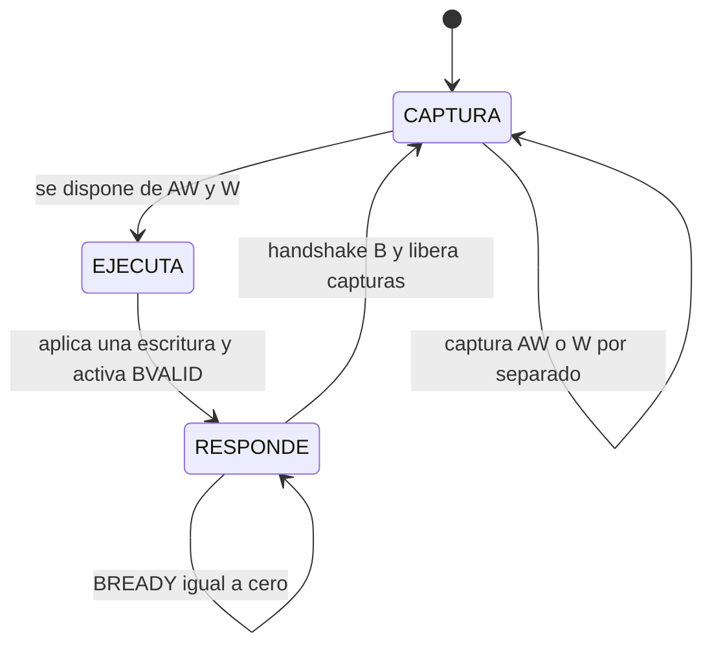

En `CAPTURA`, AWREADY solo se habilita si no hay una dirección almacenada y WREADY solo si no hay un dato almacenado. Cada handshake guarda únicamente su canal. Se puede recibir AW primero, W primero o ambos a la vez. La condición de transición contempla tanto campos ya almacenados como los aceptados en ese flanco.

En `EJECUTA`, ambos READY de escritura están en cero. En el flanco de ejecución se decodifica la dirección guardada, se aplica la máscara una sola vez y se entra en `RESPONDE` con BVALID en 1. Ningún cambio posterior de AWADDR o WDATA puede alterar esa escritura.

En `RESPONDE`, se conserva BVALID hasta el handshake B. Al aceptarse, se limpian las marcas de dirección y dato y se vuelve a `CAPTURA`. No se acepta una nueva escritura en ese mismo flanco de liberación; se admite una burbuja de bus para mantener el control sencillo.

La actualización de registros no se repite mientras BREADY sea cero. BVALID tampoco debe depender de que BREADY esté previamente en 1.

### h.6 Controlador de lectura

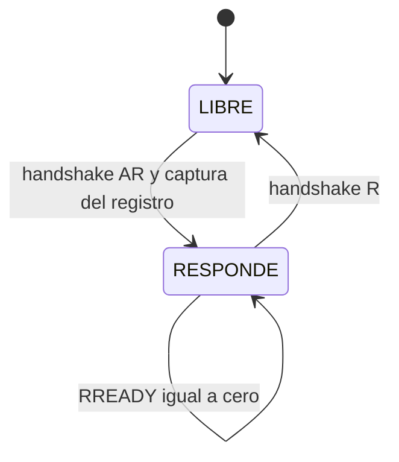

En `LIBRE` se habilita ARREADY. El handshake AR captura en `rdata_reg` el registro indicado por ARADDR y activa RVALID. En `RESPONDE`, ARREADY está en cero y `RDATA`, `RRESP` y `RVALID` permanecen estables hasta el handshake R. La siguiente dirección puede aceptarse desde el ciclo posterior a la liberación.

La lectura no modifica los registros ni reconoce eventos. Si una lectura y la ejecución de una escritura al mismo registro ocurren en el mismo flanco, la lectura captura el valor anterior a la escritura. Una lectura de control captura también el `running` existente antes de ese flanco. Esta regla permite resultados deterministas en accesos concurrentes.

### h.7 Ejemplo temporal de escritura

El ejemplo utiliza una dirección que llega antes del dato. Los valores de cada fila describen el evento en ese flanco y el resultado registrado después.

| Flanco | Evento | Resultado |
|---|---|---|
| E0 | Handshake AW con offset `0x04` | Se guarda la dirección y se deja de aceptar AW |
| E1 | Handshake W con `0x2000` y `WSTRB=0011` | Se guarda el dato y se pasa a `EJECUTA` |
| E2 | Ejecución interna | `duty_ref_reg=0x2000`, BVALID se activa y se entra en `RESPONDE` |
| E3 | BREADY en cero | Se conserva la respuesta; no se repite la escritura |
| E4 | Handshake B | Se retira la respuesta y se liberan las capturas |
| E5 | Puede comenzar otra escritura | La interfaz vuelve a aceptar AW y W |

Desde E2 la orden está disponible para el núcleo. Su aplicación física ocurre cuando la tubería y la frontera de actualización del núcleo la consumen; no se identifica E2 con un cambio inmediato de compuertas.

### h.8 Reset y límites temporales

Con reset activo se limpian capturas, respuestas y estados de transacción; `enable_reg=0`, `freq_sel_reg=01` y `duty_ref_reg=0`. READY se mantiene en cero durante reset. BVALID y RVALID permanecen en cero y RDATA se reinicia a cero.

Una transacción interrumpida por el reset de la plataforma se descarta. Al liberar el reset, el maestro y el esclavo deben haber salido del reset del mismo sistema; no se intenta conservar una respuesta de la ejecución anterior.

READY depende del estado y de las marcas internas de ocupación. Se evita construir caminos combinacionales desde entradas AXI hacia salidas AXI. Las respuestas válidas y RDATA se registran.

La espera de la respuesta del maestro puede ser arbitrariamente larga. Esta condición no impide que el núcleo continúe generando PWM con la última configuración almacenada.

## i) Diagrama esquemático detallado del diseño

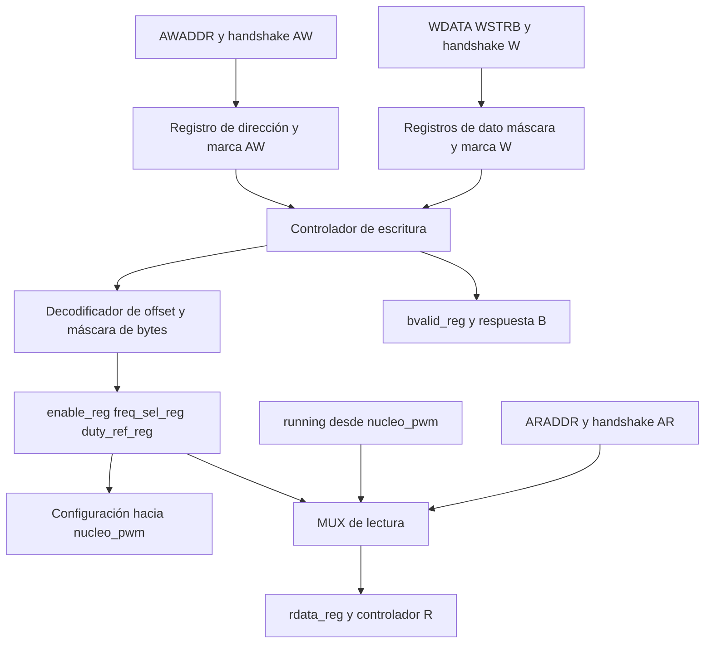

El diagrama es la arquitectura prevista del módulo. El esquemático de elaboración se contrastará con ella durante la implementación posterior.

## j) Conexiones eléctricas e integración

Este módulo no tiene pines externos de la Basys 3. Su bus se conecta a la interconexión AXI dentro del Block Design mediante `periferico_pwm`; sus señales de configuración se conectan al núcleo dentro de esa IP.

Reloj y reset provienen de la infraestructura del sistema. Las cuatro señales de compuerta y `pwm_trigger_o` salen del núcleo y no atraviesan la lógica AXI de esta interfaz. El plan de verificación está en [`plan_verificacion_pwm.md`](plan_verificacion_pwm.md).

## Referencias

- Diseño existente: [nivel 3](diagramas/nivel03.md) y [`nucleo_pwm`](modulos/nucleo_pwm.md).
- Instructivo del proyecto, secciones 4.2.2, 4.2.3 y 7.
- Arm, [AMBA AXI y ACE Protocol Specification IHI 0022E](https://documentation-service.arm.com/static/5f915b62f86e16515cdc3b1c), transacciones, dependencias de canales y AXI4-Lite.

---

<!-- Fuente: docs/diseño/modulos/nucleo_pwm.md -->

# nucleo_pwm

## a) Nombre del módulo

`nucleo_pwm`, en `src/design/nucleo_pwm.sv`. Es el núcleo del periférico PWM del [nivel 3](diagramas/nivel03.md), instanciado dentro de `periferico_pwm` junto a `interfaz_axi_pwm`.

## b) Diagrama modular

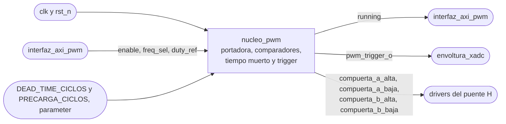

## c) Objetivo del módulo

Convierte `duty_ref` en las cuatro señales de compuerta del puente H, con modulación unipolar y tiempo muerto, y marca con `pwm_trigger_o` el instante de muestreo del ADC.

## d) Entradas

- `clk`, `logic`, reloj del sistema, el mismo del bus AXI.
- `rst_n`, `logic`, reinicio activo en bajo como el `ARESETn` del bus. Deja las cuatro compuertas apagadas.
- `enable`, `logic`, desde `interfaz_axi_pwm` (bit 0 de `0x00`).
- `freq_sel`, `logic [1:0]`, desde `interfaz_axi_pwm` (bits [2:1] de `0x00`). Elige el `MAX` de la portadora y se copia a su registro sombra en el valle.
- `duty_ref`, `logic signed [15:0]` en Q2.14, desde `interfaz_axi_pwm` (bits [15:0] de `0x04`). Es la tensión promedio pedida sobre la carga como fracción de Vdc, de -1 a +1 sin importar la frecuencia. Se copia a su registro sombra en el valle.
- `DEAD_TIME_CICLOS`, `parameter`, tiempo muerto en ciclos de `clk`.
- `PRECARGA_CICLOS`, `parameter`, ciclos de `clk` con la compuerta baja encendida al arrancar cada pierna, para cargar el capacitor de bootstrap de la alta.
- `MAX_FREQ_00`, `MAX_FREQ_01`, `MAX_FREQ_10` y `MAX_FREQ_11`, `parameter`, el máximo de la portadora para cada código de `freq_sel`. En simulación se reemplazan por valores chicos.

## e) Salidas

- `compuerta_a_alta` y `compuerta_a_baja`, `logic`, par complementario con tiempo muerto de la pierna A hacia los drivers del puente H. Compara la portadora contra `duty_ref`.
- `compuerta_b_alta` y `compuerta_b_baja`, `logic`, igual para la pierna B, que compara contra `-duty_ref`.
- `running`, `logic`, hacia `interfaz_axi_pwm`, que lo expone en el bit 3 de `0x00`. Vale 1 mientras las compuertas conmutan y cambia en el borde del período, no cuando cambia `enable`.
- `pwm_trigger_o`, `logic`, pulso de un ciclo de `clk` en el valle hacia `envoltura_xadc`. En el valle las dos piernas están en el mismo estado y la corriente pasa por su valor promedio.

Todas las salidas salen directo de flip-flops, sin lógica combinacional después, para que no lleven glitches. Las compuertas son activas en alto, con 1 para el transistor encendido, como pide la cadena de aislamiento de `potencia/diseno_puente_h.md`.

## f) Explicación de la relación con otros módulos

Lo instancia `periferico_pwm` junto a `interfaz_axi_pwm`, que le pasa `enable`, `freq_sel` y `duty_ref` tal como los escribe el software y le expone `running` en lectura. Los dos usan el reloj del bus, así que no hay sincronizadores entre ellos. Del lado del software, [`lazo_control`](modulos/lazo_control.md) escribe en cada interrupción el `duty_ref` que calcula [`pr_discreto`](modulos/pr_discreto.md), por medio de [`drivers`](modulos/drivers.md), y [`supervisor_falla`](modulos/supervisor_falla.md) apaga el puente bajando `enable`, que el núcleo toma recién en el valle siguiente.

Hacia afuera, `pwm_trigger_o` llega a [`envoltura_xadc`](modulos/envoltura_xadc.md), que decide cuándo arranca la conversión. El instante de captura respecto al valle lo definen Jefferson y Nicolás. Las compuertas van a los drivers del puente H que diseña Nicolás. De ese mismo diseño salen `DEAD_TIME_CICLOS` y las frecuencias de la tabla de `MAX`. El núcleo no tiene relación directa con el AXI Timer. Como los dos cuentan el mismo reloj, la interrupción y el valle mantienen un desfase fijo solo si el período del Timer es exactamente 2·`MAX` ciclos.

## g) Explicación de funcionamiento

La portadora es un contador que sube de 0 a `MAX` y baja de vuelta a 0, así que un período dura 2·`MAX` ciclos de `clk` y `f_sw = f_clk / (2·MAX)`. `MAX` es uno de los cuatro `parameter` `MAX_FREQ_00` a `MAX_FREQ_11`, según `freq_sel`. El contador corre siempre después del reinicio, aunque `enable` esté en cero, para que `pwm_trigger_o` siga llegando al ADC y [`lazo_control`](modulos/lazo_control.md) pueda medir el offset del sensor con el puente apagado.

El valle, cuando el contador vale 0, es el punto de sincronización de todo el núcleo. Dura un solo ciclo por período, y en ese ciclo pasan cuatro cosas.

1. `freq_sel` pasa a su registro sombra, y el `MAX` nuevo rige desde ese período.
2. `duty_ref`, ya saturado y escalado, pasa a su registro sombra.
3. Se emite `pwm_trigger_o`, registrado para que no salga con glitches.
4. `running` toma el valor de `enable`.

Lo que el software escriba a mitad de período espera al valle siguiente, así que ningún período sale con un `MAX` o un `duty_ref` mezclado.

Durante el período cada pierna compara el contador contra su referencia. La pierna A pide su compuerta alta mientras el contador está por debajo de `ref_a`, que sale de `duty_ref`, y la pierna B mientras está por debajo de `ref_b`, que sale de `-duty_ref`. Con `duty_ref = 0` las dos piernas quedan al 50 % y la carga ve 0 V en promedio, y con `duty_ref = 0,5` quedan al 75 % y al 25 % y la carga ve 0,5·Vdc.

El tiempo muerto va aparte en cada pierna. Cuando la comparación cambia de estado, las dos compuertas de la pierna se apagan de inmediato y la que corresponde se enciende recién cuando la comparación lleva `DEAD_TIME_CICLOS` ciclos estable. Si la comparación vuelve a cambiar antes, la cuenta se reinicia y las dos siguen apagadas, así que un pulso más corto que el tiempo muerto no deja solapamiento ni glitch. Apagar nunca se retrasa, solo encender.

Con `running` en cero las cuatro compuertas quedan en bajo, que es también el estado después del reinicio. Como `running` solo cambia en el valle, al subir `enable` el núcleo arranca en el siguiente período completo, y al bajarlo termina el período en curso antes de apagar.

Al arrancar, cada pierna enciende primero su compuerta baja durante `PRECARGA_CICLOS`, para que se cargue el capacitor de bootstrap de la alta, y después pasa por el tiempo muerto antes de seguir a su comparación. Mientras dura la precarga las dos bajas están encendidas y la carga ve 0 V.

## h) Diseño

El núcleo tiene dos máquinas. Una sola de control decide si el puente conmuta, y cada pierna tiene su propia máquina de tiempo muerto. El sentido del contador de la portadora es un bit que se invierte en 0 y en `MAX`, así que no lleva diagrama. Toda la lógica corre en el flanco de subida de `clk` con reinicio síncrono, porque en las FPGA de Xilinx un reinicio síncrono aprovecha mejor los flip-flops y los DSP [1].

### h.1) Portadora y tabla de MAX

`portadora` es un contador de `ANCHO_PORTADORA = $clog2(MAX_FREQ_00 + 1)` bits, 13 con los valores por defecto, y `contando_arriba` guarda su sentido. `MAX_FREQ_00` tiene que ser el mayor de los cuatro máximos, porque fija ese ancho. La señal interna `valle` es `portadora == 0`, en 1 durante un ciclo por período.

Los valores por defecto son la tabla que confirmó Nicolás. 40 kHz queda sujeto a las pérdidas del puente a esa frecuencia.

- `MAX_FREQ_00 = 5000`, 10 kHz.
- `MAX_FREQ_01 = 2500`, 20 kHz.
- `MAX_FREQ_10 = 1250`, 40 kHz.
- `MAX_FREQ_11 = 2500`, igual que `01`.

El cuarto código no se usa y satura a 20 kHz. Si algún día se define una cuarta frecuencia, basta con cambiar `MAX_FREQ_11`, sin tocar la lógica. La frecuencia de operación es 20 kHz, y el lazo cerrado corre solo con `freq_sel = 01`. 10 y 40 kHz son para mostrar el PWM y para el testbench, con el control deshabilitado. El `MAX` que rige el período es `max_sombra`, que se carga en el valle, y el contador cambia de sentido al llegar a `max_sombra` y a 0.

### h.2) Saturación y referencias

`duty_ref` viene en Q2.14, que representa de -2 a +2, pero el rango admisible es de -1 a +1. Lo que pase de ahí se satura al límite. El formato con margen es a propósito, para que una salida del PR que se pase de 1 quede recortada en vez de dar la vuelta por desborde. En Q2.14 el 1,0 vale 16384, así que `duty_sat` queda entre -16384 (`0xC000`) y 16384 (`0x4000`).

Después del recorte, un solo multiplicador saca las dos referencias de comparación.

- `ref_a = (MAX · (16384 + duty_sat)) >> 15`
- `ref_b = MAX - ref_a`

Es lo mismo que `MAX/2 · (1 ± duty_ref)`, pero sin dividir `MAX` antes, para no perder medio ciclo cuando `MAX` es impar. `ref_b` sale de una resta, así que `ref_a + ref_b = MAX` exacto y las dos piernas no tienen errores de redondeo distintos. `16384 + duty_sat` va de 0 a 32768 y el producto más grande es 5000 · 32768, menos de 2^28, que cabe en un DSP48E1, de 25 × 18 bits [2]. Con `duty_ref = 0,5` y `MAX = 2500`, `ref_a = 2500 · 24576 >> 15 = 1875` y `ref_b = 625`.

El cálculo corre en todos los ciclos en dos etapas registradas. La primera guarda `duty_sat` y el `MAX` que elige el `freq_sel` de entrada, y la segunda guarda `ref_a`, `ref_b` y ese mismo `MAX`. En el valle, `max_sombra`, `ref_a_sombra` y `ref_b_sombra` copian la salida de la segunda etapa, así que nunca se mezcla la referencia de una frecuencia con el `MAX` de otra. Lo que el software escriba en el ciclo anterior al valle o en el valle mismo entra en el período siguiente, y desde dos ciclos antes ya alcanza a entrar en ese valle. Después del reinicio, las dos etapas y los registros sombra quedan con `MAX_FREQ_00` y `duty_ref = 0`, así que el primer período dura lo de 10 kHz aunque `freq_sel` ya esté en `01`.

Como `MAX` sale de `freq_sel` dentro del núcleo, el software escribe el mismo valor a cualquier frecuencia.

### h.3) Comparadores y extremos

Las comparaciones son `portadora < ref_a_sombra` para A y `portadora < ref_b_sombra` para B. En los extremos aparecen pulsos más cortos que el tiempo muerto. Con `duty_ref = +1`, `ref_a = MAX` y la comparación de A cae a 0 solo en el ciclo del pico. La máquina de la pierna apaga la compuerta alta en ese ciclo y la vuelve a encender `DEAD_TIME_CICLOS` ciclos después, así que el ciclo de trabajo máximo real es `1 - (1 + DEAD_TIME_CICLOS) / (2·MAX)`, cerca de 98 % a 20 kHz con el tiempo muerto por defecto. Cualquier pulso más corto que el tiempo muerto desaparece, que es el efecto del tiempo de bloqueo en inversores PWM [3]. Antes de ese límite está el del bootstrap. La compuerta baja de cada pierna tiene que conducir al menos 100 ciclos por período para recargar el capacitor de la alta [6], así que [`pr_discreto`](modulos/pr_discreto.md) recorta su salida a `PR_U_MAX = 0,92`, que sale de `1 - (DEAD_TIME_CICLOS + 100) / MAX` con `MAX = 2500`. Con 0,92, `ref_a = 2400` y la comparación de A queda en bajo 201 ciclos por período, que con el tiempo muerto dejan 101 ciclos de compuerta baja.

### h.4) Tiempo muerto

La entrada es la comparación de la pierna, `portadora < ref_a_sombra` en A y `portadora < ref_b_sombra` en B. `objetivo` guarda el valor de la comparación que se está esperando y `cuenta` los ciclos que lleva estable.

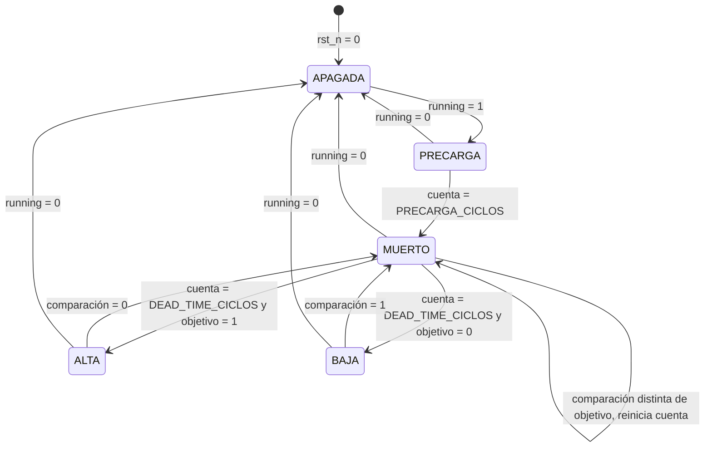

- `APAGADA`, las dos compuertas de la pierna en bajo mientras `running` esté en 0.
- `PRECARGA`, compuerta baja en 1 y alta en 0 durante `PRECARGA_CICLOS` ciclos, sin mirar la comparación. Al entrar, `cuenta` arranca en 1.
- `MUERTO`, las dos compuertas en bajo mientras se cuenta el tiempo muerto. Al entrar, `objetivo` toma la comparación y `cuenta` arranca en 1, así que dura exactamente `DEAD_TIME_CICLOS` ciclos y nunca menos de uno, aunque el parámetro valga 0.
- `ALTA`, compuerta alta en 1 y baja en 0.
- `BAJA`, compuerta baja en 1 y alta en 0.

De `ALTA` a `BAJA`, o al revés, siempre se pasa por `MUERTO`, y no hay ningún estado con las dos compuertas en 1. Eso es lo que garantiza que no haya solapamiento. La salida a `APAGADA` es inmediata desde cualquier estado porque apagar las dos compuertas nunca causa un cortocircuito.

`PRECARGA` carga el capacitor de bootstrap que alimenta la compuerta alta mientras conduce la baja de la misma pierna [6]. El estado mantiene la alta apagada y sale por `MUERTO`, de modo que el arranque respeta el tiempo muerto. Las dos bajas encendidas a la vez dejan la carga en 0 V sin camino entre Vdc y tierra. Cada salida de `APAGADA` pasa por `PRECARGA` porque el capacitor puede descargarse mientras el puente está detenido.

`cuenta` es la misma para `PRECARGA` y `MUERTO`, y tiene `$clog2(max(DEAD_TIME_CICLOS, PRECARGA_CICLOS) + 1)` bits, con 1 bit como mínimo. `DEAD_TIME_CICLOS = 100` fija el tiempo muerto final de 1 µs a 100 MHz, frente a un peor caso de 813 ns en la cadena de compuertas. La justificación está en la ficha de [`periferico_pwm`](modulos/periferico_pwm.md#h3-parámetros-expuestos-por-la-ip). El tiempo muerto es configurable al sintetizar y dura `DEAD_TIME_CICLOS · 10 ns` en todas las frecuencias de conmutación.

`PRECARGA_CICLOS = 7000` fija 70 µs a 100 MHz para cubrir 5τ del RC de bootstrap en el peor caso de tolerancias. El [Block Design](modulos/block_design.md#h1-instancias-y-configuración) fija ambos parámetros al instanciar la IP.

### h.5) Control y running

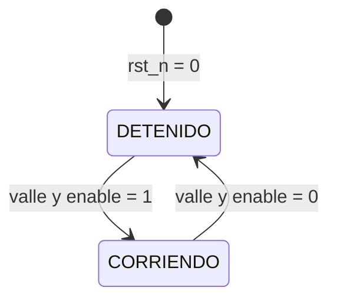

- `DETENIDO`, `running` en 0 y las dos piernas apagadas. El contador y `pwm_trigger_o` siguen corriendo.
- `CORRIENDO`, `running` en 1 y las piernas siguen a sus comparaciones después de la precarga.

Fuera del valle la máquina no cambia de estado, aunque cambie `enable`. Por eso `running` siempre arranca y termina en un borde de período. En cada arranque la carga ve 0 V durante los 70 µs de precarga, que equivalen a 0,7 períodos a 10 kHz, 1,4 a 20 kHz y 2,8 a 40 kHz.

Con `running` en cero las piernas van a `APAGADA`, y `rst_n` en cero deja las dos máquinas en su estado inicial, con las cuatro compuertas en bajo. En una falla el puente sigue conmutando como mucho un período después de que el software baja `enable`. La desconexión rápida le toca a la protección por hardware de la etapa de potencia.

### h.6) pwm_trigger_o

`pwm_trigger_o` es un flip-flop que copia `valle`, así que sube un ciclo después del valle y dura un ciclo. Sale registrado para que no lleve glitches hacia `envoltura_xadc`. No depende de `running`, y sigue saliendo con el puente apagado.

### h.7) Temporización

Es la tabla que confirmó Nicolás, con 40 kHz sujeto a las pérdidas del puente. Se calculó con `clk` de 100 MHz y `MAX = f_clk / (2·f_sw)`.

| `freq_sel` | f_sw | `MAX` | período | ciclos por período | rizado en la carga | resolución de `duty_ref` |
|---|---|---|---|---|---|---|
| `00` | 10 kHz | 5000 | 100 µs | 10 000 | 20 kHz | 2/5000 = 0,0004 |
| `01` | 20 kHz | 2500 | 50 µs | 5000 | 40 kHz | 2/2500 = 0,0008 |
| `10` | 40 kHz | 1250 | 25 µs | 2500 | 80 kHz | 2/1250 = 0,0016 |
| `11` | 20 kHz | 2500 | 50 µs | 5000 | 40 kHz | 2/2500 = 0,0008 |

El rizado en la carga está al doble de f_sw porque en unipolar la tensión diferencial tiene dos pulsos por período. La resolución es el cambio de `duty_ref` que mueve `ref_a` una cuenta. En tiempo, una cuenta siempre ensancha el pulso 20 ns, 10 ns en cada flanco, sin importar la frecuencia.

El tiempo muerto dura `DEAD_TIME_CICLOS · 10 ns` a cualquier frecuencia, porque se cuenta en ciclos de `clk`. Su valor sale de los tiempos de conmutación del MOSFET y del driver.

Los ciclos se cuentan desde el valle, el ciclo en que el contador vale 0. El ejemplo describe un período después de la precarga con `freq_sel = 01` y `duty_ref = 0,5`, así que `ref_a = 1875` y `ref_b = 625`. Las compuertas salen de flip-flops, así que van un ciclo detrás de la comparación, como se vio en simulación. `running` y `pwm_trigger_o` cambian en el ciclo 1, también según la simulación.

| ciclo | evento |
|---|---|
| 0 | El contador vale 0. |
| 1 | `pwm_trigger_o` en 1 durante un ciclo. Los registros sombra de `freq_sel` y `duty_ref` ya tienen el valor nuevo. `running` toma `enable`. |
| 625 | La comparación de B baja. |
| 626 | `compuerta_b_alta` se apaga. |
| 626 + `DEAD_TIME_CICLOS` | `compuerta_b_baja` se enciende. |
| 1875 | La comparación de A baja. |
| 1876 | `compuerta_a_alta` se apaga. |
| 1876 + `DEAD_TIME_CICLOS` | `compuerta_a_baja` se enciende. |
| 2500 | Pico, el contador cambia de sentido. |
| 3126 | La comparación de A sube. |
| 3127 | `compuerta_a_baja` se apaga. |
| 3127 + `DEAD_TIME_CICLOS` | `compuerta_a_alta` se enciende. |
| 4376 | La comparación de B sube. |
| 4377 | `compuerta_b_baja` se apaga. |
| 4377 + `DEAD_TIME_CICLOS` | `compuerta_b_alta` se enciende. |
| 5000 | Valle siguiente, vuelve al ciclo 0. |

La comparación de A queda en alto 3749 de 5000 ciclos y la de B 1249, sin contar el tiempo muerto. Con `portadora < ref` el valle y el pico pasan una sola vez por período y los demás valores dos veces, así que una comparación queda en alto `2·ref - 1` ciclos. Las dos piernas pierden el mismo ciclo, así que la diferencia sigue siendo `(ref_a - ref_b) / MAX`, el 50 % que pide `duty_ref = 0,5`. Desde el ciclo 4377 + `DEAD_TIME_CICLOS` hasta el 625 del período siguiente las dos compuertas altas están encendidas, y ese es el estado cero en que se muestrea la corriente.

Al subir `enable`, `running` pasa a 1 en el ciclo 1 del valle siguiente. Las piernas salen de `APAGADA` por `PRECARGA`, con las dos compuertas bajas encendidas desde el ciclo 2 durante `PRECARGA_CICLOS`, y después pasan por `MUERTO`. A partir del ciclo `2 + PRECARGA_CICLOS + DEAD_TIME_CICLOS`, cada pierna enciende la compuerta que indique su comparación cuando esta se haya mantenido estable durante el tiempo muerto. Al bajar `enable`, el período en curso termina normal y las cuatro compuertas se apagan después del ciclo 1 del valle siguiente.

### h.8) Interfaz en SystemVerilog

```systemverilog
module nucleo_pwm #(
    // Tiempo muerto en ciclos de clk
    parameter int unsigned DEAD_TIME_CICLOS = 100,
    // Ciclos de clk con la compuerta baja encendida al arrancar, para cargar el bootstrap
    parameter int unsigned PRECARGA_CICLOS = 7000,
    // Máximo de la portadora por código de freq_sel, MAX_FREQ_00 tiene que ser el mayor
    parameter int unsigned MAX_FREQ_00 = 5000,
    parameter int unsigned MAX_FREQ_01 = 2500,
    parameter int unsigned MAX_FREQ_10 = 1250,
    parameter int unsigned MAX_FREQ_11 = 2500
) (
    input logic clk,
    input logic rst_n,
    input logic enable,
    input logic [1:0] freq_sel,
    // Q2.14 con signo, de -1 a +1
    input logic signed [15:0] duty_ref,
    output logic running,
    output logic compuerta_a_alta,
    output logic compuerta_a_baja,
    output logic compuerta_b_alta,
    output logic compuerta_b_baja,
    output logic pwm_trigger_o
);
```

### h.9) Pendientes

- Pérdidas del puente a 40 kHz, que confirma Nicolás. Si el puente no aguanta, cambia `MAX_FREQ_10`.
- Instante de captura respecto al valle, con Nicolás.

## i) Diagrama esquemático detallado del diseño

Los registros van con `[[ ]]`, la lógica combinacional con `[ ]` y las máquinas de estado con `{{ }}`. Todos los registros usan `clk` y `rst_n`, que no se dibujan. Los anchos son los de los valores por defecto y salen de los `parameter`, 13 bits para la portadora, las referencias y `cuenta`. `16384 + duty_sat` llega hasta 32768, así que entra al multiplicador con 16 bits sin signo.

### i.1) Referencias y portadora

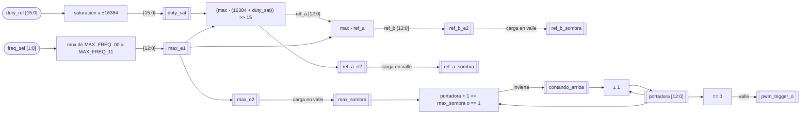

### i.2) Control y piernas

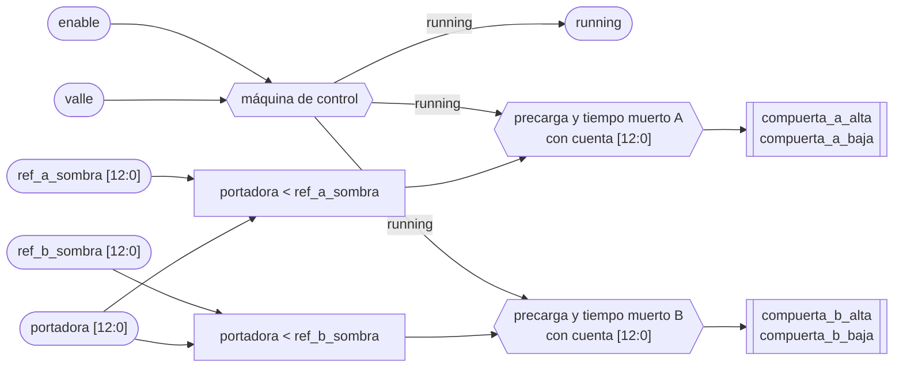

Las compuertas son registros a la salida de cada máquina, así que salen de flip-flops como dice e). El esquemático que genera Vivado al elaborar el diseño se compara contra estos dos diagramas cuando esté el código.

## j) Diagrama completo de conexiones eléctricas del diseño

El núcleo no tiene pines propios. Sus cuatro compuertas salen por los puertos de `periferico_pwm`, pasan a puertos externos del Block Design y llegan al conector JA de la Basys 3 según `basys3.xdc`, con los pines que fija [`block_design`](modulos/block_design.md). `pwm_trigger_o`, `running` y las entradas no salen de la FPGA.

```mermaid
flowchart LR
    NUC["nucleo_pwm"] -->|"4 compuertas"| PER["periferico_pwm"]
    PER -->|"puertos externos"| BD["Block Design"]
    BD -->|"basys3.xdc, LVCMOS33"| PMOD["JA7 a JA10"]
    PMOD -->|"compuertas, 3,3 V y GND"| AIS["aislamiento"]
    AIS --> DRV["drivers del puente H"]
```

Las cuatro compuertas van en la fila de abajo de JA, junto al GND (pin 11) y los 3,3 V (pin 12) que también llegan a la cadena de aislamiento. Los bancos de la Basys 3 que llegan a los Pmod trabajan a 3,3 V, así que el estándar es `LVCMOS33` [4].

- `compuerta_a_alta` en G3 (JA10).
- `compuerta_a_baja` en H2 (JA9).
- `compuerta_b_alta` en K2 (JA8).
- `compuerta_b_baja` en H1 (JA7).

Mientras la FPGA no está configurada, `rst_n` no puede mantener las compuertas en bajo. En la Basys 3 `PUDC_B` va a 3,3 V, así que durante la configuración los pines quedan en alta impedancia sin pull-ups [5]. La cadena de aislamiento lleva un pull-down de 10 kΩ en la base del transistor que maneja el LED de cada VO3120, así que con la FPGA sin configurar, con el cable suelto o con la Basys 3 apagada el LED queda apagado y la compuerta también. El detalle está en `potencia/diseno_puente_h.md`.

## Referencias

[1] K. Chapman, "Get Smart About Reset: Think Local, Not Global," Xilinx White Paper WP272.

[2] AMD Xilinx, *7 Series DSP48E1 Slice User Guide*, UG479.

[3] N. Mohan, T. M. Undeland y W. P. Robbins, *Power Electronics: Converters, Applications, and Design*, 3.ª ed. Wiley, 2003, cap. 8.

[4] Digilent, *Basys 3 FPGA Board Reference Manual*.

[5] AMD Xilinx, *7 Series FPGAs Configuration User Guide*, UG470.

[6] Texas Instruments, "Bootstrap Circuitry Selection for Half-Bridge Configurations," Application Report SLUA887.

---

<!-- Fuente: docs/diseño/modulos/envoltura_xadc.md -->

# envoltura_xadc

## a) Nombre del módulo

`envoltura_xadc`, en `src/design/envoltura_xadc.sv`. Es la envoltura AXI4-Lite propia del bloque 7 del [nivel 2](diagramas/nivel02.md), y en el [nivel 3](diagramas/nivel03.md) va como instancia del Block Design junto a un XADC Wizard sin interfaz AXI.

## b) Diagrama modular

```mermaid
flowchart LR
    CR(["clk y rst_n"]) --> ENV
    AXI(["MicroBlaze V por AXI4-Lite"]) <-->|"control en 0x00, dato en 0x04"| ENV["envoltura_xadc<br/>selector de disparo, lectura DRP<br/>y contador de conversiones"]
    PWM(["nucleo_pwm"]) -->|"pwm_trigger_o"| ENV
    ENV -->|"convst"| XW(["XADC Wizard"])
    ENV -->|"den, daddr"| XW
    XW -->|"busy, eoc, channel"| ENV
    XW -->|"do, drdy"| ENV
    ANA(["corriente_i por el JXADC"]) --> XW
```

## c) Objetivo del módulo

Arranca la conversión de `corriente_i` en el XADC con `pwm_trigger_o` o por software, según lo que elija el software, y le entrega al MicroBlaze V por AXI4-Lite la muestra junto con un contador de conversiones que le dice si hay dato nuevo.

## d) Entradas

- `clk`, `logic`, reloj del sistema de 100 MHz, el mismo del bus AXI y del `DCLK` del wizard.
- `rst_n`, `logic`, reinicio activo en bajo, el `peripheral_aresetn` del Processor System Reset.
- `pwm_trigger_o`, `logic`, pulso de un ciclo en el valle de la portadora, desde [`nucleo_pwm`](modulos/nucleo_pwm.md).
- Canal de escritura AXI4-Lite, `s_axi_awaddr[3:0]`, `s_axi_awvalid`, `s_axi_wdata[31:0]`, `s_axi_wstrb[3:0]`, `s_axi_wvalid` y `s_axi_bready`.
- Canal de lectura AXI4-Lite, `s_axi_araddr[3:0]`, `s_axi_arvalid` y `s_axi_rready`.
- `xadc_busy`, `logic`, el `busy_out` del wizard, en alto mientras convierte [2, p. 13].
- `xadc_eoc`, `logic`, el `eoc_out` del wizard, en alto cuando el resultado ya está en el registro de estado [2, p. 13].
- `xadc_channel[4:0]`, el `channel_out` del wizard, el canal de la conversión que terminó [2, p. 13].
- `xadc_do[15:0]` y `xadc_drdy`, el dato y la confirmación de una lectura por el DRP [2, p. 12].

## e) Salidas

- Respuestas AXI4-Lite, `s_axi_awready`, `s_axi_wready`, `s_axi_bresp[1:0]`, `s_axi_bvalid`, `s_axi_arready`, `s_axi_rdata[31:0]`, `s_axi_rresp[1:0]` y `s_axi_rvalid`.
- `xadc_convst`, `logic`, hacia el `convst_in` del wizard. Su flanco de subida fija el instante de muestreo [1, Event-Driven Sampling].
- `xadc_den`, `logic`, y `xadc_daddr[6:0]`, hacia `den_in` y `daddr_in` del wizard para leer el registro de estado [2, p. 12].
- `xadc_dwe` y `xadc_di[15:0]`, fijos en cero, porque la envoltura solo lee por el DRP.

Todas las salidas hacia el wizard salen de flip-flops.

## f) Explicación de la relación con otros módulos

La envoltura vive entre el XADC Wizard y la interconexión AXI. Del lado del wizard es maestra del DRP y dueña de `convst_in`, y el wizard queda configurado en modo por eventos, canal único y sin interfaz AXI (bloque 7 de `nivel03.md`). Como el wizard recibe el mismo reloj de 100 MHz en `dclk_in`, sus señales de estado llegan en el dominio de la envoltura y no hacen falta sincronizadores.

De [`nucleo_pwm`](modulos/nucleo_pwm.md) recibe `pwm_trigger_o`, que pulsa en cada valle desde el reinicio, con el puente encendido o apagado. La envoltura decide si le hace caso según el bit de fuente.

Del lado del software, [`drivers`](modulos/drivers.md) es el único que toca los dos registros. [`control_principal`](modulos/control_principal.md) pone la fuente en `pwm_trigger_o` durante el arranque, antes de habilitar el control. En cada interrupción, [`lazo_control`](modulos/lazo_control.md) lee el registro de dato una vez y saca de esa lectura la muestra y el contador. [`supervisor_falla`](modulos/supervisor_falla.md) cuenta las iteraciones en que el contador no cambió, contra `ITERACIONES_SIN_DATO_MAX`.

La señal analógica viene del acondicionamiento del sensor que diseña Jefferson, de 0 a 1 V, como fija el bloque 7 del [nivel 2](diagramas/nivel02.md).

## g) Explicación de funcionamiento

La envoltura atiende una conversión a la vez. Mientras está libre, espera un disparo de la fuente que eligió el software. El bit 1 del registro de control vale 0 para el software y 1 para `pwm_trigger_o`, y la fuente que no está elegida se ignora. Así, con el lazo corriendo, un inicio por software de más no puede mover el instante de muestreo, y en el arranque, con la fuente en software, el valle no pisa la conversión que pidió el programa.

Con el disparo, la envoltura sube `xadc_convst`. El flanco de subida fija el instante de muestreo, y la conversión arranca en el siguiente flanco del reloj del ADC [1, Event-Driven Sampling]. Cuando termina, el wizard da un pulso en `xadc_eoc`, y la envoltura lee el registro de estado del canal por el DRP. Con el dato de vuelta, guarda los 12 bits de la muestra, incrementa el contador de conversiones y queda libre otra vez.

Un disparo que llega mientras hay una conversión en curso se ignora. Desde `pwm_trigger_o` eso no pasa, porque el período más corto de la tabla de `freq_sel` es de 25 µs y una conversión dura cerca de 1 µs (h.6). Solo puede pasar desde el software, y al software el instante no le importa. La regla para el software es esperar a que cambie el contador antes de pedir otra conversión.

El software sabe que hay dato nuevo comparando el contador con el de su lectura anterior. El contador no se borra nunca, así que leer el registro no cambia nada y el software no tiene que escribir para reconocer el dato (h.3).

## h) Diseño

Toda la lógica corre en el flanco de subida de `clk` con reinicio síncrono, igual que [`nucleo_pwm`](modulos/nucleo_pwm.md) [6].

### h.1) Mapa de registros

- `0x00`, control.
  - Bit 0, `inicio`, escritura. Escribir 1 pide una conversión por software. El bit se borra solo al ciclo siguiente y una lectura siempre devuelve 0. Se ignora si `fuente` vale 1 o si hay una conversión en curso.
  - Bit 1, `fuente`, lectura y escritura. 0 dispara el software y 1 dispara `pwm_trigger_o`. Vale 0 después del reinicio.
  - `[31:2]` reservados, se leen en 0.
- `0x04`, dato, solo lectura.
  - `[11:0]`, `muestra`, la cuenta del ADC de 0 a 4095, alineada a la derecha.
  - `[13:12]`, `contador`, conversiones terminadas módulo 4. Vale 0 después del reinicio.
  - `[31:14]` reservados, se leen en 0.

Una escritura a `0x04` o a una dirección sin registro no hace nada y responde `OKAY`. Una lectura de una dirección sin registro devuelve 0. Los dos campos de control están en el byte 0, así que una escritura a `0x00` solo surte efecto si `s_axi_wstrb[0]` vale 1.

`inicio` es autolimpiante porque un registro guarda lo que se le escribe. Si el bit quedara en 1 y `CONVST` saliera de su nivel, las conversiones se sucederían sin parar. Si saliera de un detector de flancos, el segundo pedido no tendría flanco y se perdería, salvo que el software escribiera un 0 antes.

`fuente` arranca en 0 para que la envoltura no convierta en cada valle antes de que el software la configure, igual que `enable` del PWM arranca en 0. Así, la primera muestra que ve `lazo_control` viene de una conversión pedida después de configurar.

### h.2) Interfaz AXI4-Lite

Los nombres siguen la convención `s_axi_*` para que Vivado infiera la interfaz al empaquetar la IP. La dirección tiene 4 bits y se decodifica con `s_axi_awaddr[3:2]` y `s_axi_araddr[3:2]`. Las respuestas son siempre `OKAY` (`2'b00`).

- Escritura. `s_axi_awready` y `s_axi_wready` suben juntos durante un ciclo cuando `s_axi_awvalid` y `s_axi_wvalid` están en 1 y no hay una respuesta pendiente. El esclavo puede esperar las dos validaciones antes de dar cualquiera de los dos `ready`, y el maestro puede presentarlas en cualquier orden [5]. `s_axi_bvalid` sube al ciclo siguiente y se sostiene hasta `s_axi_bready`.
- Lectura. `s_axi_arready` sube durante un ciclo con `s_axi_arvalid` y sin un dato pendiente. `s_axi_rdata` se carga en ese mismo ciclo y `s_axi_rvalid` se sostiene hasta `s_axi_rready`.

El registro de dato se lee con su valor del ciclo en que se acepta la dirección. La muestra y el contador se actualizan en el mismo ciclo (h.5), así que una lectura nunca trae la muestra de una conversión con el contador de otra.

### h.3) Contador de conversiones

La disponibilidad de dato nuevo que pide el instructivo [3, p. 5] se informa con un contador de 2 bits en lugar de una bandera. Una bandera necesita que alguien la baje, y las dos formas de bajarla fallan en este sistema.

- Si baja al leer el registro, la baja cualquier lectura, también la del depurador de Vitis cuando muestra la memoria. `lazo_control` encuentra la bandera en 0 y cuenta una iteración sin dato.
- Si baja con una escritura del software, una conversión que termina entre la lectura y la escritura pierde su bandera. El desfase entre la interrupción del Timer y el valle es fijo, pero depende del orden de arranque ([`control_principal`](modulos/control_principal.md), h), así que en un encendido que caiga en esa ventana se pierden las banderas de todas las iteraciones y `supervisor_falla` declara falla.

El contador no se borra. `drivers` guarda el valor de la lectura anterior y hay dato nuevo si cambió. La resta módulo 4 entre las dos lecturas da cuántas conversiones terminaron. Con 2 bits se distinguen hasta 3 conversiones entre dos lecturas, y en la tabla de `freq_sel` con el Timer a 20 kHz la resta da 0 o 1 a 10 kHz, 1 a 20 kHz y 2 a 40 kHz. Si `drivers` arranca su valor anterior en 0, la primera conversión ya se ve como nueva sin ningún paso extra.

### h.4) Selección del disparo

El disparo de cada ciclo es `fuente ? pwm_trigger_o : pulso_inicio`, donde `pulso_inicio` es el 1 que dejó una escritura de `inicio` en el ciclo anterior. Solo se atiende con la máquina en `LIBRE` (h.5).

`pwm_trigger_o` pasa por un flip-flop antes de la máquina, así que el flanco de `xadc_convst` sale dos ciclos después del valle de la portadora, 20 ns. La corriente conmuta más tarde que la portadora, porque la cadena de compuertas atrasa las cuatro señales entre 0,1 y 0,91 µs (`potencia/diseno_puente_h.md`, secciones de aislamiento y de tiempo muerto). Vista desde la corriente, la captura cae antes de su valle, entre 0,1 y 0,91 µs. Cerca del valle el rizado casi no tiene pendiente, y la simulación del lazo de `potencia/diseno_pr.md` (sección de aliasing, en `feature/pr-discreto`) da un error de amplitud de la fundamental de −0,01 % con 0,1 µs y de −0,17 % con 0,91 µs, igual con 1,0 A que con 0,2 A pico. Eso queda unas 60 veces por debajo del 10 % del instructivo, así que la envoltura no lleva retardo antes de `CONVST`.

### h.5) Máquina de conversión

```mermaid
stateDiagram-v2
    [*] --> LIBRE : rst_n = 0
    LIBRE --> DISPARANDO : disparo
    DISPARANDO --> CONVIRTIENDO : xadc_busy = 1
    CONVIRTIENDO --> LEYENDO : xadc_eoc = 1
    LEYENDO --> LIBRE : xadc_drdy = 1
```

- `LIBRE`, `xadc_convst` en 0. Atiende el disparo de h.4.
- `DISPARANDO`, `xadc_convst` en 1. Se sostiene hasta que `xadc_busy` sube, que según UG480 pasa en el flanco de `DCLK` siguiente al instante de muestreo [1, Event-Driven Sampling]. Así el ancho del pulso no depende de un mínimo que haya que adivinar.
- `CONVIRTIENDO`, `xadc_convst` en 0. Espera el pulso de `xadc_eoc`. En ese ciclo `xadc_den` sube durante un ciclo con `xadc_daddr = {2'b00, xadc_channel}` y `xadc_dwe` en 0, que es una lectura [1, DRP Timing].
- `LEYENDO`, espera `xadc_drdy`. En ese ciclo guarda `muestra <= xadc_do[15:4]` y `contador <= contador + 1`, y vuelve a `LIBRE`.

La dirección del DRP sale de `xadc_channel` porque el resultado de cada canal queda en el registro de estado con la misma dirección que su número de canal [1, Status Registers]. Para la entrada auxiliar n son el canal 16 + n y la dirección `10h + n` [1, Tabla 3-1 y Tabla 3-7]. Así la envoltura no lleva el canal del JXADC como parámetro, y el canal se elige solo en la configuración del wizard.

El desplazamiento de 4 bits es porque el resultado de 12 bits ocupa los 12 bits altos del registro de estado de 16 bits [1, Status Registers] [2, p. 18]. Los 4 bits bajos se descartan.

En la máquina no hay espera fija ni contador de tiempo. Cada paso avanza con una señal del wizard, así que el diseño no cambia si cambia el divisor del reloj del ADC. La contra es que si el wizard queda mal configurado y `xadc_busy` o `xadc_eoc` nunca suben, la máquina se queda esperando y el contador deja de avanzar, y eso lo detecta `supervisor_falla` como falta de dato.

### h.6) Temporización

El reloj del ADC sale de dividir `DCLK` por el valor del registro de configuración 2, con un mínimo de 2 [1, Control Registers, Tabla 3-12]. Una conversión y su asentamiento llevan 26 ciclos del reloj del ADC, lo que fija su máximo en 26 MHz [1, Analog Inputs], dentro del rango de 1 a 26 MHz de la familia [7, Tabla 65, p. 57]. Con `DCLK` de 100 MHz el divisor tiene que ser 4 o más, y se usa 4, que da un reloj del ADC de 25 MHz. Es el menor divisor válido, así que deja la conversión más corta posible y acerca el dato al valle. Un divisor mayor no mejora el muestreo, porque en modo por eventos la entrada se adquiere desde que arranca la conversión anterior hasta el siguiente `CONVST` [1, Event-Driven Sampling], y eso son decenas de microsegundos con cualquier frecuencia de la tabla. El divisor es un parámetro del wizard en el Block Design.

Con divisor `D`, desde el valle hasta que el dato está en el registro pasa lo siguiente, en ciclos de `clk` de 10 ns.

- 2 ciclos hasta el flanco de `xadc_convst` (h.4).
- Hasta `D` ciclos hasta el siguiente flanco del reloj del ADC, donde arranca la conversión.
- 22·`D` ciclos de conversión [1, Continuous Sampling].
- 16 ciclos desde que `xadc_busy` baja hasta el pulso de `xadc_eoc` [1, Event-Driven Sampling].
- Los ciclos que tarde `xadc_drdy` en la lectura DRP, más uno para guardar.

Con `D = 4` son unos 110 ciclos, cerca de 1,1 µs, que es el orden que supone `control_principal.md` para ubicar la interrupción después de la conversión.

### h.7) Interfaz en SystemVerilog

```systemverilog
module envoltura_xadc (
    input  logic        clk,
    input  logic        rst_n,
    // Disparo del valle desde nucleo_pwm
    input  logic        pwm_trigger_o,
    // Esclavo AXI4-Lite
    input  logic [3:0]  s_axi_awaddr,
    input  logic        s_axi_awvalid,
    output logic        s_axi_awready,
    input  logic [31:0] s_axi_wdata,
    input  logic [3:0]  s_axi_wstrb,
    input  logic        s_axi_wvalid,
    output logic        s_axi_wready,
    output logic [1:0]  s_axi_bresp,
    output logic        s_axi_bvalid,
    input  logic        s_axi_bready,
    input  logic [3:0]  s_axi_araddr,
    input  logic        s_axi_arvalid,
    output logic        s_axi_arready,
    output logic [31:0] s_axi_rdata,
    output logic [1:0]  s_axi_rresp,
    output logic        s_axi_rvalid,
    input  logic        s_axi_rready,
    // Hacia el XADC Wizard
    output logic        xadc_convst,
    output logic        xadc_den,
    output logic        xadc_dwe,
    output logic [6:0]  xadc_daddr,
    output logic [15:0] xadc_di,
    input  logic [15:0] xadc_do,
    input  logic        xadc_drdy,
    input  logic        xadc_busy,
    input  logic        xadc_eoc,
    input  logic [4:0]  xadc_channel
);
```

## i) Diagrama esquemático detallado del diseño

Los registros van con `[[ ]]`, la lógica combinacional con `[ ]` y las máquinas de estado con `{{ }}`. Todos los registros usan `clk` y `rst_n`, que no se dibujan. La lógica de los canales AXI se resume en un bloque.

```mermaid
flowchart LR
    AXIW(["escritura AXI4-Lite"]) --> WR["decodificación de escritura<br/>0x00 con wstrb[0]"]
    WR -->|"wdata[1]"| FUE[["fuente"]]
    WR -->|"wdata[0]"| INI[["pulso_inicio"]]

    TRG(["pwm_trigger_o"]) --> RTRG[["trigger_r"]]
    FUE --> SEL["fuente ? trigger_r : pulso_inicio"]
    RTRG --> SEL
    INI --> SEL

    SEL -->|"disparo"| FSM{{"máquina de conversión"}}
    BUSY(["xadc_busy"]) --> FSM
    EOC(["xadc_eoc"]) --> FSM
    DRDY(["xadc_drdy"]) --> FSM
    FSM --> CONV[["xadc_convst"]]
    FSM --> DEN[["xadc_den"]]
    CH(["xadc_channel [4:0]"]) --> DADDR[["xadc_daddr [6:0]"]]

    DO(["xadc_do [15:4]"]) --> MUE[["muestra [11:0]"]]
    FSM -->|"guarda con xadc_drdy"| MUE
    FSM -->|"incrementa con xadc_drdy"| CNT[["contador [1:0]"]]

    FUE --> RD["mux de lectura por araddr[3:2]"]
    MUE --> RD
    CNT --> RD
    RD --> AXIR[["s_axi_rdata"]]
```

El esquemático que genera Vivado al elaborar el diseño se compara contra este diagrama cuando esté el código.

## j) Diagrama completo de conexiones eléctricas del diseño

La envoltura no tiene pines propios. La señal analógica entra por el Pmod JXADC directo al wizard, y el resto de las conexiones quedan dentro del Block Design.

```mermaid
flowchart LR
    SEN["acondicionamiento del sensor<br/>0 a 1 V"] -->|"señal y referencia"| JX["Pmod JXADC"]
    JX -->|"XA1, vauxp6 y vauxn6"| XW["XADC Wizard"]
    XW <-->|"DRP, convst, busy, eoc, channel"| ENV["envoltura_xadc"]
    ENV <-->|"AXI4-Lite"| IC["AXI SmartConnect"]
    PER["periferico_pwm"] -->|"pwm_trigger_o"| ENV
```

El JXADC lleva cuatro pares, XA1 a XA4, en los pines J3 y K3, L3 y M3, M2 y M1, y N2 y N1 (positivo y negativo de cada par) [4]. Se usa el par XA1, en J3 y K3, que en la XC7A35T es la entrada auxiliar VAUX6, y el XADC Wizard queda con canal único en VAUX6 ([`block_design`](modulos/block_design.md), h.1 y h.7). La entrada es unipolar de 0 a 1 V, con `VN` entre 0 y 0,5 V, como fija el bloque 7 del [nivel 2](diagramas/nivel02.md) [1, Analog Inputs], [7, Tabla 65, p. 57].

El negativo del par es la referencia de la medición y está del lado de la Basys 3. Con el puente aislado, el cruce de la señal del sensor por esa barrera se trata en el diseño del sensor.

## Referencias

[1] AMD, "7 Series FPGAs and Zynq-7000 SoC XADC Dual 12-Bit 1 MSPS Analog-to-Digital Converter User Guide," UG480, v1.11, jun. 2022.

[2] AMD, "XADC Wizard v3.3 LogiCORE IP Product Guide," PG091, oct. 2016.

[3] Escuela de Ingeniería Electrónica, TEC, "EL3313 Taller de Diseño Digital, Proyecto 4," II Semestre 2026.

[4] Digilent, "Basys3_Master.xdc," archivo de restricciones maestro de la Basys 3.

[5] Arm, "AMBA AXI and ACE Protocol Specification," IHI 0022, sección de dependencias entre handshakes.

[6] K. Chapman, "Get Smart About Reset: Think Local, Not Global," Xilinx White Paper WP272.

[7] AMD, "Artix 7 FPGAs Data Sheet: DC and AC Switching Characteristics," DS181, v1.27.1, jul. 2024.

---

<!-- Fuente: docs/diseño/modulos/drivers.md -->

# drivers

## a) Nombre del módulo

`drivers`, en `sw/drivers.c` y `sw/drivers.h`. Es la capa de acceso a periféricos del software del MicroBlaze V del [nivel 3](diagramas/nivel03.md).

## b) Diagrama modular

```mermaid
flowchart LR
    CP(["control_principal"]) -->|"llamadas"| DRV["drivers<br/>única capa que toca registros"]
    LC(["lazo_control"]) -->|"llamadas"| DRV
    EXP(["exportador_uart"]) -->|"llamadas"| DRV
    XP(["xparameters.h"]) -->|"direcciones base"| DRV
    DRV <-->|"AXI4-Lite"| PWM(["periférico PWM"])
    DRV <-->|"AXI4-Lite"| ADC(["interfaz ADC/XADC"])
    DRV <-->|"AXI4-Lite"| GPIO(["AXI GPIO"])
    DRV <-->|"AXI4-Lite"| UART(["AXI UART Lite"])
    DRV <-->|"AXI4-Lite"| TMR(["AXI Timer"])
```

## c) Objetivo del módulo

Concentra todos los accesos a registros de periféricos, de modo que ningún otro módulo conozca una dirección, un offset o un bit de un registro.

## d) Entradas

- Las llamadas de [`control_principal`](modulos/control_principal.md), [`lazo_control`](modulos/lazo_control.md) y [`exportador_uart`](modulos/exportador_uart.md).
- Las direcciones base de `xparameters.h`, que Vitis genera a partir del `.xsa` y del Address Editor.
- Las lecturas por AXI4-Lite de cada periférico.

## e) Salidas

- Las escrituras por AXI4-Lite al PWM, al ADC, al GPIO, a la UART y al Timer.
- Los datos y estados leídos, hacia el módulo que llamó.

## f) Explicación de la relación con otros módulos

Lo usan los dos contextos de ejecución. `control_principal` lo usa para arrancar y para los botones, los switches, los LEDs y `enable`. `lazo_control` lo usa para el ADC, `duty_ref`, el reconocimiento del Timer, el apagado ante falla y la salida de depuración. `exportador_uart` lo usa solo para mandar bytes. Ninguna función que use la interrupción espera a un periférico.

## g) Explicación de funcionamiento

Para el Timer, el GPIO y la UART Lite se apoya en los drivers de Xilinx que genera Vitis (`XTmrCtr`, `XGpio`, `XUartLite`) para la inicialización, y en sus macros de acceso a registros para lo que corre en la interrupción. Para el PWM y la interfaz del ADC, que son propios, son funciones cortas sobre `Xil_In32` y `Xil_Out32` con los offsets de cada mapa de registros.

En el flujo de Vitis 2025.1 los drivers de Xilinx se inicializan con la dirección base del periférico y no con un número de dispositivo. Los nombres exactos de las macros de `xparameters.h` se toman del archivo generado cuando esté el `.xsa`.

## h) Diseño

### h.1) Periférico PWM

Mapa de la sección 4.2.3 del enunciado.

- Offset `0x00`, control y estado. Bit 0 `enable`, bits `[2:1]` `freq_sel`, bit 3 `running` de solo lectura.
- Offset `0x04`, `duty_ref` en `[15:0]`, en Q2.14 con signo en complemento a dos, de -16384 (-1,0) a 16384 (1,0). Lo que pase de esos límites lo satura el periférico.

El periférico copia `freq_sel` y `duty_ref` a registros sombra en el valle de la portadora y `running` toma el valor de `enable` en ese mismo instante, según `nucleo_pwm.md`. Lo que el software escribe a mitad de período rige desde el valle siguiente.

Funciones.

- `void drivers_pwm_configurar(uint32_t freq_sel)`, escribe `freq_sel` con `enable` en cero. Solo en el arranque.
- `void drivers_pwm_habilitar(bool habilitar)`, desde el lazo principal. Lee el offset `0x00`, cambia el bit 0 y lo escribe, dentro de la sección crítica que mantiene `control_principal` desde su última comprobación de `falla`. El driver no cambia el estado global de las interrupciones.
- `void drivers_pwm_apagar(void)`, desde la interrupción ante falla. La misma lectura, modificación y escritura, sin deshabilitar nada porque la interrupción no se interrumpe.
- `void drivers_pwm_escribir_duty(uint16_t duty_ref)`, una escritura al offset `0x04`. El argumento es el patrón de 16 bits en Q2.14 que devuelve `pr_discreto_calcular`, sin conversión.
- `bool drivers_pwm_running(void)`, lee el bit 3. Sube y baja en un valle, así que se retrasa entre un ciclo de `clk` y un período completo respecto a `enable`.

Hacen falta dos versiones del apagado porque la del lazo principal tiene que protegerse de la interrupción y la de la interrupción no puede tocar la habilitación global de interrupciones, ya que al salir la volvería a dejar en uno a destiempo.

Ninguna de las dos apaga las compuertas al instante. Bajar `enable` surte efecto en el valle siguiente, y no hay otra escritura que lo adelante, porque `duty_ref` también espera al valle. Desde la escritura hasta que las compuertas quedan en bajo pasa hasta un período de portadora, 50 µs a 20 kHz.

### h.2) Interfaz ADC/XADC

El mapa de registros lo define Nicolás en `envoltura_xadc.md`. Hay dos registros.

- `0x00`, control. El bit 0 dispara una conversión por software, se borra solo y se ignora si el bit 1 vale 1 o si ya hay una conversión en curso. El bit 1 elige la fuente, 0 software y 1 `pwm_trigger_o`, y arranca en 0.
- `0x04`, dato, solo lectura. La muestra de 12 bits va en `[11:0]` y un contador de conversiones de 2 bits en `[13:12]`, que arranca en 0 y no se borra nunca.

No hay bandera de dato nuevo. Con bandera había que bajarla, y si la bajaba la lectura también la borraba el depurador de Vitis, mientras que si la bajaba una escritura se podía perder una conversión que terminara entre la lectura y la escritura. El contador evita las dos cosas, y la muestra y el contador salen de una sola lectura.

- `bool drivers_adc_dato_nuevo(void)`, lee el registro de dato una vez, guarda la muestra y el contador, y devuelve si el contador cambió respecto al de la lectura anterior. El contador de la lectura anterior arranca en 0.
- `uint16_t drivers_adc_leer(void)`, la muestra de 12 bits, de 0 a 4095, que guardó la última llamada a `drivers_adc_dato_nuevo`. No lee el bus, así que `lazo_control` hace una sola lectura por iteración.
- `void drivers_adc_iniciar_por_software(void)`, para diagnóstico en el arranque. Con la fuente en software, escribe el bit 0 y espera a que cambie el contador antes de pedir otra conversión.
- `void drivers_adc_configurar(void)`, pone el bit 1 en 1 para que la conversión la dispare `pwm_trigger_o`. Lo llama `control_principal` en el arranque, antes de habilitar el control.

El corrimiento a 12 bits ya lo hace la envoltura, así que `drivers` no desplaza nada.

### h.3) AXI GPIO

Se necesitan tres grupos de señales que no pueden compartir registro de salida, por la regla de `lazo_control`.

- Entradas, `BTN_HABILITAR` en el bit 0, `BTN_EXPORTAR` en el 1 y `SW[1:0]` en los bits 3 y 2.
- LEDs, `led[1:0]`, que escribe solo el lazo principal.
- Salida de depuración, un bit que escribe solo la interrupción.

La propuesta es una instancia de AXI GPIO de dos canales, el canal 1 como entradas y el canal 2 como LEDs, y una segunda instancia de un canal para la salida de depuración. Así cada registro de datos tiene un solo escritor.

- `uint32_t drivers_gpio_entradas(void)`, los cuatro bits de entrada.
- `void drivers_gpio_leds(uint32_t leds)`.
- `void drivers_depuracion(bool nivel)`, una escritura al registro de datos de la segunda instancia, sin leer antes.

### h.4) AXI UART Lite

- `bool drivers_uart_enviar(uint8_t byte)`. Lee el registro de estado y, si el bit de FIFO de transmisión llena está en cero, escribe el byte en el registro de transmisión y devuelve uno. Si la FIFO está llena devuelve cero sin escribir. No se usa `XUartLite_SendByte` porque espera activamente a que haya espacio.

La recepción no se usa, igual que en el nivel 2.

### h.5) AXI Timer e interrupción del procesador

- `void drivers_timer_preparar(uint32_t tlr)`, configura el contador 0 en modo de generación, cuenta descendente, recarga automática e interrupción. Carga el valor inicial, limpia la interrupción pendiente y deja el contador detenido. El período queda en `tlr + 2` ciclos de 100 MHz.
- `void drivers_timer_arrancar(void)`, habilita la cuenta del Timer ya preparado después de observar la publicación del XADC y aplicar el margen de arranque.
- `void drivers_timer_reconocer(void)`, escribe uno en el bit de interrupción del registro de control y estado del contador 0, que es como el AXI Timer limpia la interrupción, sin tocar los demás bits.
- `void drivers_interrupciones_iniciar(void (*rutina)(void *))`, registra la rutina con las funciones de excepciones del BSP (`xil_exception.h`) y habilita las interrupciones del procesador. No hay AXI INTC, la salida del Timer va directo a la única entrada de interrupción del MicroBlaze V. Los nombres exactos de las funciones se toman del BSP cuando esté el `.xsa`.
- `uint32_t drivers_interrupciones_guardar_y_deshabilitar(void)` devuelve el estado previo y enmascara las interrupciones. `void drivers_interrupciones_restaurar(uint32_t estado)` restaura ese estado al salir de la sección crítica.

### h.6) Prueba en la PC

Las funciones de `drivers` son las únicas que no se pueden compilar en la PC. Para probar con gcc los demás módulos, cada prueba define su propia versión de las funciones de `drivers` que necesita, que escriben en variables en vez de en registros. Así `drivers.h` es la frontera entre lo que se prueba en la PC y lo que solo corre en la placa.

## i) Diagrama esquemático detallado del diseño

No aplica, el módulo son funciones en C que leen y escriben registros, y la lógica de cada periférico está en su propio diseño o en la IP de Xilinx.

## j) Diagrama completo de conexiones eléctricas del diseño

No aplica, las conexiones eléctricas de los periféricos las fijan el Block Design y el `basys3.xdc`, el módulo solo usa sus direcciones.

---

<!-- Fuente: docs/diseño/modulos/control_principal.md -->

# control_principal

## a) Nombre del módulo

`control_principal`, en `sw/main.c`. Es el lazo principal del software del MicroBlaze V del [nivel 3](diagramas/nivel03.md), fuera de la interrupción.

## b) Diagrama modular

```mermaid
flowchart LR
    DRV_IN(["drivers"]) -->|"BTN_HABILITAR, BTN_EXPORTAR, SW[1:0]"| CP["control_principal<br/>arranque y lazo principal"]
    LC_IN(["lazo_control"]) -->|"falla"| CP
    EXP_IN(["exportador_uart"]) -->|"exportación en curso"| CP
    CP -->|"control_habilitado, amplitud_ref"| LC_OUT(["lazo_control"])
    CP -->|"exportar"| EXP_OUT(["exportador_uart"])
    CP -->|"led[1:0], enable del PWM"| DRV_OUT(["drivers"])
    CP -->|"reinicio de estados y de fase"| PRREF(["pr_discreto y ref_senoidal"])
```

## c) Objetivo del módulo

Arranca el sistema en un orden seguro y después atiende todo lo que no tiene plazo, los botones, los switches de amplitud, los LEDs y el pedido de exportación.

## d) Entradas

- `BTN_HABILITAR` y `BTN_EXPORTAR`, ya filtrados por el bloque 10 del nivel 2, leídos por [`drivers`](modulos/drivers.md) desde el AXI GPIO.
- `SW[1:0]`, la selección de la amplitud de la referencia, también por `drivers`.
- `falla`, desde [`lazo_control`](modulos/lazo_control.md).
- Si hay una exportación en curso, desde [`exportador_uart`](modulos/exportador_uart.md).

## e) Salidas

- `control_habilitado` y `amplitud_ref`, hacia `lazo_control`.
- El pedido de exportación, hacia `exportador_uart`.
- `led[1:0]`, `led[0]` para control habilitado y `led[1]` para falla, por `drivers`.
- `enable` del PWM, por `drivers`.
- El reinicio de estados de [`pr_discreto`](modulos/pr_discreto.md) y de fase de [`ref_senoidal`](modulos/ref_senoidal.md).

## f) Explicación de la relación con otros módulos

Es el dueño del arranque. Inicia todos los demás módulos y registra `lazo_control` como manejador de la interrupción del procesador, que viene directo del AXI Timer. Después corre para siempre en el lazo principal junto con `exportador_uart`, al que llama en cada vuelta. Con la interrupción se comunica solo por las tres variables compartidas del nivel 3, y es el único escritor de `control_habilitado` y `amplitud_ref`.

## g) Explicación de funcionamiento

### g.1) Arranque

1. Deja el PWM con `enable = 0` y `freq_sel = FREQ_SEL_INICIAL`.
2. Configura la UART, el GPIO y el XADC en disparo por PWM. Deja los LEDs y la salida de depuración en cero.
3. Inicia `pr_discreto`, `ref_senoidal` con `PR_FRECUENCIA_MUESTREO_HZ`, `supervisor_falla` y `buffer_muestras`.
4. Inicializa las variables compartidas y prepara el Timer detenido. Registra el manejador de interrupción antes de arrancar el Timer.
5. Alinea el Timer con una publicación del XADC según h.6. Si vence el tiempo límite, conserva `enable = 0`, indica error de arranque con el LED de falla y bloquea la habilitación hasta `BTN_RST`.

### g.2) Lazo principal

En cada vuelta, en este orden.

1. Lee los botones y los switches y saca los flancos de subida de los botones.
2. Actualiza `amplitud_ref` con `SW[1:0]`.
3. Si `falla` está en uno y el control seguía habilitado, baja `control_habilitado`.
4. Atiende un flanco de `BTN_HABILITAR`, si lo hay.
5. Atiende un flanco de `BTN_EXPORTAR`, si lo hay, con `exportador_uart_pedir`.
6. Llama a `exportador_uart_avanzar`.
7. Actualiza los LEDs.

Ningún paso espera a un periférico, así que una vuelta dura pocos microsegundos más lo que tarde la interrupción si cae en medio.

## h) Diseño

### h.1) Estados del control

| Estado | `control_habilitado` | `enable` | `led[0]` | `led[1]` |
| --- | --- | --- | --- | --- |
| deshabilitado | 0 | 0 | 0 | 0 |
| habilitado | 1 | 1 | 1 | 0 |
| falla o error de arranque | 0 | 0 | 0 | 1 |

| Estado | Evento | Acción | Siguiente |
| --- | --- | --- | --- |
| deshabilitado | flanco de `BTN_HABILITAR`, arranque correcto, `freq_sel = 01` y `falla = 0` | reinicia PR y fase, vuelve a comprobar `falla` en la sección crítica y habilita si sigue en cero | habilitado si se confirma la escritura |
| deshabilitado | flanco de `BTN_HABILITAR` con `freq_sel` distinto de `01` | nada | deshabilitado |
| habilitado | flanco de `BTN_HABILITAR` | `enable = 0`, `control_habilitado = 0` | deshabilitado |
| deshabilitado o habilitado | `falla = 1` | `control_habilitado = 0` | falla |
| falla o error de arranque | flanco de `BTN_HABILITAR` | ignora la solicitud | falla o error de arranque |
| falla o error de arranque | `BTN_RST` | reinicio de la plataforma | arranque |

El lazo principal determina el estado a partir de `control_habilitado`, `falla` y el resultado local de la sincronización de arranque.

### h.2) Orden al habilitar y al deshabilitar

Al habilitar, reinicia el PR y la fase mientras `control_habilitado` permanece en cero. Luego guarda el estado previo de las interrupciones y las enmascara. Dentro de la misma sección crítica vuelve a leer `falla` y, si vale cero y el arranque fue correcto, escribe `enable = 1` preservando `freq_sel` y publica `control_habilitado = 1`. En cualquier salida restaura el estado previo de las interrupciones. Si la ISR enclavó una falla antes de entrar a la sección crítica, la habilitación se rechaza.

Al deshabilitar por botón, baja `enable` y `control_habilitado` en una sección crítica. El núcleo aplica el apagado en el siguiente valle que capture la orden. El lazo principal y la ISR comparten la escritura del offset `0x00`, por lo que las funciones de acceso de [drivers](modulos/drivers.md#h1-periférico-pwm) preservan `freq_sel`.

### h.3) Amplitud de la referencia

| `SW[1:0]` | `amplitud_ref` |
| --- | --- |
| `00` | 0 A |
| `01` | 0,2 A pico |
| `10` | 0,5 A pico |
| `11` | 1,0 A pico |

Se lee en cada vuelta y se aplica aunque el control esté andando, que es lo que necesita el ensayo de cambio de amplitud. El código `00` sirve para habilitar el puente con corriente nula antes de subir a un punto de operación. Los switches son niveles que no se mueven durante un ensayo, así que se usa el valor directo y no se les saca flanco.

Los switches son `SW0` y `SW1` de la Basys 3.

### h.4) Detección de flancos

Se guarda la lectura de los botones de la vuelta anterior, y el flanco de subida es `actual & ~anterior`. El antirrebote ya viene resuelto por el bloque 10, así que una pulsación da un solo flanco. Como el lazo principal da miles de vueltas por segundo, no hay forma de perder una pulsación humana.

### h.5) Cambio de `freq_sel`

El lazo cerrado corre solo a 20 kHz, que es `freq_sel = 01`, y el Timer no cambia con `freq_sel`. Las otras frecuencias de la tabla de `nucleo_pwm.md` (10 kHz en `00`, 40 kHz en `10`, y `11` que satura a 20 kHz) sirven para mostrar el PWM y para el testbench, con el control deshabilitado. Por eso dos reglas.

- En el firmware de control se escribe `freq_sel` durante el arranque, con `enable = 0` y el Timer detenido. Si se cambia la frecuencia de operación, se vuelve a configurar y alinear el Timer antes de permitir el lazo cerrado.
- El flanco de `BTN_HABILITAR` solo habilita si `freq_sel` vale `01`. El código `11` también termina en 20 kHz, pero se exige `01` exacto para que lo que se lee en el registro sea lo que corre.

### h.6) Sincronización del arranque

- `FREQ_SEL_INICIAL = 01` corresponde a 20 kHz y coincide con `PR_FRECUENCIA_MUESTREO_HZ`. El PWM usa `2 · MAX = 5000` ciclos por período. El Timer cuenta hacia abajo con recarga automática. A 100 MHz se carga `TLR = 5000 - 2 = 4998`, para un período de 50 µs.
- Con el PWM deshabilitado, el XADC sigue recibiendo `pwm_trigger_o`. Dejar estabilizar la selección nominal, incluido el primer período interno tras reset. Después observar un avance nuevo del contador del XADC con sondeo acotado. El valor observado queda como base para la primera ISR.
- Desde esa observación, aplicar un margen de arranque y habilitar el contador ya preparado. El margen se elige y documenta en integración teniendo en cuenta la latencia del sondeo, la publicación del XADC, el acceso al Timer y la entrada a la ISR. Si vence el tiempo límite del sondeo, el Timer de control queda detenido y se indica error de arranque. El sondeo ocurre solo durante la inicialización.
- Verificar que, en cada ciclo, la lectura de la ISR reciba la muestra publicada después del valle correspondiente y que la primera etapa del PWM capture `duty_ref` con al menos dos ciclos más el margen de integración antes del siguiente valle. Medir la fase y el jitter tras varios reinicios, con y sin exportación UART, según el [plan de verificación](plan_verificacion_pwm.md).

## i) Diagrama esquemático detallado del diseño

No aplica, el módulo es el `main` en C del MicroBlaze V y no tiene compuertas propias.

## j) Diagrama completo de conexiones eléctricas del diseño

No aplica, el módulo no tiene pines propios, los botones, los switches y los LEDs llegan por el AXI GPIO y sus pines los fija el `basys3.xdc`.

---

<!-- Fuente: docs/diseño/modulos/lazo_control.md -->

# lazo_control

## a) Nombre del módulo

`lazo_control`, en `sw/lazo_control.c` y `sw/lazo_control.h`. Es la rutina de interrupción del AXI Timer dentro del software del MicroBlaze V del [nivel 3](diagramas/nivel03.md).

## b) Diagrama modular

```mermaid
flowchart LR
    TMR(["AXI Timer"]) -->|"interrupción periódica"| LC["lazo_control<br/>una iteración del control<br/>en orden fijo"]
    DRV_IN(["drivers"]) -->|"dato nuevo y cuenta del ADC"| LC
    CP_IN(["control_principal"]) -->|"control_habilitado, amplitud_ref"| LC
    REF(["ref_senoidal"]) -->|"i_ref"| LC
    PR(["pr_discreto"]) -->|"duty_ref, saturado"| LC
    SF(["supervisor_falla"]) -->|"falla"| LC
    LC -->|"duty_ref, enable en cero ante falla"| DRV_OUT(["drivers"])
    LC -->|"registro por iteración"| BUF(["buffer_muestras"])
    LC -->|"falla"| CP_OUT(["control_principal"])
    LC -->|"salida de depuración"| DRV_OUT
```

## c) Objetivo del módulo

Ejecuta una iteración del control en cada interrupción del Timer, siempre en el mismo orden que fija la sección 4.2.4 del enunciado.

## d) Entradas

- La interrupción del AXI Timer, que llega directo a la entrada de interrupción del procesador, sin pasar por un controlador.
- La bandera de dato nuevo y la cuenta del ADC, por [`drivers`](modulos/drivers.md).
- `control_habilitado` y `amplitud_ref`, escritas por [`control_principal`](modulos/control_principal.md).
- `i_ref` de [`ref_senoidal`](modulos/ref_senoidal.md), `duty_ref` y `saturado` de [`pr_discreto`](modulos/pr_discreto.md), y `falla` de [`supervisor_falla`](modulos/supervisor_falla.md).
- La calibración del sensor, como `#define` en `lazo_control.h`.
  - `ADC_OFFSET_CUENTAS`, la cuenta que corresponde a 0 A.
  - `ADC_AMPERES_POR_CUENTA`, cuántos amperes vale una cuenta.

## e) Salidas

- `duty_ref` hacia el offset `0x04` del periférico PWM, y `enable` en cero si hay falla, por `drivers`.
- Un `registro_t` por iteración hacia [`buffer_muestras`](modulos/buffer_muestras.md).
- `falla`, variable compartida que lee `control_principal`.
- La salida de depuración temporal, en alto mientras dura la rutina, por `drivers`.

## f) Explicación de la relación con otros módulos

Es el único módulo con plazo fijo y el centro del contexto de interrupción. Llama a `ref_senoidal`, `pr_discreto`, `supervisor_falla` y `buffer_muestras`, y por `drivers` toca el ADC, el PWM, el Timer y la salida de depuración. Con `control_principal` se comunica solo por las tres variables compartidas del nivel 3. `control_principal` lo registra como manejador de la interrupción del procesador durante el arranque.

## g) Explicación de funcionamiento

Cada interrupción sigue esta secuencia.

1. Sube la salida de depuración.
2. Reconoce la interrupción del Timer.
3. Lee una vez el registro del ADC por medio de `drivers`. Si hay muestra nueva, actualiza la cuenta y la corriente con `corriente = (cuenta - ADC_OFFSET_CUENTAS) · ADC_AMPERES_POR_CUENTA` y llama a `supervisor_falla_revisar`. Si falta la muestra, conserva la última cuenta válida, marca `dato_ausente` y llama a `supervisor_falla_sin_dato`.
4. Con el resultado de cualquiera de las dos llamadas, detecta una transición a falla. Si aparece, escribe `enable = 0` mediante `drivers_pwm_apagar()`, preserva `freq_sel` y publica `falla = 1`.
5. Si el control está habilitado y libre de falla, obtiene `i_ref` para esta iteración. Con muestra nueva, ejecuta el PR y escribe su `duty_ref`. Con muestra ausente dentro de la tolerancia, avanza la fase de la referencia, conserva los estados del PR y mantiene el último `duty_ref`. Con el control deshabilitado o en falla, registra `i_ref = 0` y omite el PR.
6. Arma el registro con la cuenta, el último `duty_ref` escrito, `i_ref` y las cuatro banderas, y se lo pasa a `buffer_muestras`.
7. Baja la salida de depuración.

Con el control deshabilitado la rutina sigue registrando la corriente cuando el Timer está en marcha. Esto permite revisar el offset del sensor con el puente deshabilitado.

## h) Diseño

### h.1) Orden respecto al enunciado

La sección 4.2.4 pide adquirir y validar el dato, calcular el PR, escribir `duty_ref` y guardar la muestra. Los pasos 3 y 4 validan la adquisición y procesan la falla antes de permitir el cálculo y la escritura del paso 5. El paso 6 conserva un registro incluso cuando falta una muestra o hay una falla.

### h.2) Reconocimiento del Timer

Se reconoce escribiendo directo el bit de interrupción del registro de control y estado del AXI Timer, por medio de `drivers`, en vez de pasar por el manejador genérico del driver de Xilinx. El manejador genérico recorre los contadores y llama a una función de usuario, y eso agrega llamadas en el camino más sensible al tiempo del programa.

Reconocerlo al principio y no al final no cambia nada mientras la rutina dure menos que el período, y si algún día dura más, la interrupción siguiente queda pendiente en vez de perderse.

### h.3) Salida de depuración

La sube al entrar y la baja al salir, así que en el osciloscopio el ancho del pulso es el tiempo de servicio y la distancia entre flancos de subida es el período efectivo, con su jitter. Los retardos que se midan así se le entregan a quien analice la estabilidad del PR.

La escribe solo esta rutina, y los LEDs solo `control_principal`. Por eso tienen que quedar en canales distintos del AXI GPIO. Si compartieran registro, una lectura y escritura del lazo principal interrumpida a la mitad podría pisar el valor que dejó la rutina.

### h.4) Apagado ante falla

El paso 4 es común a las rutas con y sin dato. En la primera iteración que declara falla, `drivers_pwm_apagar()` lee, modifica y escribe el offset `0x00`, baja solo `enable` y mantiene `freq_sel`. Las iteraciones posteriores conservan la falla enclavada y omiten escrituras del PR. El núcleo toma la orden de apagado en el siguiente valle que capture el nuevo `enable` y desactiva las compuertas con su latencia registrada.

La ISR publica `falla` y el lazo principal baja `control_habilitado` en su siguiente vuelta. La última comprobación de `falla` y la habilitación del PWM quedan en una misma sección crítica del [control principal](modulos/control_principal.md#h2-orden-al-habilitar-y-al-deshabilitar).

### h.5) Registro de la iteración

- `cuenta_banderas` lleva la cuenta en `[11:0]`, `saturado` en el bit 15, `dato_ausente` en el 14, si el control estaba habilitado en el 13 y `falla` en el 12.
- `duty_ref` es el último valor escrito en el PWM, aunque en esta iteración no se haya calculado.
- `i_ref_ma` es `i_ref · 1000` truncado a entero. Vale cero con el control deshabilitado o en falla. Ante una ausencia tolerada se registra la referencia de esa iteración y la cuenta anterior se identifica con `dato_ausente`. La bandera `saturado` conserva el resultado del último cálculo del PR si la orden se mantiene.

### h.6) Calibración

`ADC_OFFSET_CUENTAS` y `ADC_AMPERES_POR_CUENTA` salen de medir el sensor montado, y los mide Jefferson (#32). Mientras tanto quedan con valores teóricos, marcados con `// TODO: Revisar` en `lazo_control.h`.

El offset es el del nivel 2, 0 A en 0,5 V, o sea 2048 cuentas, la mitad de la escala de 12 bits. Para la ganancia se parte de una sensibilidad del sensor de 0,3 V/A, que lleva ±1,0 A a 0,2 V y 0,8 V y deja 0,2 V de margen en cada extremo de los 0 a 1 V del XADC para los transitorios. Con ella `ADC_AMPERES_POR_CUENTA = 1 V / (4096 · 0,3 V/A) = 8,138e-4 A`, 0,81 mA por cuenta, que es 0,4 % de la corriente del ensayo más chico (0,2 A). La escala completa queda en ±1,67 A, y eso pesa porque el umbral de sobrecorriente de `supervisor_falla` (1,3 A) tiene que caer dentro de lo que el ADC puede ver. Con 0,4 V/A también habría margen de tensión, pero la escala llegaría solo a ±1,25 A y el umbral no se alcanzaría nunca. La sensibilidad real la fija Jefferson en #28, y si cambia se actualizan las dos constantes y los límites de `supervisor_falla`.

### h.7) Presupuesto de tiempo

El período del Timer sale de `PR_FRECUENCIA_MUESTREO_HZ`, que con los valores de partida es 20 kHz, o sea 5000 ciclos de 100 MHz por iteración. La rutina hace un puñado de accesos AXI, seis multiplicaciones del PR, una de la referencia y una de la conversión, así que con FPU debería quedar en cientos de ciclos. Sin FPU, cada operación en `float` por software cuesta del orden de 50 a 100 ciclos, y las unas veinte operaciones de la rutina suman entre 1500 y 2500 ciclos, de 15 a 25 µs. Es una estimación gruesa y lo que vale es lo que mida la salida de depuración, antes de decidir si se pasa a punto fijo.

Para sostener el retardo de diseño, el flanco que acepta la lectura del XADC debe ocurrir después de publicar la muestra del valle actual. La orden registrada de `duty_ref` debe llegar a la primera etapa del núcleo al menos dos ciclos antes del siguiente valle, más un margen de integración. Se cuenta la latencia de la ISR, los accesos AXI y la tubería del PWM. La ISR completa debe terminar antes de la siguiente interrupción.

El [plan de verificación](plan_verificacion_pwm.md) mide estas condiciones tras varios reinicios y con exportación UART concurrente. Si se incumple la ventana, se ajusta el arranque o el presupuesto de la ISR y se revisa el retardo usado en el modelo del lazo.

### h.8) Interfaz en C

- `void lazo_control_isr(void *ref)`, la rutina que `control_principal` registra como manejador de la interrupción del procesador.
- Las variables compartidas `volatile uint32_t control_habilitado`, `volatile valor_t amplitud_ref` y `volatile uint32_t falla`, declaradas en `lazo_control.h`.

## i) Diagrama esquemático detallado del diseño

No aplica, la rutina es código C que corre en el MicroBlaze V y no tiene compuertas propias, el hardware que la dispara es el AXI Timer de Xilinx.

## j) Diagrama completo de conexiones eléctricas del diseño

No aplica, el módulo no tiene pines, la única señal física que maneja es la salida de depuración, cuyo pin lo asigna el `basys3.xdc` del Block Design.

---

<!-- Fuente: docs/diseño/modulos/ref_senoidal.md -->

# ref_senoidal

## a) Nombre del módulo

`ref_senoidal`, en `sw/ref_senoidal.c` y `sw/ref_senoidal.h`. Es parte del software del MicroBlaze V del [nivel 3](diagramas/nivel03.md).

## b) Diagrama modular

```mermaid
flowchart LR
    LC_IN(["lazo_control"]) -->|"amplitud_ref"| REF["ref_senoidal<br/>acumulador de fase<br/>y tabla de un cuarto de seno"]
    LC_IN -->|"avance de fase"| REF
    CP(["control_principal"]) -->|"reinicio de fase"| REF
    REF -->|"i_ref"| LC_OUT(["lazo_control"])
```

## c) Objetivo del módulo

Entrega en cada iteración del control la muestra de la referencia sinusoidal de 50 Hz que toca, escalada a la amplitud pedida.

## d) Entradas

- `frecuencia_muestreo_hz`, una sola vez al iniciar, para calcular cuánto avanza la fase por iteración. Sale de `PR_FRECUENCIA_MUESTREO_HZ` en `pr_params.h`.
- `amplitud_ref`, en cada llamada, en amperes pico y como `valor_t`.
- Orden de reinicio de fase, desde [`control_principal`](modulos/control_principal.md) al habilitar el control.

## e) Salidas

- `i_ref`, la muestra de la referencia en amperes, como `valor_t`.

## f) Explicación de la relación con otros módulos

Solo lo llama [`lazo_control`](modulos/lazo_control.md), una vez por interrupción y únicamente con el control habilitado. `control_principal` lo inicia en el arranque y le reinicia la fase al habilitar, mientras la interrupción todavía no lo usa. El `i_ref` que devuelve entra a [`pr_discreto`](modulos/pr_discreto.md) y también queda guardado en [`buffer_muestras`](modulos/buffer_muestras.md).

## g) Explicación de funcionamiento

Lleva la fase de la senoidal en un acumulador de 32 bits, donde una vuelta completa del acumulador es un período de 50 Hz. En cada llamada lee el seno de la fase actual en una tabla, lo multiplica por `amplitud_ref` y después suma a la fase un incremento fijo. La primera muestra después de un reinicio es cero, así que la referencia arranca sin escalón.

El cambio de amplitud entra en la muestra siguiente sin tocar la fase, que es lo que pide el ensayo de cambio de amplitud de la sección 4.3.

## h) Diseño

### h.1) Por qué un acumulador de fase

En el nivel 3 quedaron dos caminos, una tabla de un período exacto si la frecuencia de muestreo es múltiplo de 50 Hz, o un acumulador si no. El acumulador sirve en los dos casos, así que se elige. Los 20 kHz de partida son múltiplo de 50 Hz, con 400 muestras por período, y una tabla exacta serviría, pero el acumulador deja al módulo sin atarse a esa frecuencia si cambia.

El incremento por iteración es

`incremento = round(50 · 2^32 / frecuencia_muestreo_hz)`

y se calcula una vez en `ref_senoidal_iniciar` con aritmética entera de 64 bits. El error de frecuencia que deja el redondeo es como mucho `frecuencia_muestreo_hz / 2^33`, del orden de microhertz para cualquier frecuencia de muestreo razonable, y la fase no acumula error porque el acumulador desborda solo al completar la vuelta.

### h.2) Tabla de un cuarto de onda

Con 32 KB para programa, datos e histórico, una tabla de un período completo con buena resolución no cabe. Se guarda solo el primer cuarto, de 0 a π/2, en 257 entradas, y los otros tres cuadrantes salen por simetría. La entrada 256 es sin(π/2) = 1 y hace falta para que el segundo cuadrante, que recorre la tabla al revés, empiece exacto.

La fase se corta en sus 10 bits altos, lo que da 1024 posiciones por período.

- `fase[31:30]`, cuadrante.
- `fase[29:22]`, índice `i` dentro del cuarto, de 0 a 255.

| Cuadrante | Muestra |
| --- | --- |
| `00` | `tabla[i]` |
| `01` | `tabla[256 - i]` |
| `10` | `-tabla[i]` |
| `11` | `-tabla[256 - i]` |

Cortar la fase a 1024 posiciones produce un error de amplitud de a lo sumo 2π/1024, un 0,6 % del pico, que aparece como armónicos de alto orden y no como error de la fundamental. Si en el nivel de pruebas resulta poco, se agrega interpolación lineal entre dos entradas vecinas sin cambiar la interfaz.

La tabla se llena en `ref_senoidal_iniciar` con `sinf`. Así no hace falta generar un arreglo constante aparte, y el costo de `sinf` queda en el arranque y nunca en la interrupción. Con `valor_t` en punto flotante ocupa 257 · 4 = 1028 bytes.

### h.3) Formato numérico

La amplitud, la tabla y la salida son `valor_t`, el tipo único que define `sw/numerico.h`. Hoy es `float` porque todavía no se sabe si el MicroBlaze V lleva FPU. Si se pasa a punto fijo, el cambio queda en `numerico.h` y en las dos líneas de este módulo que multiplican y llenan la tabla, porque usan `valor_mul` y `VALOR` en vez de operar directo sobre `float`.

### h.4) Interfaz en C

- `void ref_senoidal_iniciar(uint32_t frecuencia_muestreo_hz)`, llena la tabla, calcula el incremento y deja la fase en cero.
- `void ref_senoidal_reiniciar_fase(void)`, deja la fase en cero.
- `valor_t ref_senoidal_siguiente(valor_t amplitud_ref)`, devuelve la muestra de la fase actual y avanza la fase.

El estado es la fase, el incremento y la tabla, todos `static` dentro de `ref_senoidal.c`. La fase la escribe solo la interrupción, salvo en el reinicio, que `control_principal` hace con el control deshabilitado.

### h.5) Prueba en la PC

`sw/pruebas/prueba_ref_senoidal.c` se compila con gcc y revisa que la primera muestra sea cero, que un período tenga la cantidad de muestras esperada, que los picos lleguen a la amplitud y que un cambio de amplitud no mueva la fase.

## i) Diagrama esquemático detallado del diseño

No aplica, el módulo es una función en C que corre en el MicroBlaze V y no tiene compuertas propias que dibujar.

## j) Diagrama completo de conexiones eléctricas del diseño

No aplica, el módulo no tiene pines ni conexiones eléctricas, solo vive en la memoria del procesador.

---

<!-- Fuente: docs/diseño/modulos/pr_discreto.md -->

# pr_discreto

## a) Nombre del módulo

`pr_discreto`, en `sw/pr_discreto.c` y `sw/pr_discreto.h`, con los coeficientes en `sw/pr_params.h` generado por `sw/generar_pr_params.m`. Es parte del software del MicroBlaze V del [nivel 3](diagramas/nivel03.md).

## b) Diagrama modular

```mermaid
flowchart LR
    LC_IN(["lazo_control"]) -->|"i_ref, corriente"| PR["pr_discreto<br/>proporcional más resonante<br/>con saturación y anti-windup"]
    PAR(["pr_params.h"]) -->|"coeficientes"| PR
    CP(["control_principal"]) -->|"reinicio de estados"| PR
    PR -->|"duty_ref, saturado"| LC_OUT(["lazo_control"])
```

## c) Objetivo del módulo

Calcula en cada iteración la ecuación en diferencias del regulador PR y la entrega como un `duty_ref` que el periférico PWM acepta sin tener que saturarlo.

## d) Entradas

- `i_ref` y `corriente` de la iteración, en amperes, como `valor_t`, desde [`lazo_control`](modulos/lazo_control.md).
- Los coeficientes de `pr_params.h`.
- La orden de reinicio de estados, desde [`control_principal`](modulos/control_principal.md).

## e) Salidas

- `duty_ref`, los 16 bits que se escriben en el offset `0x04` del periférico PWM.
- `saturado`, en uno si la salida se recortó en esta iteración.

## f) Explicación de la relación con otros módulos

Solo lo llama `lazo_control`, una vez por interrupción y con el control habilitado. `control_principal` le reinicia los estados al habilitar, mientras la interrupción todavía no lo usa. La estructura del PR, las ganancias y la discretización las diseña Mattio, y están justificadas en `potencia/diseno_pr.md`. Este módulo solo ejecuta la forma discreta que sale de ahí. El formato de `duty_ref` se acuerda con Jefferson, que es quien satura en el periférico.

## g) Explicación de funcionamiento

En cada llamada calcula el error, la parte proporcional y el término resonante, los suma y recorta el resultado al rango admisible. Si hubo recorte, corrige el estado del resonante para que no siga creciendo con una salida que no se está aplicando. Por último convierte el índice de modulación al formato de `duty_ref`.

## h) Diseño

### h.1) Ecuación en diferencias

El resonante, ideal o amortiguado y discretizado con cualquiera de los métodos candidatos, queda como un filtro de segundo orden. La forma de abajo vale para todos, y lo que cambia de uno a otro son solo los coeficientes.

- `e[k] = i_ref[k] - corriente[k]`
- `u_p[k] = KP · e[k]`
- `r[k] = B0 · e[k] + B1 · e[k-1] + B2 · e[k-2] - A1 · r[k-1] - A2 · r[k-2]`
- `u[k] = u_p[k] + r[k]`

Los estados son `e[k-1]`, `e[k-2]`, `r[k-1]` y `r[k-2]`. Cada iteración cuesta seis multiplicaciones y seis sumas o restas, más la conversión final. `B1` es cero con Tustin precorregido, pero la forma general lo multiplica igual y así el módulo sirve para los otros métodos.

Si más adelante se agrega compensación del retardo de cómputo o un segundo resonante para algún armónico, la ecuación crece en estados y coeficientes, pero la forma de la interfaz no cambia.

### h.2) Estructura y método elegidos

- Estructura ideal, `Gc(s) = Kp + Kr · s / (s² + ω0²)` con `ω0 = 2π · 50`. La referencia la genera el propio MicroBlaze a 50 Hz exactos, así que no hay desvío de frecuencia que justifique el amortiguamiento. La pregunta 5 de `potencia/preguntas_profesor_pr.tex` le consulta esto al profesor.
- Discretización por Tustin con precorrección en 50 Hz, `s = (ω0 / tan(ω0·Ts/2)) · (z-1)/(z+1)`. Con Tustin simple el polo se corre por debajo de 50 Hz, apenas 1 mHz a 20 kHz, y la ganancia infinita deja de caer exacta en la frecuencia de la referencia. Con la precorrección el polo cae exacto en `ω0` y no cuesta nada más, así que no depende de la frecuencia de muestreo que se elija.
- Con `θ = ω0 · Ts` los coeficientes salen en forma cerrada. `B0 = Kr · sin(θ) / (2 · ω0)`, `B1 = 0`, `B2 = -B0`, `A1 = -2 · cos(θ)` y `A2 = 1`. Se verificó que reproducen los valores de la tabla de abajo.

### h.3) Coeficientes de partida

Con `Vdc = 18 V`, `fs = 20 kHz`, `Kp = 16,06 V/A` y `Kr = 3000`, ya divididos entre `Vdc`, para la carga de 10 Ω y 2 mH.

- `PR_KP = 0,8922`
- `PR_B0 = 4,1665e-3`, `PR_B1 = 0`, `PR_B2 = -4,1665e-3`
- `PR_A1 = -1,99975`, `PR_A2 = 1`

Son provisionales hasta medir `L` y `R` reales y confirmar `Vdc` y la frecuencia de muestreo. Si cambian, se regeneran con el script y este módulo no se toca.

### h.4) Unidades de la salida

`u[k]` sale como índice de modulación, la tensión que se le pide al puente dividida entre `Vdc`. El script que genera `pr_params.h` mete el `1 / Vdc` dentro de `KP`, `B0`, `B1` y `B2`, así la interrupción no divide y el módulo no necesita conocer `Vdc`.

### h.5) Saturación y anti-windup

`u[k]` se recorta a `[-PR_U_MAX, PR_U_MAX]`, con `PR_U_MAX` de `pr_params.h`. Si hubo recorte, el estado que se guarda como `r[k]` no es el calculado sino

`r[k] = u_sat[k] - u_p[k]`

es decir, el valor que el resonante tendría que haber dado para que la suma cayera justo en el límite. Con eso el resonante no acumula energía durante la saturación y, al salir de ella, arranca desde un estado coherente con lo que el puente aplicó de verdad. Es la variante más simple de anti-windup por realimentación de la salida saturada, y se valida contra el modelo de la planta antes de llevarla al banco.

Se probó el mecanismo en el lazo discreto de `potencia/diseno_pr.md`, con una referencia de 10 A pico durante dos períodos, que con 18 V no se puede alcanzar, y luego de vuelta a 1,0 A. Con el anti-windup la salida estuvo saturada 35 iteraciones y sin él 181. En la recuperación el error de amplitud baja a 2,7 % a los cuatro períodos contra 3,8 % sin anti-windup, y el pico de corriente después de la saturación es 2,58 A contra 2,71 A. La mejora es moderada porque la recuperación la manda el polo del resonante en lazo cerrado, de 17 ms. Falta el caso con tiempo muerto y cuantización, que es del PLECS.

El periférico también satura `duty_ref`, pero el PR no debe depender de eso. Si recortara solo el periférico, el resonante seguiría integrando un error que la planta nunca va a poder seguir, y el software no sabría que se saturó. `PR_U_MAX` tiene que quedar dentro del rango admisible del periférico, que según Jefferson es de -1,0 a +1,0 igual en todas las frecuencias de `freq_sel`, así que 1,0 es el tope. Por debajo de eso lo fijan el tiempo muerto y el bootstrap. Con el índice cerca de 1,0 un pulso queda más corto que `DEAD_TIME_CICLOS` y el puente deja de seguir, y la compuerta baja tiene que conducir al menos 100 ciclos por período para recargar el capacitor de la alta. Con `MAX = 2500` a 20 kHz eso da `PR_U_MAX < 1 - (DEAD_TIME_CICLOS + 100) / MAX = 0,92`.

### h.6) Conversión a duty_ref

`duty_ref = round(u_sat[k] / DUTY_ESCALA)`, con `DUTY_ESCALA` el índice de modulación que vale un LSB de `duty_ref`. El formato lo fijó Jefferson en Q2.14 con signo en complemento a dos, con bits `[15:0]` del offset `0x04`, así que `DUTY_ESCALA = 1/16384` y `DUTY_CON_SIGNO = 1`. El valor 1,0 es 16384 (`0x4000`) y -1,0 es -16384 (`0xC000`), los dos caben en 16 bits. Las dos constantes viven en `pr_discreto.h`.

El LSB de 1/16384 es más fino que lo que el núcleo PWM resuelve de verdad, que es `2/MAX`, o sea 0,0008 a 20 kHz. La cuantización que importa es la del periférico y no la del formato.

### h.7) Formato numérico

Coeficientes, estados y entradas son `valor_t`, de `sw/numerico.h`. Las multiplicaciones pasan por `valor_mul` para que el cambio a punto fijo quede en un solo lugar. En punto fijo los estados del resonante son los que más crecen, y el formato se elige mirando el valor máximo que alcanza `r[k]` en el modelo con la amplitud de 1,0 A. `A1` es el coeficiente que manda. Está a 2,5e-4 de -2 y esa diferencia fija la frecuencia del polo, para mantenerlo a 0,1 Hz de 50 Hz hace falta resolverla a 1e-6, o sea unos 20 bits fraccionarios. En punto fijo eso obliga a un formato con dos bits enteros y multiplicaciones con intermedio de 64 bits. En flotante de 32 bits sobra resolución, el paso de `A1` ahí es de 1,2e-7, unos 0,012 Hz del polo, con un error de seguimiento menor a 0,03 %, así que el diseño apunta a habilitar la FPU y dejar `valor_t` en `float`. La decisión final es de Nicolás en el Block Design, y si no hay FPU se pasa a punto fijo cambiando solo `numerico.h`.

### h.8) Generador de coeficientes

`sw/generar_pr_params.m` recibe la estructura, las ganancias, `Vdc`, la frecuencia de muestreo y el método de discretización, y escribe `pr_params.h` con `PR_FRECUENCIA_MUESTREO_HZ`, los coeficientes `PR_KP`, `PR_B0`, `PR_B1`, `PR_B2`, `PR_A1` y `PR_A2` (los `KP`, `B0` y demás de las ecuaciones de arriba) y `PR_U_MAX`. Para retocar ganancias en el banco se cambia la entrada del script, se regenera el header y se recompila, sin tocar `pr_discreto.c`. Corre igual en Octave y en MATLAB. `coeficientes_resonante` implementa la fórmula de `tustin_prewarp` de h.2 para la estructura ideal, y las demás combinaciones terminan en `error` hasta que PEDP pida alguna. `sw/pruebas/prueba_generar_pr_params.m` lo revisa contra los coeficientes de `potencia/diseno_pr.md`. `PR_FRECUENCIA_MUESTREO_HZ` es la única fuente de la frecuencia de muestreo en todo el programa, porque los coeficientes solo valen para esa frecuencia, y el Timer, `ref_senoidal` y la cabecera de la exportación la toman de ahí.

### h.9) Interfaz en C

- `void pr_discreto_reiniciar(void)`, deja los cuatro estados en cero.
- `uint16_t pr_discreto_calcular(valor_t i_ref, valor_t corriente, bool *saturado)`.

### h.10) Pendientes

- `L` y `R` reales de la carga, que caracteriza Jefferson, y `Vdc` y la frecuencia de muestreo definitiva, que salen de la `f_sw` que elige Nicolás. Con ellos se repite la sintonización.
- `PR_U_MAX` queda en 0,92. Nicolás cerró el tiempo muerto en #18 con `DEAD_TIME_CICLOS = 100` (813 ns de peor caso, en `potencia/diseno_puente_h.md`), y en #7 dejó el límite `PR_U_MAX < 1 - (DEAD_TIME_CICLOS + 100) / MAX`, con `MAX = 2500` a 20 kHz. Pasado `1 - DEAD_TIME_CICLOS / MAX = 0,96` el pulso alto de la pierna B desaparece, y el requisito de 100 ciclos de la baja para el bootstrap ya cubre ese caso. El valor se revisa si cambia `DEAD_TIME_CICLOS`.
- FPU del MicroBlaze V, con Nicolás.
- Sumar el retardo del filtro antialias (Jefferson, #29, todavía sin entregar) al `Td = 1,5 · Ts` de `potencia/diseno_pr.md` y recalcular los márgenes. Hay presupuesto de sobra. El margen de fase nominal es 79° y baja a 45° con 96 µs extra, un RC de 2 a 5 kHz deja entre 59° y 69°, y 2 µs de aislamiento dejan 78,5°. Nicolás cerró el aislamiento en #21 y #34 con un retardo de la cadena de 0,1 a 0,91 µs, dentro de esos 2 µs. La asimetría del aislamiento no entra al `Td`, la cubre el tiempo muerto.
- Respuesta del profesor sobre la estructura ideal.
- Completar la validación de saturación y anti-windup en el PLECS que arma Nicolás (#38), con tiempo muerto y cuantización del ADC, que el lazo discreto de `potencia/diseno_pr.md` no tiene.

## i) Diagrama esquemático detallado del diseño

No aplica, el regulador es una ecuación en diferencias que el MicroBlaze V ejecuta en software y no tiene compuertas propias.

## j) Diagrama completo de conexiones eléctricas del diseño

No aplica, el módulo no tiene pines ni conexiones eléctricas, su única salida física es el registro `duty_ref` del periférico PWM, que escribe `lazo_control`.

---

<!-- Fuente: docs/diseño/modulos/supervisor_falla.md -->

# supervisor_falla

## a) Nombre del módulo

`supervisor_falla`, en `sw/supervisor_falla.c` y `sw/supervisor_falla.h`. Es parte del software del MicroBlaze V del [nivel 3](diagramas/nivel03.md).

## b) Diagrama modular

```mermaid
flowchart LR
    LC_IN(["lazo_control"]) -->|"cuenta, corriente"| SF["supervisor_falla<br/>tres condiciones<br/>y falla enclavada"]
    LC_IN -->|"dato_ausente"| SF
    SF -->|"falla"| LC_OUT(["lazo_control"])
```

## c) Objetivo del módulo

Decide en cada iteración si la medición obliga a apagar el puente, y una vez que decide que sí, lo sostiene hasta el reinicio.

## d) Entradas

- `cuenta`, la muestra cruda del ADC de esta iteración, de 0 a 4095.
- `corriente`, la misma muestra ya convertida a amperes con signo, como `valor_t`.
- `dato_ausente`, aviso de que en esta iteración no hubo muestra nueva.
- Los umbrales, como `#define` en `supervisor_falla.h`.
  - `UMBRAL_SOBRECORRIENTE`, en amperes.
  - `CUENTA_ADC_MIN` y `CUENTA_ADC_MAX`, límites de la escala útil del ADC.
  - `ITERACIONES_SIN_DATO_MAX`, cuántas iteraciones seguidas sin dato se toleran.

## e) Salidas

- `falla`, en uno desde la iteración en que se detecta hasta `BTN_RST`.

## f) Explicación de la relación con otros módulos

Solo lo llama [`lazo_control`](modulos/lazo_control.md), una vez por interrupción y antes de calcular el PR. Si devuelve falla, `lazo_control` apaga el PWM por medio de [`drivers`](modulos/drivers.md) en esa misma iteración y publica `falla` para [`control_principal`](modulos/control_principal.md), que enciende el LED y deja de aceptar `BTN_HABILITAR`. La protección física y el corte del driver los diseña Nicolás en la etapa de potencia, este módulo los complementa. El tiempo desde la detección hasta el apagado incluye la escritura AXI, la espera hasta el valle que capture `enable` y la latencia registrada de las compuertas. A 20 kHz, un período de portadora dura 50 µs.

## g) Explicación de funcionamiento

Cada iteración termina en una de dos llamadas. Si hubo dato, `lazo_control` llama a `supervisor_falla_revisar` con la cuenta y la corriente. Si no hubo, llama a `supervisor_falla_sin_dato`. Cualquiera de las dos devuelve el estado de falla ya actualizado.

Hay tres condiciones de falla.

1. Sobrecorriente, cuando `corriente > UMBRAL_SOBRECORRIENTE` o `corriente < -UMBRAL_SOBRECORRIENTE`.
2. Sensor fuera de escala, cuando `cuenta <= CUENTA_ADC_MIN` o `cuenta >= CUENTA_ADC_MAX`. Con el offset de unos 0,5 V del acondicionamiento, la corriente normal queda lejos de los extremos, así que una muestra pegada a uno de ellos indica que el sensor se desconectó o que la corriente se salió de lo que se puede medir.
3. Falta de dato, cuando el contador de llamadas consecutivas a `supervisor_falla_sin_dato` supera `ITERACIONES_SIN_DATO_MAX`. Con el valor provisional de 3, las primeras tres ausencias se toleran y la cuarta enclava la falla.

Una muestra nueva reinicia el contador de ausencias consecutivas. La falla ya enclavada se conserva hasta el reinicio.

## h) Diseño

### h.1) Enclavamiento

`falla` es una variable `static` que solo pasa de cero a uno. Ninguna función del módulo la baja, y `supervisor_falla_iniciar` la deja en cero en el arranque. Como `BTN_RST` reinicia la plataforma completa y el programa vuelve a arrancar desde `main`, ese es el único camino para salir de la falla. `BTN_HABILITAR` no la borra, para que un operador no pueda reenergizar el puente sin revisar qué pasó.

### h.2) Por qué la sobrecorriente no lleva filtro

Comparar una sola muestra contra el umbral hace que un pico aislado de ruido pueda disparar la falla. Se acepta así, porque un falso disparo solo obliga a reiniciar, y un filtro de varias muestras retrasa el apagado justo cuando la corriente está creciendo. Si en el banco aparecen disparos falsos, la primera revisión es el filtro antialias y el muestreo en el centro del pulso, antes que agregar un filtro acá.

### h.3) Comparación sin valor absoluto

La sobrecorriente se revisa con dos comparaciones en vez de con `fabsf`. Funciona igual con `valor_t` en punto flotante o en punto fijo y no necesita una función de valor absoluto en `numerico.h`. Las comparaciones van negadas, `!(corriente <= umbral && corriente >= -umbral)`, para que un NaN dé falla en lugar de pasar por falso en las dos.

### h.4) Valores provisionales

Ninguno de los umbrales está acordado todavía. Quedan con un valor provisional marcado con `// TODO: Revisar` en `supervisor_falla.h`.

- `UMBRAL_SOBRECORRIENTE` depende de la corriente máxima de los ensayos (1,0 A pico) más el rizado, y de lo que aguanten el puente y la carga. Lo fija la etapa de potencia. Se simuló el escalón de 0,2 A a 1,0 A pico con el PR de `potencia/diseno_pr.md` en el lazo discreto promedio, en 20 instantes del período y con `L` de 1,4 a 2,6 mH y `R` de 7,5 a 12,5 Ω, alrededor de la carga de 2 mH y 10 Ω. El pico máximo fue 1,00 A, así que el transitorio no se acerca a 1,3 A. El rizado de conmutación no entra en esa simulación y es de unos 0,03 A de pico con esa carga, así que el pico total ronda 1,03 A, bien debajo de 1,3 A. El margen que queda entre ese pico de 1,03 A y el umbral es de 0,27 A, y el ruido pico del sensor (lo mide Jefferson en #29) tiene que quedar por debajo, unas 330 cuentas del ADC con la sensibilidad teórica de `lazo_control.md`, que es de sobra para un sensor aceptable.

  Lo que el umbral no cubre es la subida de corriente mientras el apagado se hace efectivo. Desde que la corriente cruza el umbral hasta que las compuertas quedan en bajo pasan hasta dos períodos, uno hasta que la siguiente muestra la ve y otro hasta que el núcleo PWM toma `enable` en el valle, o sea hasta 100 µs. Si el PR está saturado en `PR_U_MAX = 0,92` en ese momento, la pendiente es `(0,92 · Vdc - R · I) / L`. Con 18 V, 2 mH, 10 Ω y 1,3 A arranca en 1,8 A/ms y la corriente llega a 1,44 A en 100 µs, y con 24 V, 1,4 mH y 7,5 Ω arranca en 8,8 A/ms y llega a 1,98 A. Con esta carga la `R` además pone techo, porque aunque el PR quede saturado la corriente no pasa de `0,92 · Vdc / R`, 1,66 A con 18 V y 10 Ω y 2,9 A en el peor caso de 24 V y 7,5 Ω. Es un peor caso que no se da con el lazo funcionando, porque en los ensayos previstos el PR no satura, pero sí con un sensor que lee de menos. Quiere decir que el puente y la carga tienen que aguantar un pico de unos 2 A. Con la carga en cortocircuito no queda `R` ni `L` que frenen la corriente, y eso solo lo cubre la protección por hardware que diseña Nicolás (#19), porque el umbral por software solo ve lo que el sensor mide.

- `CUENTA_ADC_MIN` y `CUENTA_ADC_MAX` dependen de la ganancia y el offset reales del acondicionamiento, que mide Jefferson. Con la sensibilidad teórica de 0,3 V/A de `lazo_control.md` (h.6), 16 y 4079 cuentas equivalen a ±1,65 A, por encima del umbral de 1,3 A, así que la sobrecorriente dispara primero y el fuera de escala queda para el sensor desconectado. Con 0,4 V/A valdrían ±1,24 A y el orden se invertiría.
- `ITERACIONES_SIN_DATO_MAX = 3` es provisional. Mientras las ausencias sean toleradas, el PWM conserva el último `duty_ref`. El umbral debe validarse junto con el tiempo de detección y apagado. Con la fase ajustada según [control principal](modulos/control_principal.md), el funcionamiento nominal debe entregar una muestra nueva por ISR.

### h.5) Interfaz en C

- `void supervisor_falla_iniciar(void)`, deja `falla` y el contador en cero.
- `bool supervisor_falla_revisar(uint16_t cuenta, valor_t corriente)`, revisa las dos primeras condiciones y reinicia el contador sin dato.
- `bool supervisor_falla_sin_dato(void)`, cuenta una iteración más sin dato y revisa la tercera condición.
- `bool supervisor_falla_activa(void)`, consulta el estado sin modificarlo.

### h.6) Prueba en la PC

`sw/pruebas/prueba_supervisor_falla.c` se compila con gcc y recorre cada condición por separado, los bordes de cada umbral, el enclavamiento después de que la medición vuelve a la normalidad y la secuencia de ausencias. Verifica que la cuarta ausencia consecutiva dispare, que una muestra nueva reinicie la cuenta de ausencias y que una muestra nueva posterior a la falla mantenga el enclavamiento.

## i) Diagrama esquemático detallado del diseño

No aplica, el módulo son comparaciones en C dentro del programa del MicroBlaze V y no tiene compuertas propias.

## j) Diagrama completo de conexiones eléctricas del diseño

No aplica, el módulo no tiene pines ni conexiones eléctricas, el apagado físico lo ejecutan el periférico PWM y la etapa de potencia.

---

<!-- Fuente: docs/diseño/modulos/buffer_muestras.md -->

# buffer_muestras

## a) Nombre del módulo

`buffer_muestras`, en `sw/buffer_muestras.c` y `sw/buffer_muestras.h`. Es parte del software del MicroBlaze V del [nivel 3](diagramas/nivel03.md).

## b) Diagrama modular

```mermaid
flowchart LR
    LC(["lazo_control"]) -->|"registro por iteración"| BUF["buffer_muestras<br/>arreglo circular<br/>en la BRAM local"]
    EXP_IN(["exportador_uart"]) -->|"congelar y liberar"| BUF
    BUF -->|"registros congelados<br/>del más viejo al más nuevo"| EXP_OUT(["exportador_uart"])
```

## c) Objetivo del módulo

Guarda el histórico de las últimas iteraciones del control en un arreglo circular dentro de la BRAM local, y lo mantiene quieto mientras se exporta.

## d) Entradas

- Un `registro_t` por iteración, desde [`lazo_control`](modulos/lazo_control.md).
- Las órdenes de congelar y liberar, desde [`exportador_uart`](modulos/exportador_uart.md).
- El índice del registro que se quiere leer, también desde `exportador_uart`.

## e) Salidas

- La cantidad de registros válidos del histórico congelado.
- El registro pedido, contado desde el más viejo.

## f) Explicación de la relación con otros módulos

Tiene un escritor y un lector en contextos distintos. `lazo_control` escribe desde la interrupción y `exportador_uart` lee desde el lazo principal. El reparto de variables sigue la regla del nivel 3, cada una tiene un solo escritor. La interrupción escribe el arreglo, `indice` y `llenos`, y el lazo principal escribe solo `congelado`. [`control_principal`](modulos/control_principal.md) lo inicia en el arranque.

## g) Explicación de funcionamiento

Con el buffer libre, cada `buffer_muestras_guardar` copia el registro en la posición `indice`, avanza `indice` y suma uno a `llenos` hasta que el arreglo se llena. Desde ahí cada registro nuevo pisa al más viejo.

Al congelar, `exportador_uart` sube `congelado`. Desde la siguiente interrupción `buffer_muestras_guardar` retorna sin escribir, pero el control sigue andando. Como el lazo principal no corre mientras corre la interrupción, cuando `exportador_uart` vuelve de congelar no hay ninguna escritura a medias. Desde ahí `indice` y `llenos` ya no cambian, y lo exportado es la ventana justo anterior al flanco de `BTN_EXPORTAR`.

Al liberar, `indice`, `llenos` y `congelado` vuelven a cero y el histórico queda vacío. Así una exportación posterior no mezcla registros viejos con nuevos sin marca, y hasta que se llene de nuevo la exportación solo entrega lo escrito después de liberar.

## h) Diseño

### h.1) Registro de una iteración

Cada registro ocupa 6 bytes, tres palabras de 16 bits.

- `cuenta_banderas`, con la muestra cruda del ADC en `[11:0]` y cuatro banderas en `[15:12]`.
  - Bit 15, `saturado`, el PR tuvo que recortar la salida.
  - Bit 14, `dato_ausente`, en esta iteración no hubo muestra nueva y la cuenta es la anterior.
  - Bit 13, `habilitado`, el control estaba habilitado en esta iteración.
  - Bit 12, `falla`, la falla estaba activa.
- `duty_ref`, los 16 bits tal como se escribieron en el periférico PWM.
- `i_ref_ma`, la referencia de esa iteración en miliamperes, con signo. Con 1,0 A pico como máximo el rango cabe holgado en 16 bits.

La corriente se guarda como cuenta cruda y no en amperes. Así la calibración se puede rehacer fuera de línea si después se mide mejor el offset o la ganancia del sensor, y cabe junto con las banderas en una sola palabra. La cabecera de la exportación lleva la escala para convertirla.

La referencia sí se guarda ya calculada. Reconstruirla en la PC a partir de la fase exigiría saber en qué iteración se habilitó el control y en cuáles cambió `SW[1:0]`, y guardarla directo cuesta solo 2 bytes por registro.

### h.2) Tamaño del arreglo

`BUFFER_REGISTROS` es una potencia de dos, para que avanzar el índice sea `indice = (indice + 1) & (BUFFER_REGISTROS - 1)` y no haga falta una división ni una comparación. Queda provisional en 2048 registros, 12 KB de los 32 KB, marcado con `// TODO: Revisar` en `buffer_muestras.h`, hasta que se enlace el programa completo y se sepa cuánto sobra.

El tamaño también tiene que cubrir la ventana que piden los ensayos, al menos cinco períodos de 50 Hz, o sea 100 ms. Con `fs` la frecuencia de muestreo hacen falta `0,1 · fs` registros. Con 2048 alcanza si `fs` no pasa de 20,48 kHz, y los 20 kHz de ahora caben justos (2000 registros). Si `fs` subiera de 20,48 kHz y la memoria no diera, la salida es guardar uno de cada `D` registros.

El presupuesto de la BRAM de 32 KB, con lo que ya está definido, es el histórico de 2048 registros de 6 bytes, 12 288 bytes, más la tabla de `ref_senoidal` de 257 entradas `float`, 1028 bytes. Son 13 316 bytes, el 41 % de la memoria, y quedan unos 19 KB (19 452 bytes) para el código, la pila y las variables. Cuando se enlace el programa completo con el BSP de Vitis se revisa el tamaño con `size` y se confirma si 2048 se mantiene.

### h.3) Lectura del histórico congelado

El registro más viejo está en `indice` si el arreglo ya dio la vuelta, y en la posición 0 si todavía no. El registro `n`, contado desde el más viejo, está en

`(inicio + n) & (BUFFER_REGISTROS - 1)`

con `inicio = (llenos < BUFFER_REGISTROS) ? 0 : indice`.

`buffer_muestras_leer` solo es válido con el buffer congelado. Sin congelar, el registro que devuelve puede estar siendo pisado.

### h.4) Variables compartidas

`indice`, `llenos` y `congelado` son de 32 bits y `volatile`, igual que las del nivel 3. El arreglo no necesita `volatile`, porque el lazo principal solo lo lee con el buffer congelado, y para entonces la interrupción ya no lo toca.

### h.5) Interfaz en C

- `void buffer_muestras_iniciar(void)`, vacía el histórico y lo deja libre.
- `void buffer_muestras_guardar(const registro_t *registro)`, desde la interrupción.
- `void buffer_muestras_congelar(void)` y `void buffer_muestras_liberar(void)`, desde el lazo principal.
- `uint32_t buffer_muestras_cantidad(void)`, registros válidos del histórico congelado.
- `const registro_t *buffer_muestras_leer(uint32_t n)`, el registro `n` desde el más viejo.

### h.6) Prueba en la PC

`sw/pruebas/prueba_buffer_muestras.c` se compila con gcc y revisa el orden de lectura antes y después de dar la vuelta, que congelado no se escriba nada, que al liberar el histórico quede vacío y las muestras nuevas no se mezclen con las viejas, y el empaquetado de las banderas.

## i) Diagrama esquemático detallado del diseño

No aplica, el módulo es un arreglo y unas funciones en C dentro de la BRAM del MicroBlaze V, sin lógica propia que llevar a compuertas.

## j) Diagrama completo de conexiones eléctricas del diseño

No aplica, el módulo no tiene pines ni conexiones eléctricas, la BRAM que lo guarda ya está dentro de la FPGA.

---

<!-- Fuente: docs/diseño/modulos/exportador_uart.md -->

# exportador_uart

## a) Nombre del módulo

`exportador_uart`, en `sw/exportador_uart.c` y `sw/exportador_uart.h`. Es parte del software del MicroBlaze V del [nivel 3](diagramas/nivel03.md).

## b) Diagrama modular

```mermaid
flowchart LR
    CP_IN(["control_principal"]) -->|"exportar"| EXP["exportador_uart<br/>trama por posición<br/>y suma de verificación"]
    BUF_IN(["buffer_muestras"]) -->|"registros congelados"| EXP
    DRV_IN(["drivers"]) -->|"espacio en la FIFO de tx"| EXP
    EXP -->|"congelar y liberar"| BUF_OUT(["buffer_muestras"])
    EXP -->|"bytes"| DRV_OUT(["drivers"])
    EXP -->|"exportación en curso"| CP_OUT(["control_principal"])
```

## c) Objetivo del módulo

Saca el histórico congelado por la UART en una trama que [`receptor_pc`](modulos/receptor_pc.md) pueda validar y convertir a unidades físicas, sin que el lazo principal se quede esperando a la UART.

## d) Entradas

- `exportar`, el pedido de [`control_principal`](modulos/control_principal.md) tras un flanco de `BTN_EXPORTAR`.
- Los registros congelados y su cantidad, desde [`buffer_muestras`](modulos/buffer_muestras.md).
- Si la FIFO de transmisión de la AXI UART Lite tiene espacio, por [`drivers`](modulos/drivers.md).
- Las constantes de la cabecera, de los headers de otros módulos.
  - `PR_FRECUENCIA_MUESTREO_HZ`, de `pr_params.h`.
  - `ADC_OFFSET_CUENTAS` y `ADC_AMPERES_POR_CUENTA`, de `lazo_control.h`.
  - `DUTY_ESCALA` y `DUTY_CON_SIGNO`, de `pr_discreto.h`.

## e) Salidas

- Los bytes de la trama hacia la AXI UART Lite, por `drivers`.
- Las órdenes de congelar y liberar hacia `buffer_muestras`.
- `exportador_uart_ocupado`, para que `control_principal` ignore un segundo pedido mientras dura el primero.

## f) Explicación de la relación con otros módulos

Corre solo en el lazo principal. `control_principal` le pasa el pedido y lo llama en cada vuelta para que avance. Es el único módulo que congela y libera `buffer_muestras` y el único que escribe en la UART. Nunca lo llama la interrupción.

## g) Explicación de funcionamiento

Al recibir `exportar` congela el buffer, arma la cabecera en un arreglo de 20 bytes y deja la posición de la trama en cero. En cada llamada siguiente mete bytes en la FIFO de la UART mientras haya espacio y todavía queden bytes, y retorna. La FIFO de la UART Lite es de 16 bytes, así que cada llamada manda como mucho 16 y nunca espera. Cuando sale el último byte libera el buffer y vuelve a quedar libre.

## h) Diseño

### h.1) Formato de la trama

Todos los campos de varios bytes van en little-endian, el orden nativo del MicroBlaze V, así que se copian de memoria sin reordenar.

| Bytes | Campo | Tipo | Contenido |
| --- | --- | --- | --- |
| 0 | inicio | `uint8` | `0xAA`, el mismo byte de inicio de las tramas del Proyecto 3 |
| 1 a 2 | `cantidad` | `uint16` | registros que siguen, `N` |
| 3 a 6 | `frecuencia_muestreo_hz` | `uint32` | `PR_FRECUENCIA_MUESTREO_HZ` |
| 7 a 10 | `adc_offset_cuentas` | `float32` | cuenta del ADC que corresponde a 0 A |
| 11 a 14 | `amperes_por_cuenta` | `float32` | ganancia del sensor y del ADC |
| 15 a 18 | `duty_escala` | `float32` | índice de modulación que vale un LSB de `duty_ref` |
| 19 | `duty_con_signo` | `uint8` | 1 si `duty_ref` se interpreta en complemento a dos |
| 20 a 19 + 6N | registros | 6 bytes cada uno | en el orden y el formato de `buffer_muestras`, del más viejo al más nuevo |
| 20 + 6N a 21 + 6N | `suma` | `uint16` | suma módulo 2^16 de los bytes 1 a 19 + 6N |

La trama mide `22 + 6N` bytes. Con los 2048 registros provisionales son 12310 bytes, que a 115200 baudios y 8N1 tardan 12310 · 10 / 115200 ≈ 1,07 s.

La suma deja afuera el `0xAA` porque ese byte solo marca el inicio. Una suma de bytes no detecta dos bytes intercambiados, pero el enlace es un USB directo a la PC y lo que hay que detectar es una trama cortada o un byte perdido, que una suma sí atrapa. Si hiciera falta algo más fuerte, cambiar a Fletcher-16 toca solo la línea que acumula y el cálculo en `receptor_pc`.

Los cuatro campos de calibración y de escala van en la cabecera para que `receptor_pc` no tenga una copia propia que se pueda desincronizar del firmware. La escala de `duty_ref` sale del formato que fijó Jefferson, Q2.14 con signo, así que `DUTY_ESCALA` vale 1/16384 y `DUTY_CON_SIGNO` vale 1, los dos en `pr_discreto.h`.

### h.2) Avance por posición

En vez de una máquina con un estado por sección de la trama, el módulo guarda solo la posición del siguiente byte y la suma acumulada. El byte de la posición `p` sale de

- la cabecera armada, si `p < 20`,
- el registro `(p - 20) / 6` de `buffer_muestras`, byte `(p - 20) % 6`, si `p < 20 + 6N`,
- la suma, en los dos últimos bytes.

Así las tres secciones comparten el mismo lazo de envío y no hay transiciones de estado que puedan quedar mal. Los estados que sí existen son dos, libre y ocupado, y los marca `ocupado`.

| Estado | Condición | Acción | Siguiente |
| --- | --- | --- | --- |
| libre | sin pedido | nada | libre |
| libre | `exportar` | congela, arma la cabecera, `p = 0`, `suma = 0` | ocupado |
| ocupado | FIFO llena | retorna | ocupado |
| ocupado | FIFO con espacio y `p < 22 + 6N` | manda el byte `p`, lo suma si corresponde, `p = p + 1` | ocupado |
| ocupado | `p = 22 + 6N` | libera el buffer | libre |

### h.3) Interfaz en C

- `void exportador_uart_pedir(void)`, arranca una exportación si está libre y si no, no hace nada.
- `void exportador_uart_avanzar(void)`, manda lo que quepa en la FIFO y retorna.
- `bool exportador_uart_ocupado(void)`.

### h.4) Prueba en la PC

La lógica de la trama se prueba con gcc cambiando la función de `drivers` que manda un byte por una que lo escribe en un arreglo y que simula la FIFO llena cada tantas llamadas. Esa misma trama sirve de entrada para probar `receptor_pc` sin la placa.

## i) Diagrama esquemático detallado del diseño

No aplica, el módulo es una función en C del lazo principal y la serialización de los bits la hace la AXI UART Lite de Xilinx.

## j) Diagrama completo de conexiones eléctricas del diseño

No aplica, el módulo no tiene pines propios, el único cable es `tx` de la AXI UART Lite al puente USB-UART de la Basys 3, que ya está en el nivel 2.

---

<!-- Fuente: docs/diseño/modulos/receptor_pc.md -->

# receptor_pc

## a) Nombre del módulo

`receptor_pc`, en `sw/receptor_pc.py`, con la detección del puerto en `sw/enlace.py`. Es el único módulo del software del [nivel 3](diagramas/nivel03.md) que corre en la computadora y no en el MicroBlaze V.

## b) Diagrama modular

```mermaid
flowchart LR
    EXP(["exportador_uart por la AXI UART Lite"]) -->|"tx, 115200 baudios, 8N1"| RX["receptor_pc<br/>lectura de la trama,<br/>conversión y gráficas"]
    RX -->|"gráficas"| OUT1(["pantalla"])
    RX -->|"CSV"| OUT2(["archivo"])
    RX -->|"error de la fundamental"| OUT3(["consola"])
```

## c) Objetivo del módulo

Recibe la trama del histórico por el puerto serie, la valida, la pasa a unidades físicas y la grafica fuera de línea, junto con el error de la fundamental que piden los ensayos.

## d) Entradas

- Los bytes de la trama de [`exportador_uart`](modulos/exportador_uart.md), por el puerto serie del FT2232 de la Basys 3, a 115200 baudios y 8N1.
- Opcionalmente, un archivo con una trama ya capturada, para repetir el análisis sin la placa.

## e) Salidas

- Un CSV con una fila por registro y las columnas `t_s`, `corriente_a`, `i_ref_a`, `duty`, `saturado`, `dato_ausente`, `habilitado` y `falla`.
- Una figura con la corriente medida y la referencia contra el tiempo, y otra con `duty` contra el tiempo, con las iteraciones saturadas o en falla marcadas.
- El error de amplitud de la fundamental y el desfase en consola, con la amplitud y la fase de la corriente y de la referencia por separado, y el error del fasor como dato extra.

## f) Explicación de la relación con otros módulos

Su única fuente es `exportador_uart`, y su única referencia de formato es la tabla de la trama de ese módulo. Toda la calibración y la escala llegan en la cabecera, así que `receptor_pc` no guarda ninguna constante del firmware. La PC no le manda nada a la FPGA.

## g) Explicación de funcionamiento

1. Detecta el puerto de la Basys 3 con `enlace.py`, que viene del Proyecto 3 y busca el FT2232 por su VID y PID con pyserial.
2. Espera un `0xAA`, lee los 19 bytes de cabecera y saca `cantidad`.
3. Lee los `6 · cantidad` bytes de registros y los 2 de la suma, y compara la suma recibida con la calculada sobre los bytes 1 en adelante. Si no coinciden, descarta todo y vuelve a esperar un `0xAA`.
4. Desempaca cada registro y convierte con los campos de la cabecera.
   - `t_s = n / frecuencia_muestreo_hz`.
   - `corriente_a = (cuenta - adc_offset_cuentas) · amperes_por_cuenta`.
   - `i_ref_a = i_ref_ma / 1000`.
   - `duty = duty_ref · duty_escala`, leyendo `duty_ref` con signo si `duty_con_signo` es 1.
5. Escribe el CSV, calcula el error de la fundamental y muestra las figuras.

## h) Diseño

### h.1) Lectura de la trama

La trama se desempaca con `struct` y el formato little-endian `<`, que calza con el orden del MicroBlaze V. La cabecera es `<HIfffB` después del `0xAA` y cada registro es `<Hhh`, con `duty_ref` leído como entero sin signo cuando `duty_con_signo` es 0. El puerto se abre con un tiempo de espera, para que una exportación cortada a la mitad termine en un error claro en vez de dejar el script colgado.

### h.2) Error de la fundamental

Se ajusta por mínimos cuadrados `a · cos(2π · 50 · t) + b · sin(2π · 50 · t) + c` a la corriente medida y, aparte, a la referencia, sobre una ventana de un número entero de períodos de 50 Hz, de al menos cinco. El ajuste sirve aunque la frecuencia de muestreo no sea múltiplo de 50 Hz, cosa que una DFT directa no permite sin fuga espectral.

De cada ajuste salen el fasor de la fundamental, con amplitud `sqrt(a² + b²)` y su fase. El instructivo (4.3.5) pone el 10 % sobre la amplitud de la fundamental, y el desfase se mide y se reporta aparte, sin límite. El criterio que se informa es

`error_amplitud = (|I1| - |R1|) / |R1| · 100 %`

y al lado el desfase `∠I1 - ∠R1`, con `I1` y `R1` los fasores de la corriente y de la referencia. El error del fasor, `|I1 - R1| / |R1|`, queda como dato extra, pero no es el criterio porque mezcla las dos cosas, con amplitudes iguales y 6° de desfase ya da 10,5 % (`2 · sen(φ/2)`). Si la ventana contiene iteraciones con `habilitado` en cero o con `falla`, el script lo avisa, porque el resultado ya no representa un ensayo en régimen.

### h.3) Rizado de conmutación

El rizado no se puede medir con estas muestras. El ADC muestrea en el centro del pulso, sincronizado con `pwm_trigger_o`, justamente para no ver el rizado, y además muestrea a lo sumo una vez por período de conmutación. Lo que queda en la corriente después de quitarle la fundamental es distorsión de baja frecuencia y no el rizado. El criterio de menos de 0,20 A pico a pico se mide con el osciloscopio sobre la corriente de la carga, y el script solo informa ese residuo con su nombre para no confundirlo.

### h.4) Archivos y dependencias

- `sw/receptor_pc.py`, el script, con la ruta del puerto o de una trama guardada como argumento opcional.
- `sw/enlace.py`, copiado del Proyecto 3 sin la parte de envío.
- `pyserial`, `numpy` y `matplotlib`, en `sw/requirements.txt`.

### h.5) Prueba sin la placa

La trama que genera la prueba en la PC de `exportador_uart` se guarda en un archivo, y `receptor_pc` se corre sobre ese archivo. Si con una senoidal conocida en la trama sale la amplitud y el error esperados, el formato y la conversión quedan verificados de punta a punta antes de conectar la Basys 3.

## i) Diagrama esquemático detallado del diseño

No aplica, el módulo es un script de Python que corre en la computadora y no tiene hardware propio.

## j) Diagrama completo de conexiones eléctricas del diseño

No aplica, la única conexión es el cable USB entre la computadora y la Basys 3, que ya está en el nivel 1.

---

<!-- Fuente: potencia/diseno_puente_h.md, block_design.md, nucleo_pwm.md, envoltura_xadc.md, supervisor_falla.md y el plan de pruebas de potencia/diseno_pr.md -->

# Integración con la etapa de potencia

La Basys 3 y el puente H no comparten tierra. La tierra del puente es propia del lado de potencia, así que cada señal entre los dos lados cruza una barrera de aislamiento. Cruzan solo dos cosas, las cuatro compuertas de la Basys 3 hacia el puente y la medición de corriente del sensor hacia el JXADC. El dimensionamiento del puente, con las hojas de datos y los cálculos completos, está en `potencia/diseno_puente_h.md`.

## Diagrama de la frontera

```mermaid
flowchart LR
    subgraph basys["Basys 3, tierra de la Basys 3"]
        NUC["periferico_pwm"] -->|"cuatro compuertas<br/>JA7 a JA10, LVCMOS33"| ENT["Entrada del aislamiento<br/>PN2222A y LED<br/>3,3 V de JA"]
        NUC -->|"pwm_trigger_o"| ENV["envoltura_xadc"]
        ENV -->|"CONVST y DRP"| XW["XADC Wizard<br/>VAUX6 unipolar"]
        JX(["JXADC, XA1<br/>0 a 1 V"]) --> XW
    end
    subgraph puente["Lado del puente, tierra de potencia"]
        OPTO["4 VO3120"] --> DRV["2 IR2110<br/>con bootstrap"]
        DRV --> MOS["4 IRF520N<br/>puente H"]
        MOS --> RL["Carga RL"]
        F15(["15 V<br/>canal aparte"]) --> OPTO
        F15 --> DRV
        VDC(["Vdc de 12 a 24 V<br/>con límite de corriente"]) --> MOS
    end
    ENT -.->|"barrera óptica"| OPTO
    RL --> SEN["Sensor de corriente<br/>y acondicionamiento"]
    SEN -.->|"cruza la barrera"| JX
```

## Señales y alimentaciones de la frontera

Del lado de la Basys 3 ([block_design](#block_design), h.7).

- `compuerta_a_alta` en G3 (JA10), `compuerta_a_baja` en H2 (JA9), `compuerta_b_alta` en K2 (JA8) y `compuerta_b_baja` en H1 (JA7), en LVCMOS33 y activas en alto. Un 1 enciende el MOSFET. Salen de flip-flops del núcleo del PWM, así que no llevan glitches.
- Los 3,3 V (pin 12) y la tierra (pin 11) de la misma fila de JA alimentan la entrada de la cadena de aislamiento. Los cuatro LED piden 60 mA como mucho, y los 3,3 V de los Pmod entregan hasta 1 A [4].
- `vauxp6` en J3 (XA1_P) y `vauxn6` en K3 (XA1_N), la entrada auxiliar VAUX6 del XADC en modo unipolar.

Del lado del puente.

- 15 V de un canal aparte de la fuente de banco, con el negativo en la tierra de potencia, para la salida de los VO3120 y para `VCC` y `VDD` de los IR2110.
- Vdc, de 12 a 24 V, de otro canal, solo para el puente.

La cadena de las compuertas funciona entera con Vdc apagado, y por eso las compuertas y el tiempo muerto se revisan sin energizar el bus.

## Accionamiento de las compuertas

Cada compuerta tiene su propia cadena.

1. El pin del Pmod, con los 200 Ω en serie de la placa [5, hoja 1], maneja la base de un PN2222A por 2,7 kΩ, con un capacitor de aceleración en paralelo y 10 kΩ entre base y emisor.
2. El PN2222A enciende el LED del VO3120, alimentado de los 3,3 V del Pmod por 160 Ω. La corriente del LED queda entre 8,3 y 15,1 mA, dentro de los 7 a 16 mA de la hoja [1, p. 2].
3. El VO3120 aísla y entrega en su salida 15 V o 0 V referidos a la tierra de potencia. Su inmunidad a modo común es de 25 kV/µs como mínimo [1, p. 5], contra unos 2 kV/µs del nodo de cada pierna.
4. Un IR2110 por pierna maneja la compuerta baja y la alta. La alta se alimenta de un bootstrap con 470 nF, un 1N4148 y 22 Ω en serie [2], así que el lado del puente no necesita fuentes flotantes.
5. Cada salida del IR2110 llega a su IRF520N por 10 Ω [3].

El pin es activo en alto y LED apagado es compuerta apagada. Con esa polaridad, una falla del lado de la Basys 3 (placa apagada, cable suelto o FPGA sin configurar) deja las cuatro compuertas apagadas. Con la polaridad contraria las encendería todas y cortocircuitaría las dos piernas, porque el IR2110 maneja `HIN` y `LIN` por separado y no impide que estén en alto a la vez [2].

Desde el pin hasta el MOSFET la cadena atrasa cada flanco entre 0,1 y 0,91 µs. El más lento es el apagado.

## Tiempo muerto, precarga y límite de `duty_ref`

Los tres valores salen del puente. Los dos primeros son parámetros de la IP del PWM fijados en el Block Design ([block_design](#block_design), h.1), y el tercero es una constante del software.

- `DEAD_TIME_CICLOS = 100`, 1 µs. Para que los dos MOSFET de una pierna no conduzcan a la vez, el tiempo muerto tiene que superar `t_off − t_on` entre las dos cadenas, con `t_off` máximo y `t_on` mínimo en cada eslabón. La diferencia suma 813 ns (250 del PN2222A, 300 del VO3120, 125 del IR2110 y 138 del IRF520N), y quedan 187 ns de margen.
- `PRECARGA_CICLOS = 7000`, 70 µs. Al pasar `running` a 1, el núcleo enciende las dos compuertas bajas para cargar los capacitores de bootstrap antes de la primera compuerta alta. Son 5τ con τ en el peor caso, 22 Ω en +5 % más 1 Ω en serie y 470 nF en +20 %. Con las dos bajas encendidas la carga ve 0 V.
- `PR_U_MAX = 0,92`. La compuerta baja de cada pierna tiene que conducir al menos 100 ciclos por período para reponer el bootstrap, así que `duty_ref` queda bajo `1 − (DEAD_TIME_CICLOS + 100) / MAX`, que da 0,92 a 20 kHz ([pr_discreto](#pr_discreto)).

## Estado de las compuertas en el arranque

Las cuatro compuertas quedan apagadas desde que la Basys 3 está sin energía hasta que el operador habilita el control.

- Basys 3 apagada o cable del Pmod suelto. El LED queda sin alimentación y la salida del VO3120 queda en bajo (tabla de verdad, [1, p. 2]).
- FPGA configurándose. Los pines quedan en alta impedancia sin pull-ups, porque `PUDC_B` (E18) va a 3,3 V por 1 kΩ [5, hoja 5], [6]. Con la fuga del pin, de 15 µA como máximo [7, Tabla 3, p. 3], el pull-down de 10 kΩ deja la base en 0,25 V como mucho y el transistor no conduce.
- Alimentación de 15 V subiendo. La salida del VO3120 se queda en bajo aunque el LED esté encendido, hasta que `VCC − VEE` pasa de 11 a 13,5 V [1, p. 2].
- Reinicio. `peripheral_aresetn` deja el núcleo en `DETENIDO`, con las cuatro compuertas apagadas ([nucleo_pwm](#nucleo_pwm)). Cargar un programa por el MDM también reinicia el PWM, por `mb_debug_sys_rst` ([block_design](#block_design), h.4).
- Después del arranque. `enable` queda en cero hasta el flanco de `BTN_HABILITAR`, y el control solo se habilita con `freq_sel = 01` y sin falla ([control_principal](#control_principal)).

Al habilitar, lo primero que actúa es la precarga. Las compuertas altas recién se encienden cuando terminan la precarga y el tiempo muerto.

## Medición de corriente y sincronización

La medición tiene que llegar al JXADC referida a la tierra de la Basys 3. Si el sensor quedara referido a la tierra de potencia y su salida entrara directo al JXADC, ese cable uniría las dos tierras y anularía el aislamiento de las compuertas. Por eso el cruce de la barrera lo hace el sensor. Del lado de la Basys 3 la entrada pide lo siguiente.

- Rango útil de 0 a 1 V entre `vauxp6` y `vauxn6`, con `vauxn6` entre 0 y 0,5 V [7, Tabla 65, p. 57]. `vauxn6` va a la tierra de la Basys 3, y la corriente alterna se representa con un offset dentro de ese rango.
- La entrada se mantiene entre −0,1 V y `VCCADC` (1,8 V) para no corromper la conversión de los otros canales [7, Tabla 65, p. 57], y nunca baja de −0,4 V ni pasa de `VCCO + 0,55 V`, 3,85 V, los límites absolutos del pin [7, Tabla 1, p. 1].
- La ganancia y el offset reales del acondicionamiento se miden y quedan en `calib.h`, que [lazo_control](#lazo_control) usa para pasar de cuentas a amperes.

`pwm_trigger_o` pulsa en cada valle de la portadora, con el puente encendido o apagado, y la envoltura sube `CONVST` 20 ns después ([envoltura_xadc](#envoltura_xadc), h.4). En el valle las dos piernas están en el mismo estado y la corriente pasa por su valor promedio, así que la muestra no ve el rizado. Como la cadena de compuertas atrasa la conmutación entre 0,1 y 0,91 µs, vista desde la corriente la captura se adelanta ese tiempo a su valle. Con ese adelanto el error de amplitud de la fundamental queda entre −0,01 % y −0,17 % en la simulación del lazo de `potencia/diseno_pr.md`, y la captura no lleva retardo.

El AXI Timer cuenta los mismos 5000 ciclos que la portadora a 20 kHz y arranca alineado con una conversión del XADC ([control_principal](#control_principal), h.6). Así cada interrupción encuentra una muestra nueva.

## Limitación de corriente y desconexión ante falla

La corriente queda limitada en dos niveles.

- La fuente de Vdc trabaja con su límite de corriente activo en todas las pruebas energizadas, y la primera energización es con 12 V.
- El software declara falla en la misma iteración en que la muestra pasa del umbral de sobrecorriente de 1,3 A, sale de la escala útil del ADC o falta más de `ITERACIONES_SIN_DATO_MAX` iteraciones seguidas ([supervisor_falla](#supervisor_falla)). La rutina del Timer escribe `enable = 0`, `control_principal` enciende el LED de falla y deja de aceptar `BTN_HABILITAR`, y la falla queda enclavada hasta `BTN_RST`.

Desde que la corriente cruza el umbral hasta que las compuertas quedan apagadas pasan hasta dos períodos, 100 µs a 20 kHz. Uno es la espera a la siguiente muestra y el otro la espera al valle en que el núcleo toma `enable`. Con el PR saturado en 0,92 la corriente sube entre 1,8 y 8,8 A/ms según Vdc, R y L, y llega a entre 1,44 y 1,98 A antes del corte. El IRF520N da 9,7 A continuos a 25 °C, 6,8 A a 100 °C y 38 A pulsados [3, p. 1], así que el puente aguanta ese pico.

Para cortar a mano hay dos caminos que no dependen del programa. `BTN_RST` deja el núcleo en `DETENIDO`, y la salida de Vdc se apaga en la fuente.

## Orden de integración

La integración con el puente sigue el plan de pruebas de `potencia/diseno_pr.md`, en pasos que descartan una causa antes de sumar la siguiente. Se energiza primero la Basys 3, programada y con `enable` en cero, después los 15 V y al final Vdc. Se apaga en el orden inverso.

1. Potencia desenergizada, con los 15 V encendidos y Vdc apagado. En el osciloscopio, y con capturas, se revisan las cuatro compuertas en las patas de los MOSFET, la precarga al habilitar y las tres frecuencias de `freq_sel`. En cada pierna, el hueco entre la bajada de una compuerta y la subida de la otra tiene que quedar sobre los 138 ns que tarda en apagarse el IRF520N, con margen, y si no alcanza se sube `DEAD_TIME_CICLOS`. Se mide el retardo de cada flanco de la cadena, que entra en el retardo del lazo. La falla se prueba con un umbral bajo, para ver que baja `enable`, enciende el LED y no se rearma sola. Con 0 A en la carga, el ADC tiene que dar el offset del acondicionamiento.
2. Vdc en 12 V con el límite de corriente bajo, en lazo abierto con un `duty_ref` senoidal fijo de 50 Hz y sin PR, desde 0,2 A. La amplitud y el desfase de la corriente confirman la ganancia y el signo del sensor y los valores de R y L.
3. Solo la parte proporcional del PR, con `Kr = 0`.
4. PR completo con 0,2, 0,5 y 1,0 A pico, los cambios de amplitud con `SW[1:0]` y el cambio de carga de al menos 25 %. Vdc sube a 18 V cuando el paso anterior sale bien.

La salida de depuración en JB1 acompaña todos los pasos, para medir el período y el jitter del lazo con la potencia conectada. En cada sesión energizada los roles quedan fijos y anotados. Una persona se encarga de la seguridad, con la salida de Vdc al alcance, otra opera la fuente y otra toma los datos.

## Referencias

[1] Vishay Semiconductors, "VO3120 2.5 A Output Current IGBT and MOSFET Driver", hoja de datos 81314 rev. 1.5, 9 dic. 2025.

[2] International Rectifier, "IR2110(-1-2)(S)PbF/IR2113(-1-2)(S)PbF High and Low Side Driver", hoja de datos PD60147 rev. U.

[3] International Rectifier, "IRF520N HEXFET Power MOSFET", hoja de datos PD-91339A, 13 may. 1998.

[4] Digilent, "Basys 3 Reference Manual", sección de los puertos Pmod. <https://digilent.com/reference/programmable-logic/basys-3/reference-manual>

[5] Digilent, "Basys 3", esquemático, documento 500-183, rev. D.1, 2021.

[6] AMD Xilinx, "7 Series FPGAs Configuration User Guide", UG470.

[7] AMD, "Artix 7 FPGAs Data Sheet: DC and AC Switching Characteristics", DS181 v1.27.1, 3 jul. 2024.
