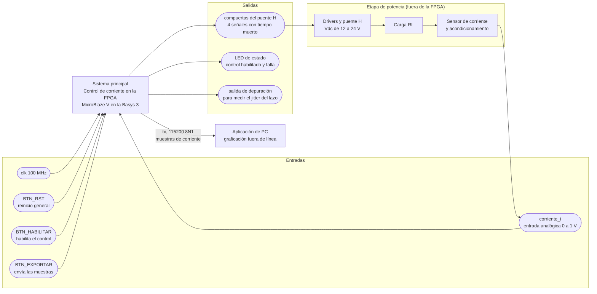

# Nivel 1

## Diagrama de primer nivel

## Objetivos

- Regular la corriente de un inversor monofásico en puente H sobre una carga RL, de forma que siga una referencia sinusoidal de 50 Hz con amplitudes de 0,2, 0,5 y 1,0 A pico.
- Ejecutar el regulador proporcional-resonante como una tarea periódica en un MicroBlaze V, con una base de tiempo determinista dada por un temporizador con interrupción.
- Generar la modulación PWM unipolar con tiempo muerto mediante un periférico propio con interfaz AXI4-Lite, y adquirir la corriente con el XADC sincronizado con el período de conmutación.
- Guardar las muestras de corriente en un buffer circular y enviarlas a la PC por UART al presionar un botón, sin afectar la ejecución del lazo.

## Descripciones

### Entradas

- `clk`, reloj de 100 MHz de la Basys 3, pin W5. Es el único reloj que entra al sistema.
- `BTN_RST`, reinicio general del sistema. El botón y el pin se definen en `basys3.xdc`.
- `BTN_HABILITAR`, habilita o deshabilita el control. Mientras no se presione, las compuertas se quedan apagadas.
- `BTN_EXPORTAR`, pide al sistema enviar por UART el histórico de muestras guardado en memoria.
- `corriente_i`, entrada analógica de 0 a 1 V hacia el XADC, por el Pmod JXADC. Llega ya acondicionada desde el sensor, con un offset para representar corriente alterna en un rango unipolar.

Los botones y los pines concretos de cada entrada están por confirmar, y su nombre es provisional hasta que se asigne el `.xdc`.

### Salidas

- `tx`, línea serial hacia la aplicación de PC por el puente USB-UART, pin A18. Lleva las muestras de corriente guardadas, a 115200 baudios.
- `compuerta_a_alta`, `compuerta_a_baja`, `compuerta_b_alta` y `compuerta_b_baja`, las cuatro señales hacia los drivers del puente H. Cada pierna tiene un par complementario con tiempo muerto. Los nombres son provisionales hasta que el diseño del periférico PWM los fije.
- `led[1:0]`, un LED para control habilitado y otro para falla.
- Una salida de depuración que se levanta al entrar a la rutina de interrupción del lazo y se baja al salir, para medir el período y el jitter con el osciloscopio.

La PC no manda comandos en este proyecto, solo recibe, así que `rx` no se usa en este nivel.

### Elementos externos

La etapa de potencia no está dentro de la FPGA. Los drivers de compuerta y el puente H reciben las cuatro señales de la FPGA y aplican la tensión sobre la carga RL. La corriente de la carga la mide el sensor, que la lleva al rango de 0 a 1 V y cierra el lazo hacia `corriente_i`. La definición y construcción de esta etapa es de PEDP, y la frontera con la FPGA son las cuatro compuertas, la entrada analógica y la tierra común.

La aplicación de PC es otro elemento externo. Recibe las muestras por el puerto serial y las grafica fuera de línea, sin intervenir en el control.

### Funcionamiento general

Al arrancar, el MicroBlaze V configura el temporizador, el PWM, la interfaz del ADC, el UART y el GPIO, fija los parámetros iniciales (referencia de corriente, frecuencia de conmutación, ciclo de trabajo de arranque) y se queda esperando la interrupción periódica.

En cada interrupción, el procesador hace siempre lo mismo y en el mismo orden. Inicia o captura la conversión del ADC y valida que haya un dato nuevo. Lee la muestra de corriente y calcula la acción del regulador PR. Escribe el nuevo `duty_ref` en el periférico PWM, y guarda la muestra en el buffer circular. Esa secuencia es la que mantiene el lazo determinista.

El periférico PWM convierte `duty_ref` en las cuatro compuertas con modulación unipolar y tiempo muerto. Además emite un disparo hacia el ADC en un instante fijo del período de conmutación, para muestrear la corriente en el centro del pulso y no ver el rizado.

Al presionar `BTN_EXPORTAR`, el lazo principal, fuera de la rutina de interrupción, recorre el buffer y manda las muestras por `tx`. Mientras tanto la interrupción sigue ejecutando el control con su temporización normal.

Si la corriente medida supera el límite configurado, el sistema baja las compuertas, enciende el LED de falla y deja de aplicar tensión a la carga.

En este nivel se muestran las relaciones con el exterior de la FPGA y con la etapa de potencia. La organización interna del sistema se desarrolla en el nivel 2.
