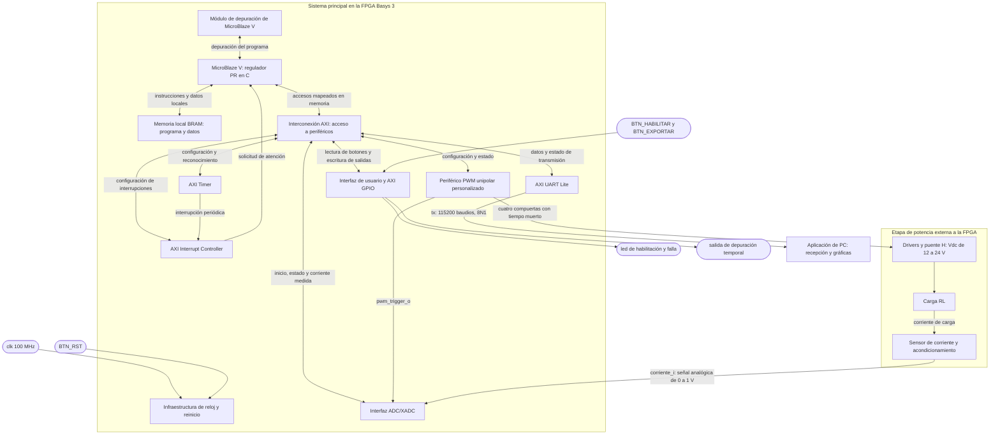

# Nivel 2

## Diagrama de segundo nivel

## Objetivos

- Subdividir el sistema principal del nivel 1 en el procesador, la memoria, la infraestructura de reloj y reinicio, la interconexión y los periféricos que lo componen.
- Distinguir los accesos del procesador a la memoria local de los accesos a los periféricos mapeados en memoria mediante AXI.
- Mostrar que el cálculo del regulador PR corresponde al software del MicroBlaze V, mientras que el PWM y la adquisición ejecutan las funciones físicas de actuación y medición.
- Identificar el recorrido de la interrupción periódica y la conexión de sincronización entre el PWM y el ADC, necesarias para coordinar el lazo de control.
- Conservar las entradas y salidas del nivel 1 y delimitar la FPGA, la etapa de potencia y la aplicación de PC.
- Establecer la función, las entradas y las salidas de cada bloque sin desarrollar todavía su organización interna.

## Descripciones

La plataforma es la Basys 3. El sistema recibe un único reloj externo de 100 MHz y mantiene al MicroBlaze V a esa frecuencia, con 32 KB de memoria local BRAM y una caché de instrucciones configurada de 8 KB. La memoria local contiene tanto el programa como los datos de trabajo; no se proponen una ROM y una RAM independientes como las del procesador uniciclo de los proyectos anteriores.

El reloj y los reinicios correspondientes llegan a los bloques internos, pero sus conexiones repetidas se omiten en el diagrama para que puedan distinguirse los caminos de información. El bloque de infraestructura representa esa distribución. Las interrupciones y el disparo de adquisición son eventos de control; no se utilizan como relojes de los módulos.

Cada flecha bidireccional entre la interconexión y un periférico representa su interfaz de acceso a registros. Los nombres externos y los nombres funcionales de conexión se mantienen de acuerdo con el nivel 1; los puertos concretos de las envolturas propias se fijarán durante su implementación. Este documento plantea la arquitectura y no presenta esos bloques como ya implementados o validados.

### Bloque 1: Infraestructura de reloj y reinicio

Recibe el reloj de la placa y el botón de reinicio general, y proporciona las condiciones de reloj y reset que necesita el sistema embebido. Su función es que el procesador, las memorias y los periféricos arranquen de forma coordinada, con las compuertas del puente H apagadas hasta que el software complete la configuración y habilite el control.

El reloj de funcionamiento del procesador y del bus es de 100 MHz. La temporización interna de conversión del XADC se configura a partir de esta infraestructura de acuerdo con las necesidades de adquisición. No se introduce un segundo reloj externo ni se fija aquí una primitiva PLL o MMCM concreta: esa selección pertenece a la integración del Block Design.

El reinicio del sistema y el paro del control tienen funciones diferentes. `BTN_RST` reinicia la plataforma; `BTN_HABILITAR` solicita habilitar o deshabilitar la actuación mediante el programa. La liberación del reset debe ser compatible con el dominio de reloj de cada IP y con la polaridad de su entrada de reinicio.

- **Entradas:** `clk` de 100 MHz, asociado al pin W5 en el nivel 1, y `BTN_RST`.
- **Salidas:** reloj del sistema y señales de reinicio hacia MicroBlaze V, memoria, interconexión y periféricos.

### Bloque 2: Procesador MicroBlaze V

Ejecuta el programa en C que configura los periféricos y realiza el control de corriente. La rutina periódica lee una muestra válida del ADC, la convierte a corriente con la calibración del sensor, genera la referencia sinusoidal, calcula el regulador PR y escribe la nueva orden de modulación en el PWM. La referencia es de 50 Hz y debe permitir los ensayos de 0,2, 0,5 y 1,0 A pico.

El PR es una función del programa, no un módulo adicional de hardware. Del mismo modo, la gestión de la habilitación, la detección de fallas a partir de la corriente medida, el almacenamiento del histórico y la organización de la exportación pertenecen al software. El ADC entrega la medición y el PWM ejecuta la actuación solicitada; ninguno de esos periféricos sustituye el cálculo del controlador.

El procesador atiende la interrupción periódica del Timer a través del controlador de interrupciones. La transmisión del histórico se realiza fuera de esa rutina para conservar el plazo del control. Esto exige que el programa no bloquee la atención de la interrupción mientras espera espacio en la UART.

- **Entradas:** reloj y reinicio, instrucciones y datos leídos de la memoria local, respuestas de los periféricos mediante AXI y solicitud de interrupción desde AXI INTC.
- **Salidas:** solicitudes de acceso a memoria local, lecturas y escrituras a los periféricos mediante AXI y comunicaciones con el módulo de depuración.

### Bloque 3: Memoria local BRAM

Almacena el programa C, las variables, la pila, los estados del regulador PR y el buffer circular de muestras. La capacidad indicada para la memoria local es de 32 KB. El reparto de esa capacidad entre código y datos se verificará al enlazar la aplicación; el buffer no dispone de los 32 KB completos para su uso exclusivo.

El procesador accede a esta memoria por la infraestructura local del subsistema MicroBlaze V. Por ello el diagrama separa su conexión de los accesos AXI a periféricos. Esta distinción evita interpretar que cada lectura de instrucciones o cada escritura al buffer tiene que pasar por el mismo camino de configuración del PWM.

La caché de instrucciones de 8 KB forma parte de la configuración del subsistema del procesador. No es un periférico adicional ni se considera memoria libre que pueda sumarse al buffer de muestras.

- **Entradas:** solicitudes de lectura o escritura del procesador, direcciones y datos de escritura a través de la interfaz de memoria local.
- **Salidas:** instrucciones y datos leídos hacia el procesador.

### Bloque 4: Módulo de depuración

Permite desarrollar y depurar la aplicación del MicroBlaze V desde las herramientas de la plataforma. Proporciona acceso de desarrollo al procesador para cargar y comprobar el programa, inspeccionar su ejecución y localizar problemas durante la integración.

Se utilizará el módulo compatible con MicroBlaze V que corresponda a la versión de Vivado/Vitis del proyecto. Este enlace de desarrollo es independiente de la UART utilizada para exportar muestras. La aplicación de PC no utiliza la depuración para intervenir en el lazo.

- **Entradas:** solicitudes de las herramientas de desarrollo y respuestas del procesador.
- **Salidas:** señales de control y acceso de depuración hacia el procesador, y respuestas hacia las herramientas.

### Bloque 5: Interconexión AXI

Conecta el procesador con los periféricos y encamina cada acceso al destino indicado por su dirección. MicroBlaze V realiza lecturas y escrituras mapeadas en memoria; la interconexión selecciona el periférico y devuelve sus datos y respuestas.

Los periféricos de control se exponen mediante AXI4-Lite. La conexión entre el maestro del procesador y los puertos de las IP se resolverá con la infraestructura AXI del Block Design, incluyendo las adaptaciones que requiera la configuración elegida. No se añade un Address Translator propio como el de los proyectos anteriores: la selección de destinos pertenece a esta infraestructura.

Las direcciones base se asignarán con el Address Editor y se utilizarán desde los controladores C generados o desarrollados para la plataforma. En este nivel se define qué bloques son accesibles y para qué se utilizan; no se inventa un mapa de direcciones ya implementado.

- **Entradas:** solicitudes de lectura y escritura del procesador y datos, estados y respuestas de los periféricos.
- **Salidas:** accesos al PWM, ADC/XADC, Timer, INTC, UART y GPIO, y respuestas de esos accesos hacia el procesador.

### Bloque 6: Periférico PWM unipolar personalizado

Recibe la orden de modulación que calcula el procesador y genera las cuatro señales de compuerta del puente H. Cada pierna tiene una salida alta y una baja, complementarias con el tiempo muerto necesario para evitar que ambos transistores de esa pierna conduzcan simultáneamente.

Este es el periférico personalizado obligatorio del proyecto. Se desarrolla en SystemVerilog con interfaz AXI4-Lite y permite configurar la habilitación, seleccionar al menos tres frecuencias de conmutación y establecer la referencia de modulación. También debe permitir configurar el tiempo muerto y consultar si el generador está funcionando. La orden de modulación se limita al rango admisible antes de aplicarla.

El procesador entrega una referencia de modulación, no una corriente medida ni la señal física de compuerta. El PWM se encarga de convertir esa orden en conmutaciones con la temporización apropiada. La elección del formato numérico y la relación exacta entre el valor escrito y los ciclos de trabajo se definirán al diseñar el periférico.

El bloque genera además `pwm_trigger_o`, conectado directamente a la interfaz de adquisición. Este evento permite muestrear en una fase definida del período de conmutación, sin que el instante de muestreo dependa de cuándo el procesador alcance una instrucción de inicio. La fase se debe elegir y verificar considerando los flancos del puente, el tiempo muerto y el acondicionamiento; la sincronización no implica por sí sola una medición libre de rizado.

- **Entradas:** reloj, reinicio y accesos AXI4-Lite con habilitación, frecuencia, referencia de modulación y configuración de tiempo muerto.
- **Salidas:** respuestas de lectura y estado hacia AXI, `pwm_trigger_o` hacia ADC/XADC, y `compuerta_a_alta`, `compuerta_a_baja`, `compuerta_b_alta` y `compuerta_b_baja` hacia los drivers.

Las compuertas deben permanecer apagadas durante el reinicio, antes de habilitar el control y cuando el sistema ordene la deshabilitación por falla. El diseño interno de los comparadores y del tiempo muerto se desarrolla en niveles posteriores.

### Bloque 7: Interfaz ADC/XADC

Adquiere la señal analógica de corriente ya acondicionada al intervalo de 0 a 1 V. Se propone utilizar el XADC de la FPGA configurado mediante el asistente de Vivado y una envoltura de adquisición que exponga al procesador la configuración, el estado y el dato convertido mediante AXI4-Lite.

La interfaz admite dos fuentes de inicio: una orden del software para configuración o diagnóstico, y `pwm_trigger_o` para adquisición sincronizada durante el control. También informa si existe una nueva muestra disponible. Así el programa puede distinguir un dato reciente de la lectura repetida del resultado anterior.

El nombre `corriente_i` representa la magnitud analógica que atraviesa la frontera del nivel 1. Su conexión física se realizará al par de entrada del canal XADC seleccionado en JXADC, con la referencia y los límites eléctricos correspondientes. No se trata de una entrada digital que contenga directamente un número en amperios.

El dato convertido representa la tensión de salida del sensor. El software aplica el offset y la ganancia medidos para recuperar la corriente con signo. Estos parámetros se coordinan con PEDP porque la corriente de la carga es alterna, mientras que la entrada analógica se utiliza en un rango unipolar.

- **Entradas:** señal analógica `corriente_i` desde el acondicionamiento, `pwm_trigger_o`, reloj, reinicio y órdenes/configuración por AXI4-Lite.
- **Salidas:** muestra digital de corriente y estado de disponibilidad y adquisición, legibles por el procesador mediante AXI4-Lite.

La coordinación del Timer y el muestreo debe asegurar que la rutina encuentre un resultado nuevo dentro del plazo de control. La latencia de conversión y el instante exacto de lectura se especificarán y medirán durante la integración.

### Bloque 8: AXI Timer

Establece la base de tiempo periódica con la que se ejecuta el regulador PR. El procesador configura el período y habilita su interrupción. Cada vencimiento solicita atención a través del AXI Interrupt Controller, evitando que la periodicidad del control dependa de un retardo implementado en el lazo principal del programa.

El período del control se selecciona junto con la frecuencia de conmutación y la estrategia de adquisición. No se presupone que dos periféricos queden alineados por el hecho de configurarlos uno después de otro: debe establecerse una coordinación temporal que relacione el disparo del PWM, la disponibilidad del ADC y la actualización de la actuación.

El Timer determina cuándo se atiende el cálculo; el PWM determina el instante de muestreo mediante su disparo. La latencia entre la solicitud de interrupción y la ejecución de la rutina se deberá medir, incluyendo la operación simultánea de la exportación UART.

- **Entradas:** reloj, reinicio y accesos AXI para configurar el período, habilitar el conteo y reconocer la interrupción.
- **Salidas:** solicitud periódica de interrupción hacia AXI INTC y respuestas de lectura/estado hacia el procesador mediante AXI.

### Bloque 9: AXI Interrupt Controller

Recibe la solicitud del Timer y la presenta a la entrada de interrupción del MicroBlaze V. El procesador configura su habilitación y la atención de la fuente mediante sus registros accesibles por AXI.

La fuente necesaria para el lazo es la del Timer. El segundo nivel no exige que UART y GPIO también generen interrupciones; sus tareas pueden atenderse en el programa principal. La configuración de prioridades debe conservar la atención oportuna de la rutina periódica.

- **Entradas:** solicitud de interrupción desde AXI Timer, reloj, reinicio y accesos de configuración por AXI.
- **Salidas:** solicitud de interrupción hacia MicroBlaze V y datos de estado hacia el procesador mediante AXI.

### Bloque 10: AXI UART Lite

Transmite los bytes del histórico almacenado hacia la aplicación de PC. El procesador prepara los datos y los entrega al periférico; UART Lite realiza la temporización de la comunicación serie a 115200 baudios, con 8 bits de datos, sin paridad y un bit de parada.

El periférico no decide qué muestras exportar ni interpreta la referencia de corriente. La organización del histórico, el orden de las muestras y la información necesaria para reconstruir su escala temporal pertenecen al programa y al formato de exportación.

La transmisión se atiende fuera de la interrupción del regulador. Debe permitir que el Timer siga siendo atendido mientras la UART entrega los bytes al ritmo del enlace. El histórico que se está enviando debe mantenerse coherente aunque el control continúe registrando muestras; el mecanismo de gestión del buffer se concretará en el diseño del software.

- **Entradas:** reloj, reinicio y accesos AXI con configuración y datos a transmitir.
- **Salidas:** estado de transmisión hacia el procesador y `tx` hacia el puente USB-UART de la Basys 3, asociado al pin A18 en el nivel 1.

La comunicación de la aplicación es de la FPGA hacia la PC. No se incorpora una entrada `rx` de comandos a la interfaz del proyecto. Si la IP dispone de recepción, esa función queda sin utilizar en esta arquitectura.

### Bloque 11: Interfaz de usuario y AXI GPIO

Recoge `BTN_HABILITAR` y `BTN_EXPORTAR`, y permite al software actualizar los LEDs de habilitación y falla y la salida de depuración temporal. El bloque agrupa el AXI GPIO y el acondicionamiento digital necesario para obtener eventos de botón utilizables por el programa.

`BTN_HABILITAR` solicita habilitar o deshabilitar la actuación. `BTN_EXPORTAR` solicita transmitir el histórico. La interpretación de ambos eventos corresponde al software; GPIO comunica las entradas y mantiene las salidas que le indique el procesador. El reinicio general `BTN_RST` se atiende en la infraestructura de reset, no como un comando que dependa de que el programa esté ejecutándose.

Los botones requieren tratamiento del rebote y de su llegada desde el exterior del dominio síncrono. En este nivel se establece esa necesidad sin abrir todavía el bloque en sincronizadores, contadores o detectores de flanco.

El LED de habilitación debe representar el estado efectivo del control, y el LED de falla, la condición detectada por el sistema. La salida de depuración se activa al entrar a la rutina periódica y se desactiva al salir. Su duración y repetición permiten medir el tiempo de servicio y la variación temporal de atención; no sustituyen la comprobación del instante de adquisición del XADC.

- **Entradas:** `BTN_HABILITAR`, `BTN_EXPORTAR`, reloj, reinicio y accesos AXI de lectura/escritura desde el procesador.
- **Salidas:** estado de botones hacia el procesador mediante AXI, `led[1:0]` hacia la placa y salida de depuración hacia el punto de medición.

La cantidad de instancias o canales GPIO se fijará al integrar el Block Design, según las entradas y salidas requeridas. El bloque del diagrama representa esa función completa.

### Elemento externo: Etapa de potencia y medición

Los drivers reciben las cuatro compuertas de la FPGA y accionan el puente H alimentado entre 12 y 24 V DC. El puente aplica la tensión a la carga RL. El sensor mide la corriente de esa carga y el acondicionamiento la lleva al rango de entrada del XADC, cerrando el camino de realimentación.

El dimensionamiento de la carga, los MOSFET, los drivers, el tiempo muerto, el sensor y las protecciones se coordina con PEDP. La frontera funcional con la FPGA está formada por las cuatro señales de compuerta, la entrada analógica y la referencia de tierra correspondiente. Las salidas lógicas de la placa deben ser compatibles con las entradas del circuito de accionamiento seleccionado.

La detección por software de sobrecorriente requiere una muestra válida y la atención del procesador; no se considera una protección instantánea frente a un cortocircuito. La protección física y el apagado de los drivers deben definirse con la etapa de potencia. Desactivar las compuertas tampoco significa que la corriente de la inductancia desaparezca de inmediato.

### Elemento externo: Aplicación de PC

Recibe el histórico por el enlace USB-UART, reconstruye las muestras en su orden temporal y grafica la corriente fuera de línea. Debe conocer el período de registro y la calibración utilizada, o recibir los datos ya escalados junto con la información temporal necesaria.

La PC no calcula el PR ni determina el instante de muestreo. Tampoco envía comandos de habilitación o referencias mediante UART. El control permanece en la FPGA y puede continuar ejecutándose durante la transmisión del histórico.

### Interfaz principal

| Conexión | Información que transporta | Función |
| --- | --- | --- |
| Reloj y reinicio hacia los bloques | Reloj del sistema y resets correspondientes | Coordinar operación y arranque de la plataforma. |
| MicroBlaze V ↔ memoria local | Direcciones, instrucciones y datos | Ejecutar el programa y conservar estados, pila e histórico. |
| Módulo de depuración ↔ MicroBlaze V | Solicitudes y respuestas de desarrollo | Cargar y depurar la aplicación. |
| MicroBlaze V ↔ interconexión AXI | Accesos mapeados en memoria | Configurar los periféricos y leer sus datos/estados. |
| Interconexión AXI ↔ PWM | Habilitación, frecuencia, modulación, tiempo muerto y estado | Controlar la actuación del puente. |
| Interconexión AXI ↔ ADC/XADC | Inicio por software, configuración, muestra y disponibilidad | Obtener la medición digital de corriente. |
| Interconexión AXI ↔ Timer e INTC | Configuración y estado de temporización e interrupciones | Establecer y atender la rutina periódica. |
| Interconexión AXI ↔ UART | Bytes a transmitir y estado del transmisor | Exportar el histórico. |
| Interconexión AXI ↔ GPIO | Botones, LEDs y salida de depuración | Atender la interfaz de usuario y la medición temporal. |
| Timer → INTC → MicroBlaze V | Solicitud de interrupción periódica | Iniciar la rutina del regulador. |
| PWM → ADC/XADC | `pwm_trigger_o` | Sincronizar la adquisición con la conmutación. |
| PWM → drivers del puente H | Cuatro señales de compuerta con tiempo muerto | Aplicar la orden de modulación a la etapa de potencia. |
| Sensor y acondicionamiento → ADC/XADC | `corriente_i`, analógica de 0 a 1 V | Realimentar la corriente de carga. |
| UART → aplicación de PC | `tx`, 115200 baudios, 8N1 | Entregar las muestras para análisis fuera de línea. |

La interfaz AXI4-Lite de los periféricos utiliza accesos de lectura y escritura con datos de 32 bits. Los registros concretos, sus offsets y la semántica detallada de los campos se documentarán en el diseño de cada periférico. En el Block Design las direcciones base deberán ser únicas y coincidir con las utilizadas por el software.

## Funcionamiento general

Al arrancar, la infraestructura de reset mantiene el sistema en una condición definida y el PWM deja las compuertas apagadas. MicroBlaze V inicia el programa, configura el Timer y su interrupción, prepara el ADC/XADC, establece la configuración del PWM y habilita UART y GPIO. También inicializa el controlador PR y el buffer circular antes de aceptar la habilitación del control.

Durante la operación, el PWM genera el disparo de adquisición en una fase definida de la conmutación. El XADC realiza la conversión y la interfaz publica la nueva muestra. La interrupción del Timer, presentada a través del INTC, activa la rutina periódica. El programa comprueba que haya una medición válida, obtiene la corriente con signo y calcula el error respecto de la referencia sinusoidal de 50 Hz. Con ese error actualiza el PR y escribe la nueva orden de modulación al periférico PWM.

El periférico transforma la orden en las cuatro compuertas y aplica el tiempo muerto entre las señales de cada pierna. La tensión del puente modifica la corriente de la carga RL; el sensor vuelve a medirla y completa el lazo. La selección del instante de muestreo y de actualización debe considerar la latencia del ADC y del cálculo, y el retardo resultante debe formar parte de la validación del controlador.

Cada iteración conserva la muestra en memoria. Cuando se presiona `BTN_EXPORTAR`, el programa principal prepara y transmite el histórico mediante UART, mientras la interrupción conserva su prioridad y periodicidad. La organización del buffer debe evitar que una muestra sea modificada durante su exportación o que se mezclen partes de históricos distintos.

Cuando se solicita deshabilitar el control o se detecta una falla, el programa ordena apagar la actuación y actualiza los LEDs. `BTN_RST` reinicia el sistema completo y devuelve la ejecución a la inicialización. La aplicación de PC interviene únicamente en la recepción y representación de los datos.

Las frecuencias de conmutación, el período de control, la fase de muestreo, el tiempo muerto, las ganancias del PR, el formato de la referencia de modulación, el tamaño del histórico y los pines aún no asignados se definirán junto con PEDP y la integración del sistema. Este segundo nivel establece los bloques y sus responsabilidades; la estructura interna y las pruebas de implementación se desarrollan en los niveles siguientes.
