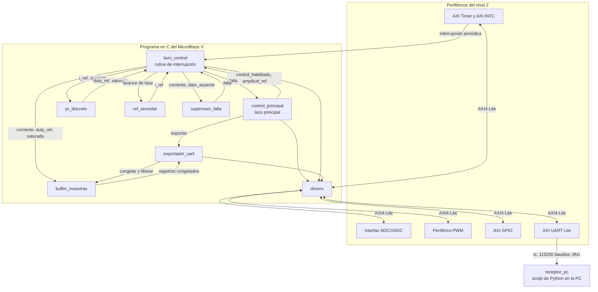

# Nivel 3

## Software del MicroBlaze V

El bloque 2 del nivel 2 ejecuta todo el programa en C. Acá se abre en nueve módulos con nombre. Ocho viven en el MicroBlaze V y uno, `receptor_pc`, corre en la computadora. El objetivo, las entradas, las salidas y el funcionamiento de cada uno están en su propio archivo de `docs/diseño/modulos/`, que en el nivel 4 se completa con el detalle.

### Módulos

- [`control_principal`](../modulos/control_principal.md), arranque del sistema, botones, switches de amplitud, LEDs y pedido de exportación.
- [`lazo_control`](../modulos/lazo_control.md), rutina de interrupción del Timer con una iteración del control.
- [`pr_discreto`](../modulos/pr_discreto.md), ecuación en diferencias del PR con saturación y anti-windup.
- [`ref_senoidal`](../modulos/ref_senoidal.md), referencia sinusoidal de 50 Hz.
- [`drivers`](../modulos/drivers.md), única capa que toca registros de periféricos.
- [`buffer_muestras`](../modulos/buffer_muestras.md), histórico circular en la BRAM local.
- [`exportador_uart`](../modulos/exportador_uart.md), envío del histórico sin bloquear el lazo principal.
- [`supervisor_falla`](../modulos/supervisor_falla.md), apagado del puente por sobrecorriente o falta de dato.
- [`receptor_pc`](../modulos/receptor_pc.md), recepción y gráficas en la computadora.

### Contextos de ejecución

El programa tiene dos contextos. `lazo_control` corre dentro de la interrupción del Timer y es lo único con plazo fijo, junto con lo que llama (`ref_senoidal`, `pr_discreto`, `supervisor_falla` y la escritura en `buffer_muestras`). `control_principal` y `exportador_uart` corren en el lazo principal, que nunca bloquea y puede ser interrumpido en cualquier punto. Ningún acceso que espere a un periférico lento, como la UART, entra a la interrupción.

Los dos contextos comparten pocas variables, cada una de 32 bits y declarada `volatile`, con un solo escritor. `control_principal` escribe `control_habilitado` y `amplitud_ref`, y la interrupción solo las lee. La interrupción escribe `falla` y el lazo principal solo la lee. Así ninguna necesita candado.
