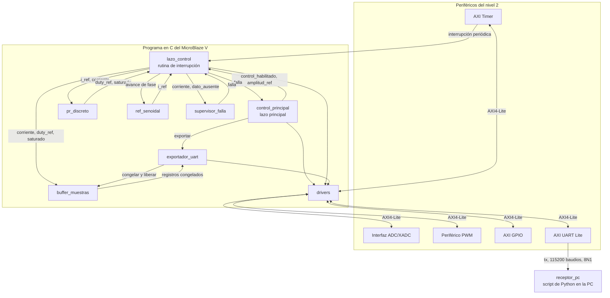
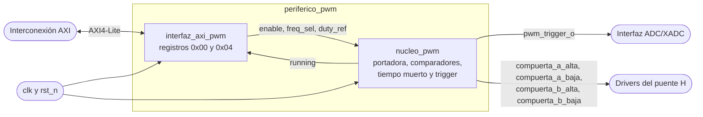
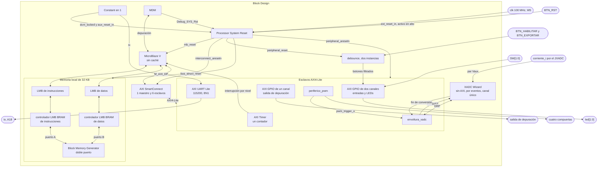

# Nivel 3

## Software del MicroBlaze V

El bloque 2 del nivel 2 ejecuta todo el programa en C. Acá se abre en nueve módulos con nombre. Ocho viven en el MicroBlaze V y uno, `receptor_pc`, corre en la computadora. El objetivo, las entradas, las salidas y el funcionamiento de cada uno están en su propio archivo de `docs/diseño/modulos/`, que en el nivel 4 se completa con el detalle.

### Módulos

- [`control_principal`](../modulos/control_principal.md), arranque del sistema, botones, switches de amplitud, LEDs y pedido de exportación.
- [`lazo_control`](../modulos/lazo_control.md), rutina de interrupción del Timer con una iteración del control.
- [`pr_discreto`](../modulos/pr_discreto.md), ecuación en diferencias del PR con saturación y anti-windup.
- [`ref_senoidal`](../modulos/ref_senoidal.md), referencia sinusoidal de 50 Hz.
- [`drivers`](../modulos/drivers.md), única capa que toca registros de periféricos.
- [`buffer_muestras`](../modulos/buffer_muestras.md), histórico circular en la BRAM local.
- [`exportador_uart`](../modulos/exportador_uart.md), envío del histórico sin bloquear el lazo principal.
- [`supervisor_falla`](../modulos/supervisor_falla.md), apagado del puente por sobrecorriente o falta de dato.
- [`receptor_pc`](../modulos/receptor_pc.md), recepción y gráficas en la computadora.

### Contextos de ejecución

El programa tiene dos contextos. `lazo_control` corre dentro de la interrupción del Timer y es lo único con plazo fijo, junto con lo que llama (`ref_senoidal`, `pr_discreto`, `supervisor_falla` y la escritura en `buffer_muestras`). `control_principal` y `exportador_uart` corren en el lazo principal, que nunca bloquea y puede ser interrumpido en cualquier punto. Ningún acceso que espere a un periférico lento, como la UART, entra a la interrupción.

Los dos contextos comparten pocas variables, cada una de 32 bits y declarada `volatile`, con un solo escritor. `control_principal` escribe `control_habilitado` y `amplitud_ref`, y la interrupción solo las lee. La interrupción escribe `falla` y el lazo principal solo la lee. La secuencia que vuelve a comprobar `falla` y escribe `enable = 1` se protege como una unidad en [control principal](../modulos/control_principal.md).

## Periférico PWM

El bloque 6 del nivel 2 se abre en dos módulos de SystemVerilog dentro de `periferico_pwm`, que es el módulo superior que entra al Block Design como módulo RTL de referencia. `interfaz_axi_pwm` atiende el bus y guarda los registros, y `nucleo_pwm` genera la portadora, las compuertas y el disparo del ADC. Van en archivos separados para que cada uno se trabaje en su rama sin pisarse.

### Módulos

- `interfaz_axi_pwm`, esclavo AXI4-Lite con el registro de control y estado y el de `duty_ref`.
- [`nucleo_pwm`](../modulos/nucleo_pwm.md), portadora triangular, modulación unipolar, tiempo muerto y `pwm_trigger_o`.

### Registros

- `0x00`, control y estado. `enable` en el bit 0, `freq_sel` en los bits [2:1] y `running` en el bit 3, de solo lectura.
- `0x04`, `duty_ref` en los bits [15:0], en Q2.14 con signo.

### Reparto de funciones

La interfaz guarda lo que escribe el software y lo pasa tal cual al núcleo. Los registros sombra, la saturación de `duty_ref` y la espera al valle están en el núcleo, así que la interfaz no necesita saber nada de la portadora. `running` va en sentido contrario, lo produce el núcleo y la interfaz solo lo expone en lectura.

El tiempo muerto no pasa por la interfaz. Es el `parameter` `DEAD_TIME_CICLOS` de `nucleo_pwm`, que `periferico_pwm` expone como parámetro de la IP para fijarlo al armar el Block Design.

Los dos módulos usan el reloj y el reinicio del bus, así que no hay cruce de dominios de reloj entre la interfaz y el núcleo.

## Plataforma del MicroBlaze V

Los bloques 1, 3, 4, 5, 7, 8, 9 y 10 del nivel 2 son casi todos IP de Xilinx. Abrirlos es decir qué instancias del Block Design los forman, cómo se conectan y con qué configuración. Hay lógica propia en dos lugares, los dos `debounce` del bloque 10 y `envoltura_xadc` del bloque 7, que tiene su propio archivo en `docs/diseño/modulos/`.

El reloj de 100 MHz llega a todas las instancias. Igual que en el nivel 2, esas conexiones se omiten en el diagrama, salvo la que entra al Processor System Reset.

### Bloque 1, reloj y reinicio

El reloj de W5 entra directo al Block Design, sin Clocking Wizard. El procesador, el bus, el PWM, el Timer y el `DCLK` del XADC corren a los mismos 100 MHz del oscilador, así que no hay otra frecuencia que generar. Con un solo reloj, además, el Timer y la portadora del PWM cuentan exactamente los mismos ciclos.

Los reinicios salen de un Processor System Reset, que los sincroniza con el reloj y los entrega en la polaridad que pide cada destino [1]. `BTN_RST` llega a `ext_reset_in`, configurada activa en alto porque los botones de la Basys 3 dan alto solo mientras se presionan [2]. `Debug_SYS_Rst` del MDM llega a `mb_debug_sys_rst`, que es siempre activa en alto. Así, cargar un programa desde Vitis reinicia también los periféricos, y el PWM no sigue conmutando con la configuración del programa anterior mientras arranca el nuevo.

Las otras dos entradas van a un Constant en 1. `dcm_locked` va en alto porque no hay un generador de reloj al que esperar [1, p. 9], y `aux_reset_in` no se usa y queda con su polaridad activa en bajo, así que el 1 es su nivel inactivo.

Mientras la FPGA se configura todavía no hay diseño que maneje los pines. En la Basys 3 `PUDC_B` está en alto por una resistencia a 3,3 V, así que los pines de usuario quedan en alta impedancia y sin pull-ups internos [3]. En ese intervalo las compuertas las mantiene apagadas el pull-down entre base y emisor del transistor que maneja el LED del aislamiento (`potencia/diseno_puente_h.md`).

- Entradas, `clk` de 100 MHz en W5, `BTN_RST` y `Debug_SYS_Rst` del MDM.
- Salidas, el reloj del sistema y cinco reinicios.
  - `mb_reset`, activo en alto, hacia el MicroBlaze V.
  - `bus_struct_reset`, activo en alto, hacia los dos LMB.
  - `interconnect_aresetn`, activo en bajo, hacia la interconexión AXI.
  - `peripheral_aresetn`, activo en bajo, hacia los seis esclavos AXI4-Lite, incluidos `periferico_pwm` y `envoltura_xadc`.
  - `peripheral_reset`, activo en alto, hacia los dos `debounce`.

### Bloque 3, memoria local BRAM

La memoria local tiene dos buses LMB, uno de instrucciones y otro de datos, cada uno con su controlador LMB BRAM, y un Block Memory Generator de doble puerto con los 32 KB. El controlador de instrucciones usa el puerto A y el de datos el puerto B, así que el procesador puede buscar una instrucción y acceder a un dato en el mismo ciclo. Los 32 KB ocupan 8 de los 50 bloques RAMB36 de la XC7A35T [4].

El MicroBlaze V va sin caché, por la razón que da el bloque 3 del nivel 2.

- Entradas, accesos del MicroBlaze V por los dos LMB y `bus_struct_reset`.
- Salidas, instrucciones y datos leídos hacia el procesador.

### Bloque 4, módulo de depuración

El MDM se conecta al MicroBlaze V por su interfaz de depuración. Por ahí Vitis carga y depura el programa a través del JTAG del USB de la Basys 3. No es maestro AXI, así que no aparece en la interconexión. Su salida `Debug_SYS_Rst` va al Processor System Reset del bloque 1.

- Entradas, el JTAG del USB y las respuestas del procesador.
- Salidas, la interfaz de depuración hacia el MicroBlaze V y `Debug_SYS_Rst`.

### Bloque 5, interconexión AXI

Tiene un solo maestro, `M_AXI_DP`, el puerto de datos para periféricos del MicroBlaze V, y seis esclavos AXI4-Lite.

- `periferico_pwm`
- `envoltura_xadc`
- AXI Timer
- AXI UART Lite
- AXI GPIO de entradas y LEDs
- AXI GPIO de la salida de depuración

Las instrucciones y los datos de la BRAM van por LMB y no pasan por acá.

La rutina periódica hace entre cinco y seis accesos AXI por iteración (depuración, reconocimiento del Timer, dato y contador del ADC en una sola lectura, `duty_ref` y depuración otra vez), y el presupuesto temporal del control debe incluir la latencia de la interconexión. Se usa un AXI SmartConnect, la IP que coloca Connection Automation de Vivado. Con seis esclavos AXI4-Lite atiende una transacción a la vez, igual que AXI Interconnect [5], [6]. Las direcciones base las asigna el Address Editor, y el mapa está en [`block_design`](../modulos/block_design.md).

- Entradas, accesos de `M_AXI_DP`, respuestas de los esclavos e `interconnect_aresetn`.
- Salidas, accesos hacia los seis esclavos y respuestas hacia el procesador.

### Bloque 7, interfaz ADC/XADC

Se arma con dos instancias, un XADC Wizard y `envoltura_xadc`.

El XADC Wizard va sin interfaz AXI, en modo por eventos y con canal único [7]. En modo por eventos cada conversión arranca con un flanco en `CONVST`. El modo continuo muestrea a su propio ritmo, sin relación con la portadora, y la muestra podría caer en cualquier punto del período, incluso en una conmutación. Con una sola señal analógica el secuenciador no hace falta, y el dato queda siempre en el mismo registro de estado.

`envoltura_xadc` es esclava AXI4-Lite de la interconexión y maestra del puerto DRP del wizard. Un bit de su registro de control elige si `CONVST` lo dispara `pwm_trigger_o` o el inicio por software, y la fuente que no está elegida se ignora. Al fin de cada conversión lee el registro de estado del canal por el DRP y publica el dato junto con un contador de conversiones, que el software compara con su lectura anterior para saber si hay dato nuevo. El detalle está en [`envoltura_xadc`](../modulos/envoltura_xadc.md).

El wizard queda como instancia aparte, fuera de la envoltura, para que el testbench de la envoltura use un modelo simple de los puertos DRP y de conversión, sin simular la primitiva analógica.

- Entradas, `corriente_i` por el par Vaux del canal del JXADC, `pwm_trigger_o` de `periferico_pwm`, accesos AXI4-Lite y `peripheral_aresetn`.
- Salidas, el dato y el contador de conversiones hacia el procesador por AXI4-Lite.

### Bloque 8, AXI Timer

Va con un solo contador, el 0, y el Timer 2 desactivado [8]. El modo de generación, la cuenta hacia abajo, la recarga automática y la interrupción los configura `drivers` con el Timer detenido. [Control principal](../modulos/control_principal.md) arranca la cuenta después de usar una publicación del XADC como referencia de fase.

Su salida de interrupción va directo a la entrada de interrupción del MicroBlaze V, configurada por nivel. La salida del Timer se queda en alto hasta que el software la limpia, y con una entrada por nivel la rutina tiene que limpiarla antes de terminar o la interrupción vuelve a dispararse [9]. `lazo_control` la reconoce en el paso 2, que se ejecuta en todas las iteraciones, también cuando no hay dato nuevo.

- Entradas, accesos AXI4-Lite y `peripheral_aresetn`.
- Salidas, la interrupción hacia el MicroBlaze V.

### Bloque 9, AXI UART Lite

La velocidad de 115200 baudios, los 8 bits de datos y la falta de paridad son parámetros de la IP, fijos al sintetizar [10]. El software solo entrega bytes.

`rx` va al Constant en 1, el nivel de reposo de una línea serie. En 0 el receptor vería un bit de inicio permanente y marcaría errores de trama.

- Entradas, accesos AXI4-Lite, `peripheral_aresetn` y `rx` en 1.
- Salidas, `tx` hacia el puente USB-UART en A18.

### Bloque 10, interfaz de usuario y AXI GPIO

Se arma con dos AXI GPIO y dos instancias de `debounce`.

- El GPIO de dos canales tiene el canal 1 de entrada, con cuatro bits (`BTN_HABILITAR` y `BTN_EXPORTAR` filtrados, y `SW[1:0]`), y el canal 2 de salida, con `led[1:0]`.
- El GPIO de un canal tiene un bit de salida, la salida de depuración.

La salida de depuración la escribe solo la rutina periódica y los LEDs solo el lazo principal. En instancias distintas, cada registro de datos tiene un solo escritor, y una lectura y escritura del lazo principal interrumpida a la mitad no puede pisar lo que dejó la rutina.

Los botones pasan por un antirrebote en hardware antes del GPIO. El manual de la Basys 3 describe para los botones solo resistencias en serie y el nivel bajo en reposo, sin filtro [2], y el contacto rebota durante algunos milisegundos al presionar. Como `control_principal` alterna el control en cada flanco de subida de `BTN_HABILITAR`, cada rebote que llegara al software lo cambiaría de estado otra vez.

`debounce` se reutiliza del Proyecto 2 (`src/design/debounce.sv`) y va una instancia por botón, entre el pin y el canal 1. Dos flip-flops en cadena sincronizan el botón con el reloj. Un contador vuelve a cero cada vez que la entrada cambia, y la salida copia la entrada recién cuando el contador enciende su bit más alto. Con `N = 21` eso son 2^20 ciclos, unos 10,5 ms de entrada estable a 100 MHz. Su reinicio es activo en alto, por eso va a `peripheral_reset`. Entra al Block Design como módulo RTL. Los switches no pasan por `debounce` porque `control_principal` los lee como niveles.

El orden de los bits en cada canal se fija en el Block Design (#15), y `drivers` lo toma de ahí.

- Entradas, `BTN_HABILITAR`, `BTN_EXPORTAR`, `SW[1:0]`, accesos AXI4-Lite, `peripheral_aresetn` y `peripheral_reset`.
- Salidas, `led[1:0]`, la salida de depuración, y el estado de botones y switches hacia el procesador por AXI4-Lite.

### Referencias

[1] AMD, "Processor System Reset Module v5.0 LogiCORE IP Product Guide," PG164, nov. 2015.

[2] Digilent, "Basys 3 Reference Manual." [En línea]. Disponible en https://digilent.com/reference/programmable-logic/basys-3/reference-manual

[3] AMD, "7 Series FPGAs Configuration User Guide," UG470.

[4] AMD, "7 Series FPGAs Data Sheet: Overview," DS180.

[5] AMD, "AXI Interconnect LogiCORE IP Product Guide," PG059, v2.1, dic. 2025.

[6] AMD, "SmartConnect LogiCORE IP Product Guide," PG247, v1.0, jun. 2026.

[7] AMD, "7 Series FPGAs and Zynq-7000 SoC XADC Dual 12-Bit 1 MSPS Analog-to-Digital Converter User Guide," UG480.

[8] AMD, "AXI Timer LogiCORE IP Product Guide," PG079.

[9] AMD, "MicroBlaze V Processor Reference Guide," UG1629, sección External Interrupt.

[10] AMD, "AXI UART Lite LogiCORE IP Product Guide," PG142.
