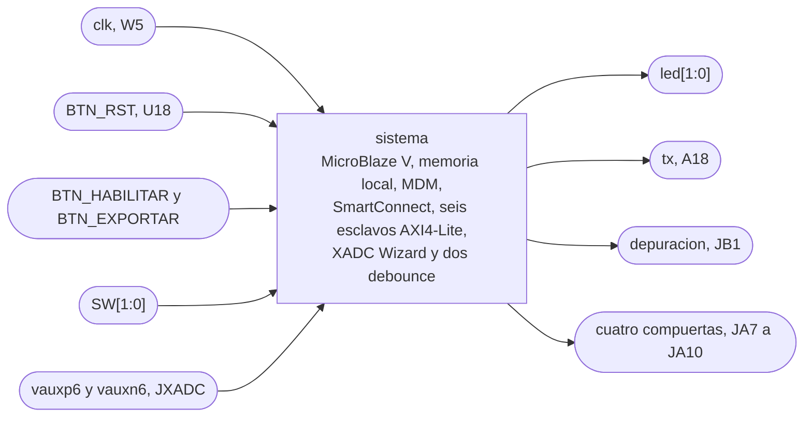
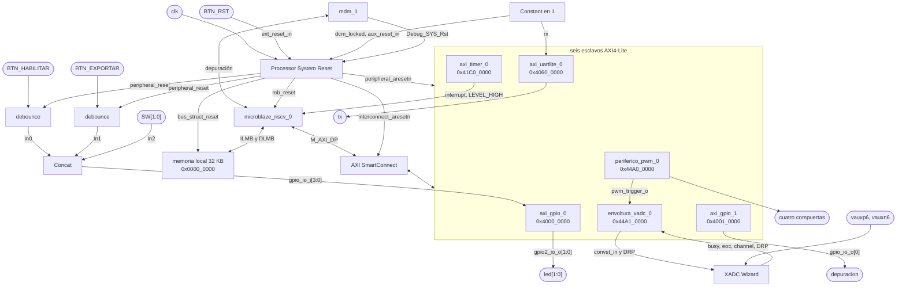
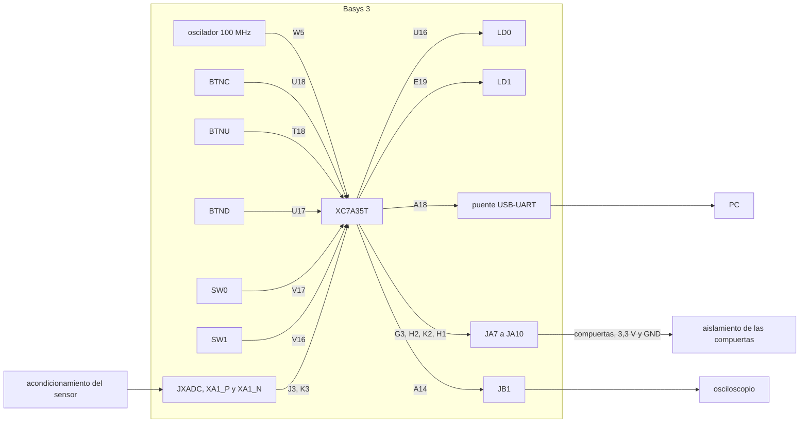

# block_design

## a) Nombre del módulo

`block_design`, el Block Design `sistema` del proyecto de Vivado 2026.1 para la XC7A35T-1CPG236 de la Basys 3. Se exporta con `write_bd_tcl` a `src/bd/sistema.tcl`, y el proyecto se regenera desde ahí en `vivado/`, que no se versiona. Junta en una sola integración los bloques 1, 3, 4, 5, 6, 7, 8, 9 y 10 del [nivel 2](../diagramas/nivel02.md), abiertos en la plataforma del [nivel 3](../diagramas/nivel03.md).

## b) Diagrama modular

## c) Objetivo del módulo

Fija cómo se arman e interconectan las instancias de la plataforma, con su configuración, el mapa de direcciones, la interrupción, el reloj y los reinicios, y qué pin de la Basys 3 le toca a cada puerto externo. Es la base de `src/bd/sistema.tcl`, de `basys3.xdc` y del `.xsa` sobre el que se arma la plataforma de Vitis.

## d) Entradas

- `clk`, reloj de 100 MHz del oscilador de la placa.
- `BTN_RST`, botón de reinicio del sistema, activo en alto.
- `BTN_HABILITAR` y `BTN_EXPORTAR`, botones sin filtrar, activos en alto.
- `SW[1:0]`, switches de selección de la amplitud de la referencia.
- `vauxp6` y `vauxn6`, el par analógico de `corriente_i` por el canal XA1 del JXADC.

## e) Salidas

- `led[1:0]`, `led[0]` para control habilitado y `led[1]` para falla, como fija [`control_principal`](control_principal.md).
- `tx`, la línea serie hacia el puente USB-UART.
- `depuracion`, la salida de depuración que escribe la rutina periódica, para medir período y jitter con el osciloscopio.
- `compuerta_a_alta`, `compuerta_a_baja`, `compuerta_b_alta` y `compuerta_b_baja`, de [`periferico_pwm`](periferico_pwm.md), hacia el aislamiento de las compuertas.

## f) Explicación de la relación con otros módulos

El Block Design contiene a [`periferico_pwm`](periferico_pwm.md), a [`envoltura_xadc`](envoltura_xadc.md) y a los dos `debounce` como módulos RTL de referencia, que Vivado toma directo de `src/design/`. Fija los parámetros de `periferico_pwm` y conecta su `pwm_trigger_o` a la envoltura.

Del lado del software, el `.xsa` le entrega a Vitis la configuración del procesador y el mapa de direcciones. [`drivers`](drivers.md) toma las direcciones base de `xparameters.h`, donde cada macro lleva el nombre de su instancia, y el orden de los bits de los GPIO de h.6.

Del lado de potencia, las cuatro compuertas salen por JA hacia la cadena de aislamiento de `potencia/diseno_puente_h.md`, que también toma de JA los 3,3 V y el GND para los LED de los VO3120.

## g) Explicación de funcionamiento

Al soltar `BTN_RST`, o al terminar un reinicio pedido por el MDM, el Processor System Reset libera los reinicios en orden. Primero salen la interconexión y los LMB, 16 ciclos después los periféricos y otros 16 ciclos después el procesador [1, p. 9]. Así, cuando el MicroBlaze V hace su primer acceso, todos los esclavos ya están fuera de reinicio. Durante el reinicio `periferico_pwm` mantiene las cuatro compuertas en bajo.

El procesador busca instrucciones y datos en la memoria local de 32 KB por los dos LMB, y llega a los seis periféricos por `M_AXI_DP` a través del SmartConnect. El AXI Timer interrumpe al procesador directo, sin controlador de interrupciones. Todo corre con el mismo reloj de 100 MHz.

## h) Diseño

### h.1) Instancias y configuración

- `microblaze_riscv_0`, MicroBlaze V a 100 MHz, sin caché, con el puerto AXI de periféricos (`M_AXI_DP`) habilitado. La razón de ir sin caché está en el bloque 3 del [nivel 2](../diagramas/nivel02.md). Lleva la unidad de punto flotante de precisión simple, la multiplicación y división entera y las instrucciones atómicas. El PR de [`pr_discreto`](pr_discreto.md) trabaja en `float`, y sin esas unidades cada suma o multiplicación pasa a una rutina de software dentro de los 50 µs de la rutina periódica.
- `microblaze_riscv_0_local_memory`, memoria local de 32 KB con un LMB de instrucciones y otro de datos, como el bloque 3 de `nivel03.md`.
- `mdm_1`, módulo de depuración en modo Enabled, solo depuración. La salida serie del sistema va por la UART Lite, así que el MDM no lleva UART por JTAG.
- Processor System Reset, con `ext_reset_in` activo en alto (External Reset Logic Level en 1 [1, p. 16]).
- Un Constant de un bit en 1, para `dcm_locked` y `aux_reset_in` del Processor System Reset y para `rx` de la UART Lite.
- AXI SmartConnect, con un esclavo (`M_AXI_DP`) y seis maestros, uno por periférico.
- `axi_timer_0`, AXI Timer con el Timer 2 desactivado y 32 bits.
- `axi_uartlite_0`, AXI UART Lite a 115200 baudios, 8 bits de datos y sin paridad.
- `axi_gpio_0`, AXI GPIO de dos canales. El canal 1 tiene 4 bits de entrada y el canal 2 tiene 2 bits de salida.
- `axi_gpio_1`, AXI GPIO de un canal con 1 bit de salida.
- `periferico_pwm_0`, instancia de `periferico_pwm`, con `DEAD_TIME_CICLOS = 100` y `PRECARGA_CICLOS = 7000` de `potencia/diseno_puente_h.md`, y `MAX_FREQ_00 = 5000`, `MAX_FREQ_01 = 2500`, `MAX_FREQ_10 = 1250` y `MAX_FREQ_11 = 2500` de la tabla de `freq_sel` de [`nucleo_pwm`](nucleo_pwm.md).
- `envoltura_xadc_0`, instancia de `envoltura_xadc`. Su DRP es la interfaz maestra `m_drp`, conectada al `s_drp` del wizard.
- XADC Wizard sin interfaz AXI, con interfaz DRP, modo por eventos, canal único en VAUX6, entrada unipolar, `DCLK` de 100 MHz y divisor del reloj del ADC en 4, como fija h.6 de [`envoltura_xadc`](envoltura_xadc.md). El wizard no recibe el divisor directo, lo calcula de la tasa de conversión, y con 1000 kSPS escribe el divisor 4 en el registro de configuración 2 (`INIT_42 = 0x0400`).
- Dos instancias de `debounce` (`src/design/debounce.sv`, `N = 21`), una para `BTN_HABILITAR` y otra para `BTN_EXPORTAR`.
- Un Concat que arma el bus de 4 bits del canal 1 de `axi_gpio_0` (h.6).

### h.2) Mapa de direcciones

El MicroBlaze V tiene dos espacios de 32 bits, uno de datos y otro de instrucciones. Los dos ven la misma BRAM en `0x0000_0000`, cada uno por su LMB. Los periféricos están solo en el espacio de datos.

| Instancia | Base | Rango | Dirección alta |
|---|---|---|---|
| Memoria local (LMB de instrucciones y de datos) | `0x0000_0000` | 32K | `0x0000_7FFF` |
| `axi_gpio_0` | `0x4000_0000` | 64K | `0x4000_FFFF` |
| `axi_gpio_1` | `0x4001_0000` | 64K | `0x4001_FFFF` |
| `axi_uartlite_0` | `0x4060_0000` | 64K | `0x4060_FFFF` |
| `axi_timer_0` | `0x41C0_0000` | 64K | `0x41C0_FFFF` |
| `periferico_pwm_0` | `0x44A0_0000` | 4K | `0x44A0_0FFF` |
| `envoltura_xadc_0` | `0x44A1_0000` | 4K | `0x44A1_0FFF` |

Las bases de los periféricos de Xilinx son las que asigna el Address Editor. Las de `periferico_pwm_0` y `envoltura_xadc_0` se fijan a mano en `0x44A0_0000` y `0x44A1_0000`, lejos de la memoria local. El MicroBlaze V manda por `M_AXI_DP` todo acceso de datos que cae fuera de la memoria local, así que con el PWM justo después de la BRAM una escritura del software que se pase del final de la memoria llegaría a su registro de control y podría cambiar `enable` o `freq_sel`. El software no escribe ninguna dirección a mano, sino que las toma de `xparameters.h`, y el valor de cada base queda fijo en `src/bd/sistema.tcl`.

Cada periférico propio usa 8 bytes, con dos registros en `0x00` y `0x04`, y se le da un segmento de 4K. Con AXI Interconnect un esclavo AXI4-Lite puede tener un rango menor a 4K solo si todos los esclavos de esa interconexión son AXI4-Lite, y con 4K o más no hay restricción [3]. SmartConnect no fija un rango mínimo por segmento [2, Features]. Con 4K el segmento sirve con cualquiera de las dos.

Los dos periféricos decodifican 4 bits de dirección, así que dentro de su segmento los dos registros se repiten cada 16 bytes, y un acceso a `base + 0x10` llega al registro de `0x00`. `envoltura_xadc` elige el registro con los bits `[3:2]`, mientras que `interfaz_axi_pwm` compara los 4 bits, y en el PWM `0x08` y `0x0C` se leen en 0. Un acceso fuera de todos los segmentos no llega a ningún esclavo, y el SmartConnect responde con DECERR [2, Address Decode].

### h.3) Interrupción

La salida `interrupt` de `axi_timer_0` va directo a la entrada `Interrupt` del MicroBlaze V, con sensibilidad `LEVEL_HIGH`. No hay AXI Interrupt Controller, por la razón que da el bloque 8 de `nivel03.md` [6].

### h.4) Reloj y reinicios

`clk` entra de W5 directo al Block Design, sin Clocking Wizard, y llega a todas las instancias, incluido el `dclk_in` del XADC Wizard.

Conexiones del Processor System Reset.

- `slowest_sync_clk` a `clk`.
- `ext_reset_in` a `BTN_RST`, activo en alto.
- `mb_debug_sys_rst` a `Debug_SYS_Rst` de `mdm_1`, para que cargar un programa desde Vitis reinicie también los periféricos.
- `dcm_locked` y `aux_reset_in` al Constant en 1.
- `mb_reset` al MicroBlaze V.
- `bus_struct_reset` a los dos LMB.
- `interconnect_aresetn` al `aresetn` del SmartConnect.
- `peripheral_aresetn` a los seis esclavos AXI4-Lite.
- `peripheral_reset` a los dos `debounce`.

Al liberar el reinicio, `bus_struct_reset` e `interconnect_aresetn` salen primero, `peripheral_reset` y `peripheral_aresetn` 16 ciclos después, y `mb_reset` otros 16 ciclos después [1, p. 9]. El SmartConnect va en `interconnect_aresetn`, la salida que PG164 destina a la interconexión, y queda listo antes que los esclavos.

### h.5) Memoria

Los 32 KB de la memoria local alcanzan para el programa y los datos, y el procesador va sin caché. El programa se carga por el MDM desde Vitis.

### h.6) Bits de los GPIO

Canal 1 de `axi_gpio_0`, entradas.

- Bit 0, `BTN_HABILITAR` filtrado por su `debounce`.
- Bit 1, `BTN_EXPORTAR` filtrado por su `debounce`.
- Bits 2 y 3, `SW[1:0]`, con `SW0` en el bit 2 y `SW1` en el bit 3.

Los switches quedan juntos y en orden, así que la amplitud se lee como `(entradas >> 2) & 0x3`.

Canal 2 de `axi_gpio_0`, salidas.

- Bit 0, `led[0]`, en LD0.
- Bit 1, `led[1]`, en LD1.

Canal 1 de `axi_gpio_1`, salida.

- Bit 0, `depuracion`.

### h.7) Pines

Todos los pines digitales van en LVCMOS33. Los pines del paquete salen del archivo maestro de restricciones de Digilent [4], y los de JXADC del esquemático de la placa [5].

- `clk` en W5.
- `BTN_RST` en U18 (BTNC).
- `BTN_HABILITAR` en T18 (BTNU).
- `BTN_EXPORTAR` en U17 (BTND).
- `SW[0]` en V17 y `SW[1]` en V16.
- `led[0]` en U16 (LD0) y `led[1]` en E19 (LD1).
- `tx` en A18.
- `depuracion` en A14 (JB1).
- `compuerta_a_alta` en G3 (JA10).
- `compuerta_a_baja` en H2 (JA9).
- `compuerta_b_alta` en K2 (JA8).
- `compuerta_b_baja` en H1 (JA7).
- `vauxp6` en J3 (XA1_P) y `vauxn6` en K3 (XA1_N).

Las cuatro compuertas quedan en la fila de abajo de JA, junto al GND (pin 11) y los 3,3 V (pin 12) de la misma fila, que van a la cadena de aislamiento. La salida de depuración va en otro conector, así la punta del osciloscopio no se conecta en el conector que maneja el aislamiento. JC queda libre.

## i) Diagrama esquemático detallado del diseño

## j) Diagrama completo de conexiones eléctricas del diseño

## Referencias

[1] AMD, "Processor System Reset Module v5.0 LogiCORE IP Product Guide," PG164, nov. 2015.

[2] AMD, "SmartConnect LogiCORE IP Product Guide," PG247, v1.0, jun. 2026.

[3] AMD, "Vivado Design Suite User Guide: Designing IP Subsystems Using IP Integrator," UG994, sección Addressing Structure.

[4] Digilent, "Basys-3-Master.xdc," archivo maestro de restricciones de la Basys 3. [En línea]. Disponible en https://github.com/Digilent/digilent-xdc

[5] Digilent, "Basys 3 FPGA Board Schematic," rev. D.

[6] AMD, "MicroBlaze V Processor Reference Guide," UG1629, sección External Interrupt.
