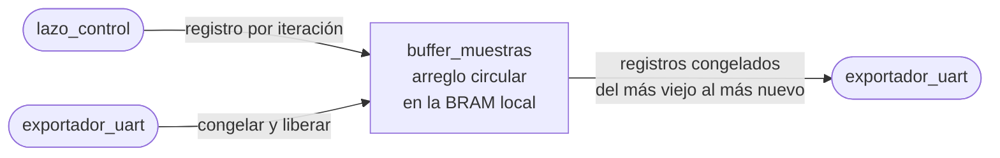

# buffer_muestras

## a) Nombre del módulo

`buffer_muestras`, en `sw/buffer_muestras.c` y `sw/buffer_muestras.h`. Es parte del software del MicroBlaze V del [nivel 3](../diagramas/nivel03.md).

## b) Diagrama modular

## c) Objetivo del módulo

Guarda el histórico de las últimas iteraciones del control en un arreglo circular dentro de la BRAM local, y lo mantiene quieto mientras se exporta.

## d) Entradas

- Un `registro_t` por iteración, desde [`lazo_control`](lazo_control.md).
- Las órdenes de congelar y liberar, desde [`exportador_uart`](exportador_uart.md).
- El índice del registro que se quiere leer, también desde `exportador_uart`.

## e) Salidas

- La cantidad de registros válidos del histórico congelado.
- El registro pedido, contado desde el más viejo.

## f) Explicación de la relación con otros módulos

Tiene un escritor y un lector en contextos distintos. `lazo_control` escribe desde la interrupción y `exportador_uart` lee desde el lazo principal. El reparto de variables sigue la regla del nivel 3, cada una tiene un solo escritor. La interrupción escribe el arreglo, `indice` y `llenos`, y el lazo principal escribe solo `congelado`. [`control_principal`](control_principal.md) lo inicia en el arranque.

## g) Explicación de funcionamiento

Con el buffer libre, cada `buffer_muestras_guardar` copia el registro en la posición `indice`, avanza `indice` y suma uno a `llenos` hasta que el arreglo se llena. Desde ahí cada registro nuevo pisa al más viejo.

Al congelar, `exportador_uart` sube `congelado`. Desde la siguiente interrupción `buffer_muestras_guardar` retorna sin escribir, pero el control sigue andando. Como el lazo principal no corre mientras corre la interrupción, cuando `exportador_uart` vuelve de congelar no hay ninguna escritura a medias. Desde ahí `indice` y `llenos` ya no cambian, y lo exportado es la ventana justo anterior al flanco de `BTN_EXPORTAR`.

Al liberar, `congelado` baja y la interrupción sigue escribiendo donde quedó. El histórico tiene entonces un hueco del tamaño de la exportación, que no importa porque la exportación siguiente vuelve a tomar solo la ventana más reciente.

## h) Diseño

### Registro de una iteración

Cada registro ocupa 6 bytes, tres palabras de 16 bits.

- `cuenta_banderas`, con la muestra cruda del ADC en `[11:0]` y cuatro banderas en `[15:12]`.
  - Bit 15, `saturado`, el PR tuvo que recortar la salida.
  - Bit 14, `dato_ausente`, en esta iteración no hubo muestra nueva y la cuenta es la anterior.
  - Bit 13, `habilitado`, el control estaba habilitado en esta iteración.
  - Bit 12, `falla`, la falla estaba activa.
- `duty_ref`, los 16 bits tal como se escribieron en el periférico PWM.
- `i_ref_ma`, la referencia de esa iteración en miliamperes, con signo. Con 1,0 A pico como máximo el rango cabe holgado en 16 bits.

La corriente se guarda como cuenta cruda y no en amperes. Así la calibración se puede rehacer fuera de línea si después se mide mejor el offset o la ganancia del sensor, y cabe junto con las banderas en una sola palabra. La cabecera de la exportación lleva la escala para convertirla.

La referencia sí se guarda ya calculada. Reconstruirla en la PC a partir de la fase exigiría saber en qué iteración se habilitó el control y en cuáles cambió `SW[1:0]`, y guardarla directo cuesta solo 2 bytes por registro.

### Tamaño del arreglo

`BUFFER_REGISTROS` es una potencia de dos, para que avanzar el índice sea `indice = (indice + 1) & (BUFFER_REGISTROS - 1)` y no haga falta una división ni una comparación. Queda provisional en 1024 registros, 6 KB de los 32 KB, marcado con `// TODO: Revisar` en `buffer_muestras.h`, hasta que se enlace el programa completo y se sepa cuánto sobra.

El tamaño también tiene que cubrir la ventana que piden los ensayos, al menos cinco períodos de 50 Hz, o sea 100 ms. Con `fs` la frecuencia de muestreo hacen falta `0,1 · fs` registros. Con 1024 alcanza solo si `fs` no pasa de 10,24 kHz. Si la frecuencia que se acuerde con PEDP es más alta y la memoria no da, la salida es guardar uno de cada `D` registros, y eso se decide cuando se conozca `fs`.

### Lectura del histórico congelado

El registro más viejo está en `indice` si el arreglo ya dio la vuelta, y en la posición 0 si todavía no. El registro `n`, contado desde el más viejo, está en

`(inicio + n) & (BUFFER_REGISTROS - 1)`

con `inicio = (llenos < BUFFER_REGISTROS) ? 0 : indice`.

`buffer_muestras_leer` solo es válido con el buffer congelado. Sin congelar, el registro que devuelve puede estar siendo pisado.

### Variables compartidas

`indice`, `llenos` y `congelado` son de 32 bits y `volatile`, igual que las del nivel 3. El arreglo no necesita `volatile`, porque el lazo principal solo lo lee con el buffer congelado, y para entonces la interrupción ya no lo toca.

### Interfaz en C

- `void buffer_muestras_iniciar(void)`, vacía el histórico y lo deja libre.
- `void buffer_muestras_guardar(const registro_t *registro)`, desde la interrupción.
- `void buffer_muestras_congelar(void)` y `void buffer_muestras_liberar(void)`, desde el lazo principal.
- `uint32_t buffer_muestras_cantidad(void)`, registros válidos del histórico congelado.
- `const registro_t *buffer_muestras_leer(uint32_t n)`, el registro `n` desde el más viejo.

### Prueba en la PC

`sw/pruebas/prueba_buffer_muestras.c` se compila con gcc y revisa el orden de lectura antes y después de dar la vuelta, que congelado no se escriba nada, que al liberar se siga desde donde quedó y el empaquetado de las banderas.

## i) Diagrama esquemático detallado del diseño

No aplica, el módulo es un arreglo y unas funciones en C dentro de la BRAM del MicroBlaze V, sin lógica propia que llevar a compuertas.

## j) Diagrama completo de conexiones eléctricas del diseño

No aplica, el módulo no tiene pines ni conexiones eléctricas, la BRAM que lo guarda ya está dentro de la FPGA.
