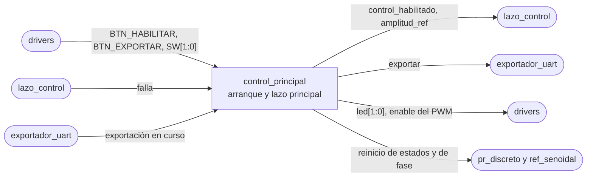

# control_principal

## a) Nombre del módulo

`control_principal`, en `sw/main.c`. Es el lazo principal del software del MicroBlaze V del [nivel 3](../diagramas/nivel03.md), fuera de la interrupción.

## b) Diagrama modular

## c) Objetivo del módulo

Arranca el sistema en un orden seguro y después atiende todo lo que no tiene plazo, los botones, los switches de amplitud, los LEDs y el pedido de exportación.

## d) Entradas

- `BTN_HABILITAR` y `BTN_EXPORTAR`, ya filtrados por el bloque 11 del nivel 2, leídos por [`drivers`](drivers.md) desde el AXI GPIO.
- `SW[1:0]`, la selección de la amplitud de la referencia, también por `drivers`.
- `falla`, desde [`lazo_control`](lazo_control.md).
- Si hay una exportación en curso, desde [`exportador_uart`](exportador_uart.md).

## e) Salidas

- `control_habilitado` y `amplitud_ref`, hacia `lazo_control`.
- El pedido de exportación, hacia `exportador_uart`.
- `led[1:0]`, `led[0]` para control habilitado y `led[1]` para falla, por `drivers`.
- `enable` del PWM, por `drivers`.
- El reinicio de estados de [`pr_discreto`](pr_discreto.md) y de fase de [`ref_senoidal`](ref_senoidal.md).

## f) Explicación de la relación con otros módulos

Es el dueño del arranque. Inicia todos los demás módulos y registra `lazo_control` en el AXI INTC. Después corre para siempre en el lazo principal junto con `exportador_uart`, al que llama en cada vuelta. Con la interrupción se comunica solo por las tres variables compartidas del nivel 3, y es el único escritor de `control_habilitado` y `amplitud_ref`.

## g) Explicación de funcionamiento

### Arranque

1. Deja el PWM con `enable` en cero y `freq_sel` en `FREQ_SEL_INICIAL`.
2. Configura el ADC, la UART y el GPIO, con los LEDs y la salida de depuración en cero.
3. Inicia `pr_discreto`, `ref_senoidal` con `PR_FRECUENCIA_MUESTREO_HZ`, `supervisor_falla` y `buffer_muestras`.
4. Deja `control_habilitado` en cero, `amplitud_ref` según `SW[1:0]` y `falla` en cero.
5. Registra `lazo_control` en el AXI INTC, programa el Timer con el período de muestreo y habilita la interrupción.

El Timer va al final para que la primera interrupción ya encuentre todo listo.

### Lazo principal

En cada vuelta, en este orden.

1. Lee los botones y los switches y saca los flancos de subida de los botones.
2. Actualiza `amplitud_ref` con `SW[1:0]`.
3. Si `falla` está en uno y el control seguía habilitado, baja `control_habilitado`.
4. Atiende un flanco de `BTN_HABILITAR`, si lo hay.
5. Atiende un flanco de `BTN_EXPORTAR`, si lo hay, con `exportador_uart_pedir`.
6. Llama a `exportador_uart_avanzar`.
7. Actualiza los LEDs.

Ningún paso espera a un periférico, así que una vuelta dura pocos microsegundos más lo que tarde la interrupción si cae en medio.

## h) Diseño

### Estados del control

| Estado | `control_habilitado` | `enable` | `led[0]` | `led[1]` |
| --- | --- | --- | --- | --- |
| deshabilitado | 0 | 0 | 0 | 0 |
| habilitado | 1 | 1 | 1 | 0 |
| falla | 0 | 0 | 0 | 1 |

| Estado | Evento | Acción | Siguiente |
| --- | --- | --- | --- |
| deshabilitado | flanco de `BTN_HABILITAR` | reinicia PR y fase, `control_habilitado = 1`, `enable = 1` | habilitado |
| habilitado | flanco de `BTN_HABILITAR` | `enable = 0`, `control_habilitado = 0` | deshabilitado |
| deshabilitado o habilitado | `falla = 1` | `control_habilitado = 0` | falla |
| falla | flanco de `BTN_HABILITAR` | nada | falla |
| falla | `BTN_RST` | reinicio de la plataforma | arranque |

No hace falta una variable de estado aparte, porque el estado queda determinado por `control_habilitado` y `falla`.

### Orden al habilitar y al deshabilitar

Al habilitar, primero reinicia los estados del PR y la fase de la referencia, después sube `control_habilitado` y por último `enable`. Mientras `control_habilitado` está en cero la interrupción no toca ni el PR ni la referencia, así que el reinicio no puede chocar con ella, y el primer `duty_ref` sale de un PR limpio y de una referencia que arranca en cero.

Al deshabilitar el orden se invierte. Primero baja `enable`, para que las compuertas se apaguen cuanto antes, y después `control_habilitado`. Si en medio cae una interrupción y escribe un `duty_ref` más, el periférico ya está apagado y no pasa nada.

La escritura de `enable` es una lectura, modificación y escritura del offset `0x00`, compartido con `freq_sel`, y la interrupción también lo escribe cuando declara falla. `drivers` la hace con las interrupciones deshabilitadas, para que una falla declarada en medio no quede pisada por un `enable` en uno.

### Amplitud de la referencia

| `SW[1:0]` | `amplitud_ref` |
| --- | --- |
| `00` | 0 A |
| `01` | 0,2 A pico |
| `10` | 0,5 A pico |
| `11` | 1,0 A pico |

Se lee en cada vuelta y se aplica aunque el control esté andando, que es lo que necesita el ensayo de cambio de amplitud. El código `00` sirve para habilitar el puente con corriente nula antes de subir a un punto de operación. Los switches son niveles que no se mueven durante un ensayo, así que se usa el valor directo y no se les saca flanco.

Los switches son `SW0` y `SW1` de la Basys 3. Todavía faltan en la entrada del nivel 1 y del bloque 11 del nivel 2.

### Detección de flancos

Se guarda la lectura de los botones de la vuelta anterior, y el flanco de subida es `actual & ~anterior`. El antirrebote ya viene resuelto por el bloque 11, así que una pulsación da un solo flanco. Como el lazo principal da miles de vueltas por segundo, no hay forma de perder una pulsación humana.

### Valores provisionales

- `FREQ_SEL_INICIAL`, el código de `freq_sel` con el que arranca el PWM. Depende de qué frecuencia vaya en cada código, que define Jefferson.
- El período del Timer en ciclos sale de `PR_FRECUENCIA_MUESTREO_HZ`. Con el AXI Timer contando hacia abajo y recarga automática, el período es `TLR + 2` ciclos, así que `TLR = 100 MHz / PR_FRECUENCIA_MUESTREO_HZ - 2`. Hay que verificar que la división dé exacta para la frecuencia que se acuerde.

## i) Diagrama esquemático detallado del diseño

No aplica, el módulo es el `main` en C del MicroBlaze V y no tiene compuertas propias.

## j) Diagrama completo de conexiones eléctricas del diseño

No aplica, el módulo no tiene pines propios, los botones, los switches y los LEDs llegan por el AXI GPIO y sus pines los fija el `basys3.xdc`.
