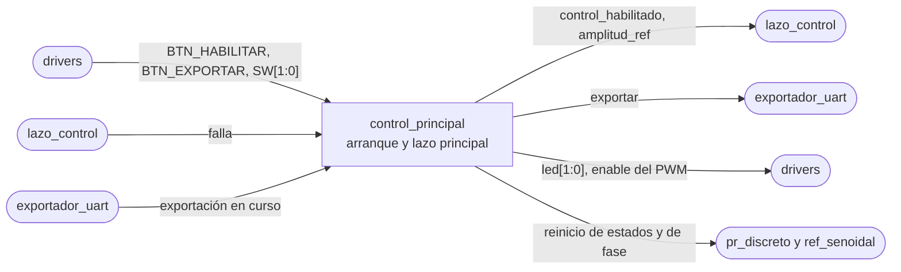

# control_principal

## a) Nombre del módulo

`control_principal`, en `sw/control_principal.c` y `sw/control_principal.h`, con un `sw/main.c` que solo lo llama (h.7). Es el lazo principal del software del MicroBlaze V del [nivel 3](../diagramas/nivel03.md), fuera de la interrupción.

## b) Diagrama modular

## c) Objetivo del módulo

Arranca el sistema en un orden seguro y después atiende todo lo que no tiene plazo, los botones, los switches de amplitud, los LEDs y el pedido de exportación.

## d) Entradas

- `BTN_HABILITAR` y `BTN_EXPORTAR`, ya filtrados por el bloque 10 del nivel 2, leídos por [`drivers`](drivers.md) desde el AXI GPIO.
- `SW[1:0]`, la selección de la amplitud de la referencia, también por `drivers`.
- `falla`, desde [`lazo_control`](lazo_control.md).
- Si hay una exportación en curso, desde [`exportador_uart`](exportador_uart.md).

## e) Salidas

- `control_habilitado` y `amplitud_ref`, hacia `lazo_control`.
- El pedido de exportación, hacia `exportador_uart`.
- `led[1:0]`, `led[0]` para control habilitado y `led[1]` para falla, por `drivers`.
- `enable` del PWM, por `drivers`.
- El reinicio de estados de [`pr_discreto`](pr_discreto.md) y de fase de [`ref_senoidal`](ref_senoidal.md).

## f) Explicación de la relación con otros módulos

Es el dueño del arranque. Inicia todos los demás módulos y registra `lazo_control` como manejador de la interrupción del procesador, que viene directo del AXI Timer. Después corre para siempre en el lazo principal junto con `exportador_uart`, al que llama en cada vuelta. Con la interrupción se comunica solo por las tres variables compartidas del nivel 3, y es el único escritor de `control_habilitado` y `amplitud_ref`.

## g) Explicación de funcionamiento

### g.1) Arranque

1. Deja el PWM con `enable = 0` y `freq_sel = FREQ_SEL_INICIAL`.
2. Pone el XADC en disparo por PWM y deja los LEDs y la salida de depuración en cero. La UART y el GPIO no se configuran por software, porque el [Block Design](block_design.md) fija los 115200 baudios de la UART Lite y la dirección de cada canal del GPIO dentro de cada IP.
3. Inicia `pr_discreto`, `ref_senoidal` con `PR_FRECUENCIA_MUESTREO_HZ`, `supervisor_falla` y `buffer_muestras`.
4. Inicializa las variables compartidas y prepara el Timer detenido. Registra el manejador de interrupción antes de arrancar el Timer.
5. Alinea el Timer con una publicación del XADC según h.6. Si vence el tiempo límite, conserva `enable = 0`, indica error de arranque con el LED de falla y bloquea la habilitación hasta `BTN_RST`.

### g.2) Lazo principal

En cada vuelta, en este orden.

1. Lee los botones y los switches y saca los flancos de subida de los botones.
2. Actualiza `amplitud_ref` con `SW[1:0]`.
3. Si `falla` está en uno y el control seguía habilitado, baja `control_habilitado`.
4. Atiende un flanco de `BTN_HABILITAR`, si lo hay.
5. Atiende un flanco de `BTN_EXPORTAR`, si lo hay, con `exportador_uart_pedir`.
6. Llama a `exportador_uart_avanzar`.
7. Actualiza los LEDs.

Ningún paso espera a un periférico, así que una vuelta dura pocos microsegundos más lo que tarde la interrupción si cae en medio.

## h) Diseño

### h.1) Estados del control

| Estado | `control_habilitado` | `enable` | `led[0]` | `led[1]` |
| --- | --- | --- | --- | --- |
| deshabilitado | 0 | 0 | 0 | 0 |
| habilitado | 1 | 1 | 1 | 0 |
| falla o error de arranque | 0 | 0 | 0 | 1 |

| Estado | Evento | Acción | Siguiente |
| --- | --- | --- | --- |
| deshabilitado | flanco de `BTN_HABILITAR`, arranque correcto, `freq_sel = 01` y `falla = 0` | reinicia PR y fase, vuelve a comprobar `falla` en la sección crítica y habilita si sigue en cero | habilitado si se confirma la escritura |
| deshabilitado | flanco de `BTN_HABILITAR` con `freq_sel` distinto de `01` | nada | deshabilitado |
| habilitado | flanco de `BTN_HABILITAR` | `enable = 0`, `control_habilitado = 0` | deshabilitado |
| deshabilitado o habilitado | `falla = 1` | `control_habilitado = 0` | falla |
| falla o error de arranque | flanco de `BTN_HABILITAR` | ignora la solicitud | falla o error de arranque |
| falla o error de arranque | `BTN_RST` | reinicio de la plataforma | arranque |

El lazo principal determina el estado a partir de `control_habilitado`, `falla` y el resultado local de la sincronización de arranque.

### h.2) Orden al habilitar y al deshabilitar

Al habilitar, reinicia el PR y la fase mientras `control_habilitado` permanece en cero. Luego guarda el estado previo de las interrupciones y las enmascara. Dentro de la misma sección crítica vuelve a leer `falla` y, si vale cero y el arranque fue correcto, escribe `enable = 1` preservando `freq_sel` y publica `control_habilitado = 1`. En cualquier salida restaura el estado previo de las interrupciones. Si la ISR enclavó una falla antes de entrar a la sección crítica, la habilitación se rechaza.

Al deshabilitar por botón, baja `enable` y `control_habilitado` en una sección crítica. El núcleo aplica el apagado en el siguiente valle que capture la orden. El lazo principal y la ISR comparten la escritura del offset `0x00`, por lo que las funciones de acceso de [drivers](drivers.md#h1-periférico-pwm) preservan `freq_sel`.

### h.3) Amplitud de la referencia

| `SW[1:0]` | `amplitud_ref` |
| --- | --- |
| `00` | 0 A |
| `01` | 0,2 A pico |
| `10` | 0,5 A pico |
| `11` | 1,0 A pico |

Se lee en cada vuelta y se aplica aunque el control esté andando, que es lo que necesita el ensayo de cambio de amplitud. El código `00` sirve para habilitar el puente con corriente nula antes de subir a un punto de operación. Los switches son niveles que no se mueven durante un ensayo, así que se usa el valor directo y no se les saca flanco.

Los switches son `SW0` y `SW1` de la Basys 3.

### h.4) Detección de flancos

Se guarda la lectura de los botones de la vuelta anterior, y el flanco de subida es `actual & ~anterior`. El antirrebote ya viene resuelto por el bloque 10, así que una pulsación da un solo flanco. Como el lazo principal da miles de vueltas por segundo, no hay forma de perder una pulsación humana.

### h.5) Cambio de `freq_sel`

El lazo cerrado corre solo a 20 kHz, que es `freq_sel = 01`, y el Timer no cambia con `freq_sel`. Las otras frecuencias de la tabla de `nucleo_pwm.md` (10 kHz en `00`, 40 kHz en `10`, y `11` que satura a 20 kHz) sirven para mostrar el PWM y para el testbench, con el control deshabilitado. Por eso dos reglas.

- En el firmware de control se escribe `freq_sel` durante el arranque, con `enable = 0` y el Timer detenido. Si se cambia la frecuencia de operación, se vuelve a configurar y alinear el Timer antes de permitir el lazo cerrado.
- El flanco de `BTN_HABILITAR` solo habilita si `freq_sel` vale `01`. El código `11` también termina en 20 kHz, pero se exige `01` exacto para que lo que se lee en el registro sea lo que corre. Se lee del periférico con `drivers_pwm_freq_sel()` y no de una copia en memoria, así la comprobación también confirma que la escritura del arranque llegó.

### h.6) Sincronización del arranque

- `FREQ_SEL_INICIAL = 01` corresponde a 20 kHz y coincide con `PR_FRECUENCIA_MUESTREO_HZ`. El PWM usa `2 · MAX = 5000` ciclos por período. El Timer cuenta hacia abajo con recarga automática. A 100 MHz se carga `TLR = 5000 - 2 = 4998`, para un período de 50 µs.
- Con el PWM deshabilitado, el XADC sigue recibiendo `pwm_trigger_o`. Dejar estabilizar la selección nominal, incluido el primer período interno tras reset. Después observar un avance nuevo del contador del XADC con sondeo acotado. El valor observado queda como base para la primera ISR.
- Desde esa observación, aplicar un margen de arranque y habilitar el contador ya preparado. El margen se elige y documenta en integración teniendo en cuenta la latencia del sondeo, la publicación del XADC, el acceso al Timer y la entrada a la ISR. Si vence el tiempo límite del sondeo, el Timer de control queda detenido y se indica error de arranque. El sondeo ocurre solo durante la inicialización.
- En el código, el sondeo usa `drivers_adc_dato_nuevo`, que es la misma función que la ISR, así el contador que queda guardado en `drivers` es la base de la primera iteración. Una primera lectura toma el contador actual. El primer avance que aparece después se descarta, porque puede venir de un período que empezó antes de escribir `freq_sel`, y el segundo es la observación. Cada espera se corta a las `SONDEO_MAX_LECTURAS` lecturas, provisional en 100000. Cada lectura AXI con su comparación lleva al menos unos 10 ciclos, así que el tope es de al menos 10 ms, unos 200 períodos a 20 kHz. Con el Timer detenido no hay ISR que compita por ese contador.
- El margen es una espera activa de `MARGEN_ARRANQUE_VUELTAS` vueltas de un lazo con un contador `volatile`, provisional en 40, del orden de 2 µs. Con la ISR estimada en 15 a 25 µs sin FPU (`lazo_control.md` h.7), arrancar unos 2 µs después de la publicación deja más de la mitad del período libre antes del siguiente valle. El tiempo real de la espera y la fase resultante se miden con la salida de depuración, y de ahí sale el valor definitivo.
- Verificar que, en cada ciclo, la lectura de la ISR reciba la muestra publicada después del valle correspondiente y que la primera etapa del PWM capture `duty_ref` con al menos dos ciclos más el margen de integración antes del siguiente valle. Medir la fase y el jitter tras varios reinicios, con y sin exportación UART, según el [plan de verificación](../plan_verificacion_pwm.md).

### h.7) Interfaz en C

- `void control_principal_arrancar(void)`, la secuencia de g.1.
- `void control_principal_vuelta(void)`, una vuelta de g.2, sin esperar a nada.
- `sw/main.c` llama a `control_principal_arrancar` una vez y a `control_principal_vuelta` en un lazo infinito. Está separado para que la prueba en la PC pueda tener su propio `main` y llamar a las dos funciones.

En `control_principal.h` quedan `FREQ_SEL_INICIAL`, `RELOJ_HZ` (100 MHz), `TIMER_TLR` calculado como `RELOJ_HZ / PR_FRECUENCIA_MUESTREO_HZ - 2`, para que siga a la frecuencia de muestreo si cambia, `SONDEO_MAX_LECTURAS` y `MARGEN_ARRANQUE_VUELTAS`.

Es el único escritor de `control_habilitado` y `amplitud_ref` y solo lee `falla`. Cada una es de 32 bits y `volatile`, así que escribir `amplitud_ref` en cada vuelta no necesita sección crítica. Las únicas secciones críticas son las de h.2, porque ahí `enable` y `control_habilitado` tienen que cambiar juntos respecto de la ISR. Las barreras de `drivers_interrupciones_guardar_y_deshabilitar` y `drivers_interrupciones_restaurar` hacen que el reinicio del PR y de la fase quede escrito antes de publicar `control_habilitado`. La lectura anterior de los botones y el resultado del arranque son `static` sin `volatile`, porque solo los toca el lazo principal.

### h.8) Prueba en la PC

`sw/pruebas/prueba_control_principal.c` se compila con gcc junto con los demás módulos reales y define sus propias funciones de `drivers`, que escriben en variables y simulan el contador del XADC, `freq_sel` y los botones. La ISR no corre, y la falla se simula escribiendo `falla`. Revisa que el Timer arranque solo después del segundo avance del contador y que con el sondeo vencido quede detenido, con el LED de falla y la habilitación bloqueada. También revisa que la habilitación se rechace con `falla` o con `freq_sel` distinto de `01`, que `enable` y `control_habilitado` cambien dentro de una sección crítica, que la falla baje `control_habilitado` y encienda `led[1]`, la amplitud de cada código de `SW[1:0]`, que un botón sostenido dé un solo flanco y que `BTN_EXPORTAR` arranque la exportación.

## i) Diagrama esquemático detallado del diseño

No aplica, el módulo es el `main` en C del MicroBlaze V y no tiene compuertas propias.

## j) Diagrama completo de conexiones eléctricas del diseño

No aplica, el módulo no tiene pines propios, los botones, los switches y los LEDs llegan por el AXI GPIO y sus pines los fija el `basys3.xdc`.
