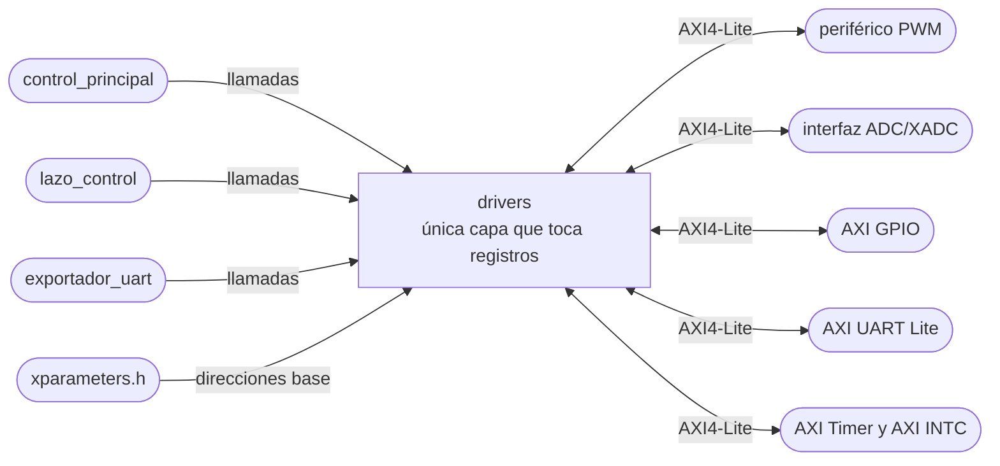

# drivers

## a) Nombre del módulo

`drivers`, en `sw/drivers.c` y `sw/drivers.h`. Es la capa de acceso a periféricos del software del MicroBlaze V del [nivel 3](../diagramas/nivel03.md).

## b) Diagrama modular

## c) Objetivo del módulo

Concentra todos los accesos a registros de periféricos, de modo que ningún otro módulo conozca una dirección, un offset o un bit de un registro.

## d) Entradas

- Las llamadas de [`control_principal`](control_principal.md), [`lazo_control`](lazo_control.md) y [`exportador_uart`](exportador_uart.md).
- Las direcciones base de `xparameters.h`, que Vitis genera a partir del `.xsa` y del Address Editor.
- Las lecturas por AXI4-Lite de cada periférico.

## e) Salidas

- Las escrituras por AXI4-Lite al PWM, al ADC, al GPIO, a la UART, al Timer y al INTC.
- Los datos y estados leídos, hacia el módulo que llamó.

## f) Explicación de la relación con otros módulos

Lo usan los dos contextos de ejecución. `control_principal` lo usa para arrancar y para los botones, los switches, los LEDs y `enable`. `lazo_control` lo usa para el ADC, `duty_ref`, el reconocimiento del Timer, el apagado ante falla y la salida de depuración. `exportador_uart` lo usa solo para mandar bytes. Ninguna función que use la interrupción espera a un periférico.

## g) Explicación de funcionamiento

Para el Timer, el INTC, el GPIO y la UART Lite se apoya en los drivers de Xilinx que genera Vitis (`XTmrCtr`, `XIntc`, `XGpio`, `XUartLite`) para la inicialización, y en sus macros de acceso a registros para lo que corre en la interrupción. Para el PWM y la interfaz del ADC, que son propios, son funciones cortas sobre `Xil_In32` y `Xil_Out32` con los offsets de cada mapa de registros.

En el flujo de Vitis 2025.1 los drivers de Xilinx se inicializan con la dirección base del periférico y no con un número de dispositivo. Los nombres exactos de las macros de `xparameters.h` se toman del archivo generado cuando esté el `.xsa`.

## h) Diseño

### Periférico PWM

Mapa de la sección 4.2.3 del enunciado.

- Offset `0x00`, control y estado. Bit 0 `enable`, bits `[2:1]` `freq_sel`, bit 3 `running` de solo lectura.
- Offset `0x04`, `duty_ref` en `[15:0]`.

Funciones.

- `void drivers_pwm_configurar(uint32_t freq_sel)`, escribe `freq_sel` con `enable` en cero. Solo en el arranque.
- `void drivers_pwm_habilitar(bool habilitar)`, desde el lazo principal. Lee el offset `0x00`, cambia el bit 0 y lo escribe, con las interrupciones deshabilitadas durante esas tres operaciones.
- `void drivers_pwm_apagar(void)`, desde la interrupción ante falla. La misma lectura, modificación y escritura, sin deshabilitar nada porque la interrupción no se interrumpe.
- `void drivers_pwm_escribir_duty(uint16_t duty_ref)`, una escritura al offset `0x04`.
- `bool drivers_pwm_running(void)`, lee el bit 3.

Hacen falta dos versiones del apagado porque la del lazo principal tiene que protegerse de la interrupción y la de la interrupción no puede tocar la habilitación global de interrupciones, ya que al salir la volvería a dejar en uno a destiempo.

### Interfaz ADC/XADC

Su mapa de registros lo define Nicolás y todavía no está. Las funciones que necesita el resto del programa sí se pueden fijar.

- `bool drivers_adc_dato_nuevo(void)`, la bandera de dato nuevo.
- `uint16_t drivers_adc_leer(void)`, la cuenta de 12 bits, de 0 a 4095, y que la lectura baje la bandera o que la baje una escritura aparte depende de cómo quede la interfaz.
- `void drivers_adc_iniciar_por_software(void)`, para diagnóstico en el arranque.
- `void drivers_adc_configurar(void)`, deja la conversión disparada por `pwm_trigger_o`.

Si el XADC entrega el resultado alineado a la izquierda en 16 bits, como hace su registro de estado, el corrimiento a 12 bits se hace acá y no en `lazo_control`.

### AXI GPIO

Se necesitan tres grupos de señales que no pueden compartir registro de salida, por la regla de `lazo_control`.

- Entradas, `BTN_HABILITAR` en el bit 0, `BTN_EXPORTAR` en el 1 y `SW[1:0]` en los bits 3 y 2.
- LEDs, `led[1:0]`, que escribe solo el lazo principal.
- Salida de depuración, un bit que escribe solo la interrupción.

La propuesta es una instancia de AXI GPIO de dos canales, el canal 1 como entradas y el canal 2 como LEDs, y una segunda instancia de un canal para la salida de depuración. Así cada registro de datos tiene un solo escritor. Queda por confirmar con Nicolás en el Block Design.

- `uint32_t drivers_gpio_entradas(void)`, los cuatro bits de entrada.
- `void drivers_gpio_leds(uint32_t leds)`.
- `void drivers_depuracion(bool nivel)`, una escritura al registro de datos de la segunda instancia, sin leer antes.

### AXI UART Lite

- `bool drivers_uart_enviar(uint8_t byte)`. Lee el registro de estado y, si el bit de FIFO de transmisión llena está en cero, escribe el byte en el registro de transmisión y devuelve uno. Si la FIFO está llena devuelve cero sin escribir. No se usa `XUartLite_SendByte` porque espera activamente a que haya espacio.

La recepción no se usa, igual que en el nivel 2.

### AXI Timer y AXI INTC

- `void drivers_timer_iniciar(uint32_t tlr)`, deja el contador 0 en modo de generación, contando hacia abajo, con recarga automática y con la interrupción habilitada, y lo arranca. El período queda en `tlr + 2` ciclos de 100 MHz.
- `void drivers_timer_reconocer(void)`, escribe uno en el bit de interrupción del registro de control y estado del contador 0, que es como el AXI Timer limpia la interrupción, sin tocar los demás bits.
- `void drivers_interrupciones_iniciar(void (*rutina)(void *))`, inicia el INTC, conecta la rutina a la entrada del Timer, arranca el INTC en modo real y habilita las excepciones del procesador.
- `void drivers_interrupciones_deshabilitar(void)` y `void drivers_interrupciones_habilitar(void)`, para las secciones protegidas del lazo principal.

### Prueba en la PC

Las funciones de `drivers` son las únicas que no se pueden compilar en la PC. Para probar con gcc los demás módulos, cada prueba define su propia versión de las funciones de `drivers` que necesita, que escriben en variables en vez de en registros. Así `drivers.h` es la frontera entre lo que se prueba en la PC y lo que solo corre en la placa.

## i) Diagrama esquemático detallado del diseño

No aplica, el módulo son funciones en C que leen y escriben registros, y la lógica de cada periférico está en su propio diseño o en la IP de Xilinx.

## j) Diagrama completo de conexiones eléctricas del diseño

No aplica, las conexiones eléctricas de los periféricos las fijan el Block Design y el `basys3.xdc`, el módulo solo usa sus direcciones.
