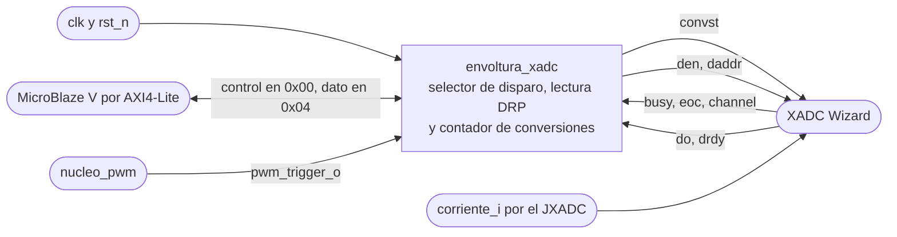
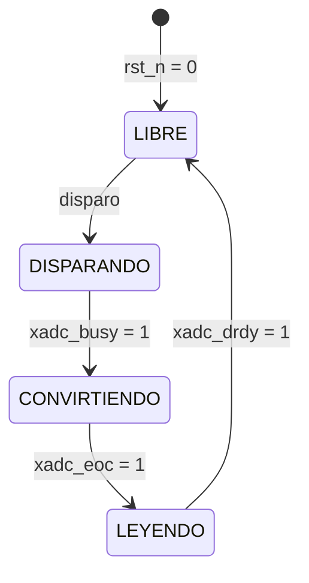
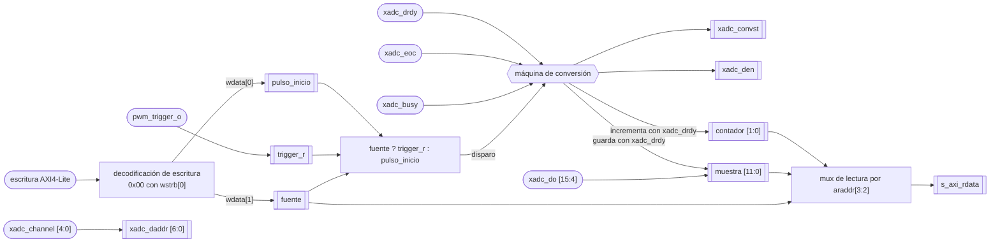
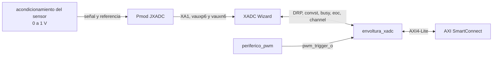

# envoltura_xadc

## a) Nombre del módulo

`envoltura_xadc`, en `src/design/envoltura_xadc.sv`. Es la envoltura AXI4-Lite propia del bloque 7 del [nivel 2](../diagramas/nivel02.md), y en el [nivel 3](../diagramas/nivel03.md) va como instancia del Block Design junto a un XADC Wizard sin interfaz AXI.

## b) Diagrama modular



## c) Objetivo del módulo

Arranca la conversión de `corriente_i` en el XADC con `pwm_trigger_o` o por software, según lo que elija el software, y le entrega al MicroBlaze V por AXI4-Lite la muestra junto con un contador de conversiones que le dice si hay dato nuevo.

## d) Entradas

- `clk`, `logic`, reloj del sistema de 100 MHz, el mismo del bus AXI y del `DCLK` del wizard.
- `rst_n`, `logic`, reinicio activo en bajo, el `peripheral_aresetn` del Processor System Reset.
- `pwm_trigger_o`, `logic`, pulso de un ciclo en el valle de la portadora, desde [`nucleo_pwm`](nucleo_pwm.md).
- Canal de escritura AXI4-Lite, `s_axi_awaddr[3:0]`, `s_axi_awvalid`, `s_axi_wdata[31:0]`, `s_axi_wstrb[3:0]`, `s_axi_wvalid` y `s_axi_bready`.
- Canal de lectura AXI4-Lite, `s_axi_araddr[3:0]`, `s_axi_arvalid` y `s_axi_rready`.
- `xadc_busy`, `logic`, el `busy_out` del wizard, en alto mientras convierte [2, p. 13].
- `xadc_eoc`, `logic`, el `eoc_out` del wizard, en alto cuando el resultado ya está en el registro de estado [2, p. 13].
- `xadc_channel[4:0]`, el `channel_out` del wizard, el canal de la conversión que terminó [2, p. 13].
- `xadc_do[15:0]` y `xadc_drdy`, el dato y la confirmación de una lectura por el DRP [2, p. 12].

## e) Salidas

- Respuestas AXI4-Lite, `s_axi_awready`, `s_axi_wready`, `s_axi_bresp[1:0]`, `s_axi_bvalid`, `s_axi_arready`, `s_axi_rdata[31:0]`, `s_axi_rresp[1:0]` y `s_axi_rvalid`.
- `xadc_convst`, `logic`, hacia el `convst_in` del wizard. Su flanco de subida fija el instante de muestreo [1, Event-Driven Sampling].
- `xadc_den`, `logic`, y `xadc_daddr[6:0]`, hacia `den_in` y `daddr_in` del wizard para leer el registro de estado [2, p. 12].
- `xadc_dwe` y `xadc_di[15:0]`, fijos en cero, porque la envoltura solo lee por el DRP.

Todas las salidas hacia el wizard salen de flip-flops.

## f) Explicación de la relación con otros módulos

La envoltura vive entre el XADC Wizard y la interconexión AXI. Del lado del wizard es maestra del DRP y dueña de `convst_in`, y el wizard queda configurado en modo por eventos, canal único y sin interfaz AXI (bloque 7 de `nivel03.md`). Como el wizard recibe el mismo reloj de 100 MHz en `dclk_in`, sus señales de estado llegan en el dominio de la envoltura y no hacen falta sincronizadores.

De [`nucleo_pwm`](nucleo_pwm.md) recibe `pwm_trigger_o`, que pulsa en cada valle desde el reinicio, con el puente encendido o apagado. La envoltura decide si le hace caso según el bit de fuente.

Del lado del software, [`drivers`](drivers.md) es el único que toca los dos registros. [`control_principal`](control_principal.md) pone la fuente en `pwm_trigger_o` durante el arranque, antes de habilitar el control. En cada interrupción, [`lazo_control`](lazo_control.md) lee el registro de dato una vez y saca de esa lectura la muestra y el contador. [`supervisor_falla`](supervisor_falla.md) cuenta las iteraciones en que el contador no cambió, contra `ITERACIONES_SIN_DATO_MAX`.

La señal analógica viene del acondicionamiento del sensor que diseña Jefferson, de 0 a 1 V, como fija el bloque 7 del [nivel 2](../diagramas/nivel02.md).

## g) Explicación de funcionamiento

La envoltura atiende una conversión a la vez. Mientras está libre, espera un disparo de la fuente que eligió el software. El bit 1 del registro de control vale 0 para el software y 1 para `pwm_trigger_o`, y la fuente que no está elegida se ignora. Así, con el lazo corriendo, un inicio por software de más no puede mover el instante de muestreo, y en el arranque, con la fuente en software, el valle no pisa la conversión que pidió el programa.

Con el disparo, la envoltura sube `xadc_convst`. El flanco de subida fija el instante de muestreo, y la conversión arranca en el siguiente flanco del reloj del ADC [1, Event-Driven Sampling]. Cuando termina, el wizard da un pulso en `xadc_eoc`, y la envoltura lee el registro de estado del canal por el DRP. Con el dato de vuelta, guarda los 12 bits de la muestra, incrementa el contador de conversiones y queda libre otra vez.

Un disparo que llega mientras hay una conversión en curso se ignora. Desde `pwm_trigger_o` eso no pasa, porque el período más corto de la tabla de `freq_sel` es de 25 µs y una conversión dura cerca de 1 µs (h.6). Solo puede pasar desde el software, y al software el instante no le importa. La regla para el software es esperar a que cambie el contador antes de pedir otra conversión.

El software sabe que hay dato nuevo comparando el contador con el de su lectura anterior. El contador no se borra nunca, así que leer el registro no cambia nada y el software no tiene que escribir para reconocer el dato (h.3).

## h) Diseño

Toda la lógica corre en el flanco de subida de `clk` con reinicio síncrono, igual que [`nucleo_pwm`](nucleo_pwm.md) [6].

### h.1) Mapa de registros

- `0x00`, control.
  - Bit 0, `inicio`, escritura. Escribir 1 pide una conversión por software. El bit se borra solo al ciclo siguiente y una lectura siempre devuelve 0. Se ignora si `fuente` vale 1 o si hay una conversión en curso.
  - Bit 1, `fuente`, lectura y escritura. 0 dispara el software y 1 dispara `pwm_trigger_o`. Vale 0 después del reinicio.
  - `[31:2]` reservados, se leen en 0.
- `0x04`, dato, solo lectura.
  - `[11:0]`, `muestra`, la cuenta del ADC de 0 a 4095, alineada a la derecha.
  - `[13:12]`, `contador`, conversiones terminadas módulo 4. Vale 0 después del reinicio.
  - `[31:14]` reservados, se leen en 0.

Una escritura a `0x04` o a una dirección sin registro no hace nada y responde `OKAY`. Una lectura de una dirección sin registro devuelve 0. Los dos campos de control están en el byte 0, así que una escritura a `0x00` solo surte efecto si `s_axi_wstrb[0]` vale 1.

`inicio` es autolimpiante porque un registro guarda lo que se le escribe. Si el bit quedara en 1 y `CONVST` saliera de su nivel, las conversiones se sucederían sin parar. Si saliera de un detector de flancos, el segundo pedido no tendría flanco y se perdería, salvo que el software escribiera un 0 antes.

`fuente` arranca en 0 para que la envoltura no convierta en cada valle antes de que el software la configure, igual que `enable` del PWM arranca en 0. Así, la primera muestra que ve `lazo_control` viene de una conversión pedida después de configurar.

### h.2) Interfaz AXI4-Lite

Los nombres siguen la convención `s_axi_*` para que Vivado infiera la interfaz al empaquetar la IP. La dirección tiene 4 bits y se decodifica con `s_axi_awaddr[3:2]` y `s_axi_araddr[3:2]`. Las respuestas son siempre `OKAY` (`2'b00`).

- Escritura. `s_axi_awready` y `s_axi_wready` suben juntos durante un ciclo cuando `s_axi_awvalid` y `s_axi_wvalid` están en 1 y no hay una respuesta pendiente. El esclavo puede esperar las dos validaciones antes de dar cualquiera de los dos `ready`, y el maestro puede presentarlas en cualquier orden [5]. `s_axi_bvalid` sube al ciclo siguiente y se sostiene hasta `s_axi_bready`.
- Lectura. `s_axi_arready` sube durante un ciclo con `s_axi_arvalid` y sin un dato pendiente. `s_axi_rdata` se carga en ese mismo ciclo y `s_axi_rvalid` se sostiene hasta `s_axi_rready`.

El registro de dato se lee con su valor del ciclo en que se acepta la dirección. La muestra y el contador se actualizan en el mismo ciclo (h.5), así que una lectura nunca trae la muestra de una conversión con el contador de otra.

### h.3) Contador de conversiones

La disponibilidad de dato nuevo que pide el instructivo [3, p. 5] se informa con un contador de 2 bits en lugar de una bandera. Una bandera necesita que alguien la baje, y las dos formas de bajarla fallan en este sistema.

- Si baja al leer el registro, la baja cualquier lectura, también la del depurador de Vitis cuando muestra la memoria. `lazo_control` encuentra la bandera en 0 y cuenta una iteración sin dato.
- Si baja con una escritura del software, una conversión que termina entre la lectura y la escritura pierde su bandera. El desfase entre la interrupción del Timer y el valle es fijo, pero depende del orden de arranque ([`control_principal`](control_principal.md), h), así que en un encendido que caiga en esa ventana se pierden las banderas de todas las iteraciones y `supervisor_falla` declara falla.

El contador no se borra. `drivers` guarda el valor de la lectura anterior y hay dato nuevo si cambió. La resta módulo 4 entre las dos lecturas da cuántas conversiones terminaron. Con 2 bits se distinguen hasta 3 conversiones entre dos lecturas, y en la tabla de `freq_sel` con el Timer a 20 kHz la resta da 0 o 1 a 10 kHz, 1 a 20 kHz y 2 a 40 kHz. Si `drivers` arranca su valor anterior en 0, la primera conversión ya se ve como nueva sin ningún paso extra.

### h.4) Selección del disparo

El disparo de cada ciclo es `fuente ? pwm_trigger_o : pulso_inicio`, donde `pulso_inicio` es el 1 que dejó una escritura de `inicio` en el ciclo anterior. Solo se atiende con la máquina en `LIBRE` (h.5).

`pwm_trigger_o` pasa por un flip-flop antes de la máquina, así que el flanco de `xadc_convst` sale dos ciclos después del valle de la portadora, 20 ns. La corriente conmuta más tarde que la portadora, porque la cadena de compuertas atrasa las cuatro señales entre 0,1 y 0,91 µs (`potencia/diseno_puente_h.md`, secciones de aislamiento y de tiempo muerto). Vista desde la corriente, la captura cae antes de su valle, entre 0,1 y 0,91 µs. Cerca del valle el rizado casi no tiene pendiente, y la simulación del lazo de `potencia/diseno_pr.md` (sección de aliasing, en `feature/pr-discreto`) da un error de amplitud de la fundamental de −0,01 % con 0,1 µs y de −0,17 % con 0,91 µs, igual con 1,0 A que con 0,2 A pico. Eso queda unas 60 veces por debajo del 10 % del instructivo, así que la envoltura no lleva retardo antes de `CONVST`.

### h.5) Máquina de conversión



- `LIBRE`, `xadc_convst` en 0. Atiende el disparo de h.4 si `xadc_busy` está en 0. Con `xadc_busy` en 1 el XADC está ocupado, por ejemplo calibrando al salir del reinicio [2, p. 13], y un disparo en ese momento dejaría a la máquina esperando un `xadc_eoc` que no corresponde a ningún `CONVST` propio. El disparo se ignora igual que uno que llega durante una conversión.
- `DISPARANDO`, `xadc_convst` en 1. Se sostiene hasta que `xadc_busy` sube, que según UG480 pasa en el flanco de `DCLK` siguiente al instante de muestreo [1, Event-Driven Sampling]. Así el ancho del pulso no depende de un mínimo que haya que adivinar.
- `CONVIRTIENDO`, `xadc_convst` en 0. Espera el pulso de `xadc_eoc`. En ese ciclo `xadc_den` sube durante un ciclo con `xadc_daddr = {2'b00, xadc_channel}` y `xadc_dwe` en 0, que es una lectura [1, DRP Timing].
- `LEYENDO`, espera `xadc_drdy`. En ese ciclo guarda `muestra <= xadc_do[15:4]` y `contador <= contador + 1`, y vuelve a `LIBRE`.

La dirección del DRP sale de `xadc_channel` porque el resultado de cada canal queda en el registro de estado con la misma dirección que su número de canal [1, Status Registers]. Para la entrada auxiliar n son el canal 16 + n y la dirección `10h + n` [1, Tabla 3-1 y Tabla 3-7]. Así la envoltura no lleva el canal del JXADC como parámetro, y el canal se elige solo en la configuración del wizard.

El desplazamiento de 4 bits es porque el resultado de 12 bits ocupa los 12 bits altos del registro de estado de 16 bits [1, Status Registers] [2, p. 18]. Los 4 bits bajos se descartan.

En la máquina no hay espera fija ni contador de tiempo. Cada paso avanza con una señal del wizard, así que el diseño no cambia si cambia el divisor del reloj del ADC. La contra es que si el wizard queda mal configurado y `xadc_busy` o `xadc_eoc` nunca suben, la máquina se queda esperando y el contador deja de avanzar, y eso lo detecta `supervisor_falla` como falta de dato.

### h.6) Temporización

El reloj del ADC sale de dividir `DCLK` por el valor del registro de configuración 2, con un mínimo de 2 [1, Control Registers, Tabla 3-12]. Una conversión y su asentamiento llevan 26 ciclos del reloj del ADC, lo que fija su máximo en 26 MHz [1, Analog Inputs], dentro del rango de 1 a 26 MHz de la familia [7, Tabla 65, p. 57]. Con `DCLK` de 100 MHz el divisor tiene que ser 4 o más, y se usa 4, que da un reloj del ADC de 25 MHz. Es el menor divisor válido, así que deja la conversión más corta posible y acerca el dato al valle. Un divisor mayor no mejora el muestreo, porque en modo por eventos la entrada se adquiere desde que arranca la conversión anterior hasta el siguiente `CONVST` [1, Event-Driven Sampling], y eso son decenas de microsegundos con cualquier frecuencia de la tabla. El divisor es un parámetro del wizard en el Block Design.

Con divisor `D`, desde el valle hasta que el dato está en el registro pasa lo siguiente, en ciclos de `clk` de 10 ns.

- 2 ciclos hasta el flanco de `xadc_convst` (h.4).
- Hasta `D` ciclos hasta el siguiente flanco del reloj del ADC, donde arranca la conversión.
- 22·`D` ciclos de conversión [1, Continuous Sampling].
- 16 ciclos desde que `xadc_busy` baja hasta el pulso de `xadc_eoc` [1, Event-Driven Sampling].
- Los ciclos que tarde `xadc_drdy` en la lectura DRP, más uno para guardar.

Con `D = 4` son unos 110 ciclos, cerca de 1,1 µs, que es el orden que supone `control_principal.md` para ubicar la interrupción después de la conversión.

### h.7) Interfaz en SystemVerilog

```systemverilog
module envoltura_xadc (
    input  logic        clk,
    input  logic        rst_n,
    // Disparo del valle desde nucleo_pwm
    input  logic        pwm_trigger_o,
    // Esclavo AXI4-Lite
    input  logic [3:0]  s_axi_awaddr,
    input  logic        s_axi_awvalid,
    output logic        s_axi_awready,
    input  logic [31:0] s_axi_wdata,
    input  logic [3:0]  s_axi_wstrb,
    input  logic        s_axi_wvalid,
    output logic        s_axi_wready,
    output logic [1:0]  s_axi_bresp,
    output logic        s_axi_bvalid,
    input  logic        s_axi_bready,
    input  logic [3:0]  s_axi_araddr,
    input  logic        s_axi_arvalid,
    output logic        s_axi_arready,
    output logic [31:0] s_axi_rdata,
    output logic [1:0]  s_axi_rresp,
    output logic        s_axi_rvalid,
    input  logic        s_axi_rready,
    // Hacia el XADC Wizard
    output logic        xadc_convst,
    output logic        xadc_den,
    output logic        xadc_dwe,
    output logic [6:0]  xadc_daddr,
    output logic [15:0] xadc_di,
    input  logic [15:0] xadc_do,
    input  logic        xadc_drdy,
    input  logic        xadc_busy,
    input  logic        xadc_eoc,
    input  logic [4:0]  xadc_channel
);
```

## i) Diagrama esquemático detallado del diseño

Los registros van con `[[ ]]`, la lógica combinacional con `[ ]` y las máquinas de estado con `{{ }}`. Todos los registros usan `clk` y `rst_n`, que no se dibujan. La lógica de los canales AXI se resume en un bloque.



El esquemático que genera Vivado al elaborar el diseño se compara contra este diagrama cuando esté el código.

## j) Diagrama completo de conexiones eléctricas del diseño

La envoltura no tiene pines propios. La señal analógica entra por el Pmod JXADC directo al wizard, y el resto de las conexiones quedan dentro del Block Design.



El JXADC lleva cuatro pares, XA1 a XA4, en los pines J3 y K3, L3 y M3, M2 y M1, y N2 y N1 (positivo y negativo de cada par) [4]. Se usa el par XA1, en J3 y K3, que en la XC7A35T es la entrada auxiliar VAUX6, y el XADC Wizard queda con canal único en VAUX6 ([`block_design`](block_design.md), h.1 y h.7). La entrada es unipolar de 0 a 1 V, con `VN` entre 0 y 0,5 V, como fija el bloque 7 del [nivel 2](../diagramas/nivel02.md) [1, Analog Inputs], [7, Tabla 65, p. 57].

El negativo del par es la referencia de la medición y está del lado de la Basys 3. Con el puente aislado, el cruce de la señal del sensor por esa barrera se trata en el diseño del sensor.

## Referencias

[1] AMD, "7 Series FPGAs and Zynq-7000 SoC XADC Dual 12-Bit 1 MSPS Analog-to-Digital Converter User Guide," UG480, v1.11, jun. 2022.

[2] AMD, "XADC Wizard v3.3 LogiCORE IP Product Guide," PG091, oct. 2016.

[3] Escuela de Ingeniería Electrónica, TEC, "EL3313 Taller de Diseño Digital, Proyecto 4," II Semestre 2026.

[4] Digilent, "Basys3_Master.xdc," archivo de restricciones maestro de la Basys 3.

[5] Arm, "AMBA AXI and ACE Protocol Specification," IHI 0022, sección de dependencias entre handshakes.

[6] K. Chapman, "Get Smart About Reset: Think Local, Not Global," Xilinx White Paper WP272.

[7] AMD, "Artix 7 FPGAs Data Sheet: DC and AC Switching Characteristics," DS181, v1.27.1, jul. 2024.
