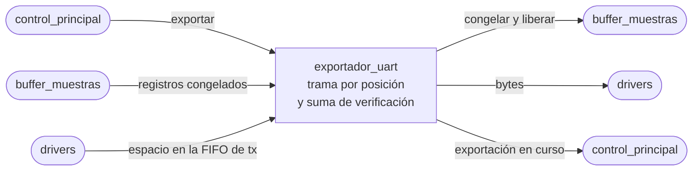

# exportador_uart

## a) Nombre del módulo

`exportador_uart`, en `sw/exportador_uart.c` y `sw/exportador_uart.h`. Es parte del software del MicroBlaze V del [nivel 3](../diagramas/nivel03.md).

## b) Diagrama modular

## c) Objetivo del módulo

Saca el histórico congelado por la UART en una trama que [`receptor_pc`](receptor_pc.md) pueda validar y convertir a unidades físicas, sin que el lazo principal se quede esperando a la UART.

## d) Entradas

- `exportar`, el pedido de [`control_principal`](control_principal.md) tras un flanco de `BTN_EXPORTAR`.
- Los registros congelados y su cantidad, desde [`buffer_muestras`](buffer_muestras.md).
- Si la FIFO de transmisión de la AXI UART Lite tiene espacio, por [`drivers`](drivers.md).
- Las constantes de la cabecera, de los headers de otros módulos.
  - `PR_FRECUENCIA_MUESTREO_HZ`, de `pr_params.h`.
  - `ADC_OFFSET_CUENTAS` y `ADC_AMPERES_POR_CUENTA`, de `lazo_control.h`.
  - `DUTY_ESCALA` y `DUTY_CON_SIGNO`, de `pr_discreto.h`.

## e) Salidas

- Los bytes de la trama hacia la AXI UART Lite, por `drivers`.
- Las órdenes de congelar y liberar hacia `buffer_muestras`.
- `exportador_uart_ocupado`, para que `control_principal` ignore un segundo pedido mientras dura el primero.

## f) Explicación de la relación con otros módulos

Corre solo en el lazo principal. `control_principal` le pasa el pedido y lo llama en cada vuelta para que avance. Es el único módulo que congela y libera `buffer_muestras` y el único que escribe en la UART. Nunca lo llama la interrupción.

## g) Explicación de funcionamiento

Al recibir `exportar` congela el buffer, arma la cabecera en un arreglo de 20 bytes y deja la posición de la trama en cero. En cada llamada siguiente mete bytes en la FIFO de la UART mientras haya espacio y todavía queden bytes, y retorna. La FIFO de la UART Lite es de 16 bytes, así que cada llamada manda como mucho 16 y nunca espera. Cuando sale el último byte libera el buffer y vuelve a quedar libre.

## h) Diseño

### Formato de la trama

Todos los campos de varios bytes van en little-endian, el orden nativo del MicroBlaze V, así que se copian de memoria sin reordenar.

| Bytes | Campo | Tipo | Contenido |
| --- | --- | --- | --- |
| 0 | inicio | `uint8` | `0xAA`, el mismo byte de inicio de las tramas del Proyecto 3 |
| 1 a 2 | `cantidad` | `uint16` | registros que siguen, `N` |
| 3 a 6 | `frecuencia_muestreo_hz` | `uint32` | `PR_FRECUENCIA_MUESTREO_HZ` |
| 7 a 10 | `adc_offset_cuentas` | `float32` | cuenta del ADC que corresponde a 0 A |
| 11 a 14 | `amperes_por_cuenta` | `float32` | ganancia del sensor y del ADC |
| 15 a 18 | `duty_escala` | `float32` | índice de modulación que vale un LSB de `duty_ref` |
| 19 | `duty_con_signo` | `uint8` | 1 si `duty_ref` se interpreta en complemento a dos |
| 20 a 19 + 6N | registros | 6 bytes cada uno | en el orden y el formato de `buffer_muestras`, del más viejo al más nuevo |
| 20 + 6N a 21 + 6N | `suma` | `uint16` | suma módulo 2^16 de los bytes 1 a 19 + 6N |

La trama mide `22 + 6N` bytes. Con los 1024 registros provisionales son 6166 bytes, que a 115200 baudios y 8N1 tardan 6166 · 10 / 115200 ≈ 0,54 s.

La suma deja afuera el `0xAA` porque ese byte solo marca el inicio. Una suma de bytes no detecta dos bytes intercambiados, pero el enlace es un USB directo a la PC y lo que hay que detectar es una trama cortada o un byte perdido, que una suma sí atrapa. Si hiciera falta algo más fuerte, cambiar a Fletcher-16 toca solo la línea que acumula y el cálculo en `receptor_pc`.

Los cuatro campos de calibración y de escala van en la cabecera para que `receptor_pc` no tenga una copia propia que se pueda desincronizar del firmware. La escala de `duty_ref` depende del formato que se acuerde con Jefferson, y mientras no esté, `DUTY_ESCALA` y `DUTY_CON_SIGNO` quedan provisionales en `pr_discreto.h`.

### Avance por posición

En vez de una máquina con un estado por sección de la trama, el módulo guarda solo la posición del siguiente byte y la suma acumulada. El byte de la posición `p` sale de

- la cabecera armada, si `p < 20`,
- el registro `(p - 20) / 6` de `buffer_muestras`, byte `(p - 20) % 6`, si `p < 20 + 6N`,
- la suma, en los dos últimos bytes.

Así las tres secciones comparten el mismo lazo de envío y no hay transiciones de estado que puedan quedar mal. Los estados que sí existen son dos, libre y ocupado, y los marca `ocupado`.

| Estado | Condición | Acción | Siguiente |
| --- | --- | --- | --- |
| libre | sin pedido | nada | libre |
| libre | `exportar` | congela, arma la cabecera, `p = 0`, `suma = 0` | ocupado |
| ocupado | FIFO llena | retorna | ocupado |
| ocupado | FIFO con espacio y `p < 22 + 6N` | manda el byte `p`, lo suma si corresponde, `p = p + 1` | ocupado |
| ocupado | `p = 22 + 6N` | libera el buffer | libre |

### Interfaz en C

- `void exportador_uart_pedir(void)`, arranca una exportación si está libre y si no, no hace nada.
- `void exportador_uart_avanzar(void)`, manda lo que quepa en la FIFO y retorna.
- `bool exportador_uart_ocupado(void)`.

### Prueba en la PC

La lógica de la trama se prueba con gcc cambiando la función de `drivers` que manda un byte por una que lo escribe en un arreglo y que simula la FIFO llena cada tantas llamadas. Esa misma trama sirve de entrada para probar `receptor_pc` sin la placa.

## i) Diagrama esquemático detallado del diseño

No aplica, el módulo es una función en C del lazo principal y la serialización de los bits la hace la AXI UART Lite de Xilinx.

## j) Diagrama completo de conexiones eléctricas del diseño

No aplica, el módulo no tiene pines propios, el único cable es `tx` de la AXI UART Lite al puente USB-UART de la Basys 3, que ya está en el nivel 2.
