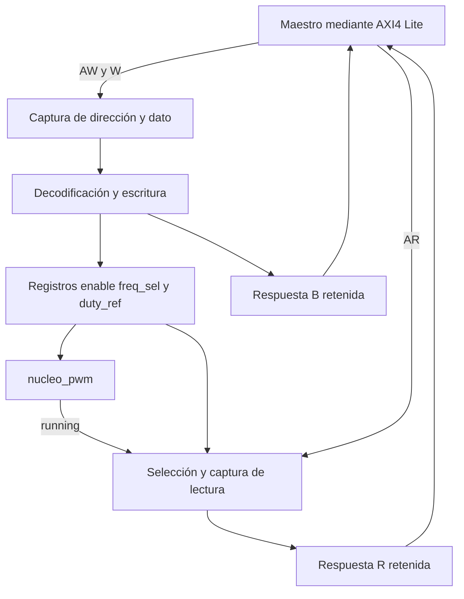
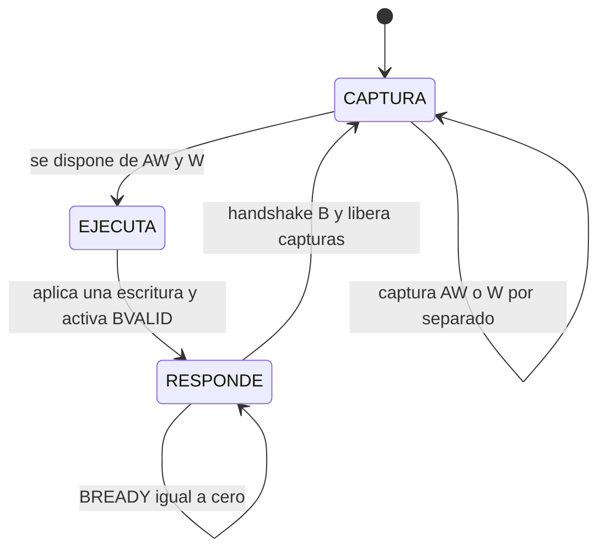
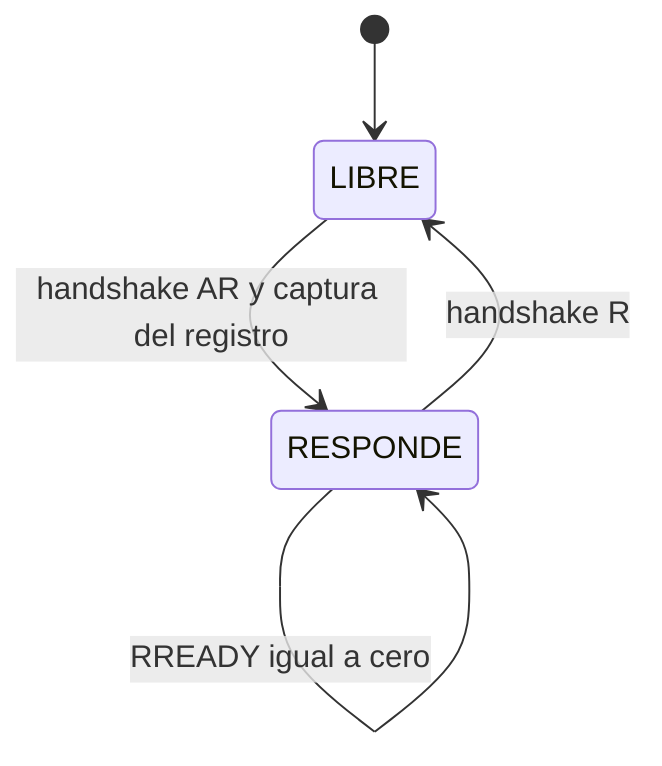
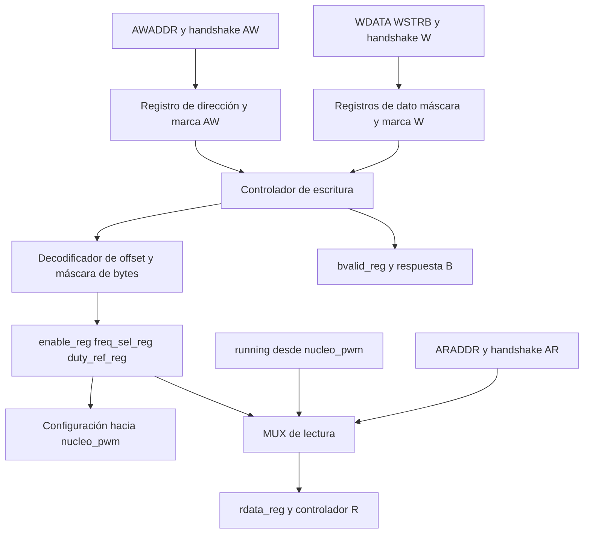

# interfaz_axi_pwm

## a) Nombre del módulo

`interfaz_axi_pwm`, previsto en `src/design/interfaz_axi_pwm.sv`. Es el esclavo AXI4-Lite que forma parte de [`periferico_pwm`](periferico_pwm.md), junto con [`nucleo_pwm`](nucleo_pwm.md), de acuerdo con el [nivel 3](../diagramas/nivel03.md).

Esta ficha especifica el diseño para la entrega documental. Las decisiones de reset, lectura de referencia y transacciones que se detallan aquí completan la descripción general del repositorio; deben mantenerse iguales al implementar el RTL y los drivers. No representa una implementación ni pruebas ya ejecutadas.

## b) Diagrama modular

`clk` y `rst_n` llegan a toda la lógica. Se omiten sus conexiones repetidas en el diagrama.

## c) Objetivo del módulo

Traducir accesos de lectura y escritura del MicroBlaze V en registros de configuración del PWM y devolver su estado de operación. Conserva dirección y dato aunque lleguen en ciclos distintos y mantiene cada respuesta hasta que el maestro la acepte.

La interfaz entrega una orden de modulación al núcleo. La generación de compuertas, saturación efectiva, registros sombra, tiempo muerto y trigger pertenecen a `nucleo_pwm`.

## d) Entradas

Todos los puertos digitales se muestrean en el flanco ascendente de `clk`.

| Señal | Ancho | Función |
|---|---:|---|
| `clk` | 1 | Reloj común de 100 MHz |
| `rst_n` | 1 | Reset activo en bajo, aplicado de forma síncrona a la lógica interna |
| `s_axi_awaddr` | 4 | Offset en bytes de escritura dentro del periférico |
| `s_axi_awprot` | 3 | Atributos AXI de protección; se aceptan sin aplicar restricciones adicionales |
| `s_axi_awvalid` | 1 | Dirección de escritura válida |
| `s_axi_wdata` | 32 | Dato de escritura |
| `s_axi_wstrb` | 4 | Habilitación de escritura por byte |
| `s_axi_wvalid` | 1 | Dato de escritura válido |
| `s_axi_bready` | 1 | Maestro dispuesto a aceptar la respuesta de escritura |
| `s_axi_araddr` | 4 | Offset en bytes de lectura |
| `s_axi_arprot` | 3 | Atributos de lectura; se aceptan sin restricciones adicionales |
| `s_axi_arvalid` | 1 | Dirección de lectura válida |
| `s_axi_rready` | 1 | Maestro dispuesto a aceptar el dato de lectura |
| `running` | 1 | Estado efectivo del generador, producido por `nucleo_pwm` |

`AWPROT` y `ARPROT` se exponen para describir la interfaz AXI completa que se agrupará en la IP. No controlan el accionamiento del puente.

## e) Salidas

| Señal | Ancho | Función |
|---|---:|---|
| `s_axi_awready` | 1 | Puede aceptar una dirección de escritura |
| `s_axi_wready` | 1 | Puede aceptar un dato de escritura |
| `s_axi_bresp` | 2 | Respuesta de escritura, `OKAY = 00` |
| `s_axi_bvalid` | 1 | Respuesta de escritura pendiente |
| `s_axi_arready` | 1 | Puede aceptar una dirección de lectura |
| `s_axi_rdata` | 32 | Instantánea del registro leído |
| `s_axi_rresp` | 2 | Respuesta de lectura, `OKAY = 00` |
| `s_axi_rvalid` | 1 | Dato de lectura pendiente |
| `enable` | 1 | Solicitud de habilitación hacia el núcleo |
| `freq_sel` | 2 | Código de frecuencia hacia el núcleo |
| `duty_ref` | 16 con signo | Referencia solicitada en Q2.14 hacia el núcleo |

No se producen señales físicas de compuerta en este módulo.

## f) Relación con otros módulos

`periferico_pwm` conecta el esclavo al bus y une las salidas `enable`, `freq_sel` y `duty_ref` a las entradas homónimas de `nucleo_pwm`. El núcleo devuelve `running`. Ambos utilizan el mismo reloj y reset; no hay un cruce de dominio en esta conexión.

Los drivers C acceden a las direcciones base asignadas por Vivado más los offsets de esta ficha. La interfaz no conoce el algoritmo PR, los amperios de referencia ni la dirección base que tendrá la IP en el sistema.

La interfaz cambia sus registros cuando completa una escritura. El núcleo consume la configuración en su frontera de actualización. Una respuesta AXI confirma la escritura del registro, no que el nuevo PWM ya se haya aplicado.

## g) Funcionamiento

Una escritura tiene tres partes: dirección por AW, datos por W y confirmación por B. La interfaz guarda AW y W independientemente. Cuando dispone de ambos, aplica una única escritura al registro y genera una respuesta. Mientras esa respuesta no sea aceptada, no comienza otra escritura.

Una lectura acepta una dirección por AR, captura el valor seleccionado y lo devuelve por R. El dato capturado no cambia aunque el registro original o `running` cambien mientras el maestro mantenga `RREADY` en cero.

Los caminos de lectura y escritura trabajan en paralelo. Se permite una escritura pendiente y una lectura pendiente, pero no varias transacciones pendientes del mismo tipo. Esta capacidad es suficiente para la configuración y actualización periódica del PWM sin complicar el diseño con colas.

## h) Diseño

### h.1 Mapa de registros

| Offset | Registro | Campo | Acceso | Valor tras reset |
|---|---|---|---|---|
| `0x00` | Control y estado | `[0] enable` | R/W | 0 |
| `0x00` | Control y estado | `[2:1] freq_sel` | R/W | `01` |
| `0x00` | Control y estado | `[3] running` | RO | Estado del núcleo, inicialmente 0 |
| `0x00` | Control y estado | `[31:4]` reservados | Lectura cero | 0 |
| `0x04` | Referencia | `[15:0] duty_ref` | R/W | 0 |
| `0x04` | Referencia | `[31:16]` reservados | Lectura cero | 0 |

Se propone `freq_sel = 01` tras reset para solicitar la frecuencia nominal de 20 kHz de la tabla existente. Con `enable = 0`, esto no habilita el puente. La lectura inicial de `0x00` es `0x00000002` una vez que `running` está en cero. Este valor de reset se incorpora a la especificación de drivers y no se presenta como un requisito impuesto por el instructivo.

El bit `running` se toma del núcleo al capturar la lectura; no existe un registro R/W que permita al software forzarlo. Escribir un 1 en el bit 3 no cambia el estado efectivo del PWM.

### h.2 Frecuencia y referencia con signo

La tabla proviene de `nucleo_pwm.md`:

| `freq_sel` | Frecuencia por transistor | MAX de la portadora |
|---|---:|---:|
| `00` | 10 kHz | 5000 |
| `01` | 20 kHz | 2500 |
| `10` | 40 kHz | 1250 |
| `11` | 20 kHz | 2500 |

La interfaz conserva el código escrito. Si se escribe `11`, la lectura devuelve `11` y el núcleo lo interpreta como 20 kHz. La autorización de operar el lazo cerrado solo con `01` pertenece al software del sistema, según el diseño actual.

`duty_ref` se interpreta en complemento a dos y Q2.14, con escala de 1/16384. Su rango representable es de -2 a 2 menos un LSB; su rango admisible de modulación es de -1 a +1.

| Referencia | Patrón de 16 bits | Índice pedido |
|---|---|---:|
| Cero | `0x0000` | 0 |
| Positiva intermedia | `0x2000` | +0,5 |
| Negativa intermedia | `0xE000` | -0,5 |
| Límite positivo | `0x4000` | +1 |
| Límite negativo | `0xC000` | -1 |

La saturación se realiza en el núcleo antes de escalar a la portadora. Debe hacerse con operaciones de signo y ancho suficientes para que valores extremos como `0x8000` no desborden durante una negación o escalado.

**Semántica de lectura elegida:** la interfaz conserva y devuelve los 16 bits de la orden solicitada, incluso si están fuera del rango admisible. El núcleo utiliza la versión saturada. Por ejemplo, escribir `0x7FFF` permite leer `0x00007FFF` en `0x04`, mientras la modulación efectiva se limita a +1. La lectura no informa la referencia activa de los registros sombra.

Esta decisión mantiene la saturación y los registros sombra en el núcleo, como establece el nivel 3. Si el equipo prefiere lectura del valor limitado, debe cambiar de forma consistente esta ficha, la conexión con el núcleo, los drivers y los casos de verificación.

### h.3 Escrituras parciales y direcciones

`WSTRB[n]` habilita el byte n de WDATA. Los bytes deshabilitados conservan su valor previo.

- En `0x00`, solo `WSTRB[0]` puede cambiar `enable` y `freq_sel`. `running` y los bits reservados se ignoran al escribir.
- En `0x04`, `WSTRB[0]` actualiza los bits `[7:0]` y `WSTRB[1]` los bits `[15:8]`. `WSTRB[3:2]` no tienen efecto.
- Con `WSTRB = 0000`, la transacción se confirma y ningún registro cambia.
- Las direcciones se comparan completas dentro de los cuatro bits de offset. Solo `0x0` y `0x4` seleccionan registros; `0x8` no debe convertirse en un alias de `0x0`.
- Para offsets sin registro o no alineados a palabra: lectura cero, escritura sin efecto y respuesta `OKAY`. Es una política local elegida para esta IP, no una regla general de AXI.

La combinación de bytes se efectúa antes de interpretar `duty_ref` con signo. Escribir solo un byte puede cambiar considerablemente el valor solicitado; el driver normal utilizará una escritura completa de los 16 bits bajos.

### h.4 Registros internos

| Registro | Ancho | Propósito |
|---|---:|---|
| `enable_reg` | 1 | Solicitud de habilitación |
| `freq_sel_reg` | 2 | Código solicitado |
| `duty_ref_reg` | 16 | Orden solicitada |
| `awaddr_reg` | 4 | Dirección de la escritura pendiente |
| `aw_pendiente` | 1 | Ya se aceptó una dirección AW |
| `wdata_reg` | 32 | Dato de la escritura pendiente |
| `wstrb_reg` | 4 | Máscara asociada al dato capturado |
| `w_pendiente` | 1 | Ya se aceptó un dato W |
| `bvalid_reg` | 1 | Confirmación pendiente |
| `rdata_reg` | 32 | Instantánea de lectura |
| `rvalid_reg` | 1 | Dato de lectura pendiente |

Los estados de los controladores completan el almacenamiento de control. `BRESP` y `RRESP` son constantes `00` bajo la política definida.

### h.5 Controlador de escritura

Una aceptación, o handshake, ocurre en un flanco con `VALID` y `READY` simultáneamente en 1.

En `CAPTURA`, AWREADY solo se habilita si no hay una dirección almacenada y WREADY solo si no hay un dato almacenado. Cada handshake guarda únicamente su canal. Se puede recibir AW primero, W primero o ambos a la vez. La condición de transición contempla tanto campos ya almacenados como los aceptados en ese flanco.

En `EJECUTA`, ambos READY de escritura están en cero. En el flanco de ejecución se decodifica la dirección guardada, se aplica la máscara una sola vez y se entra en `RESPONDE` con BVALID en 1. Ningún cambio posterior de AWADDR o WDATA puede alterar esa escritura.

En `RESPONDE`, se conserva BVALID hasta el handshake B. Al aceptarse, se limpian las marcas de dirección y dato y se vuelve a `CAPTURA`. No se acepta una nueva escritura en ese mismo flanco de liberación; se admite una burbuja de bus para mantener el control sencillo.

La actualización de registros no se repite mientras BREADY sea cero. BVALID tampoco debe depender de que BREADY esté previamente en 1.

### h.6 Controlador de lectura

En `LIBRE` se habilita ARREADY. El handshake AR captura en `rdata_reg` el registro indicado por ARADDR y activa RVALID. En `RESPONDE`, ARREADY está en cero y `RDATA`, `RRESP` y `RVALID` permanecen estables hasta el handshake R. La siguiente dirección puede aceptarse desde el ciclo posterior a la liberación.

La lectura no modifica los registros ni reconoce eventos. Si una lectura y la ejecución de una escritura al mismo registro ocurren en el mismo flanco, la lectura captura el valor anterior a la escritura. Una lectura de control captura también el `running` existente antes de ese flanco. Esta regla permite resultados deterministas en accesos concurrentes.

### h.7 Ejemplo temporal de escritura

El ejemplo utiliza una dirección que llega antes del dato. Los valores de cada fila describen el evento en ese flanco y el resultado registrado después.

| Flanco | Evento | Resultado |
|---|---|---|
| E0 | Handshake AW con offset `0x04` | Se guarda la dirección y se deja de aceptar AW |
| E1 | Handshake W con `0x2000` y `WSTRB=0011` | Se guarda el dato y se pasa a `EJECUTA` |
| E2 | Ejecución interna | `duty_ref_reg=0x2000`, BVALID se activa y se entra en `RESPONDE` |
| E3 | BREADY en cero | Se conserva la respuesta; no se repite la escritura |
| E4 | Handshake B | Se retira la respuesta y se liberan las capturas |
| E5 | Puede comenzar otra escritura | La interfaz vuelve a aceptar AW y W |

Desde E2 la orden está disponible para el núcleo. Su aplicación física ocurre cuando la tubería y la frontera de actualización del núcleo la consumen; no se identifica E2 con un cambio inmediato de compuertas.

### h.8 Reset y límites temporales

Con reset activo se limpian capturas, respuestas y estados de transacción; `enable_reg=0`, `freq_sel_reg=01` y `duty_ref_reg=0`. READY se mantiene en cero durante reset. BVALID y RVALID permanecen en cero y RDATA se reinicia a cero.

Una transacción interrumpida por el reset de la plataforma se descarta. Al liberar el reset, el maestro y el esclavo deben haber salido del reset del mismo sistema; no se intenta conservar una respuesta de la ejecución anterior.

READY depende del estado y de las marcas internas de ocupación. Se evita construir caminos combinacionales desde entradas AXI hacia salidas AXI. Las respuestas válidas y RDATA se registran.

La espera de la respuesta del maestro puede ser arbitrariamente larga. Esta condición no impide que el núcleo continúe generando PWM con la última configuración almacenada.

## i) Diagrama esquemático detallado del diseño

El diagrama es la arquitectura prevista del módulo. El esquemático de elaboración se contrastará con ella durante la implementación posterior.

## j) Conexiones eléctricas e integración

Este módulo no tiene pines externos de la Basys 3. Su bus se conecta a la interconexión AXI dentro del Block Design mediante `periferico_pwm`; sus señales de configuración se conectan al núcleo dentro de esa IP.

Reloj y reset provienen de la infraestructura del sistema. Las cuatro señales de compuerta y `pwm_trigger_o` salen del núcleo y no atraviesan la lógica AXI de esta interfaz. El plan de verificación está en [`plan_verificacion_pwm.md`](../plan_verificacion_pwm.md).

## Referencias

- Diseño existente: [nivel 3](../diagramas/nivel03.md) y [`nucleo_pwm`](nucleo_pwm.md).
- Instructivo del proyecto, secciones 4.2.2, 4.2.3 y 7.
- Arm, [AMBA AXI y ACE Protocol Specification IHI 0022E](https://documentation-service.arm.com/static/5f915b62f86e16515cdc3b1c), transacciones, dependencias de canales y AXI4-Lite.
