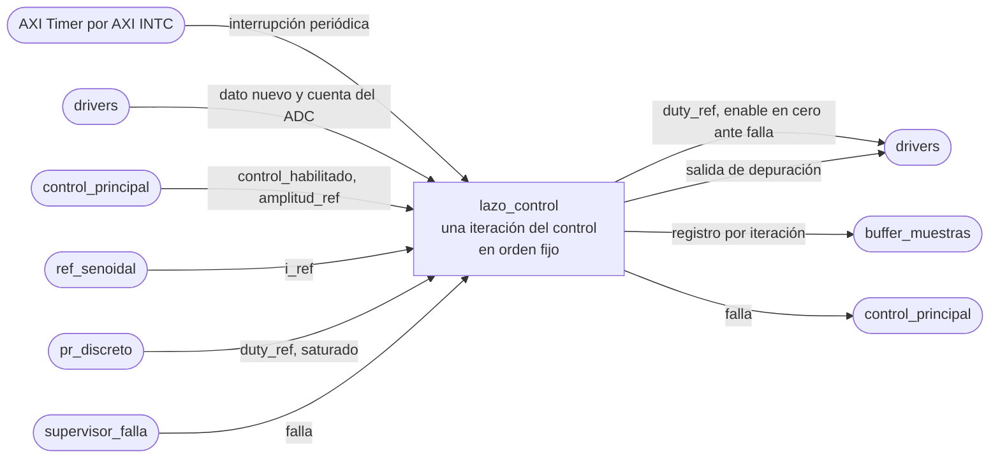

# lazo_control

## a) Nombre del módulo

`lazo_control`, en `sw/lazo_control.c` y `sw/lazo_control.h`. Es la rutina de interrupción del AXI Timer dentro del software del MicroBlaze V del [nivel 3](../diagramas/nivel03.md).

## b) Diagrama modular

## c) Objetivo del módulo

Ejecuta una iteración del control en cada interrupción del Timer, siempre en el mismo orden que fija la sección 4.2.4 del enunciado.

## d) Entradas

- La interrupción del AXI Timer, que llega por el AXI INTC.
- La bandera de dato nuevo y la cuenta del ADC, por [`drivers`](drivers.md).
- `control_habilitado` y `amplitud_ref`, escritas por [`control_principal`](control_principal.md).
- `i_ref` de [`ref_senoidal`](ref_senoidal.md), `duty_ref` y `saturado` de [`pr_discreto`](pr_discreto.md), y `falla` de [`supervisor_falla`](supervisor_falla.md).
- La calibración del sensor, como `#define` en `lazo_control.h`.
  - `ADC_OFFSET_CUENTAS`, la cuenta que corresponde a 0 A.
  - `ADC_AMPERES_POR_CUENTA`, cuántos amperes vale una cuenta.

## e) Salidas

- `duty_ref` hacia el offset `0x04` del periférico PWM, y `enable` en cero si hay falla, por `drivers`.
- Un `registro_t` por iteración hacia [`buffer_muestras`](buffer_muestras.md).
- `falla`, variable compartida que lee `control_principal`.
- La salida de depuración temporal, en alto mientras dura la rutina, por `drivers`.

## f) Explicación de la relación con otros módulos

Es el único módulo con plazo fijo y el centro del contexto de interrupción. Llama a `ref_senoidal`, `pr_discreto`, `supervisor_falla` y `buffer_muestras`, y por `drivers` toca el ADC, el PWM, el Timer y la salida de depuración. Con `control_principal` se comunica solo por las tres variables compartidas del nivel 3. `control_principal` lo registra en el AXI INTC durante el arranque.

## g) Explicación de funcionamiento

Cada interrupción sigue esta secuencia.

1. Sube la salida de depuración.
2. Reconoce la interrupción del Timer.
3. Pregunta a `drivers` si hay dato nuevo del ADC.
   - Si no hay, llama a `supervisor_falla_sin_dato`, repite la cuenta y la corriente de la iteración anterior, no calcula el PR y deja en el PWM el `duty_ref` anterior. Salta al paso 7.
4. Lee la cuenta y la convierte a corriente con signo, `corriente = (cuenta - ADC_OFFSET_CUENTAS) · ADC_AMPERES_POR_CUENTA`.
5. Llama a `supervisor_falla_revisar`. Si devuelve falla y la falla es nueva, apaga `enable` del PWM y publica `falla`.
6. Si `control_habilitado` está en uno y no hay falla, pide `i_ref` a `ref_senoidal` con `amplitud_ref`, calcula `pr_discreto` y escribe el `duty_ref` resultante en el PWM. Si no, `i_ref` es cero y el PR no avanza.
7. Arma el registro con la cuenta, el último `duty_ref`, `i_ref` en miliamperes y las cuatro banderas, y se lo pasa a `buffer_muestras`.
8. Baja la salida de depuración.

Con el control deshabilitado la rutina sigue corriendo y registrando la corriente, que debería ser cero. Eso sirve para revisar el offset del sensor sin energizar el puente.

## h) Diseño

### Orden respecto al enunciado

La sección 4.2.4 pide, en cada período y siempre igual, adquirir y validar el dato, calcular el PR, escribir `duty_ref` y guardar en el buffer. Los pasos 3 y 4 son la adquisición y su validación, el 6 es el cálculo y la escritura, y el 7 es el buffer. La revisión de falla del paso 5 se mete entre la medición y el cálculo para que, si la corriente ya se pasó, el PR no llegue a escribir un `duty_ref` nuevo.

### Reconocimiento del Timer

Se reconoce escribiendo directo el bit de interrupción del registro de control y estado del AXI Timer, por medio de `drivers`, en vez de pasar por el manejador genérico del driver de Xilinx. El manejador genérico recorre los contadores y llama a una función de usuario, y eso agrega llamadas en el camino más sensible al tiempo del programa.

Reconocerlo al principio y no al final no cambia nada mientras la rutina dure menos que el período, y si algún día dura más, la interrupción siguiente queda pendiente en vez de perderse.

### Salida de depuración

La sube al entrar y la baja al salir, así que en el osciloscopio el ancho del pulso es el tiempo de servicio y la distancia entre flancos de subida es el período efectivo, con su jitter. Los retardos que se midan así se le entregan a quien analice la estabilidad del PR.

La escribe solo esta rutina, y los LEDs solo `control_principal`. Por eso tienen que quedar en canales distintos del AXI GPIO. Si compartieran registro, una lectura y escritura del lazo principal interrumpida a la mitad podría pisar el valor que dejó la rutina.

### Apagado ante falla

`enable` vive en el mismo registro que `freq_sel`, así que apagarlo es leer, modificar y escribir el offset `0x00`. Dentro de la interrupción eso es seguro porque nada la interrumpe. El apagado se hace una sola vez, en la iteración en que la falla aparece. Las siguientes ya no tocan el registro de control.

La rutina no baja `control_habilitado`, porque esa variable la escribe solo `control_principal`. En su lugar revisa `falla` antes de calcular, y `control_principal` baja `control_habilitado` en su siguiente vuelta.

### Registro de la iteración

- `cuenta_banderas` lleva la cuenta en `[11:0]`, `saturado` en el bit 15, `dato_ausente` en el 14, si el control estaba habilitado en el 13 y `falla` en el 12.
- `duty_ref` es el último valor escrito en el PWM, aunque en esta iteración no se haya calculado.
- `i_ref_ma` es `i_ref · 1000` truncado a entero, cero con el control deshabilitado.

### Calibración

`ADC_OFFSET_CUENTAS` y `ADC_AMPERES_POR_CUENTA` salen de medir el sensor montado, y los mide Nicolás. Mientras tanto quedan con el valor teórico del nivel 2, 0 A en 0,5 V, o sea la mitad de la escala de 12 bits, marcados con `// TODO: Revisar` en `lazo_control.h`. `ADC_AMPERES_POR_CUENTA` no tiene valor teórico acordado y queda también como pendiente.

### Presupuesto de tiempo

El período del Timer sale de `PR_FRECUENCIA_MUESTREO_HZ`, que todavía no está acordado. La rutina hace un puñado de accesos AXI, siete multiplicaciones del PR y una de la referencia y otra de la conversión, así que a 100 MHz debería caber en pocos microsegundos con FPU. Sin FPU, cada multiplicación en `float` por software cuesta decenas de ciclos, y eso es justo lo que se mide con la salida de depuración antes de decidir si se pasa a punto fijo.

### Interfaz en C

- `void lazo_control_isr(void *ref)`, la rutina que `control_principal` registra en el AXI INTC.
- Las variables compartidas `volatile uint32_t control_habilitado`, `volatile valor_t amplitud_ref` y `volatile uint32_t falla`, declaradas en `lazo_control.h`.

## i) Diagrama esquemático detallado del diseño

No aplica, la rutina es código C que corre en el MicroBlaze V y no tiene compuertas propias, el hardware que la dispara es el AXI Timer de Xilinx.

## j) Diagrama completo de conexiones eléctricas del diseño

No aplica, el módulo no tiene pines, la única señal física que maneja es la salida de depuración, cuyo pin lo asigna el `basys3.xdc` del Block Design.
