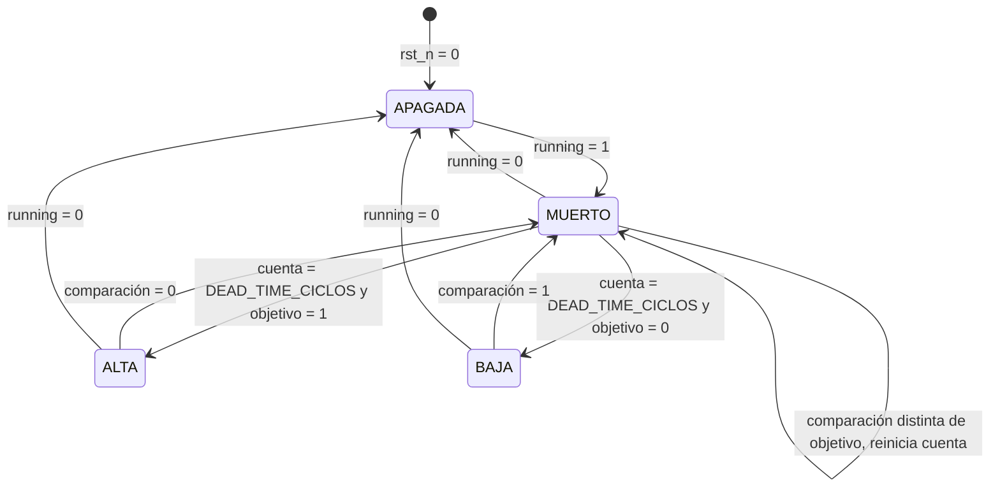
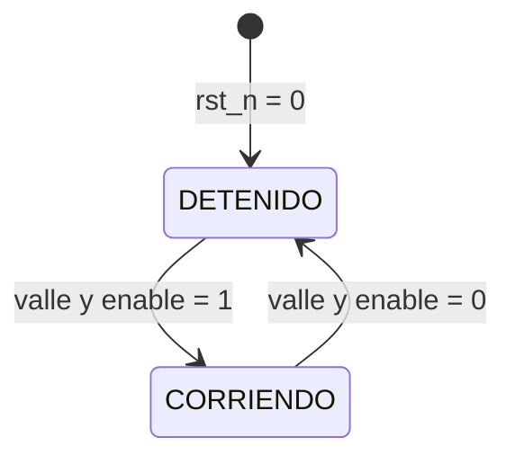
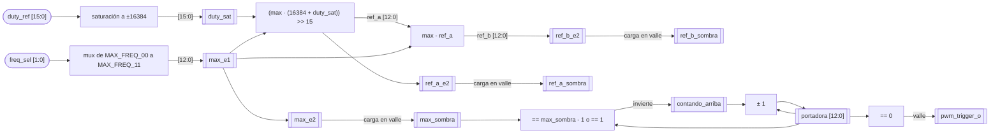
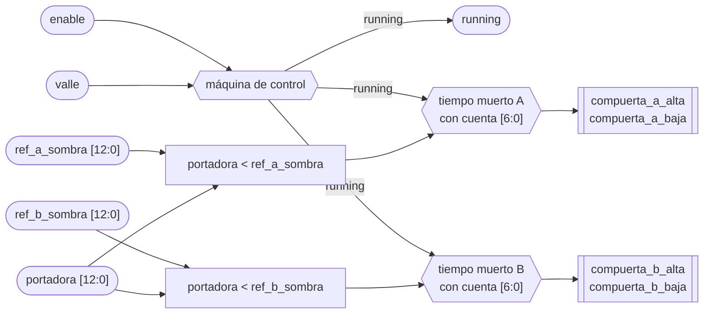
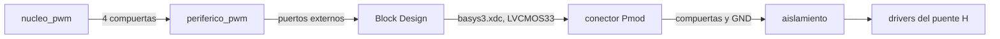

# nucleo_pwm

## a) Nombre del módulo

`nucleo_pwm`, en `src/design/nucleo_pwm.sv`. Es el núcleo del periférico PWM del [nivel 3](../diagramas/nivel03.md), instanciado dentro de `periferico_pwm` junto a `interfaz_axi_pwm`.

## b) Diagrama modular


## c) Objetivo del módulo

Convierte `duty_ref` en las cuatro señales de compuerta del puente H, con modulación unipolar y tiempo muerto, y marca con `pwm_trigger_o` el instante de muestreo del ADC.

## d) Entradas

- `clk`, `logic`, reloj del sistema, el mismo del bus AXI.
- `rst_n`, `logic`, reinicio activo en bajo como el `ARESETn` del bus. Deja las cuatro compuertas apagadas.
- `enable`, `logic`, desde `interfaz_axi_pwm` (bit 0 de `0x00`).
- `freq_sel`, `logic [1:0]`, desde `interfaz_axi_pwm` (bits [2:1] de `0x00`). Elige el `MAX` de la portadora y se copia a su registro sombra en el valle.
- `duty_ref`, `logic signed [15:0]` en Q2.14, desde `interfaz_axi_pwm` (bits [15:0] de `0x04`). Es la tensión promedio pedida sobre la carga como fracción de Vdc, de -1 a +1 sin importar la frecuencia. Se copia a su registro sombra en el valle.
- `DEAD_TIME_CICLOS`, `parameter`, tiempo muerto en ciclos de `clk`.
- `MAX_FREQ_00`, `MAX_FREQ_01`, `MAX_FREQ_10` y `MAX_FREQ_11`, `parameter`, el máximo de la portadora para cada código de `freq_sel`. En simulación se reemplazan por valores chicos.

## e) Salidas

- `compuerta_a_alta` y `compuerta_a_baja`, `logic`, par complementario con tiempo muerto de la pierna A hacia los drivers del puente H. Compara la portadora contra `duty_ref`.
- `compuerta_b_alta` y `compuerta_b_baja`, `logic`, igual para la pierna B, que compara contra `-duty_ref`.
- `running`, `logic`, hacia `interfaz_axi_pwm`, que lo expone en el bit 3 de `0x00`. Vale 1 mientras las compuertas conmutan y cambia en el borde del período, no cuando cambia `enable`.
- `pwm_trigger_o`, `logic`, pulso de un ciclo de `clk` en el valle hacia `envoltura_xadc`. En el valle las dos piernas están en el mismo estado y la corriente pasa por su valor promedio.

Todas las salidas salen directo de flip-flops, sin lógica combinacional después, para que no lleven glitches. Las compuertas son activas en alto, con 1 para el transistor encendido. Esa polaridad se confirma con Nicolás cuando elija el driver y el aislamiento.

## f) Explicación de la relación con otros módulos

Lo instancia `periferico_pwm` junto a `interfaz_axi_pwm`, que le pasa `enable`, `freq_sel` y `duty_ref` tal como los escribe el software y le expone `running` en lectura. Los dos usan el reloj del bus, así que no hay sincronizadores entre ellos. Del lado del software, [`lazo_control`](lazo_control.md) escribe en cada interrupción el `duty_ref` que calcula [`pr_discreto`](pr_discreto.md), por medio de [`drivers`](drivers.md), y [`supervisor_falla`](supervisor_falla.md) apaga el puente bajando `enable`, que el núcleo toma recién en el valle siguiente.

Hacia afuera, `pwm_trigger_o` llega a [`envoltura_xadc`](envoltura_xadc.md), que decide cuándo arranca la conversión. El instante de captura respecto al valle lo definen Jefferson y Nicolás. Las compuertas van a los drivers del puente H que diseña Nicolás. De ese mismo diseño salen `DEAD_TIME_CICLOS` y las frecuencias de la tabla de `MAX`. El núcleo no tiene relación directa con el AXI Timer. Como los dos cuentan el mismo reloj, la interrupción y el valle mantienen un desfase fijo solo si el período del Timer es exactamente 2·`MAX` ciclos.

## g) Explicación de funcionamiento

La portadora es un contador que sube de 0 a `MAX` y baja de vuelta a 0, así que un período dura 2·`MAX` ciclos de `clk` y `f_sw = f_clk / (2·MAX)`. `MAX` es uno de los cuatro `parameter` `MAX_FREQ_00` a `MAX_FREQ_11`, según `freq_sel`. El contador corre siempre después del reinicio, aunque `enable` esté en cero, para que `pwm_trigger_o` siga llegando al ADC y [`lazo_control`](lazo_control.md) pueda medir el offset del sensor con el puente apagado.

El valle, cuando el contador vale 0, es el punto de sincronización de todo el núcleo. Dura un solo ciclo por período, y en ese ciclo pasan cuatro cosas.

1. `freq_sel` pasa a su registro sombra, y el `MAX` nuevo rige desde ese período.
2. `duty_ref`, ya saturado y escalado, pasa a su registro sombra.
3. Se emite `pwm_trigger_o`, registrado para que no salga con glitches.
4. `running` toma el valor de `enable`.

Lo que el software escriba a mitad de período espera al valle siguiente, así que ningún período sale con un `MAX` o un `duty_ref` mezclado.

Durante el período cada pierna compara el contador contra su referencia. La pierna A pide su compuerta alta mientras el contador está por debajo de `ref_a`, que sale de `duty_ref`, y la pierna B mientras está por debajo de `ref_b`, que sale de `-duty_ref`. Con `duty_ref = 0` las dos piernas quedan al 50 % y la carga ve 0 V en promedio, y con `duty_ref = 0,5` quedan al 75 % y al 25 % y la carga ve 0,5·Vdc.

El tiempo muerto va aparte en cada pierna. Cuando la comparación cambia de estado, las dos compuertas de la pierna se apagan de inmediato y la que corresponde se enciende recién cuando la comparación lleva `DEAD_TIME_CICLOS` ciclos estable. Si la comparación vuelve a cambiar antes, la cuenta se reinicia y las dos siguen apagadas, así que un pulso más corto que el tiempo muerto no deja solapamiento ni glitch. Apagar nunca se retrasa, solo encender.

Con `running` en cero las cuatro compuertas quedan en bajo, que es también el estado después del reinicio. Como `running` solo cambia en el valle, al subir `enable` el núcleo arranca en el siguiente período completo, y al bajarlo termina el período en curso antes de apagar.

## h) Diseño

El núcleo tiene dos máquinas. Una sola de control decide si el puente conmuta, y cada pierna tiene su propia máquina de tiempo muerto. El sentido del contador de la portadora es un bit que se invierte en 0 y en `MAX`, así que no lleva diagrama. Toda la lógica corre en el flanco de subida de `clk` con reinicio síncrono, porque en las FPGA de Xilinx un reinicio síncrono aprovecha mejor los flip-flops y los DSP [1].

### h.1) Portadora y tabla de MAX

`portadora` es un contador de `ANCHO_PORTADORA = $clog2(MAX_FREQ_00 + 1)` bits, 13 con los valores por defecto, y `contando_arriba` guarda su sentido. `MAX_FREQ_00` tiene que ser el mayor de los cuatro máximos, porque fija ese ancho. La señal interna `valle` es `portadora == 0`, en 1 durante un ciclo por período.

Los valores por defecto son la tabla que confirmó Nicolás. 40 kHz queda sujeto a las pérdidas del puente a esa frecuencia.

- `MAX_FREQ_00 = 5000`, 10 kHz.
- `MAX_FREQ_01 = 2500`, 20 kHz.
- `MAX_FREQ_10 = 1250`, 40 kHz.
- `MAX_FREQ_11 = 2500`, igual que `01`.

El cuarto código no se usa y satura a 20 kHz. Si algún día se define una cuarta frecuencia, basta con cambiar `MAX_FREQ_11`, sin tocar la lógica. La frecuencia de operación es 20 kHz, y el lazo cerrado corre solo con `freq_sel = 01`. 10 y 40 kHz son para mostrar el PWM y para el testbench, con el control deshabilitado. El `MAX` que rige el período es `max_sombra`, que se carga en el valle, y el contador cambia de sentido al llegar a `max_sombra` y a 0.

### h.2) Saturación y referencias

`duty_ref` viene en Q2.14, que representa de -2 a +2, pero el rango admisible es de -1 a +1. Lo que pase de ahí se satura al límite. El formato con margen es a propósito, para que una salida del PR que se pase de 1 quede recortada en vez de dar la vuelta por desborde. En Q2.14 el 1,0 vale 16384, así que `duty_sat` queda entre -16384 (`0xC000`) y 16384 (`0x4000`).

Después del recorte, un solo multiplicador saca las dos referencias de comparación.

- `ref_a = (MAX · (16384 + duty_sat)) >> 15`
- `ref_b = MAX - ref_a`

Es lo mismo que `MAX/2 · (1 ± duty_ref)`, pero sin dividir `MAX` antes, para no perder medio ciclo cuando `MAX` es impar. `ref_b` sale de una resta, así que `ref_a + ref_b = MAX` exacto y las dos piernas no tienen errores de redondeo distintos. `16384 + duty_sat` va de 0 a 32768 y el producto más grande es 5000 · 32768, menos de 2^28, que cabe en un DSP48E1, de 25 × 18 bits [2]. Con `duty_ref = 0,5` y `MAX = 2500`, `ref_a = 2500 · 24576 >> 15 = 1875` y `ref_b = 625`.

El cálculo corre en todos los ciclos en dos etapas registradas. La primera guarda `duty_sat` y el `MAX` que elige el `freq_sel` de entrada, y la segunda guarda `ref_a`, `ref_b` y ese mismo `MAX`. En el valle, `max_sombra`, `ref_a_sombra` y `ref_b_sombra` copian la salida de la segunda etapa, así que nunca se mezcla la referencia de una frecuencia con el `MAX` de otra. Lo que el software escriba uno o dos ciclos antes del valle entra en el período siguiente.

Como `MAX` sale de `freq_sel` dentro del núcleo, el software escribe el mismo valor a cualquier frecuencia.

### h.3) Comparadores y extremos

Las comparaciones son `portadora < ref_a_sombra` para A y `portadora < ref_b_sombra` para B. En los extremos aparecen pulsos más cortos que el tiempo muerto. Con `duty_ref = +1`, `ref_a = MAX` y la comparación de A cae a 0 solo en el ciclo del pico. La máquina de la pierna apaga la compuerta alta en ese ciclo y la vuelve a encender `DEAD_TIME_CICLOS` ciclos después, así que el ciclo de trabajo máximo real es `1 - (1 + DEAD_TIME_CICLOS) / (2·MAX)`, cerca de 98 % a 20 kHz con el tiempo muerto por defecto. Cualquier pulso más corto que el tiempo muerto desaparece, que es el efecto del tiempo de bloqueo en inversores PWM [3]. Ese máximo es el que fija `PR_U_MAX` en [`pr_discreto`](pr_discreto.md).

### h.4) Tiempo muerto

La entrada es la comparación de la pierna, `portadora < ref_a_sombra` en A y `portadora < ref_b_sombra` en B. `objetivo` guarda el valor de la comparación que se está esperando y `cuenta` los ciclos que lleva estable.



- `APAGADA`, las dos compuertas de la pierna en bajo mientras `running` esté en 0.
- `MUERTO`, las dos compuertas en bajo mientras se cuenta el tiempo muerto. Al entrar, `objetivo` toma la comparación y `cuenta` vuelve a cero.
- `ALTA`, compuerta alta en 1 y baja en 0.
- `BAJA`, compuerta baja en 1 y alta en 0.

De `ALTA` a `BAJA`, o al revés, siempre se pasa por `MUERTO`, y no hay ningún estado con las dos compuertas en 1. Eso es lo que garantiza que no haya solapamiento. La salida a `APAGADA` es inmediata desde cualquier estado porque apagar las dos compuertas nunca causa un cortocircuito.

`cuenta` tiene `$clog2(DEAD_TIME_CICLOS + 1)` bits. `DEAD_TIME_CICLOS = 100`, 1 µs, es un valor provisional con margen, sin fuente. El valor final lo fija Nicolás como parámetro de la IP en el Block Design, a partir del tiempo muerto mínimo del puente con el retardo del aislamiento. El enunciado pide tiempo muerto configurable en 4.2.2, pero el mapa de registros sugerido en 4.2.3 no tiene un registro para eso, así que se deja configurable al sintetizar. Dura `DEAD_TIME_CICLOS · 10 ns` a cualquier frecuencia, porque se cuenta en ciclos de `clk`.

### h.5) Control y running



- `DETENIDO`, `running` en 0 y las dos piernas apagadas. El contador y `pwm_trigger_o` siguen corriendo.
- `CORRIENDO`, `running` en 1 y las piernas siguen a sus comparaciones.

Fuera del valle la máquina no cambia de estado, aunque cambie `enable`. Por eso `running` siempre arranca y termina en un borde de período.

Con `running` en cero las piernas van a `APAGADA`, y `rst_n` en cero deja las dos máquinas en su estado inicial, con las cuatro compuertas en bajo. En una falla el puente sigue conmutando como mucho un período después de que el software baja `enable`. La desconexión rápida le toca a la protección por hardware de la etapa de potencia.

### h.6) pwm_trigger_o

`pwm_trigger_o` es un flip-flop que copia `valle`, así que sube un ciclo después del valle y dura un ciclo. Sale registrado para que no lleve glitches hacia `envoltura_xadc`. No depende de `running`, y sigue saliendo con el puente apagado.

### h.7) Temporización

Es la tabla que confirmó Nicolás, con 40 kHz sujeto a las pérdidas del puente. Se calculó con `clk` de 100 MHz y `MAX = f_clk / (2·f_sw)`.

| `freq_sel` | f_sw | `MAX` | período | ciclos por período | rizado en la carga | resolución de `duty_ref` |
|---|---|---|---|---|---|---|
| `00` | 10 kHz | 5000 | 100 µs | 10 000 | 20 kHz | 2/5000 = 0,0004 |
| `01` | 20 kHz | 2500 | 50 µs | 5000 | 40 kHz | 2/2500 = 0,0008 |
| `10` | 40 kHz | 1250 | 25 µs | 2500 | 80 kHz | 2/1250 = 0,0016 |
| `11` | 20 kHz | 2500 | 50 µs | 5000 | 40 kHz | 2/2500 = 0,0008 |

El rizado en la carga está al doble de f_sw porque en unipolar la tensión diferencial tiene dos pulsos por período. La resolución es el cambio de `duty_ref` que mueve `ref_a` una cuenta. En tiempo, una cuenta siempre ensancha el pulso 20 ns, 10 ns en cada flanco, sin importar la frecuencia.

El tiempo muerto dura `DEAD_TIME_CICLOS · 10 ns` a cualquier frecuencia, porque se cuenta en ciclos de `clk`. Su valor sale de los tiempos de conmutación del MOSFET y del driver.

El rizado en la carga está al doble de f_sw porque en unipolar la tensión diferencial tiene dos pulsos por período. La resolución es el cambio de `duty_ref` que mueve `ref_a` una cuenta. En tiempo, una cuenta siempre ensancha el pulso 20 ns, 10 ns en cada flanco, sin importar la frecuencia.

Los ciclos se cuentan desde el valle, el ciclo en que el contador vale 0. El ejemplo usa `freq_sel = 01` y `duty_ref = 0,5`, así que `ref_a = 1875` y `ref_b = 625`. Las latencias de un ciclo por los registros se confirman en el testbench.

| ciclo | evento |
|---|---|
| 0 | El contador vale 0. |
| 1 | `pwm_trigger_o` en 1 durante un ciclo. Los registros sombra de `freq_sel` y `duty_ref` ya tienen el valor nuevo. `running` toma `enable`. |
| 625 | La comparación de B baja. `compuerta_b_alta` se apaga. |
| 625 + `DEAD_TIME_CICLOS` | `compuerta_b_baja` se enciende. |
| 1875 | La comparación de A baja. `compuerta_a_alta` se apaga. |
| 1875 + `DEAD_TIME_CICLOS` | `compuerta_a_baja` se enciende. |
| 2500 | Pico, el contador cambia de sentido. |
| 3125 | La comparación de A sube. `compuerta_a_baja` se apaga. |
| 3125 + `DEAD_TIME_CICLOS` | `compuerta_a_alta` se enciende. |
| 4375 | La comparación de B sube. `compuerta_b_baja` se apaga. |
| 4375 + `DEAD_TIME_CICLOS` | `compuerta_b_alta` se enciende. |
| 5000 | Valle siguiente, vuelve al ciclo 0. |

La pierna A queda en alto 3750 de 5000 ciclos, el 75 %, y la B 1250, el 25 %, sin contar el tiempo muerto. Desde el ciclo 4375 + `DEAD_TIME_CICLOS` hasta el 625 del período siguiente las dos compuertas altas están encendidas, y ese es el estado cero en que se muestrea la corriente.

Al subir `enable`, `running` pasa a 1 en el ciclo 1 del valle siguiente, y las compuertas altas se encienden en el ciclo `1 + DEAD_TIME_CICLOS`, porque las piernas salen de `APAGADA` por `MUERTO`. Al bajar `enable`, el período en curso termina normal y las cuatro compuertas se apagan después del ciclo 1 del valle siguiente.

### h.8) Interfaz en SystemVerilog

```systemverilog
module nucleo_pwm #(
    // Tiempo muerto en ciclos de clk
    parameter int unsigned DEAD_TIME_CICLOS = 100,
    // Máximo de la portadora por código de freq_sel, MAX_FREQ_00 tiene que ser el mayor
    parameter int unsigned MAX_FREQ_00 = 5000,
    parameter int unsigned MAX_FREQ_01 = 2500,
    parameter int unsigned MAX_FREQ_10 = 1250,
    parameter int unsigned MAX_FREQ_11 = 2500
) (
    input logic clk,
    input logic rst_n,
    input logic enable,
    input logic [1:0] freq_sel,
    // Q2.14 con signo, de -1 a +1
    input logic signed [15:0] duty_ref,
    output logic running,
    output logic compuerta_a_alta,
    output logic compuerta_a_baja,
    output logic compuerta_b_alta,
    output logic compuerta_b_baja,
    output logic pwm_trigger_o
);
```

### h.9) Pendientes

- Pérdidas del puente a 40 kHz, que confirma Nicolás. Si el puente no aguanta, cambia `MAX_FREQ_10`.
- `DEAD_TIME_CICLOS`, que sale del puente y del aislamiento de Nicolás. Con ese valor se le pasa a Mattio el ciclo de trabajo máximo para `PR_U_MAX`.
- Polaridad de las compuertas, con Nicolás.
- Instante de captura respecto al valle, con Nicolás.
- Latencias de un ciclo por los registros, que se confirman en el testbench.
- Pines de las cuatro compuertas en `basys3.xdc` y resistencia de pull-down a la entrada del aislamiento, con Nicolás.

## i) Diagrama esquemático detallado del diseño

Los registros van con `[[ ]]`, la lógica combinacional con `[ ]` y las máquinas de estado con `{{ }}`. Todos los registros usan `clk` y `rst_n`, que no se dibujan. Los anchos son los de los valores por defecto y salen de los `parameter`, 13 bits para la portadora y las referencias y 7 para `cuenta`. `16384 + duty_sat` llega hasta 32768, así que entra al multiplicador con 16 bits sin signo.

### i.1) Referencias y portadora



### i.2) Control y piernas



Las compuertas son registros a la salida de cada máquina, así que salen de flip-flops como dice e). El esquemático que genera Vivado al elaborar el diseño se compara contra estos dos diagramas cuando esté el código.

## j) Diagrama completo de conexiones eléctricas del diseño

El núcleo no tiene pines propios. Sus cuatro compuertas salen por los puertos de `periferico_pwm`, pasan a puertos externos del Block Design y llegan a un conector Pmod de la Basys 3 según `basys3.xdc`, que escribe Nicolás. `pwm_trigger_o`, `running` y las entradas no salen de la FPGA.



Las cuatro compuertas van en un mismo conector Pmod, junto a uno de sus pines de GND como retorno hacia el aislamiento. Los bancos de la Basys 3 que llegan a los Pmod trabajan a 3,3 V, así que el estándar es `LVCMOS33` [4]. Los pines exactos los fija Nicolás en `basys3.xdc`.

Mientras la FPGA no está configurada, `rst_n` no puede mantener las compuertas en bajo. Durante la configuración, los pines pueden quedar con pull-up según `PUDC_B` [5], y un 1 en una compuerta activa en alto enciende el transistor. Por eso conviene que la entrada del aislamiento o del driver tenga una resistencia de pull-down, para que las compuertas queden apagadas también con la FPGA sin configurar o con el cable suelto. Se acuerda con Nicolás junto con la polaridad.

## Referencias

[1] K. Chapman, "Get Smart About Reset: Think Local, Not Global," Xilinx White Paper WP272.

[2] AMD Xilinx, *7 Series DSP48E1 Slice User Guide*, UG479.

[3] N. Mohan, T. M. Undeland y W. P. Robbins, *Power Electronics: Converters, Applications, and Design*, 3.ª ed. Wiley, 2003, cap. 8.

[4] Digilent, *Basys 3 FPGA Board Reference Manual*.

[5] AMD Xilinx, *7 Series FPGAs Configuration User Guide*, UG470.
