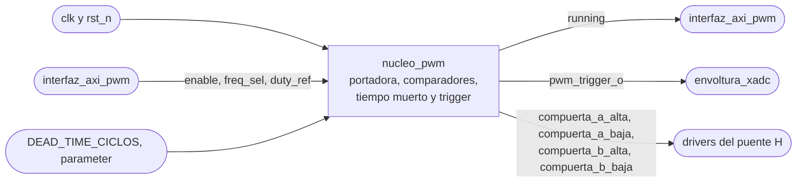
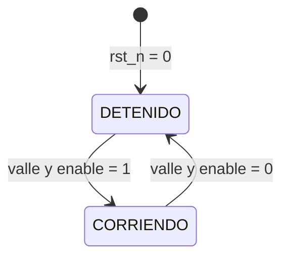
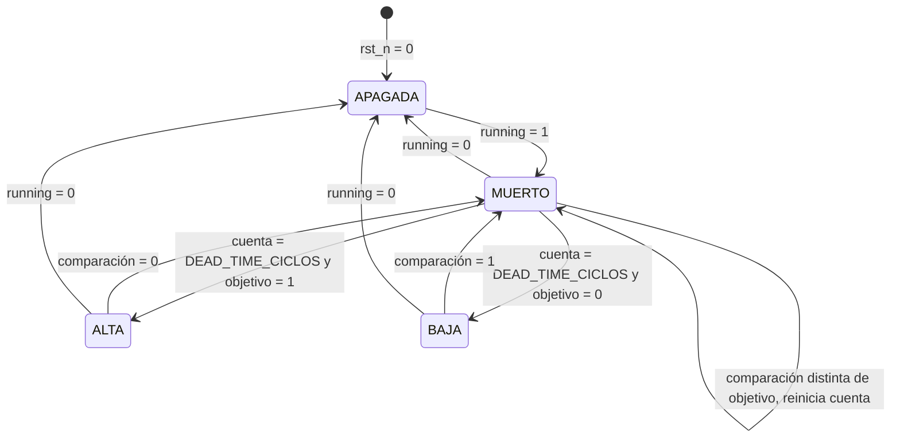

# nucleo_pwm

## a) Nombre del módulo

`nucleo_pwm`, en `src/design/nucleo_pwm.sv`. Es el núcleo del periférico PWM del [nivel 3](../diagramas/nivel03.md), instanciado dentro de `periferico_pwm` junto a `interfaz_axi_pwm`.

## b) Diagrama modular

## Objetivo

Convierte `duty_ref` en las cuatro señales de compuerta del puente H, con modulación unipolar y tiempo muerto, y marca con `pwm_trigger_o` el instante de muestreo del ADC.

## Entradas

- `clk`, reloj del sistema, el mismo del bus AXI.
- `rst_n`, reinicio activo en bajo como el `ARESETn` del bus. Deja las cuatro compuertas apagadas.
- `enable`, bit 0 del registro de control en `0x00`, desde la interfaz AXI4-Lite.
- `freq_sel`, bits [2:1] del registro de control, fija el máximo de la portadora. Se copia al registro sombra en el valle.
- `duty_ref`, bits [15:0] del registro en `0x04`, en Q2.14 con signo. Es la tensión promedio pedida sobre la carga como fracción de Vdc, de -1 a +1 sin importar la frecuencia. Se copia al registro sombra en el valle.
- `DEAD_TIME_CICLOS`, tiempo muerto en ciclos de `clk`, como `parameter` que se fija al sintetizar.

## Salidas

- `compuerta_a_alta` y `compuerta_a_baja`, par complementario con tiempo muerto de la pierna A hacia los drivers del puente H. Compara la portadora contra `duty_ref`.
- `compuerta_b_alta` y `compuerta_b_baja`, igual para la pierna B, que compara contra `-duty_ref`.
- `running`, solo lectura en el bit 3 del registro de control. Vale 1 mientras las compuertas conmutan y cambia en el borde del período, no cuando cambia `enable`.
- `pwm_trigger_o`, pulso de un ciclo de `clk` en el valle de la portadora hacia la interfaz del XADC. En el valle las dos piernas están en el mismo estado y la corriente pasa por su valor promedio.

## f) Explicación de la relación con otros módulos

Lo instancia `periferico_pwm` junto a `interfaz_axi_pwm`, que le pasa `enable`, `freq_sel` y `duty_ref` tal como los escribe el software y le expone `running` en lectura. Los dos usan el reloj del bus, así que no hay sincronizadores entre ellos. Del lado del software, [`lazo_control`](lazo_control.md) escribe en cada interrupción el `duty_ref` que calcula [`pr_discreto`](pr_discreto.md), por medio de [`drivers`](drivers.md), y [`supervisor_falla`](supervisor_falla.md) apaga el puente bajando `enable`, que el núcleo toma recién en el valle siguiente.

Hacia afuera, `pwm_trigger_o` llega a [`envoltura_xadc`](envoltura_xadc.md), que decide cuándo arranca la conversión. El instante de captura respecto al valle lo definen Jefferson y Nicolás. Las compuertas van a los drivers del puente H que diseña Nicolás. De ese mismo diseño salen `DEAD_TIME_CICLOS` y las frecuencias de la tabla de `MAX`. El núcleo no tiene relación directa con el AXI Timer. Como los dos cuentan el mismo reloj, la interrupción y el valle mantienen un desfase fijo solo si el período del Timer es exactamente 2·`MAX` ciclos.

## Explicación general

La portadora es un contador que sube de 0 a `MAX` y baja de vuelta a 0, así que un período dura 2·`MAX` ciclos de `clk` y `f_sw = f_clk / (2·MAX)`. Cada código de `freq_sel` elige un `MAX` de una tabla fija. Las tres frecuencias y qué hace el cuarto código se cierran con PEDP en el nivel 4. El contador corre siempre después del reinicio, aunque `enable` esté en cero, para que `pwm_trigger_o` siga llegando al ADC y [`lazo_control`](lazo_control.md) pueda medir el offset del sensor con el puente apagado.

El valle, cuando el contador vale 0, es el punto de sincronización de todo el núcleo. Dura un solo ciclo por período, y en ese ciclo pasan cuatro cosas.

1. `freq_sel` pasa a su registro sombra, y el `MAX` nuevo rige desde ese período.
2. `duty_ref`, ya saturado y escalado, pasa a su registro sombra.
3. Se emite `pwm_trigger_o`, registrado para que no salga con glitches.
4. `running` toma el valor de `enable`.

Lo que el software escriba a mitad de período espera al valle siguiente, así que ningún período sale con un `MAX` o un `duty_ref` mezclado.

`duty_ref` viene en Q2.14, que representa de -2 a +2, pero el rango admisible es de -1 a +1. Lo que pase de ahí se satura al límite. El formato con margen es a propósito, para que una salida del PR que se pase de 1 quede recortada en vez de dar la vuelta por desborde. Después del recorte, un solo multiplicador saca las dos referencias de comparación.

- `ref_a = MAX/2 · (1 + duty_ref)`
- `ref_b = MAX/2 · (1 - duty_ref)`

La pierna A pide su compuerta alta mientras el contador está por debajo de `ref_a`, y la pierna B mientras está por debajo de `ref_b`. Así, con `duty_ref = 0` las dos piernas quedan al 50 % y la carga ve 0 V en promedio, y con `duty_ref = 0,5` quedan al 75 % y al 25 % y la carga ve 0,5·Vdc. Como `MAX` sale de `freq_sel` dentro del núcleo, el software escribe el mismo valor a cualquier frecuencia.

El tiempo muerto va aparte en cada pierna. Cuando la comparación cambia de estado, las dos compuertas de la pierna se apagan de inmediato y la que corresponde se enciende recién cuando la comparación lleva `DEAD_TIME_CICLOS` ciclos estable. Si la comparación vuelve a cambiar antes, la cuenta se reinicia y las dos siguen apagadas, así que un pulso más corto que el tiempo muerto no deja solapamiento ni glitch. Apagar nunca se retrasa, solo encender.

Con `running` en cero las cuatro compuertas quedan en bajo, que es también el estado después del reinicio. Como `running` solo cambia en el valle, al subir `enable` el núcleo arranca en el siguiente período completo, y al bajarlo termina el período en curso antes de apagar. En una falla el puente sigue conmutando como mucho un período después de que el software baja `enable`. La desconexión rápida le toca a la protección por hardware de la etapa de potencia.

## Diagramas de estado

El núcleo tiene dos máquinas. Una sola de control decide si el puente conmuta, y cada pierna tiene su propia máquina de tiempo muerto. El sentido del contador de la portadora es un bit que se invierte en 0 y en `MAX`, así que no lleva diagrama.

### Control

- `DETENIDO`, `running` en 0 y las dos piernas apagadas. El contador y `pwm_trigger_o` siguen corriendo.
- `CORRIENDO`, `running` en 1 y las piernas siguen a sus comparaciones.

Fuera del valle la máquina no cambia de estado, aunque cambie `enable`. Por eso `running` siempre arranca y termina en un borde de período.

### Tiempo muerto de cada pierna

La entrada es la comparación de la pierna, `portadora < ref_a` en A y `portadora < ref_b` en B. `objetivo` guarda el valor de la comparación que se está esperando y `cuenta` los ciclos que lleva estable.

- `APAGADA`, las dos compuertas de la pierna en bajo mientras `running` esté en 0.
- `MUERTO`, las dos compuertas en bajo mientras se cuenta el tiempo muerto. Al entrar, `objetivo` toma la comparación y `cuenta` vuelve a cero.
- `ALTA`, compuerta alta en 1 y baja en 0.
- `BAJA`, compuerta baja en 1 y alta en 0.

De `ALTA` a `BAJA`, o al revés, siempre se pasa por `MUERTO`, y no hay ningún estado con las dos compuertas en 1. Eso es lo que garantiza que no haya solapamiento. La salida a `APAGADA` es inmediata desde cualquier estado porque apagar las dos compuertas nunca causa un cortocircuito.

## Tabla de temporización

Las frecuencias son provisionales hasta que PEDP cierre la frecuencia de conmutación. Se calcularon con `clk` de 100 MHz y `MAX = f_clk / (2·f_sw)`.

### Por código de freq_sel

| `freq_sel` | f_sw | `MAX` | período | ciclos por período | rizado en la carga | resolución de `duty_ref` |
|---|---|---|---|---|---|---|
| `00` | 10 kHz | 5000 | 100 µs | 10 000 | 20 kHz | 2/5000 = 0,0004 |
| `01` | 20 kHz | 2500 | 50 µs | 5000 | 40 kHz | 2/2500 = 0,0008 |
| `10` | 40 kHz | 1250 | 25 µs | 2500 | 80 kHz | 2/1250 = 0,0016 |
| `11` | pendiente | | | | | |

El rizado en la carga está al doble de f_sw porque en unipolar la tensión diferencial tiene dos pulsos por período. La resolución es el cambio de `duty_ref` que mueve `ref_a` una cuenta. En tiempo, una cuenta siempre ensancha el pulso 20 ns, 10 ns en cada flanco, sin importar la frecuencia.

El tiempo muerto dura `DEAD_TIME_CICLOS · 10 ns` a cualquier frecuencia, porque se cuenta en ciclos de `clk`. Su valor sale de los tiempos de conmutación del MOSFET y del driver.

### Eventos de un período

Los ciclos se cuentan desde el valle, el ciclo en que el contador vale 0. El ejemplo usa `freq_sel = 01` y `duty_ref = 0,5`, así que `ref_a = 1875` y `ref_b = 625`. Las latencias de un ciclo por los registros se confirman en el testbench.

| ciclo | evento |
|---|---|
| 0 | El contador vale 0. |
| 1 | `pwm_trigger_o` en 1 durante un ciclo. Los registros sombra de `freq_sel` y `duty_ref` ya tienen el valor nuevo. `running` toma `enable`. |
| 625 | La comparación de B baja. `compuerta_b_alta` se apaga. |
| 625 + `DEAD_TIME_CICLOS` | `compuerta_b_baja` se enciende. |
| 1875 | La comparación de A baja. `compuerta_a_alta` se apaga. |
| 1875 + `DEAD_TIME_CICLOS` | `compuerta_a_baja` se enciende. |
| 2500 | Pico, el contador cambia de sentido. |
| 3125 | La comparación de A sube. `compuerta_a_baja` se apaga. |
| 3125 + `DEAD_TIME_CICLOS` | `compuerta_a_alta` se enciende. |
| 4375 | La comparación de B sube. `compuerta_b_baja` se apaga. |
| 4375 + `DEAD_TIME_CICLOS` | `compuerta_b_alta` se enciende. |
| 5000 | Valle siguiente, vuelve al ciclo 0. |

La pierna A queda en alto 3750 de 5000 ciclos, el 75 %, y la B 1250, el 25 %, sin contar el tiempo muerto. Desde el ciclo 4375 + `DEAD_TIME_CICLOS` hasta el 625 del período siguiente las dos compuertas altas están encendidas, y ese es el estado cero en que se muestrea la corriente.

Al subir `enable`, `running` pasa a 1 en el ciclo 1 del valle siguiente, y las compuertas altas se encienden en el ciclo `1 + DEAD_TIME_CICLOS`, porque las piernas salen de `APAGADA` por `MUERTO`. Al bajar `enable`, el período en curso termina normal y las cuatro compuertas se apagan después del ciclo 1 del valle siguiente.
