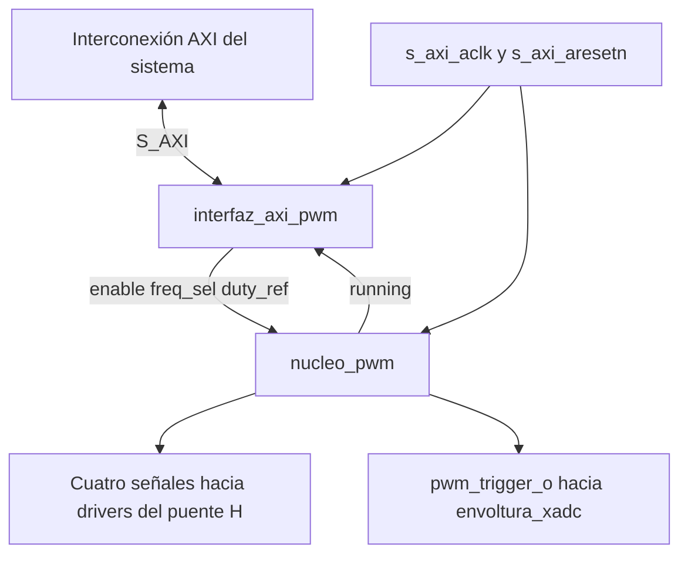
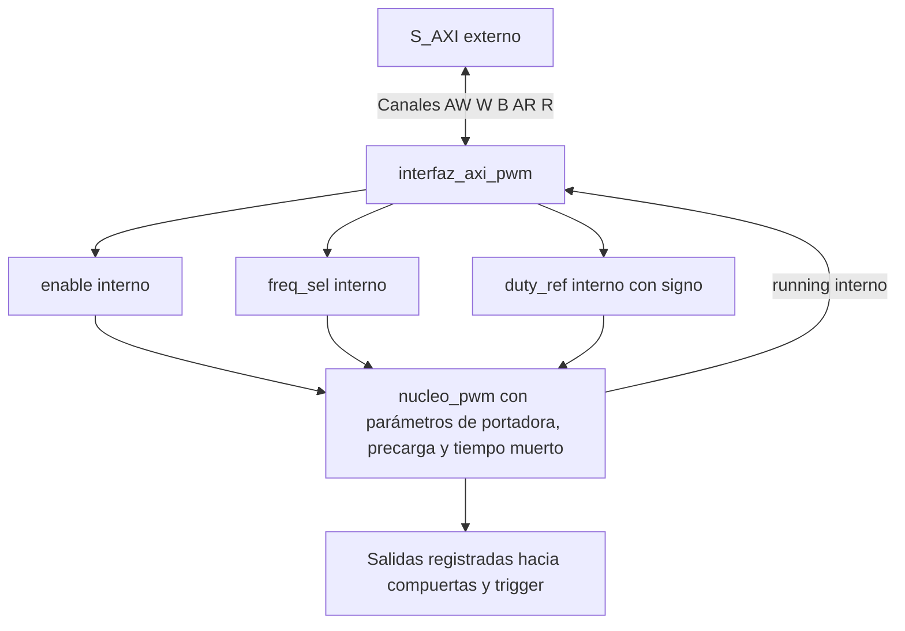
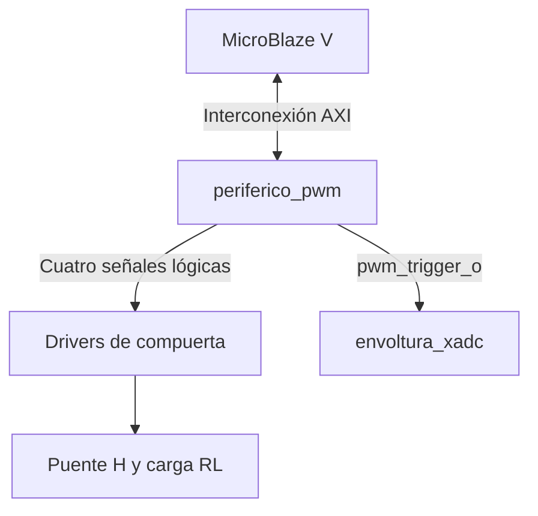

# periferico_pwm

## a) Nombre del módulo

`periferico_pwm`, en `src/design/periferico_pwm.sv`. Es el módulo superior del PWM personalizado y entra al Block Design como módulo RTL de referencia, con la instancia `periferico_pwm_0`.

Integra [`interfaz_axi_pwm`](interfaz_axi_pwm.md), desarrollada como parte de la Persona B, y [`nucleo_pwm`](nucleo_pwm.md), cuya generación de PWM corresponde a la Persona A.

## b) Diagrama modular

El diagrama abre la IP en sus dos módulos. No añade un procesador ni una segunda interconexión dentro del periférico.

## c) Objetivo del módulo

Presentar al sistema una única IP AXI4-Lite que reciba la referencia de modulación y produzca cuatro señales PWM unipolares con tiempo muerto y un trigger de adquisición. La envoltura reúne conexiones, reloj, reset y parámetros sin duplicar las funciones internas.

## d) Entradas

| Grupo | Señales | Propósito |
|---|---|---|
| Reloj | `s_axi_aclk` | Reloj común de 100 MHz |
| Reset | `s_axi_aresetn` | Reset de periféricos activo en bajo |
| Dirección de escritura | `s_axi_awaddr[3:0]`, `s_axi_awprot[2:0]`, `s_axi_awvalid` | Canal AW |
| Dato de escritura | `s_axi_wdata[31:0]`, `s_axi_wstrb[3:0]`, `s_axi_wvalid` | Canal W |
| Aceptación de confirmación | `s_axi_bready` | Finaliza la respuesta B |
| Dirección de lectura | `s_axi_araddr[3:0]`, `s_axi_arprot[2:0]`, `s_axi_arvalid` | Canal AR |
| Aceptación de dato | `s_axi_rready` | Finaliza la respuesta R |

Los nombres de reloj de la envoltura se adaptan internamente a `clk` y `rst_n`, usados por los dos módulos. No se introducen nuevos relojes ni conversiones de dominio.

## e) Salidas

| Grupo | Señales | Propósito |
|---|---|---|
| Aceptación de escritura | `s_axi_awready`, `s_axi_wready` | Handshakes AW y W |
| Respuesta de escritura | `s_axi_bresp[1:0]`, `s_axi_bvalid` | Canal B |
| Aceptación de lectura | `s_axi_arready` | Handshake AR |
| Respuesta de lectura | `s_axi_rdata[31:0]`, `s_axi_rresp[1:0]`, `s_axi_rvalid` | Canal R |
| Pierna A | `compuerta_a_alta`, `compuerta_a_baja` | Señales lógicas hacia sus drivers |
| Pierna B | `compuerta_b_alta`, `compuerta_b_baja` | Señales lógicas hacia sus drivers |
| Sincronización | `pwm_trigger_o` | Pulso registrado hacia la adquisición XADC |

Las salidas de compuerta son señales de control de nivel lógico; el accionamiento eléctrico de los MOSFET se realiza mediante los drivers de potencia.

## f) Relación con otros módulos

La interconexión AXI encamina los accesos del procesador a la IP. `interfaz_axi_pwm` conserva la configuración y lee el estado; `nucleo_pwm` transforma esa orden en compuertas y trigger. La envoltura conecta ambos.

`pwm_trigger_o` se conecta directamente a la envoltura de adquisición. Las cuatro compuertas se llevan a puertos externos del sistema y a los pines definidos por la integración de la Basys 3. La selección y asignación de esos pines corresponde al Block Design y a los constraints.

Los drivers C utilizan los offsets del periférico respecto de la dirección base asignada por Vivado. No se fija en esta ficha una base absoluta ni se añade un Address Translator propio.

## g) Funcionamiento

Tras el reset, la interfaz solicita `enable=0`, `freq_sel=01` y `duty_ref=0`; el núcleo mantiene las cuatro compuertas apagadas. La portadora y el trigger pueden seguir funcionando con el puente deshabilitado, según la especificación del núcleo, para permitir adquirir corriente sin energizarlo.

Al escribir `duty_ref`, la interfaz confirma el almacenamiento y el núcleo calcula y limita la referencia antes de cargar sus registros sombra. Al habilitar, `running` refleja la entrada efectiva en operación en la frontera de período definida. La lectura de `running` llega por AXI; no se convierte en un pin adicional obligatorio de la IP.

La envoltura no tiene una máquina de estados propia. Su control resulta de las máquinas AXI de la interfaz y de las máquinas de habilitación y tiempo muerto del núcleo.

## h) Diseño

### h.1 Distribución de responsabilidades internas

| Función | Módulo que la realiza |
|---|---|
| Protocolo AXI4-Lite y captura de AW y W | `interfaz_axi_pwm` |
| Registros solicitados de configuración | `interfaz_axi_pwm` |
| Instantánea de lectura de `running` | `interfaz_axi_pwm`, utilizando el estado del núcleo |
| Saturación efectiva de la referencia | `nucleo_pwm` |
| Portadora, comparadores y registros sombra | `nucleo_pwm` |
| Precarga, tiempo muerto, compuertas y trigger | `nucleo_pwm` |
| Conexiones, exposición de parámetros y frontera IP | `periferico_pwm` |

Esta separación conserva el reparto del nivel 3 y evita dos versiones diferentes de la misma lógica de saturación o actualización.

### h.2 Conexiones internas

| Origen | Destino | Señal |
|---|---|---|
| `s_axi_aclk` | `interfaz_axi_pwm.clk`, `nucleo_pwm.clk` | Reloj común |
| `s_axi_aresetn` | `interfaz_axi_pwm.rst_n`, `nucleo_pwm.rst_n` | Reset común |
| `interfaz_axi_pwm.enable` | `nucleo_pwm.enable` | 1 bit |
| `interfaz_axi_pwm.freq_sel` | `nucleo_pwm.freq_sel` | 2 bits |
| `interfaz_axi_pwm.duty_ref` | `nucleo_pwm.duty_ref` | 16 bits con signo |
| `nucleo_pwm.running` | `interfaz_axi_pwm.running` | 1 bit |
| Salidas registradas del núcleo | Puertos externos homónimos de la IP | Cuatro compuertas y trigger |

El signo de `duty_ref` debe conservarse tanto en la declaración interna como al conectarlo al núcleo. La envoltura no cambia su escala ni invierte su signo.

### h.3 Parámetros expuestos por la IP

| Parámetro | Valor en el Block Design | Uso |
|---|---:|---|
| `DEAD_TIME_CICLOS` | 100 | Tiempo muerto final de 1 µs a 100 MHz |
| `PRECARGA_CICLOS` | 7000 | Precarga de los capacitores de bootstrap durante 70 µs a 100 MHz |
| `MAX_FREQ_00` | 5000 | 10 kHz a 100 MHz |
| `MAX_FREQ_01` | 2500 | 20 kHz a 100 MHz |
| `MAX_FREQ_10` | 1250 | 40 kHz a 100 MHz |
| `MAX_FREQ_11` | 2500 | Código alternativo equivalente a 20 kHz |

La [sección h.1 del Block Design](block_design.md#h1-instancias-y-configuración) fija los seis valores de la instancia. La sección [Tiempo muerto](https://github.com/Taller-de-diseno-digital-GR01/Proyecto-4-Regulador-PR/blob/08f6ac7c8c3c1e5ac408df8e93421b7c671e3ce0/potencia/diseno_puente_h.md#tiempo-muerto) justifica los 100 ciclos a partir de un peor caso de 813 ns en la cadena de compuertas, con 187 ns de margen. La sección [Precarga en el arranque](https://github.com/Taller-de-diseno-digital-GR01/Proyecto-4-Regulador-PR/blob/08f6ac7c8c3c1e5ac408df8e93421b7c671e3ce0/potencia/diseno_puente_h.md#precarga-en-el-arranque) obtiene aproximadamente 68 µs para 5τ del RC de bootstrap en el peor caso de tolerancias y fija la precarga en 70 µs. Ambos valores se pasan como parámetros al núcleo, que usa `PRECARGA_CICLOS` en el estado `PRECARGA`.

La frecuencia se calcula como `f_clk/(2·MAX)`, siempre que el contador implementado tenga exactamente ese período. En el núcleo actual `MAX_FREQ_00` debe ser el mayor porque fija el ancho de portadora. Las configuraciones de prueba deben respetar esa restricción y usar valores positivos de `MAX`. Un cambio del reloj requiere recalcular `MAX` y los ciclos de tiempo muerto y precarga para mantener las duraciones especificadas.

### h.4 Registros visibles y actualización

La especificación completa de los registros y de sus efectos laterales está en [`interfaz_axi_pwm.md`](interfaz_axi_pwm.md). Esta envoltura no añade registros:

- `0x00`: habilitación, selección de frecuencia y estado `running`.
- `0x04`: referencia solicitada Q2.14 en los 16 bits bajos.

La interfaz ofrece la orden registrada al núcleo. La tubería del núcleo calcula referencias y las copia a los registros activos en el valle. Una escritura cercana al valle puede quedar para un período posterior según la latencia documentada en el núcleo. Los valores de frecuencia y referencias deben llegar juntos a los registros sombra para no producir un período con escalas mezcladas.

La orden `enable=0` se aplica en el valle siguiente según el diseño actual. El apagado por falla y las protecciones deben tener en cuenta esa demora; la envoltura no añade una desconexión inmediata que el núcleo no tenga.

### h.5 Integración en el Block Design

`periferico_pwm` entra al Block Design como módulo RTL de referencia. Vivado infiere la interfaz esclava `S_AXI`, con datos de 32 bits y direcciones de 4 bits, por los atributos `X_INTERFACE_INFO` de los puertos, y le asocia `s_axi_aclk` y `s_axi_aresetn`, con el reset activo en bajo y el reloj de 100 MHz. Las fuentes de síntesis son la envoltura, la interfaz y el núcleo, en `src/design/`, y el banco de prueba queda en `src/sim/`, fuera de la lógica sintetizable. Los seis parámetros de la tabla anterior se fijan en la instancia `periferico_pwm_0`.

El segmento de la instancia es de 4 KiB, con la base que fija la [sección h.2 del Block Design](block_design.md#h2-mapa-de-direcciones). El software usa esa base desde `xparameters.h` y accede a los registros en `0x00` y `0x04`. Como la interfaz decodifica los cuatro bits bajos del offset, los dos registros se repiten cada 16 bytes dentro del segmento.

### h.6 Estrategia de verificación

El [plan de verificación del PWM](../plan_verificacion_pwm.md) detalla los estímulos, resultados esperados y pruebas de integración en FPGA.

El banco de pruebas se conectará al nivel de `periferico_pwm`, realizará transacciones AXI y observará compuertas y trigger. Así se verificará la relación entre escrituras, estado y actuación real, además de probar por separado la interfaz.

Se cubrirán reset, contrapresión, escrituras parciales, saturación, frecuencias, actualización en valle, no solapamiento y tiempo muerto. En cada arranque se comprobará que las dos compuertas bajas permanezcan encendidas durante los 7000 ciclos de precarga y que las altas permanezcan apagadas durante la precarga y el tiempo muerto posterior. La simulación temporizada posterior utilizará la implementación y su SDF con un banco compatible; sus resultados corresponden a una etapa posterior.

## i) Diagrama esquemático detallado del diseño

No hay lógica combinacional adicional entre las salidas registradas del núcleo y los puertos de salida de la envoltura.

## j) Conexiones eléctricas del sistema

Las compuertas se asignan a pines de la Basys 3 con el estándar eléctrico y polaridad acordados con la etapa de potencia. Los drivers deben ser compatibles con el nivel lógico seleccionado. No se conectan las salidas de la FPGA directamente como accionamiento de potencia de los MOSFET.

La asignación de pines está en la [sección h.7 del Block Design](block_design.md#h7-pines). La adquisición analógica y su acondicionamiento pertenecen al camino XADC.

## Referencias

- [Nivel 3 del sistema](../diagramas/nivel03.md), [`nucleo_pwm`](nucleo_pwm.md) y [`interfaz_axi_pwm`](interfaz_axi_pwm.md).
- Instructivo del proyecto, secciones 4.2.2, 4.2.3 y 7.
- AMD, *Vivado Design Suite User Guide: Designing IP Subsystems Using IP Integrator*, UG994, sección Referencing RTL Modules.
