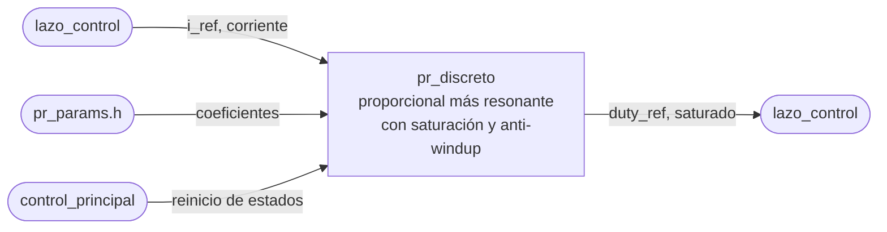

# pr_discreto

## a) Nombre del módulo

`pr_discreto`, en `sw/pr_discreto.c` y `sw/pr_discreto.h`, con los coeficientes en `sw/pr_params.h` generado por `sw/generar_pr_params.py`. Es parte del software del MicroBlaze V del [nivel 3](../diagramas/nivel03.md).

## b) Diagrama modular

## c) Objetivo del módulo

Calcula en cada iteración la ecuación en diferencias del regulador PR y la entrega como un `duty_ref` que el periférico PWM acepta sin tener que saturarlo.

## d) Entradas

- `i_ref` y `corriente` de la iteración, en amperes, como `valor_t`, desde [`lazo_control`](lazo_control.md).
- Los coeficientes de `pr_params.h`.
- La orden de reinicio de estados, desde [`control_principal`](control_principal.md).

## e) Salidas

- `duty_ref`, los 16 bits que se escriben en el offset `0x04` del periférico PWM.
- `saturado`, en uno si la salida se recortó en esta iteración.

## f) Explicación de la relación con otros módulos

Solo lo llama `lazo_control`, una vez por interrupción y con el control habilitado. `control_principal` le reinicia los estados al habilitar, mientras la interrupción todavía no lo usa. La estructura del PR y sus ganancias las diseña PEDP. Este módulo solo implementa la forma discreta que sale de esa estructura. El formato de `duty_ref` se acuerda con Jefferson, que es quien satura en el periférico.

## g) Explicación de funcionamiento

En cada llamada calcula el error, la parte proporcional y el término resonante, los suma y recorta el resultado al rango admisible. Si hubo recorte, corrige el estado del resonante para que no siga creciendo con una salida que no se está aplicando. Por último convierte el índice de modulación al formato de `duty_ref`.

## h) Diseño

### Ecuación en diferencias

Cualquiera de las dos estructuras que se estudian en PEDP, resonante ideal o con amortiguamiento, discretizada con cualquiera de los métodos candidatos (Tustin con o sin precorrección en 50 Hz, ZOH, invariante al impulso), deja el término resonante como un filtro de segundo orden. Con eso el módulo puede quedar escrito antes de que se elija.

- `e[k] = i_ref[k] - corriente[k]`
- `u_p[k] = KP · e[k]`
- `r[k] = B0 · e[k] + B1 · e[k-1] + B2 · e[k-2] - A1 · r[k-1] - A2 · r[k-2]`
- `u[k] = u_p[k] + r[k]`

Los estados son `e[k-1]`, `e[k-2]`, `r[k-1]` y `r[k-2]`. Cada iteración cuesta siete multiplicaciones y seis sumas o restas, más la conversión final.

Si PEDP agrega compensación del retardo de cómputo o un segundo resonante para algún armónico, la ecuación crece en estados y coeficientes, pero la forma de la interfaz no cambia.

### Unidades de la salida

`u[k]` sale como índice de modulación, la tensión que se le pide al puente dividida entre `Vdc`. El script que genera `pr_params.h` mete el `1 / Vdc` dentro de `KP`, `B0`, `B1` y `B2`, así la interrupción no divide y el módulo no necesita conocer `Vdc`.

### Saturación y anti-windup

`u[k]` se recorta a `[-PR_U_MAX, PR_U_MAX]`, con `PR_U_MAX` de `pr_params.h`. Si hubo recorte, el estado que se guarda como `r[k]` no es el calculado sino

`r[k] = u_sat[k] - u_p[k]`

es decir, el valor que el resonante tendría que haber dado para que la suma cayera justo en el límite. Con eso el resonante no acumula energía durante la saturación y, al salir de ella, arranca desde un estado coherente con lo que el puente aplicó de verdad. Es la variante más simple de anti-windup por realimentación de la salida saturada, y se valida contra el modelo de la planta antes de llevarla al banco.

El periférico también satura `duty_ref`, pero el PR no debe depender de eso. Si recortara solo el periférico, el resonante seguiría integrando un error que la planta nunca va a poder seguir, y el software no sabría que se saturó. `PR_U_MAX` tiene que quedar dentro del rango admisible del periférico a cualquier frecuencia de `freq_sel`.

### Conversión a duty_ref

`duty_ref = round(u_sat[k] / DUTY_ESCALA)`, con `DUTY_ESCALA` el índice de modulación que vale un LSB de `duty_ref`. Si `DUTY_CON_SIGNO` es 1 el resultado se guarda en complemento a dos, y si es 0 se le suma el desplazamiento que defina el formato. Las dos constantes viven en `pr_discreto.h` y quedan provisionales con `// TODO: Revisar` hasta acordar el formato con Jefferson.

### Formato numérico

Coeficientes, estados y entradas son `valor_t`, de `sw/numerico.h`. Las multiplicaciones pasan por `valor_mul` para que el cambio a punto fijo quede en un solo lugar. En punto fijo los estados del resonante son los que más crecen, y el formato se elige mirando el valor máximo que alcanza `r[k]` en el modelo con la amplitud de 1,0 A. Esa decisión espera a saber si el MicroBlaze V lleva FPU.

### Coeficientes

`sw/generar_pr_params.py` recibe la estructura, las ganancias, `Vdc`, la frecuencia de muestreo y el método de discretización, y escribe `pr_params.h` con `PR_FRECUENCIA_MUESTREO_HZ`, los coeficientes `PR_KP`, `PR_B0`, `PR_B1`, `PR_B2`, `PR_A1` y `PR_A2` (los `KP`, `B0` y demás de las ecuaciones de arriba) y `PR_U_MAX`. Para retocar ganancias en el banco se cambia la entrada del script, se regenera el header y se recompila, sin tocar `pr_discreto.c`. `PR_FRECUENCIA_MUESTREO_HZ` es la única fuente de la frecuencia de muestreo en todo el programa, porque los coeficientes solo valen para esa frecuencia, y el Timer, `ref_senoidal` y la cabecera de la exportación la toman de ahí.

### Interfaz en C

- `void pr_discreto_reiniciar(void)`, deja los cuatro estados en cero.
- `uint16_t pr_discreto_calcular(valor_t i_ref, valor_t corriente, bool *saturado)`.

### Pendientes

- Estructura del PR, ganancias, `Vdc` y frecuencia de muestreo, de PEDP.
- Método de discretización, que se elige comparando cuál deja el pico resonante en 50 Hz con la frecuencia de muestreo acordada.
- Formato y rango de `duty_ref`, con Jefferson.
- Punto fijo o flotante, según la FPU.

## i) Diagrama esquemático detallado del diseño

No aplica, el regulador es una ecuación en diferencias que el MicroBlaze V ejecuta en software y no tiene compuertas propias.

## j) Diagrama completo de conexiones eléctricas del diseño

No aplica, el módulo no tiene pines ni conexiones eléctricas, su única salida física es el registro `duty_ref` del periférico PWM, que escribe `lazo_control`.
