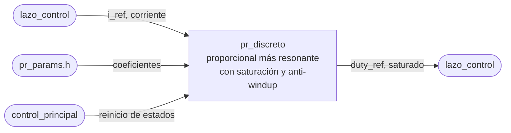

# pr_discreto

## a) Nombre del módulo

`pr_discreto`, en `sw/pr_discreto.c` y `sw/pr_discreto.h`, con los coeficientes en `sw/pr_params.h` generado por `sw/generar_pr_params.m`. Es parte del software del MicroBlaze V del [nivel 3](../diagramas/nivel03.md).

## b) Diagrama modular

## c) Objetivo del módulo

Calcula en cada iteración la ecuación en diferencias del regulador PR y la entrega como un `duty_ref` que el periférico PWM acepta sin tener que saturarlo.

## d) Entradas

- `i_ref` y `corriente` de la iteración, en amperes, como `valor_t`, desde [`lazo_control`](lazo_control.md).
- Los coeficientes de `pr_params.h`.
- La orden de reinicio de estados, desde [`control_principal`](control_principal.md).

## e) Salidas

- `duty_ref`, los 16 bits que se escriben en el offset `0x04` del periférico PWM.
- `saturado`, en uno si la salida se recortó en esta iteración.

## f) Explicación de la relación con otros módulos

Solo lo llama `lazo_control`, una vez por interrupción y con el control habilitado. `control_principal` le reinicia los estados al habilitar, mientras la interrupción todavía no lo usa. La estructura del PR, las ganancias y la discretización las diseña Mattio, y están justificadas en `potencia/diseno_pr.md`. Este módulo solo ejecuta la forma discreta que sale de ahí. El formato de `duty_ref` se acuerda con Jefferson, que es quien satura en el periférico.

## g) Explicación de funcionamiento

En cada llamada calcula el error, la parte proporcional y el término resonante, los suma y recorta el resultado al rango admisible. Si hubo recorte, corrige el estado del resonante para que no siga creciendo con una salida que no se está aplicando. Por último convierte el índice de modulación al formato de `duty_ref`.

## h) Diseño

### h.1) Ecuación en diferencias

El resonante, ideal o amortiguado y discretizado con cualquiera de los métodos candidatos, queda como un filtro de segundo orden. La forma de abajo vale para todos, y lo que cambia de uno a otro son solo los coeficientes.

- `e[k] = i_ref[k] - corriente[k]`
- `u_p[k] = KP · e[k]`
- `r[k] = B0 · e[k] + B1 · e[k-1] + B2 · e[k-2] - A1 · r[k-1] - A2 · r[k-2]`
- `u[k] = u_p[k] + r[k]`

Los estados son `e[k-1]`, `e[k-2]`, `r[k-1]` y `r[k-2]`. Cada iteración cuesta seis multiplicaciones y seis sumas o restas, más la conversión final. `B1` es cero con Tustin precorregido, pero la forma general lo multiplica igual y así el módulo sirve para los otros métodos.

Si más adelante se agrega compensación del retardo de cómputo o un segundo resonante para algún armónico, la ecuación crece en estados y coeficientes, pero la forma de la interfaz no cambia.

### h.2) Estructura y método elegidos

- Estructura ideal, `Gc(s) = Kp + Kr · s / (s² + ω0²)` con `ω0 = 2π · 50`. La referencia la genera el propio MicroBlaze a 50 Hz exactos, así que no hay desvío de frecuencia que justifique el amortiguamiento. La pregunta 5 de `potencia/preguntas_profesor_pr.tex` le consulta esto al profesor.
- Discretización por Tustin con precorrección en 50 Hz, `s = (ω0 / tan(ω0·Ts/2)) · (z-1)/(z+1)`. Con Tustin simple el polo se corre por debajo de 50 Hz, apenas 1 mHz a 20 kHz, y la ganancia infinita deja de caer exacta en la frecuencia de la referencia. Con la precorrección el polo cae exacto en `ω0` y no cuesta nada más, así que no depende de la frecuencia de muestreo que se elija.
- Con `θ = ω0 · Ts` los coeficientes salen en forma cerrada. `B0 = Kr · sin(θ) / (2 · ω0)`, `B1 = 0`, `B2 = -B0`, `A1 = -2 · cos(θ)` y `A2 = 1`. Se verificó que reproducen los valores de la tabla de abajo.

### h.3) Coeficientes de partida

Con `Vdc = 18 V`, `fs = 20 kHz`, `Kp = 16,06 V/A` y `Kr = 3000`, ya divididos entre `Vdc`, para la carga de 10 Ω y 2 mH.

- `PR_KP = 0,8922`
- `PR_B0 = 4,1665e-3`, `PR_B1 = 0`, `PR_B2 = -4,1665e-3`
- `PR_A1 = -1,99975`, `PR_A2 = 1`

Son provisionales hasta medir `L` y `R` reales y confirmar `Vdc` y la frecuencia de muestreo. Si cambian, se regeneran con el script y este módulo no se toca.

### h.4) Unidades de la salida

`u[k]` sale como índice de modulación, la tensión que se le pide al puente dividida entre `Vdc`. El script que genera `pr_params.h` mete el `1 / Vdc` dentro de `KP`, `B0`, `B1` y `B2`, así la interrupción no divide y el módulo no necesita conocer `Vdc`.

### h.5) Saturación y anti-windup

`u[k]` se recorta a `[-PR_U_MAX, PR_U_MAX]`, con `PR_U_MAX` de `pr_params.h`. Si hubo recorte, el estado que se guarda como `r[k]` no es el calculado sino

`r[k] = u_sat[k] - u_p[k]`

es decir, el valor que el resonante tendría que haber dado para que la suma cayera justo en el límite. Con eso el resonante no acumula energía durante la saturación y, al salir de ella, arranca desde un estado coherente con lo que el puente aplicó de verdad. Es la variante más simple de anti-windup por realimentación de la salida saturada, y se valida contra el modelo de la planta antes de llevarla al banco.

Se probó el mecanismo en el lazo discreto de `potencia/diseno_pr.md`, con una referencia de 10 A pico durante dos períodos, que con 18 V no se puede alcanzar, y luego de vuelta a 1,0 A. Con el anti-windup la salida estuvo saturada 35 iteraciones y sin él 181. En la recuperación el error de amplitud baja a 2,7 % a los cuatro períodos contra 3,8 % sin anti-windup, y el pico de corriente después de la saturación es 2,58 A contra 2,71 A. La mejora es moderada porque la recuperación la manda el polo del resonante en lazo cerrado, de 17 ms. Falta el caso con tiempo muerto y cuantización, que es del PLECS.

El periférico también satura `duty_ref`, pero el PR no debe depender de eso. Si recortara solo el periférico, el resonante seguiría integrando un error que la planta nunca va a poder seguir, y el software no sabría que se saturó. `PR_U_MAX` tiene que quedar dentro del rango admisible del periférico, que según Jefferson es de -1,0 a +1,0 igual en todas las frecuencias de `freq_sel`, así que 1,0 es el tope. Por debajo de eso lo fijan el tiempo muerto y el bootstrap. Con el índice cerca de 1,0 un pulso queda más corto que `DEAD_TIME_CICLOS` y el puente deja de seguir, y la compuerta baja tiene que conducir al menos 100 ciclos por período para recargar el capacitor de la alta. Con `MAX = 2500` a 20 kHz eso da `PR_U_MAX < 1 - (DEAD_TIME_CICLOS + 100) / MAX = 0,92`.

### h.6) Conversión a duty_ref

`duty_ref = round(u_sat[k] / DUTY_ESCALA)`, con `DUTY_ESCALA` el índice de modulación que vale un LSB de `duty_ref`. El formato lo fijó Jefferson en Q2.14 con signo en complemento a dos, con bits `[15:0]` del offset `0x04`, así que `DUTY_ESCALA = 1/16384` y `DUTY_CON_SIGNO = 1`. El valor 1,0 es 16384 (`0x4000`) y -1,0 es -16384 (`0xC000`), los dos caben en 16 bits. Las dos constantes viven en `pr_discreto.h`.

El LSB de 1/16384 es más fino que lo que el núcleo PWM resuelve de verdad, que es `2/MAX`, o sea 0,0008 a 20 kHz. La cuantización que importa es la del periférico y no la del formato.

### h.7) Formato numérico

Coeficientes, estados y entradas son `valor_t`, de `sw/numerico.h`. Las multiplicaciones pasan por `valor_mul` para que el cambio a punto fijo quede en un solo lugar. En punto fijo los estados del resonante son los que más crecen, y el formato se elige mirando el valor máximo que alcanza `r[k]` en el modelo con la amplitud de 1,0 A. `A1` es el coeficiente que manda. Está a 2,5e-4 de -2 y esa diferencia fija la frecuencia del polo, para mantenerlo a 0,1 Hz de 50 Hz hace falta resolverla a 1e-6, o sea unos 20 bits fraccionarios. En punto fijo eso obliga a un formato con dos bits enteros y multiplicaciones con intermedio de 64 bits. En flotante de 32 bits sobra resolución, el paso de `A1` ahí es de 1,2e-7, unos 0,012 Hz del polo, con un error de seguimiento menor a 0,03 %, así que el diseño apunta a habilitar la FPU y dejar `valor_t` en `float`. La decisión final es de Nicolás en el Block Design, y si no hay FPU se pasa a punto fijo cambiando solo `numerico.h`.

### h.8) Generador de coeficientes

`sw/generar_pr_params.m` recibe la estructura, las ganancias, `Vdc`, la frecuencia de muestreo y el método de discretización, y escribe `pr_params.h` con `PR_FRECUENCIA_MUESTREO_HZ`, los coeficientes `PR_KP`, `PR_B0`, `PR_B1`, `PR_B2`, `PR_A1` y `PR_A2` (los `KP`, `B0` y demás de las ecuaciones de arriba) y `PR_U_MAX`. Para retocar ganancias en el banco se cambia la entrada del script, se regenera el header y se recompila, sin tocar `pr_discreto.c`. Corre igual en Octave y en MATLAB. `coeficientes_resonante` implementa la fórmula de `tustin_prewarp` de h.2 para la estructura ideal, y las demás combinaciones terminan en `error` hasta que PEDP pida alguna. `sw/pruebas/prueba_generar_pr_params.m` lo revisa contra los coeficientes de `potencia/diseno_pr.md`. `PR_FRECUENCIA_MUESTREO_HZ` es la única fuente de la frecuencia de muestreo en todo el programa, porque los coeficientes solo valen para esa frecuencia, y el Timer, `ref_senoidal` y la cabecera de la exportación la toman de ahí.

### h.9) Interfaz en C

- `void pr_discreto_reiniciar(void)`, deja los cuatro estados en cero.
- `uint16_t pr_discreto_calcular(valor_t i_ref, valor_t corriente, bool *saturado)`.

### h.10) Pendientes

- `L` y `R` reales de la carga, que caracteriza Jefferson, y `Vdc` y la frecuencia de muestreo definitiva, que salen de la `f_sw` que elige Nicolás. Con ellos se repite la sintonización.
- `PR_U_MAX` queda en 0,92. Nicolás cerró el tiempo muerto en #18 con `DEAD_TIME_CICLOS = 100` (813 ns de peor caso, en `potencia/diseno_puente_h.md`), y en #7 dejó el límite `PR_U_MAX < 1 - (DEAD_TIME_CICLOS + 100) / MAX`, con `MAX = 2500` a 20 kHz. Pasado `1 - DEAD_TIME_CICLOS / MAX = 0,96` el pulso alto de la pierna B desaparece, y el requisito de 100 ciclos de la baja para el bootstrap ya cubre ese caso. El valor se revisa si cambia `DEAD_TIME_CICLOS`.
- FPU del MicroBlaze V, con Nicolás.
- Sumar el retardo del filtro antialias (Jefferson, #29, todavía sin entregar) al `Td = 1,5 · Ts` de `potencia/diseno_pr.md` y recalcular los márgenes. Hay presupuesto de sobra. El margen de fase nominal es 79° y baja a 45° con 96 µs extra, un RC de 2 a 5 kHz deja entre 59° y 69°, y 2 µs de aislamiento dejan 78,5°. Nicolás cerró el aislamiento en #21 y #34 con un retardo de la cadena de 0,1 a 0,91 µs, dentro de esos 2 µs. La asimetría del aislamiento no entra al `Td`, la cubre el tiempo muerto.
- Respuesta del profesor sobre la estructura ideal.
- Completar la validación de saturación y anti-windup en el PLECS que arma Nicolás (#38), con tiempo muerto y cuantización del ADC, que el lazo discreto de `potencia/diseno_pr.md` no tiene.

## i) Diagrama esquemático detallado del diseño

No aplica, el regulador es una ecuación en diferencias que el MicroBlaze V ejecuta en software y no tiene compuertas propias.

## j) Diagrama completo de conexiones eléctricas del diseño

No aplica, el módulo no tiene pines ni conexiones eléctricas, su única salida física es el registro `duty_ref` del periférico PWM, que escribe `lazo_control`.
