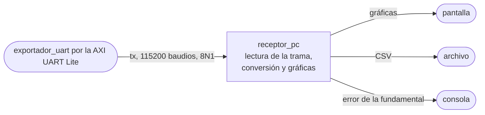

# receptor_pc

## a) Nombre del módulo

`receptor_pc`, en `sw/receptor_pc.py`, con la detección del puerto en `sw/enlace.py`. Es el único módulo del software del [nivel 3](../diagramas/nivel03.md) que corre en la computadora y no en el MicroBlaze V.

## b) Diagrama modular

## c) Objetivo del módulo

Recibe la trama del histórico por el puerto serie, la valida, la pasa a unidades físicas y la grafica fuera de línea, junto con el error de la fundamental que piden los ensayos.

## d) Entradas

- Los bytes de la trama de [`exportador_uart`](exportador_uart.md), por el puerto serie del FT2232 de la Basys 3, a 115200 baudios y 8N1.
- Opcionalmente, un archivo con una trama ya capturada, para repetir el análisis sin la placa.

## e) Salidas

- Un CSV con una fila por registro y las columnas `t_s`, `corriente_a`, `i_ref_a`, `duty`, `saturado`, `dato_ausente`, `habilitado` y `falla`.
- Una figura con la corriente medida y la referencia contra el tiempo, y otra con `duty` contra el tiempo, con las iteraciones saturadas o en falla marcadas.
- El error de la fundamental en consola, con la amplitud y la fase de la corriente y de la referencia por separado.

## f) Explicación de la relación con otros módulos

Su única fuente es `exportador_uart`, y su única referencia de formato es la tabla de la trama de ese módulo. Toda la calibración y la escala llegan en la cabecera, así que `receptor_pc` no guarda ninguna constante del firmware. La PC no le manda nada a la FPGA.

## g) Explicación de funcionamiento

1. Detecta el puerto de la Basys 3 con `enlace.py`, que viene del Proyecto 3 y busca el FT2232 por su VID y PID con pyserial.
2. Espera un `0xAA`, lee los 19 bytes de cabecera y saca `cantidad`.
3. Lee los `6 · cantidad` bytes de registros y los 2 de la suma, y compara la suma recibida con la calculada sobre los bytes 1 en adelante. Si no coinciden, descarta todo y vuelve a esperar un `0xAA`.
4. Desempaca cada registro y convierte con los campos de la cabecera.
   - `t_s = n / frecuencia_muestreo_hz`.
   - `corriente_a = (cuenta - adc_offset_cuentas) · amperes_por_cuenta`.
   - `i_ref_a = i_ref_ma / 1000`.
   - `duty = duty_ref · duty_escala`, leyendo `duty_ref` con signo si `duty_con_signo` es 1.
5. Escribe el CSV, calcula el error de la fundamental y muestra las figuras.

## h) Diseño

### Lectura de la trama

La trama se desempaca con `struct` y el formato little-endian `<`, que calza con el orden del MicroBlaze V. La cabecera es `<HIfffB` después del `0xAA` y cada registro es `<Hhh`, con `duty_ref` leído como entero sin signo cuando `duty_con_signo` es 0. El puerto se abre con un tiempo de espera, para que una exportación cortada a la mitad termine en un error claro en vez de dejar el script colgado.

### Error de la fundamental

Se ajusta por mínimos cuadrados `a · cos(2π · 50 · t) + b · sin(2π · 50 · t) + c` a la corriente medida y, aparte, a la referencia, sobre una ventana de un número entero de períodos de 50 Hz, de al menos cinco. El ajuste sirve aunque la frecuencia de muestreo no sea múltiplo de 50 Hz, cosa que una DFT directa no permite sin fuga espectral.

De cada ajuste salen el fasor de la fundamental, con amplitud `sqrt(a² + b²)` y su fase. El error que se informa es

`error = |I1 - R1| / |R1| · 100 %`

con `I1` y `R1` los fasores de la corriente y de la referencia. Ese error incluye amplitud y fase a la vez, y por eso también se informan las dos por separado. Si la ventana contiene iteraciones con `habilitado` en cero o con `falla`, el script lo avisa, porque el resultado ya no representa un ensayo en régimen.

### Rizado de conmutación

El rizado no se puede medir con estas muestras. El ADC muestrea en el centro del pulso, sincronizado con `pwm_trigger_o`, justamente para no ver el rizado, y además muestrea a lo sumo una vez por período de conmutación. Lo que queda en la corriente después de quitarle la fundamental es distorsión de baja frecuencia y no el rizado. El criterio de menos de 0,20 A pico a pico se mide con el osciloscopio sobre la corriente de la carga, y el script solo informa ese residuo con su nombre para no confundirlo.

### Archivos y dependencias

- `sw/receptor_pc.py`, el script, con la ruta del puerto o de una trama guardada como argumento opcional.
- `sw/enlace.py`, copiado del Proyecto 3 sin la parte de envío.
- `pyserial`, `numpy` y `matplotlib`, en `sw/requirements.txt`.

### Prueba sin la placa

La trama que genera la prueba en la PC de `exportador_uart` se guarda en un archivo, y `receptor_pc` se corre sobre ese archivo. Si con una senoidal conocida en la trama sale la amplitud y el error esperados, el formato y la conversión quedan verificados de punta a punta antes de conectar la Basys 3.

## i) Diagrama esquemático detallado del diseño

No aplica, el módulo es un script de Python que corre en la computadora y no tiene hardware propio.

## j) Diagrama completo de conexiones eléctricas del diseño

No aplica, la única conexión es el cable USB entre la computadora y la Basys 3, que ya está en el nivel 1.
