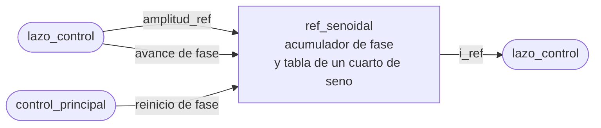

# ref_senoidal

## a) Nombre del módulo

`ref_senoidal`, en `sw/ref_senoidal.c` y `sw/ref_senoidal.h`. Es parte del software del MicroBlaze V del [nivel 3](../diagramas/nivel03.md).

## b) Diagrama modular

## c) Objetivo del módulo

Entrega en cada iteración del control la muestra de la referencia sinusoidal de 50 Hz que toca, escalada a la amplitud pedida.

## d) Entradas

- `frecuencia_muestreo_hz`, una sola vez al iniciar, para calcular cuánto avanza la fase por iteración. Sale de `PR_FRECUENCIA_MUESTREO_HZ` en `pr_params.h`.
- `amplitud_ref`, en cada llamada, en amperes pico y como `valor_t`.
- Orden de reinicio de fase, desde [`control_principal`](control_principal.md) al habilitar el control.

## e) Salidas

- `i_ref`, la muestra de la referencia en amperes, como `valor_t`.

## f) Explicación de la relación con otros módulos

Solo lo llama [`lazo_control`](lazo_control.md), una vez por interrupción y únicamente con el control habilitado. `control_principal` lo inicia en el arranque y le reinicia la fase al habilitar, mientras la interrupción todavía no lo usa. El `i_ref` que devuelve entra a [`pr_discreto`](pr_discreto.md) y también queda guardado en [`buffer_muestras`](buffer_muestras.md).

## g) Explicación de funcionamiento

Lleva la fase de la senoidal en un acumulador de 32 bits, donde una vuelta completa del acumulador es un período de 50 Hz. En cada llamada lee el seno de la fase actual en una tabla, lo multiplica por `amplitud_ref` y después suma a la fase un incremento fijo. La primera muestra después de un reinicio es cero, así que la referencia arranca sin escalón.

El cambio de amplitud entra en la muestra siguiente sin tocar la fase, que es lo que pide el ensayo de cambio de amplitud de la sección 4.3.

## h) Diseño

### Por qué un acumulador de fase

En el nivel 3 quedaron dos caminos, una tabla de un período exacto si la frecuencia de muestreo es múltiplo de 50 Hz, o un acumulador si no. El acumulador sirve en los dos casos, así que se elige desde ya y el módulo no depende de una frecuencia que todavía no se acordó con PEDP.

El incremento por iteración es

`incremento = round(50 · 2^32 / frecuencia_muestreo_hz)`

y se calcula una vez en `ref_senoidal_iniciar` con aritmética entera de 64 bits. El error de frecuencia que deja el redondeo es como mucho `frecuencia_muestreo_hz / 2^33`, del orden de microhertz para cualquier frecuencia de muestreo razonable, y la fase no acumula error porque el acumulador desborda solo al completar la vuelta.

### Tabla de un cuarto de onda

Con 32 KB para programa, datos e histórico, una tabla de un período completo con buena resolución no cabe. Se guarda solo el primer cuarto, de 0 a π/2, en 257 entradas, y los otros tres cuadrantes salen por simetría. La entrada 256 es sin(π/2) = 1 y hace falta para que el segundo cuadrante, que recorre la tabla al revés, empiece exacto.

La fase se corta en sus 10 bits altos, lo que da 1024 posiciones por período.

- `fase[31:30]`, cuadrante.
- `fase[29:22]`, índice `i` dentro del cuarto, de 0 a 255.

| Cuadrante | Muestra |
| --- | --- |
| `00` | `tabla[i]` |
| `01` | `tabla[256 - i]` |
| `10` | `-tabla[i]` |
| `11` | `-tabla[256 - i]` |

Cortar la fase a 1024 posiciones produce un error de amplitud de a lo sumo 2π/1024, un 0,6 % del pico, que aparece como armónicos de alto orden y no como error de la fundamental. Si en el nivel de pruebas resulta poco, se agrega interpolación lineal entre dos entradas vecinas sin cambiar la interfaz.

La tabla se llena en `ref_senoidal_iniciar` con `sinf`. Así no hace falta generar un arreglo constante aparte, y el costo de `sinf` queda en el arranque y nunca en la interrupción. Con `valor_t` en punto flotante ocupa 257 · 4 = 1028 bytes.

### Formato numérico

La amplitud, la tabla y la salida son `valor_t`, el tipo único que define `sw/numerico.h`. Hoy es `float` porque todavía no se sabe si el MicroBlaze V lleva FPU. Si se pasa a punto fijo, el cambio queda en `numerico.h` y en las dos líneas de este módulo que multiplican y llenan la tabla, porque usan `valor_mul` y `VALOR` en vez de operar directo sobre `float`.

### Interfaz en C

- `void ref_senoidal_iniciar(uint32_t frecuencia_muestreo_hz)`, llena la tabla, calcula el incremento y deja la fase en cero.
- `void ref_senoidal_reiniciar_fase(void)`, deja la fase en cero.
- `valor_t ref_senoidal_siguiente(valor_t amplitud_ref)`, devuelve la muestra de la fase actual y avanza la fase.

El estado es la fase, el incremento y la tabla, todos `static` dentro de `ref_senoidal.c`. La fase la escribe solo la interrupción, salvo en el reinicio, que `control_principal` hace con el control deshabilitado.

### Prueba en la PC

`sw/pruebas/prueba_ref_senoidal.c` se compila con gcc y revisa que la primera muestra sea cero, que un período tenga la cantidad de muestras esperada, que los picos lleguen a la amplitud y que un cambio de amplitud no mueva la fase.

## i) Diagrama esquemático detallado del diseño

No aplica, el módulo es una función en C que corre en el MicroBlaze V y no tiene compuertas propias que dibujar.

## j) Diagrama completo de conexiones eléctricas del diseño

No aplica, el módulo no tiene pines ni conexiones eléctricas, solo vive en la memoria del procesador.
