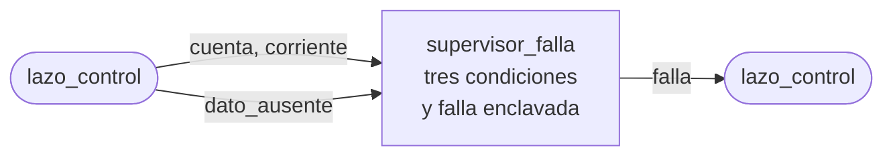

# supervisor_falla

## a) Nombre del módulo

`supervisor_falla`, en `sw/supervisor_falla.c` y `sw/supervisor_falla.h`. Es parte del software del MicroBlaze V del [nivel 3](../diagramas/nivel03.md).

## b) Diagrama modular

## c) Objetivo del módulo

Decide en cada iteración si la medición obliga a apagar el puente, y una vez que decide que sí, lo sostiene hasta el reinicio.

## d) Entradas

- `cuenta`, la muestra cruda del ADC de esta iteración, de 0 a 4095.
- `corriente`, la misma muestra ya convertida a amperes con signo, como `valor_t`.
- `dato_ausente`, aviso de que en esta iteración no hubo muestra nueva.
- Los umbrales, como `#define` en `supervisor_falla.h`.
  - `UMBRAL_SOBRECORRIENTE`, en amperes.
  - `CUENTA_ADC_MIN` y `CUENTA_ADC_MAX`, límites de la escala útil del ADC.
  - `ITERACIONES_SIN_DATO_MAX`, cuántas iteraciones seguidas sin dato se toleran.

## e) Salidas

- `falla`, en uno desde la iteración en que se detecta hasta `BTN_RST`.

## f) Explicación de la relación con otros módulos

Solo lo llama [`lazo_control`](lazo_control.md), una vez por interrupción y antes de calcular el PR. Si devuelve falla, `lazo_control` apaga el PWM por medio de [`drivers`](drivers.md) en esa misma iteración y publica `falla` para [`control_principal`](control_principal.md), que enciende el LED y deja de aceptar `BTN_HABILITAR`. La protección física y el corte del driver los diseña Nicolás en la etapa de potencia, este módulo los complementa. El tiempo desde la detección hasta el apagado incluye la escritura AXI, la espera hasta el valle que capture `enable` y la latencia registrada de las compuertas. A 20 kHz, un período de portadora dura 50 µs.

## g) Explicación de funcionamiento

Cada iteración termina en una de dos llamadas. Si hubo dato, `lazo_control` llama a `supervisor_falla_revisar` con la cuenta y la corriente. Si no hubo, llama a `supervisor_falla_sin_dato`. Cualquiera de las dos devuelve el estado de falla ya actualizado.

Hay tres condiciones de falla.

1. Sobrecorriente, cuando `corriente > UMBRAL_SOBRECORRIENTE` o `corriente < -UMBRAL_SOBRECORRIENTE`.
2. Sensor fuera de escala, cuando `cuenta <= CUENTA_ADC_MIN` o `cuenta >= CUENTA_ADC_MAX`. Con el offset de unos 0,5 V del acondicionamiento, la corriente normal queda lejos de los extremos, así que una muestra pegada a uno de ellos indica que el sensor se desconectó o que la corriente se salió de lo que se puede medir.
3. Falta de dato, cuando el contador de llamadas consecutivas a `supervisor_falla_sin_dato` supera `ITERACIONES_SIN_DATO_MAX`. Con el valor provisional de 3, las primeras tres ausencias se toleran y la cuarta enclava la falla.

Una muestra nueva reinicia el contador de ausencias consecutivas. La falla ya enclavada se conserva hasta el reinicio.

## h) Diseño

### h.1) Enclavamiento

`falla` es una variable `static` que solo pasa de cero a uno. Ninguna función del módulo la baja, y `supervisor_falla_iniciar` la deja en cero en el arranque. Como `BTN_RST` reinicia la plataforma completa y el programa vuelve a arrancar desde `main`, ese es el único camino para salir de la falla. `BTN_HABILITAR` no la borra, para que un operador no pueda reenergizar el puente sin revisar qué pasó.

### h.2) Por qué la sobrecorriente no lleva filtro

Comparar una sola muestra contra el umbral hace que un pico aislado de ruido pueda disparar la falla. Se acepta así, porque un falso disparo solo obliga a reiniciar, y un filtro de varias muestras retrasa el apagado justo cuando la corriente está creciendo. Si en el banco aparecen disparos falsos, la primera revisión es el filtro antialias y el muestreo en el centro del pulso, antes que agregar un filtro acá.

### h.3) Comparación sin valor absoluto

La sobrecorriente se revisa con dos comparaciones en vez de con `fabsf`. Funciona igual con `valor_t` en punto flotante o en punto fijo y no necesita una función de valor absoluto en `numerico.h`. Las comparaciones van negadas, `!(corriente <= umbral && corriente >= -umbral)`, para que un NaN dé falla en lugar de pasar por falso en las dos.

### h.4) Valores provisionales

Ninguno de los umbrales está acordado todavía. Quedan con un valor provisional marcado con `// TODO: Revisar` en `supervisor_falla.h`.

- `UMBRAL_SOBRECORRIENTE` depende de la corriente máxima de los ensayos (1,0 A pico) más el rizado, y de lo que aguanten el puente y la carga. Lo fija la etapa de potencia. Se simuló el escalón de 0,2 A a 1,0 A pico con el PR de `potencia/diseno_pr.md` en el lazo discreto promedio, en 20 instantes del período y con `L` de 0,7 a 1,3 mH y `R` de 1,5 a 2,5 Ω. El pico máximo fue 1,016 A, así que el transitorio no se acerca a 1,3 A. El rizado de conmutación no entra en esa simulación y es de unos 0,02 A de pico con la `L` de partida, así que el pico total ronda 1,04 A, bien debajo de 1,3 A. El margen que queda entre ese pico de 1,04 A y el umbral es de 0,26 A, y el ruido pico del sensor (lo mide Jefferson en #29) tiene que quedar por debajo, unas 320 cuentas del ADC con la sensibilidad teórica de `lazo_control.md`, que es de sobra para un sensor aceptable.

  Lo que el umbral no cubre es la subida de corriente mientras el apagado se hace efectivo. Desde que la corriente cruza el umbral hasta que las compuertas quedan en bajo pasan hasta dos períodos, uno hasta que la siguiente muestra la ve y otro hasta que el núcleo PWM toma `enable` en el valle, o sea hasta 100 µs. Si el PR está saturado en `PR_U_MAX = 0,92` en ese momento, la pendiente es `(0,92 · Vdc - R · I) / L`. Con 18 V, 1 mH, 2 Ω y 1,3 A son unos 14 A/ms y suma 1,4 A en 100 µs, y con 24 V y 0,7 mH son unos 28 A/ms y 2,8 A. Es un peor caso que no se da con el lazo funcionando, porque en los ensayos previstos el PR no satura, pero sí con una carga en cortocircuito o un sensor que lee de menos. Quiere decir que el puente y la carga tienen que aguantar un pico de entre 2,7 y 4,1 A, o que la protección por hardware que diseña Nicolás (#19) tiene que actuar antes, porque el umbral por software solo ve lo que el sensor mide.

- `CUENTA_ADC_MIN` y `CUENTA_ADC_MAX` dependen de la ganancia y el offset reales del acondicionamiento, que mide Jefferson. Con la sensibilidad teórica de 0,3 V/A de `lazo_control.md` (h.6), 16 y 4079 cuentas equivalen a ±1,65 A, por encima del umbral de 1,3 A, así que la sobrecorriente dispara primero y el fuera de escala queda para el sensor desconectado. Con 0,4 V/A valdrían ±1,24 A y el orden se invertiría.
- `ITERACIONES_SIN_DATO_MAX = 3` es provisional. Mientras las ausencias sean toleradas, el PWM conserva el último `duty_ref`. El umbral debe validarse junto con el tiempo de detección y apagado. Con la fase ajustada según [control principal](control_principal.md), el funcionamiento nominal debe entregar una muestra nueva por ISR.

### h.5) Interfaz en C

- `void supervisor_falla_iniciar(void)`, deja `falla` y el contador en cero.
- `bool supervisor_falla_revisar(uint16_t cuenta, valor_t corriente)`, revisa las dos primeras condiciones y reinicia el contador sin dato.
- `bool supervisor_falla_sin_dato(void)`, cuenta una iteración más sin dato y revisa la tercera condición.
- `bool supervisor_falla_activa(void)`, consulta el estado sin modificarlo.

### h.6) Prueba en la PC

`sw/pruebas/prueba_supervisor_falla.c` se compila con gcc y recorre cada condición por separado, los bordes de cada umbral, el enclavamiento después de que la medición vuelve a la normalidad y la secuencia de ausencias. Verifica que la cuarta ausencia consecutiva dispare, que una muestra nueva reinicie la cuenta de ausencias y que una muestra nueva posterior a la falla mantenga el enclavamiento.

## i) Diagrama esquemático detallado del diseño

No aplica, el módulo son comparaciones en C dentro del programa del MicroBlaze V y no tiene compuertas propias.

## j) Diagrama completo de conexiones eléctricas del diseño

No aplica, el módulo no tiene pines ni conexiones eléctricas, el apagado físico lo ejecutan el periférico PWM y la etapa de potencia.
