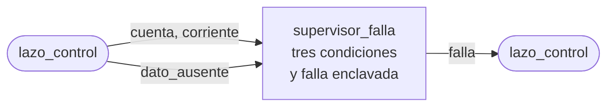

# supervisor_falla

## a) Nombre del módulo

`supervisor_falla`, en `sw/supervisor_falla.c` y `sw/supervisor_falla.h`. Es parte del software del MicroBlaze V del [nivel 3](../diagramas/nivel03.md).

## b) Diagrama modular

## c) Objetivo del módulo

Decide en cada iteración si la medición obliga a apagar el puente, y una vez que decide que sí, lo sostiene hasta el reinicio.

## d) Entradas

- `cuenta`, la muestra cruda del ADC de esta iteración, de 0 a 4095.
- `corriente`, la misma muestra ya convertida a amperes con signo, como `valor_t`.
- `dato_ausente`, aviso de que en esta iteración no hubo muestra nueva.
- Los umbrales, como `#define` en `supervisor_falla.h`.
  - `UMBRAL_SOBRECORRIENTE`, en amperes.
  - `CUENTA_ADC_MIN` y `CUENTA_ADC_MAX`, límites de la escala útil del ADC.
  - `ITERACIONES_SIN_DATO_MAX`, cuántas iteraciones seguidas sin dato se toleran.

## e) Salidas

- `falla`, en uno desde la iteración en que se detecta hasta `BTN_RST`.

## f) Explicación de la relación con otros módulos

Solo lo llama [`lazo_control`](lazo_control.md), una vez por interrupción y antes de calcular el PR. Si devuelve falla, `lazo_control` apaga el PWM por medio de [`drivers`](drivers.md) en esa misma iteración y publica `falla` para [`control_principal`](control_principal.md), que enciende el LED y deja de aceptar `BTN_HABILITAR`. La protección física y el corte del driver los diseña la etapa de potencia, este módulo los complementa.

## g) Explicación de funcionamiento

Cada iteración termina en una de dos llamadas. Si hubo dato, `lazo_control` llama a `supervisor_falla_revisar` con la cuenta y la corriente. Si no hubo, llama a `supervisor_falla_sin_dato`. Cualquiera de las dos devuelve el estado de falla ya actualizado.

Hay tres condiciones de falla.

1. Sobrecorriente, cuando `corriente > UMBRAL_SOBRECORRIENTE` o `corriente < -UMBRAL_SOBRECORRIENTE`.
2. Sensor fuera de escala, cuando `cuenta <= CUENTA_ADC_MIN` o `cuenta >= CUENTA_ADC_MAX`. Con el offset de unos 0,5 V del acondicionamiento, la corriente normal queda lejos de los extremos, así que una muestra pegada a uno de ellos indica que el sensor se desconectó o que la corriente se salió de lo que se puede medir.
3. Falta de dato, cuando se acumulan más de `ITERACIONES_SIN_DATO_MAX` llamadas seguidas a `supervisor_falla_sin_dato`. Sin muestra nueva el lazo trabaja a ciegas. Una iteración aislada sin dato se tolera, porque el Timer y el disparo del PWM no comparten fase y puede pasar que una conversión llegue tarde.

El contador de iteraciones sin dato vuelve a cero en cada `supervisor_falla_revisar`.

## h) Diseño

### Enclavamiento

`falla` es una variable `static` que solo pasa de cero a uno. Ninguna función del módulo la baja, y `supervisor_falla_iniciar` la deja en cero en el arranque. Como `BTN_RST` reinicia la plataforma completa y el programa vuelve a arrancar desde `main`, ese es el único camino para salir de la falla. `BTN_HABILITAR` no la borra, para que un operador no pueda reenergizar el puente sin revisar qué pasó.

### Por qué la sobrecorriente no lleva filtro

Comparar una sola muestra contra el umbral hace que un pico aislado de ruido pueda disparar la falla. Se acepta así, porque un falso disparo solo obliga a reiniciar, y un filtro de varias muestras retrasa el apagado justo cuando la corriente está creciendo. Si en el banco aparecen disparos falsos, la primera revisión es el filtro antialias y el muestreo en el centro del pulso, antes que agregar un filtro acá.

### Comparación sin valor absoluto

La sobrecorriente se revisa con dos comparaciones en vez de con `fabsf`. Funciona igual con `valor_t` en punto flotante o en punto fijo y no necesita una función de valor absoluto en `numerico.h`.

### Valores provisionales

Ninguno de los umbrales está acordado todavía. Quedan con un valor provisional marcado con `// TODO: Revisar` en `supervisor_falla.h`.

- `UMBRAL_SOBRECORRIENTE` depende de la corriente máxima de los ensayos (1,0 A pico) más el rizado, y de lo que aguanten el puente y la carga. Lo fija la etapa de potencia.
- `CUENTA_ADC_MIN` y `CUENTA_ADC_MAX` dependen de la ganancia y el offset reales del acondicionamiento, que mide Nicolás.
- `ITERACIONES_SIN_DATO_MAX` depende de la relación entre el período del Timer y el del disparo del PWM.

### Interfaz en C

- `void supervisor_falla_iniciar(void)`, deja `falla` y el contador en cero.
- `bool supervisor_falla_revisar(uint16_t cuenta, valor_t corriente)`, revisa las dos primeras condiciones y reinicia el contador sin dato.
- `bool supervisor_falla_sin_dato(void)`, cuenta una iteración más sin dato y revisa la tercera condición.
- `bool supervisor_falla_activa(void)`, consulta el estado sin modificarlo.

### Prueba en la PC

`sw/pruebas/prueba_supervisor_falla.c` se compila con gcc y recorre cada condición por separado, los bordes de cada umbral, el enclavamiento después de que la medición vuelve a la normalidad y la tolerancia a iteraciones aisladas sin dato.

## i) Diagrama esquemático detallado del diseño

No aplica, el módulo son comparaciones en C dentro del programa del MicroBlaze V y no tiene compuertas propias.

## j) Diagrama completo de conexiones eléctricas del diseño

No aplica, el módulo no tiene pines ni conexiones eléctricas, el apagado físico lo ejecutan el periférico PWM y la etapa de potencia.
