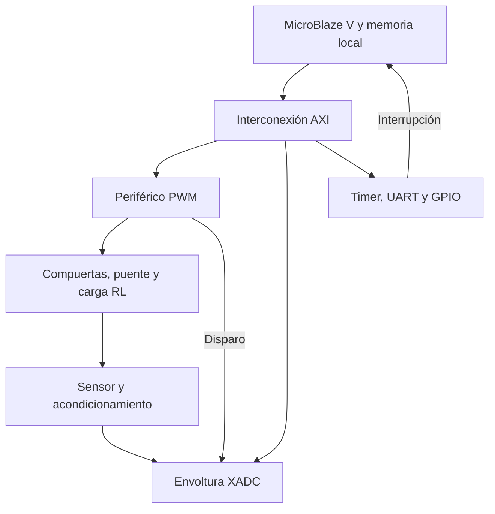
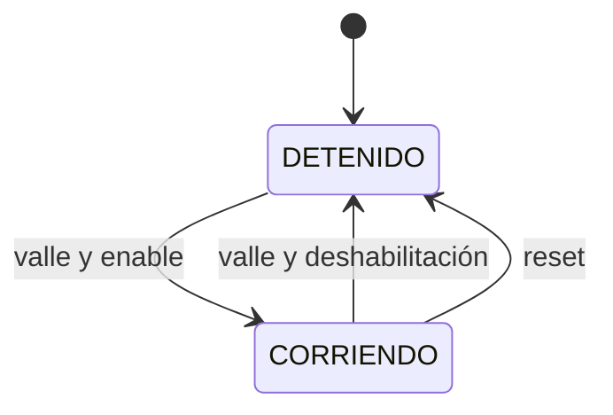
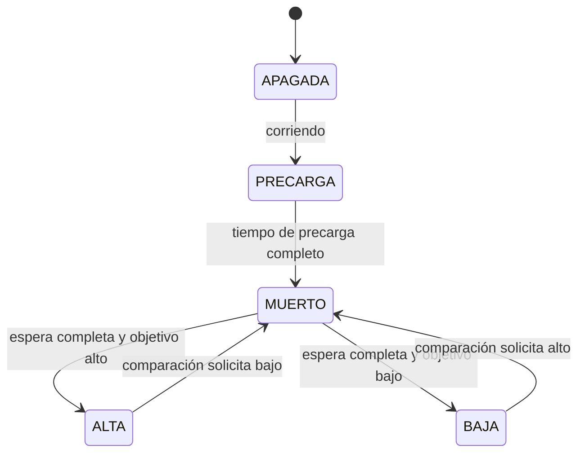
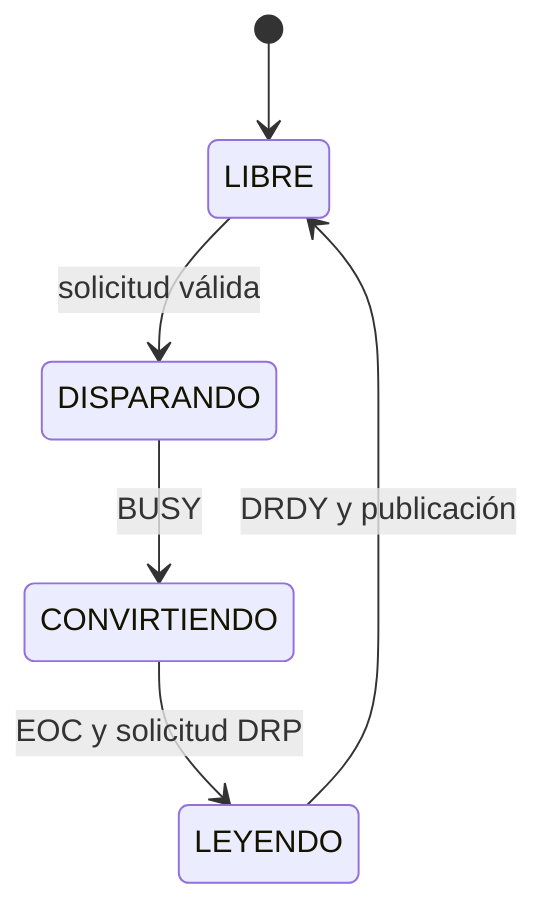
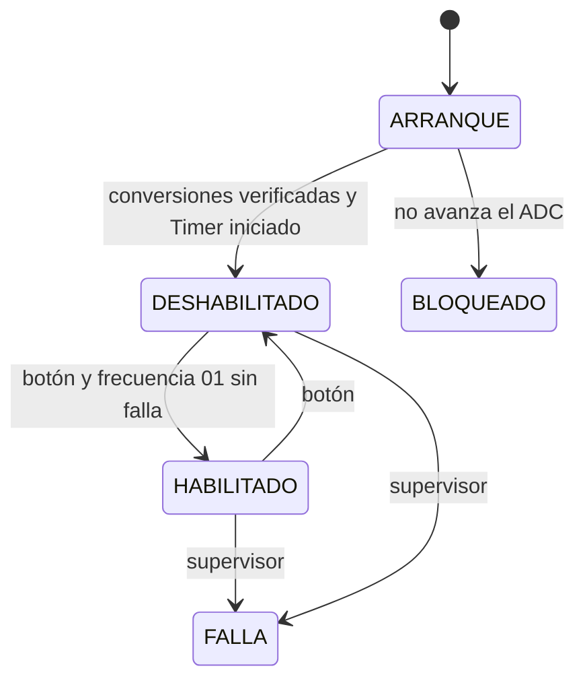
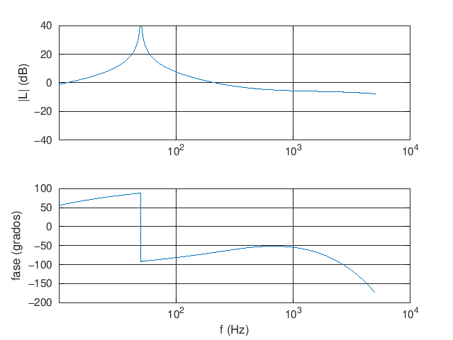
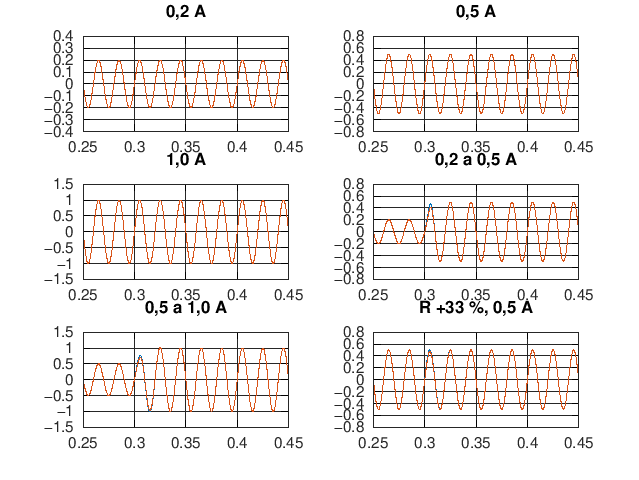
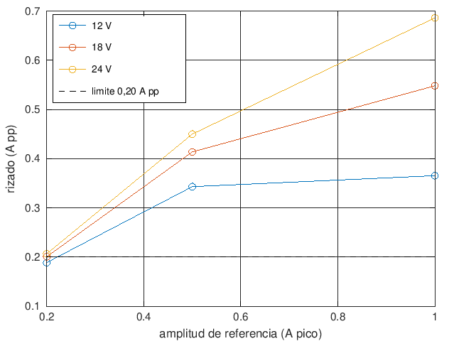
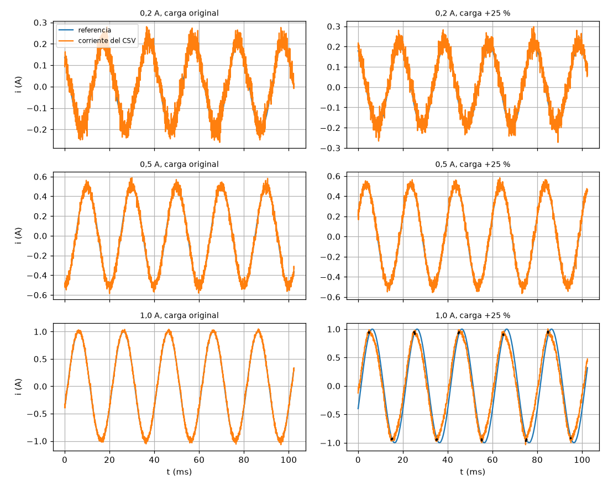
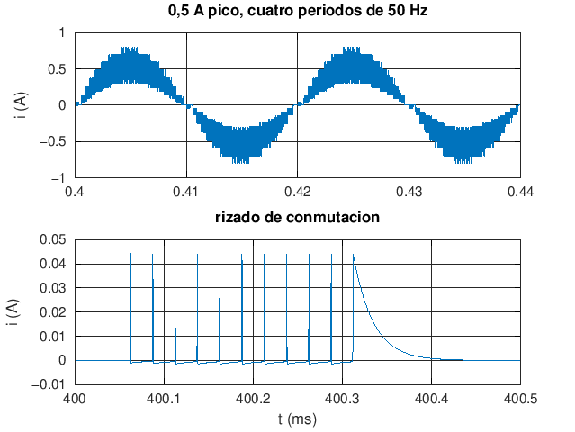

# Informe técnico, Proyecto 4: control de corriente de un inversor monofásico con regulador PR sobre MicroBlaze V

EL3313 Taller de Diseño Digital / EL4201 Procesamiento Electrónico de Potencia  
Escuela de Ingeniería Electrónica, Tecnológico de Costa Rica. II semestre de 2026.

Profesores: Dr.-Ing. Jeferson González-Gómez, PhD. Yeiner Arias-Esquivel e Ing. Rolen Coto Calderón.

Integrantes: Carlos Castro Villegas, Jefferson Chinchilla Quesada, Mattio Coghi Quirós y Nicolás Mena Valerio.

Revisión documental: 24 de noviembre de 2026. Fuentes de implementación: `develop`, commit `f784e85`. Los reportes de implementación de Vivado son del 11 de noviembre; no se atribuyen a una nueva compilación de todos los fuentes actuales. Los datos de banco del 23 y 24 de noviembre (CSV del receptor y capturas del osciloscopio) están en `muestras_Inversor/`, y lo anotado durante los ensayos en `potencia/mediciones/2026-11-24/registro.md`. Las celdas que todavía no tienen dato quedan marcadas como PENDIENTE.

## Tabla de contenidos

1. [Resumen](#1-resumen)
2. [Introducción y objetivos](#2-introducción-y-objetivos)
3. [Fundamentación teórica](#3-fundamentación-teórica)
4. [Enfoque de la solución](#4-enfoque-de-la-solución)
5. [Descripción formal de interfaces y registros](#5-descripción-formal-de-interfaces-y-registros)
6. [Periférico PWM](#6-periférico-pwm)
7. [Interfaz del ADC](#7-interfaz-del-adc)
8. [Software de control](#8-software-de-control)
9. [Etapa de potencia, carga y sensor](#9-etapa-de-potencia-carga-y-sensor)
10. [Diagramas de estado](#10-diagramas-de-estado)
11. [Estrategia de validación](#11-estrategia-de-validación)
12. [Resultados](#12-resultados)
13. [Análisis de resultados](#13-análisis-de-resultados)
14. [Problemas encontrados y su solución](#14-problemas-encontrados-y-su-solución)
15. [Análisis crítico](#15-análisis-crítico)
16. [Conclusiones y aprendizaje obtenido](#16-conclusiones-y-aprendizaje-obtenido)
17. [Referencias](#17-referencias)
18. [Anexo, evidencia y cómo reproducirla](#18-anexo-evidencia-y-cómo-reproducirla)

## Estado de la evidencia

Los resultados se clasifican por su procedencia. Una prueba de software en PC verifica comportamiento lógico; una simulación promediada representa la componente de baja frecuencia; una simulación conmutada permite estudiar el rizado; una medición demuestra el comportamiento del montaje. Estas evidencias no son intercambiables.

| Evidencia disponible | Alcance y limitación |
|---|---|
| Simulación RTL del periférico PWM, modos rápido y nominal | Autochequeo de AXI, portadora, referencias, precarga, tiempo muerto y apagado. No incluye retardos físicos ni SDF. |
| Simulación RTL de la envoltura XADC | Verifica la lógica propia con un modelo del convertidor. No mide la cadena analógica ni caracteriza el XADC real. |
| Siete ejecutables de prueba C y trece pruebas Python | Verifican módulos en PC, con controladores simulados donde corresponde. Logs en `evidencia/`. No acreditan duración de ISR ni ejecución del ELF en MicroBlaze V. |
| Cálculos en Octave | Márgenes (`verificar_pr.m`), aliasing (`aliasing_pr.m`), figuras, predicción de rizado y seis casos del modelo promediado para 9 Ω y 200 µH (`figuras_informe.m`). Salidas en `evidencia/`. |
| Reportes de Vivado del diseño ruteado | Recursos y timing de la ejecución archivada del 11 de noviembre de 2026. |
| Simulación conmutada en Octave | Lazo cerrado con tiempo muerto y ADC cuantizado para 9 Ω y 18 V, y repetida para 9,6 Ω y 12 V (`simular_conmutado.m`). No incluye filtro ni drivers. |
| Resultados PLECS archivados | Lazo abierto con una carga anterior de 12 Ω y 30 mH. Son antecedentes; no validan la configuración actual. |
| Ajustes de banco del 23 de noviembre | Polaridad de corriente invertida detectada por correlación entre duty y corriente, y cero del sensor fijado en 2808 cuentas con una captura a 0 A. Los cuatro `.bin` del 23 de noviembre traen ese offset en la cabecera. |
| Banco del 23 y 24 de noviembre | Lazo cerrado a 0,2, 0,5 y 1,0 A pico con la carga original y con 2,5 Ω añadidos, 1,0 A con 18 V, capturas de compuertas, tiempo muerto, rizado y fundamental en el osciloscopio. Resultados en 12.8. |

Permanece pendiente la simulación temporizada post-implementación del PWM, la validación conmutada en PLECS con la carga final y la calibración integral del sensor. En banco, el CSV sigue a la referencia con menos de 0,5 % de error a 0,2 y 0,5 A, pero la medición independiente con el osciloscopio da entre 14 y 19 % más corriente física, el punto de 1,0 A satura tanto con 12,5 como con 18 V, y el rizado medido supera 0,20 A pp. Por ello no se declara cumplimiento global del sistema.

## 1. Resumen

Se desarrolla un control de corriente para un inversor monofásico en puente H, con referencia senoidal de 50 Hz y regulador proporcional-resonante discreto ejecutado en MicroBlaze V. La plataforma sobre Basys 3 utiliza un reloj de 100 MHz, memoria local de 32 KiB, AXI Timer, UART, GPIO, una envoltura XADC y un periférico PWM propio en SystemVerilog con interfaz AXI4-Lite.

El PWM produce cuatro señales de compuerta mediante modulación unipolar, con tiempo muerto de 1 µs y precarga de bootstrap de 70 µs. Permite 10, 20 y 40 kHz; el firmware actual habilita el lazo únicamente a 20 kHz. La referencia se escribe en Q2.14 con signo y se aplica mediante registros sombra en el valle de la portadora. El ADC recibe un disparo asociado al mismo valle. La ISR calcula el control, atiende las fallas y almacena un histórico exportable por UART.

La configuración nominal actual es una resistencia externa de 8 Ω y dos inductores de 100 µH en serie, con aproximadamente 0,5 Ω de devanado cada uno: 9 Ω totales y 200 µH. El modelo y los coeficientes actuales usan un bus de 18 V, `Kp = 4,5 V/A`, `Kr = 10000` y `Ts = 50 µs`. Con el modelo continuo de diseño y un retardo supuesto de 75 µs se obtiene un cruce de 215,7 Hz, margen de fase de 112,4° y margen de ganancia de 7,8 dB.

Las pruebas RTL y de software disponibles pasan sin errores. El reporte de Vivado archivado registra 5567 LUT, 3651 flip-flops, ocho RAMB36 y siete DSP, con WNS de 0,519 ns a 100 MHz. Sin embargo, los cálculos RL ideales predicen aproximadamente 0,201, 0,414 y 0,548 A pico a pico de rizado para 0,2, 0,5 y 1,0 A pico a 18 V. Este resultado exige revisar el dimensionamiento y validarlo con conmutación y mediciones. El seguimiento experimental de la fundamental, el rizado real y los plazos de ejecución del firmware todavía no se han demostrado con evidencia completa.

## 2. Introducción y objetivos

El proyecto integra el diseño de potencia de EL4201 con una plataforma embebida desarrollada en EL3313. El regulador se implementa en C, mientras la temporización precisa de compuertas, el tiempo muerto y el disparo de adquisición se resuelven en lógica programable. Esta división permite modificar el algoritmo sin alterar la estructura del PWM, pero exige definir de forma precisa las interfaces y los retardos entre adquisición, cálculo y aplicación de la orden.

El objetivo general es regular la corriente de una carga RL con referencias de 0,2, 0,5 y 1,0 A pico a 50 Hz y comprobar el resultado conforme al enunciado [1]. En régimen nominal, el error de amplitud de la fundamental debe ser como máximo 10 %, evaluado sobre al menos cinco períodos completos, y el rizado de conmutación debe ser como máximo 0,20 A pico a pico. El desfase se mide y reporta, sin imponer un límite de fase adicional.

Los objetivos específicos son:

1. Integrar MicroBlaze V, memoria, interrupciones y periféricos mediante un flujo reproducible de Vivado y Vitis.
2. Implementar y verificar el periférico AXI4-Lite con cuatro compuertas, frecuencia seleccionable, referencias con signo, tiempo muerto, precarga y disparo del ADC.
3. Ejecutar el PR discretizado a 20 kHz con saturación, anti-windup, rampa de amplitud y supervisión de fallas.
4. Exportar muestras y referencia para calcular la fundamental sin detener la ejecución del control.
5. Evaluar los cambios de consigna de 0,2 a 0,5 y de 0,5 a 1,0 A pico, y un cambio de resistencia externa de al menos 25 % a 0,5 A pico, manteniendo la inductancia.
6. Contrastar predicción, simulación y medición, documentando los incumplimientos y las verificaciones pendientes.

## 3. Fundamentación teórica

### 3.1 Puente H y modulación unipolar

Las piernas A y B conectan cada terminal de la carga al bus positivo o al retorno. La tensión diferencial puede tomar los valores `+Vdc`, cero y `−Vdc`. Para una referencia normalizada `u`, las referencias de comparación complementarias son:

$$D_A=\frac{1+u}{2},\qquad D_B=\frac{1-u}{2},\qquad \overline v_o=V_{dc}u.$$

Cada pierna conmuta a `fsw`; la tensión diferencial unipolar presenta dos pulsos por período de portadora en las condiciones ideales del análisis. El modelo promediado es útil para diseñar el lazo, pero elimina el rizado que debe comprobarse por separado [3, 8]. El índice ideal requerido para una corriente de amplitud pico `Ipk` es:

$$m_{pk}=\frac{I_{pk}\sqrt{R^2+(2\pi f_0L)^2}}{V_{dc}}.$$

### 3.2 Carga actual y modelo discreto

La carga cumple:

$$L\frac{di}{dt}+Ri=v_o,\qquad P(s)=\frac{I(s)}{U(s)}=\frac{V_{dc}}{Ls+R}.$$

Con `R = 9 Ω`, `L = 200 µH`, `Vdc = 18 V` y `Ts = 50 µs`:

| Magnitud | Valor nominal calculado |
|---|---:|
| Constante de tiempo `L/R` | 22,22 µs |
| Reactancia a 50 Hz | 0,06283 Ω |
| Módulo de impedancia a 50 Hz | 9,00022 Ω |
| Ángulo de la impedancia | 0,400° |
| Índice ideal para 0,2 / 0,5 / 1,0 A pico | 0,1000 / 0,2500 / 0,5000 |

Para una entrada constante durante cada período, la discretización ZOH exacta es:

$$i[k+1]=a\,i[k]+b\,u_a[k],\quad a=e^{-RT_s/L}=0{,}105399225,$$
$$b=\frac{V_{dc}}R(1-a)=1{,}789201551.$$

El modelo temporal empleado en esta revisión incorpora una muestra de demora de actuación: `u_a[k] = u[k−1]`. Esto representa que la orden calculada no gobierna el intervalo que ya terminó. El ZOH ya está incluido en `a` y `b`.

Para el análisis continuo de diseño se aproxima el conjunto de cómputo y retención por `Td = 1,5Ts = 75 µs`. Es una hipótesis del modelo, pendiente de contrastar con la fase real de adquisición y actualización. No se añade otro bloque de 75 µs al modelo discreto que ya incluye ZOH y una muestra explícita de demora. El filtro analógico se incorpora aparte, mediante su función de transferencia, si está instalado.

### 3.3 Regulador PR y discretización

El PR ideal combina una acción proporcional y una resonante centrada en 50 Hz [4, 5]:

$$C(s)=K_p+K_r\frac{s}{s^2+\omega_0^2},\qquad \omega_0=2\pi50.$$

Se utilizan `Kp = 4,5 V/A` y `Kr = 10000`. La ganancia resonante permite reducir el error senoidal en la frecuencia de diseño. Esto no elimina los errores de calibración, las limitaciones de tensión, el aliasing ni las diferencias entre frecuencia real y nominal.

El resonante se discretiza con Tustin y prewarp a 50 Hz. Si `θ = ω0Ts`, los coeficientes físicos son:

$$b_0=\frac{K_r\sin\theta}{2\omega_0},\quad b_1=0,\quad b_2=-b_0,\quad a_1=-2\cos\theta,\quad a_2=1.$$

Como el firmware entrega un índice de modulación, se divide la ganancia proporcional y los coeficientes del numerador entre `Vdc`. Los coeficientes del denominador conservan su valor. `sw/pr_params.h` contiene:

| Constante | Valor |
|---|---:|
| `PR_FRECUENCIA_MUESTREO_HZ` | 20000 |
| `PR_KP` | 0,25 |
| `PR_B0` | 0,0138883177 |
| `PR_B1` | 0 |
| `PR_B2` | −0,0138883177 |
| `PR_A1` | −1,99975326 |
| `PR_A2` | 1 |
| `PR_U_MAX` | 0,92 |

La ecuación implementada en `pr_discreto.c` es:

$$e[k]=i_{ref}[k]-i[k],$$
$$r_0[k]=B_0e[k]+B_1e[k-1]+B_2e[k-2]-A_1r[k-1]-A_2r[k-2],$$
$$u_p[k]=KP\,e[k],\qquad u_0[k]=u_p[k]+r_0[k],$$
$$u[k]=\operatorname{clip}(u_0[k],-0{,}92,0{,}92).$$

Si hay saturación, el estado resonante guardado es `r[k] = u[k] − up[k]`; en otro caso es `r[k] = r0[k]`. Luego se desplazan los estados de error y resonante. Este anti-windup hace consistente el estado con la orden limitada, aunque la tensión real del puente también depende de sus pérdidas y del tiempo muerto.

### 3.4 Tiempo muerto y bootstrap

La conmutación entre los transistores de una pierna incorpora un intervalo con ambas compuertas bajas. Así se evita ordenar conducción simultánea. El tiempo muerto introduce una distorsión dependiente de la corriente que el modelo promediado ideal no contiene [8].

El bootstrap requiere oportunidades de recarga. La precarga inicial activa las compuertas bajas durante 70 µs, seguida por la secuencia de conmutación. El límite de modulación de ±0,92 corresponde al diseño de 20 kHz. La capacidad digital de aceptar ±1 no demuestra que ese régimen sea admisible de forma sostenida en el puente: en un extremo puede faltar recarga de una pierna. Tampoco se traslada automáticamente el límite de 0,92 a 40 kHz.

### 3.5 Rizado, muestreo y aliasing

La referencia de 50 Hz está muy por debajo de la frecuencia de muestreo de 20 kHz. Sin embargo, el rizado de conmutación y el ruido fuera de banda pueden plegarse a bajas frecuencias. Muestrear en una fase fija de la portadora reduce la variación del instante de captura, pero no garantiza medir exactamente el promedio del período [9].

Con `τ = 22,22 µs`, la corriente cambia de forma apreciablemente exponencial dentro de los tramos de conmutación. Una muestra tomada en el valle puede tener un sesgo respecto del promedio. El lazo puede seguir correctamente la corriente muestreada y aun así presentar un error en la corriente física. Por eso debe compararse el registro UART con una medición independiente.

Para estimar el máximo rizado local con tensión positiva y cero, se considera `h = 1/(2fsw)` y un ciclo de pulso local `D`. La solución periódica RL ideal da:

$$\Delta i_{pp}(D)=\frac{V_{dc}}R\frac{(1-e^{-RDh/L})(1-e^{-R(1-D)h/L})}{1-e^{-Rh/L}}.$$

Para una envolvente senoidal que alcanza `mpk`, el máximo de esta aproximación se evalúa en `D = min(mpk, 0,5)`. Supone envolvente local casi constante, componentes ideales y ausencia de tiempo muerto. Es una predicción de dimensionamiento, no una medición ni una simulación completa del inversor.

### 3.6 Interfaces y tiempo real

AXI4-Lite separa las direcciones de escritura, datos y respuestas en canales independientes. El periférico debe admitir que AW y W lleguen en distinto orden y mantener las respuestas estables mientras el maestro aplica contrapresión [7]. La interfaz de registros desacopla el programa del PWM, pero una escritura aceptada por AXI todavía debe atravesar el pipeline y esperar la actualización en el valle.

La ISR dispone nominalmente de 50 µs. Su duración máxima, el jitter y el orden de llegada de la conversión deben medirse en la FPGA. El cierre de timing a 100 MHz verifica caminos del circuito bajo las restricciones aplicadas; no acredita que el programa complete toda la ISR dentro de ese plazo.

## 4. Enfoque de la solución

### 4.1 Arquitectura



El Timer interrumpe al procesador a 20 kHz. El periférico PWM mantiene la portadora y dispara al ADC aun estando deshabilitada la potencia. Esta propiedad permite al programa comprobar que llegan conversiones antes de habilitar las compuertas. La orden de control se aplica en el valle mediante registros sombra.

La plataforma define MicroBlaze V a 100 MHz, memoria LMB de 32 KiB, FPU, multiplicación/división y operaciones atómicas. La interrupción del Timer se conecta de forma directa. El diseño documentado usa memoria local sin caché; esto se aparta de la petición de caché de 8 KiB del enunciado. La elección tiene una justificación por el acceso a LMB, pero la aceptación de esa desviación debe quedar explícita y no se da por acreditada.

### 4.2 Decisiones y alcance

| Decisión | Justificación y condición |
|---|---|
| PWM y tiempo muerto en hardware | Precisión de un ciclo de 10 ns e independencia de la duración de la ISR. |
| PR en C con `float` | Facilita el ajuste y utiliza la FPU configurada. Falta verificar el tiempo máximo de ejecución real. |
| Referencia Q2.14 en AXI | Representación con signo simple, con saturación adicional dentro del núcleo. |
| Registros sombra y pipeline | Aplican frecuencia y referencias coherentes, evitando cambios de umbral durante la portadora. |
| Adquisición disparada desde PWM | Mantiene una fase de disparo fija, pendiente de caracterizar hasta la apertura analógica real. |
| Buffer circular y UART fuera de la ISR | Conserva una ventana de datos y evita esperar la transmisión dentro del control. |
| Integración RTL mediante `module_ref` | El Block Design instancia los módulos propios. Un IP empaquetado con `component.xml` sería otra forma de integración; no se presenta como un artefacto existente. |

### 4.3 Coordinación y trazabilidad

La integración requiere concordancia entre el diseño del puente, la carga, la calibración, los coeficientes del PR y los parámetros digitales. El repositorio organiza estos trabajos mediante ramas y solicitudes de integración. Esta revisión identifica explícitamente las ramas de documentos y herramientas que aún no están fusionadas, para evitar presentar como reproducible desde `main` un flujo que depende de ellas. La distribución detallada de responsabilidades se mantiene en la documentación de planificación del equipo.

## 5. Descripción formal de interfaces y registros

### 5.1 Mapa de direcciones

| Base | Bloque | Tamaño asignado |
|---|---|---:|
| `0x00000000` | Memoria local LMB | 32 KiB |
| `0x40000000` | `axi_gpio_0` | 64 KiB |
| `0x40010000` | `axi_gpio_1` | 64 KiB |
| `0x40600000` | `axi_uartlite_0` | 64 KiB |
| `0x41C00000` | `axi_timer_0` | 64 KiB |
| `0x44A00000` | `periferico_pwm_0` | 4 KiB |
| `0x44A10000` | `envoltura_xadc_0` | 4 KiB |

Los periféricos propios reciben una dirección local de cuatro bits; sus registros tienen alias cada 16 bytes dentro de la región asignada. El programa debe utilizar únicamente los offsets documentados.

### 5.2 Interfaz AXI4-Lite del PWM

La interfaz emplea datos de 32 bits, direcciones locales de cuatro bits y cuatro habilitaciones de byte `WSTRB`. Incluye los canales AW (`AWADDR`, `AWPROT`, `AWVALID`, `AWREADY`), W (`WDATA`, `WSTRB`, `WVALID`, `WREADY`), B (`BRESP`, `BVALID`, `BREADY`), AR (`ARADDR`, `ARPROT`, `ARVALID`, `ARREADY`) y R (`RDATA`, `RRESP`, `RVALID`, `RREADY`), con reloj y reset activo en bajo. Los atributos de protección no cambian la funcionalidad del esclavo.

| Offset | Campo | Acceso | Reset | Semántica |
|---|---|---|---|---|
| `0x00` | Bit 0, `enable` | R/W | 0 | Solicitud de marcha; el núcleo la atiende en el valle. |
| `0x00` | Bits `[2:1]`, `freq_sel` | R/W | `01` | Selección de la frecuencia solicitada. |
| `0x00` | Bit 3, `running` | R | 0 | Estado de marcha del núcleo, no confirmación de precarga terminada. |
| `0x00` | Bits `[31:4]` | R | 0 | Reservados; escritura sin efecto. |
| `0x04` | Bits `[15:0]`, `duty_ref` | R/W | 0 | Orden Q2.14 con signo. |
| `0x04` | Bits `[31:16]` | R | 0 | Reservados. |

La lectura inicial del control es `0x00000002`. La lectura de `duty_ref` devuelve la orden escrita, incluso si el núcleo limita un valor fuera de ±1. Las respuestas son `OKAY`; los offsets no implementados se leen en cero y su escritura no tiene efecto. El PWM compara el offset completo: los accesos desalineados no equivalen a un acceso alineado al registro. `WSTRB[n]` modifica únicamente el byte habilitado.

| `freq_sel` | `MAX` nominal | Frecuencia estable |
|---|---:|---:|
| `00` | 5000 | 10 kHz |
| `01` | 2500 | 20 kHz |
| `10` | 1250 | 40 kHz |
| `11` | 2500 | 20 kHz |

La frecuencia cumple `fsw = 100 MHz/(2MAX)`. El núcleo reinicia internamente con `MAX_FREQ_00`, aunque el registro AXI solicite `01`. Por tanto, no se presupone que el primer intervalo después del reset ya corresponda a 20 kHz. La secuencia de arranque descarta avances iniciales del ADC antes de iniciar el Timer.

| Referencia | Patrón hexadecimal |
|---|---|
| +0,5 | `0x2000` |
| −0,5 | `0xE000` |
| +1 | `0x4000` |
| −1 | `0xC000` |

### 5.3 Núcleo y parámetros del PWM

Entradas: `clk`, `rst_n`, `enable`, `freq_sel[1:0]` y `duty_ref[15:0]` con signo. Salidas: las cuatro compuertas activas en alto, `running` y `pwm_trigger_o`. Las compuertas y el trigger salen de registros.

| Parámetro | Valor nominal | Resultado a 100 MHz |
|---|---:|---|
| `DEAD_TIME_CICLOS` | 100 | 1,00 µs |
| `PRECARGA_CICLOS` | 7000 | 70 µs |
| `MAX_FREQ_00` | 5000 | Máximo usado para dimensionar la portadora |
| `MAX_FREQ_01` | 2500 | 20 kHz |
| `MAX_FREQ_10` | 1250 | 40 kHz |
| `MAX_FREQ_11` | 2500 | Repite la nominal |

Al cambiar parámetros, `MAX_FREQ_00` debe seguir siendo el mayor de los máximos y los valores deben ser válidos para el contador. La configurabilidad de tiempo muerto y precarga se realiza por parámetros de elaboración, no por registros AXI en tiempo de ejecución.

### 5.4 Registros de la envoltura XADC

| Offset | Campo | Función |
|---|---|---|
| `0x00` | Bit 0, inicio por software | Pulso de solicitud autolimpiante; se atiende si esa fuente está seleccionada y la máquina está libre. |
| `0x00` | Bit 1, fuente | 0: disparo por software; 1: trigger del PWM. |
| `0x04` | Bits `[11:0]` | Última conversión publicada. |
| `0x04` | Bits `[13:12]` | Contador de publicación módulo cuatro. |

La cuenta y su contador se leen juntos. El software compara el contador con el anterior para identificar un dato nuevo; la lectura no borra una bandera. Si pasan cuatro conversiones entre lecturas, el contador puede volver al mismo valor, de modo que no sustituye un contador amplio de pérdidas de muestras. La envoltura decodifica `addr[3:2]`, por lo que los bits bajos de dirección producen alias dentro de cada palabra; esto difiere del PWM.

### 5.5 GPIO y conexiones de placa

`axi_gpio_0` canal 1 recibe los botones de habilitación y exportación, con antirrebote, y dos interruptores de consigna. El canal 2 gobierna los LED de habilitado y falla. `axi_gpio_1` produce el pulso de depuración de la ISR.

| Señal | Conector / pin FPGA |
|---|---|
| Compuerta A alta | JA10 / G3 |
| Compuerta A baja | JA9 / H2 |
| Compuerta B alta | JA8 / K2 |
| Compuerta B baja | JA7 / H1 |
| Depuración ISR | JB1 / A14 |
| Entrada analógica diferencial | JXADC, `vauxp6` / J3 y `vauxn6` / K3 |
| UART de salida | Puente USB-UART, `tx` / A18 |

La nomenclatura de conector físico no debe confundirse con el número del canal auxiliar del XADC. Los pines y estándares eléctricos definitivos se toman de `src/fpga/basys3.xdc`.

### 5.6 Protocolo de exportación

La trama utiliza little-endian. No se transmite texto de depuración dentro de este protocolo.

| Posición | Tamaño | Campo |
|---|---:|---|
| 0 | 1 byte | Sincronización `0xAA` |
| 1–2 | 2 bytes | Cantidad `N`, `uint16` |
| 3–6 | 4 bytes | Frecuencia de muestreo, `uint32` |
| 7–10 | 4 bytes | Offset ADC, `float32` |
| 11–14 | 4 bytes | Amperes por cuenta, `float32` |
| 15–18 | 4 bytes | Escala de duty, `float32` |
| 19 | 1 byte | Indicador de duty con signo |
| Desde 20 | `6N` bytes | Registros, del más antiguo al más reciente |
| Últimos dos | 2 bytes | Suma de los bytes posteriores a `0xAA`, excluida la propia suma, módulo 65536 |

Cada registro tiene tres campos de dos bytes: `cuenta_banderas`, `duty_ref` e `i_ref_ma` con signo. En el primero, `[11:0]` es la cuenta ADC, bit 15 saturación, bit 14 ausencia de dato, bit 13 habilitado y bit 12 falla. La referencia se guarda en mA con truncamiento; no debe omitirse al interpretar los seis bytes.

Con 2048 registros, la trama contiene 12310 bytes. A 115200 baudios, 8N1, el tiempo mínimo de línea es 1,069 s. La ventana nominal corresponde a 102,4 ms de adquisición; la diferencia entre el instante de la primera y última muestra es 102,35 ms. Esto permite seleccionar cinco períodos completos de 50 Hz, siempre que no haya faltantes y se documente la ventana elegida.

## 6. Periférico PWM

### 6.1 Recepción AXI

`interfaz_axi_pwm.sv` recibe AW y W de forma independiente, conserva cada componente hasta completar la escritura y permite una transacción pendiente por dirección de acceso. Mantiene `BVALID` o `RVALID` y la información correspondiente mientras el maestro no acepte la respuesta. Una lectura coincidente con el flanco que ejecuta una escritura obtiene el valor anterior del registro. Estos casos forman parte del banco de autochequeo.

### 6.2 Pipeline y registros sombra

El núcleo limita la referencia a ±16384. La primera etapa guarda el máximo de portadora junto con la referencia limitada. La segunda calcula:

$$ref_A=\left\lfloor\frac{MAX(16384+d)}{32768}\right\rfloor,\qquad ref_B=MAX-ref_A.$$

La resta hace que las referencias sumen exactamente `MAX`, pese al truncamiento. Las dos referencias y el máximo se trasladan juntos a los registros sombra en el valle. Así no se usa una referencia calculada con un máximo de frecuencia distinto. Una escritura demasiado próxima al valle puede aplicarse un período después; la aceptación AXI no garantiza una aplicación inmediata.

### 6.3 Piernas, precarga y tiempo muerto

Cada pierna tiene los estados `APAGADA`, `PRECARGA`, `MUERTO`, `ALTA` y `BAJA`. Al habilitar se precarga el bootstrap con el transistor bajo. Antes de activar el transistor alto se respeta el tiempo muerto. Cuando la comparación cambia, la pierna apaga ambas salidas y espera antes de entrar al nuevo estado conductor. Un pulso solicitado demasiado corto puede suprimirse; no se fuerza una conducción que viole el tiempo muerto.

El tiempo muerto digital nominal es 1 µs en el Pmod. El intervalo real entre conducción de transistores también depende de la cadena de aisladores, drivers y MOSFET; debe medirse después de esa cadena.

### 6.4 Apagado y significado de `running`

`enable` se atiende en el valle. Al deshabilitar, el estado global pasa a detenido y las piernas llevan las salidas a cero en el siguiente flanco que observa ese estado. La implementación no garantiza completar el último pulso de compuerta: un pulso alto centrado alrededor del valle puede quedar truncado. La captura en el valle evita una actualización arbitraria a mitad de la cuenta, pero no equivale a esperar el final de cada pulso físico.

Un diagnóstico RTL con los módulos reales, a 20 kHz y referencia +0,5, observó pulsos regulares de A alta de 36,490 µs y un último pulso de 17,750 µs tras la deshabilitación. Es una evidencia de simulación funcional, no una captura de osciloscopio. No se observó una orden de conducción simultánea en ese diagnóstico. Si se requiere preservar todos los pulsos completos al parar, hace falta cambiar la política de apagado y volver a verificarla.

`running` informa el estado global del núcleo, no la finalización de la precarga ni la presencia de tensión de bus. La portadora y el trigger continúan con `enable = 0`.

## 7. Interfaz del ADC

La envoltura `envoltura_xadc.sv` coordina la petición de conversión y la lectura por DRP del resultado [6]. Su secuencia es:

1. `LIBRE`: espera un disparo de la fuente seleccionada.
2. `DISPARANDO`: mantiene la solicitud de conversión hasta observar `BUSY`.
3. `CONVIRTIENDO`: espera `EOC` y solicita la lectura DRP.
4. `LEYENDO`: espera `DRDY`, publica la cuenta e incrementa el contador módulo cuatro.

Los disparos que llegan durante una conversión no se encolan. El contador avanza cuando se publica el dato, por lo que la ISR debe comprobar que la conversión ya finalizó. La ausencia de dato nuevo conserva la última orden y no hace avanzar el estado del PR.

La temporización observada en RTL estacionario a 100 MHz es:

| Relación | Retardo |
|---|---:|
| Evento de valle interno → `pwm_trigger_o` | 10 ns |
| `pwm_trigger_o` → `CONVST` de la envoltura | 20 ns |
| Valle interno → `CONVST` | 30 ns |

El testbench de la envoltura toma como origen su señal de entrada de disparo; por ello sus 20 ns no deben describirse como valle interno a `CONVST`. Estos valores tampoco representan la latencia total del XADC ni el instante exacto de apertura analógica. Deben agregarse la configuración y temporización del convertidor, la publicación DRP y la fase de lectura de la ISR.

El arranque espera dos avances del contador con un número acotado de lecturas, descarta la posible conversión asociada al intervalo inicial de otra frecuencia y añade una espera de software antes de arrancar el Timer. La repetibilidad de esta fase debe comprobarse tras varios reinicios y con la configuración final de compilación.

## 8. Software de control

### 8.1 Organización

| Módulo | Responsabilidad |
|---|---|
| `drivers` | Acceso a PWM, ADC, GPIO, UART, Timer e interrupciones. |
| `control_principal` | Arranque, botones, consignas, habilitación, LED y exportación. |
| `lazo_control` | ISR de adquisición, referencia, PR, supervisión y registro. |
| `pr_discreto` | Resonante, proporcional, saturación, anti-windup y conversión Q2.14. |
| `ref_senoidal` | Fase y referencia mediante tabla senoidal e interpolación. |
| `supervisor_falla` | Sobreintensidad, rango ADC y pérdida de datos, con enclavamiento. |
| `buffer_muestras` | Histórico circular de 2048 registros y congelación para exportar. |
| `exportador_uart` | Serialización y envío por disponibilidad de FIFO, sin espera de línea. |
| `receptor_pc` | Validación de trama, CSV y extracción de la fundamental. |

### 8.2 Secuencia de la ISR

La ISR sube primero el GPIO de depuración y reconoce la interrupción del Timer. Toma una copia del estado de habilitación y de la amplitud solicitada, comprueba si hay dato ADC nuevo y ejecuta el supervisor. Ante la primera detección de falla solicita el apagado del PWM y publica el enclavamiento.

Si el control está habilitado y no hay falla, actualiza la rampa de amplitud y la fase de referencia. Cuando hay una muestra nueva, convierte la cuenta a corriente, ejecuta el PR y escribe el duty. Si no la hay, conserva la orden y los estados del PR; la fase de referencia y la rampa sí continúan. Por último registra cuenta, banderas, duty y referencia, y baja el GPIO de depuración.

El período del Timer debe ser 5000 ciclos de reloj. El código carga `TIMER_TLR = 4998`, porque el período se calcula como `TLR + 2`; no se debe reemplazar esa carga por 5000 sin considerar la semántica del Timer.

### 8.3 Representación numérica y límites

`valor_t` es `float`. Los coeficientes de `pr_params.h` ya están normalizados para 18 V; una implementación en PLECS que los utilice como salida de modulación no debe volver a dividirlos entre el bus. Si se usa el PR físico en V/A, la división entre bus se aplica una sola vez antes del modulador.

La salida limitada se multiplica por 16384 y se redondea al entero más cercano antes de convertir a `uint16_t`. El signo se conserva mediante el patrón de complemento a dos. El paso de índice es `1/16384`; a 18 V equivale idealmente a 1,10 mV de tensión diferencial promedio.

La aritmética real tiene redondeo de precisión simple y cuantización de referencia, ADC y duty. Los cálculos promediados añadidos en esta revisión usan doble precisión y no demuestran por sí solos el error numérico del firmware completo. Las pruebas C sí ejercitan las funciones reales, dentro de sus escenarios definidos.

### 8.4 Rampa de consigna

La amplitud cambia como máximo 0,0025 A por muestra. Desde cero hasta 1 A requiere nominalmente 400 muestras, 20 ms. Desde 0,2 hasta 0,5 A requiere 120 muestras, 6 ms, y desde 0,5 hasta 1 A, 200 muestras, 10 ms. No todos los cambios de amplitud duran un período completo de 50 Hz.

Al habilitar se reinician los estados del PR, la fase y la rampa. En los ensayos se deben mostrar tanto la consigna seleccionada como la referencia realmente aplicada, porque esta última tiene una transición limitada en pendiente.

### 8.5 Supervisor de fallas

El supervisor enclava falla si la corriente calculada sale del intervalo ±1,3 A, si la cuenta ADC es menor o igual a 16 o mayor o igual a 4079, o si se acumulan cuatro iteraciones consecutivas sin dato nuevo. La formulación de la comparación de corriente también detecta un valor NaN. Una muestra válida reinicia el contador de ausencias.

La falla solo se libera por reinicio del sistema. El apagado conserva la selección de frecuencia y desactiva `enable`. La protección es de software y tiene latencia de adquisición, evaluación y aplicación en el valle: no se acredita como protección instantánea ante un cortocircuito. Su coordinación con fusible, fuente y límites térmicos debe validarse con el montaje actual.

### 8.6 Exportación y memoria

El buffer ocupa `2048 × 6 = 12288` bytes, 12 KiB. La tabla senoidal de 257 `float` ocupa 1028 bytes. El linker reserva memoria para pila y heap; con los 32 KiB disponibles hace falta revisar el archivo de mapa del enlace real y el margen de pila, no solo sumar estas dos estructuras.

Al exportar se congela la escritura del histórico. La ISR continúa ejecutando el control, pero no incorpora nuevas muestras al buffer hasta terminar el envío. El exportador aprovecha el espacio de la FIFO y vuelve al lazo principal si está llena. Este diseño evita una espera de aproximadamente un segundo en la ISR; el efecto residual de la UART sobre el tiempo real debe medirse.

## 9. Etapa de potencia, carga y sensor

### 9.1 Puente y cadena de compuertas


*Figura 1. Topología de referencia tomada del informe original. Los símbolos R y L corresponden aquí a la carga actual; la figura no constituye una fotografía ni una verificación del montaje final.*

El diseño de referencia en `potencia/diseno_puente_h.md` emplea MOSFET IRF520N, drivers IR2110, optoacopladores VO3120 y adaptación con PN2222A. Documenta bootstrap de 470 nF con 22 Ω y diodo 1N4148, además de desacoplo de bus de 470 µF y cerámicos de 100 nF. Estos componentes describen la solución documentada; se debe cotejar su referencia y cableado con lo realmente instalado antes de atribuirles resultados experimentales.

El presupuesto documental de propagación suma aproximadamente 813 ns entre adaptación, aislamiento, driver y transistor. Justifica evaluar un tiempo muerto de 1 µs, pero la resta de retardos máximos de hojas de datos no sustituye medir los cruces de compuerta y conducción. El cálculo RC de precarga del bootstrap, con tolerancias del diseño, resulta del orden de 68 µs y motivó seleccionar 70 µs. La tensión real del bootstrap y su recuperación en condiciones extremas siguen pendientes de registro.

La tensión de bus de 18 V es la base del modelo actual. Debe anotarse la tensión medida y su variación durante cada ensayo. Las estimaciones de falla y energía de documentos anteriores con 30 mH no se reutilizan para 200 µH: cambian la dinámica de corriente, la energía almacenada y los tiempos disponibles de protección.

### 9.2 Caracterización de la carga

La configuración nominal acordada es:

| Elemento | Valor nominal |
|---|---:|
| Resistencia externa | 8 Ω |
| Inductor 1 | 100 µH y aproximadamente 0,5 Ω |
| Inductor 2 | 100 µH y aproximadamente 0,5 Ω |
| Total en serie | 200 µH y aproximadamente 9 Ω |

Estos valores son nominales; no se presentan como una medición LCR del montaje final. La resistencia debe medirse a cuatro hilos en frío y después de varios minutos de corriente. La inductancia se medirá con LCR a 1 kHz, consignando frecuencia, amplitud de prueba, modelo serie y condiciones de conexión. Para 200 µH, la reactancia es apenas 0,126 Ω a 100 Hz y 1,257 Ω a 1 kHz; frente al devanado y a los errores de conexión, la medición a 100 Hz resulta poco favorable. Una lectura a 1 kHz no demuestra por sí sola ausencia de saturación con corriente continua o alterna elevada.

Si la R medida se aparta más de ±25 % o la L más de ±30 % del nominal, se debe volver a ejecutar `potencia/verificar_pr.m` con los valores reales antes de cerrar el lazo. Aun dentro de ese intervalo, la comparación final debe usar lo medido. La hoja de datos de cada inductor debe confirmar una corriente de saturación holgadamente superior a 1,3 A, y debe comprobarse también el pico real que suma fundamental y rizado.

La carga montada en banco el 24 de noviembre usa dos resistencias de 4,7 Ω y 5 W en lugar de la de 8 Ω. Se registraron 9,46 Ω para las dos resistencias juntas y 11,8 Ω para la carga completa con inductores y cableado; la inductancia quedó en su valor nominal de 200 µH, sin medición LCR. La diferencia de 2,3 Ω entre ambas lecturas reúne devanados, conexiones y cables.

Para el ensayo resistivo se añadieron 2,5 Ω en serie, conservando los inductores. Es un aumento de 26,4 % sobre las resistencias externas y de 21,2 % sobre la carga completa. El primero satisface el cambio mínimo de 25 %, el segundo no, así que el informe reporta ambos y no declara cumplido el criterio sobre la resistencia total. Con 3 Ω o más se cumplirían los dos.

Para una senoidal ideal de 1 A pico, `Irms = 0,707 A`, y cada resistencia de 4,7 Ω disipa unos 2,35 W, el 47 % de sus 5 W. La de 2,5 Ω añadida disipa 1,25 W en el mismo punto. Son potencias de la fundamental ideal; el rizado aumenta la corriente RMS y las pérdidas. Si la corriente física supera a la del sensor en la proporción de 12.8, a 1 A pico de consigna cada resistencia de 4,7 Ω llegaría a unos 3,3 W, todavía bajo su nominal. No se midieron temperaturas; el margen de disipación se justifica con este cálculo.

### 9.3 Sensor y acondicionamiento

La documentación utiliza un ACS712 de ±5 A y una sensibilidad reportada por el equipo de 183 mV/A. El acondicionador actual se especifica con ganancia 1,2 y salida centrada aproximadamente en 0,5 V. Por multiplicación:

$$G_{cadena}=0{,}183\cdot1{,}2=0{,}2196\ \mathrm{V/A}.$$

Este producto es una conversión calculada a partir de parámetros de la cadena; no equivale a una calibración integral del sensor, acondicionador y ADC. El firmware usa:

$$i=(N-N_0)K_I,\qquad N_0=2808,\qquad K_I=-1{,}1118\cdot10^{-3}\ \mathrm{A/cuenta}.$$

El cero empezó en 2785 cuentas, por 0,68 V medidos con multímetro en J3 con corriente nula el 23 de noviembre, y se afinó a 2808 con el promedio de una captura a 0 A con el control deshabilitado (commit `e9299a6`). Ambos quedan por encima de los 0,5 V de diseño (2048 cuentas). El signo de `K_I` es negativo porque la corriente entra al ACS712 por el lado contrario al supuesto, lo que se detectó con una correlación de −1 entre duty y corriente. Si se invierten los cables del primario vuelve a ser positivo. Ambos valores están en `sw/lazo_control.h` y viajan en la cabecera de la trama, así que `receptor_pc.py` escala correctamente los CSV.

Con fondo de escala nominal de 1 V y 12 bits, un paso ideal representa 0,244 mV. Para ±1,3 A, la salida ideal del acondicionador sería aproximadamente 0,215 a 0,785 V. Deben comprobarse offset, ganancia, ruido y margen de tensión reales. El antiguo esquema con ganancia 2,4 no se utiliza como evidencia del acondicionador actual de 1,2.

### 9.4 Calibración y filtro

Con corriente física cero, se exportan 2048 muestras y se calcula la media de las cuentas ADC originales. La expectativa de diseño era 2048 ±102 cuentas; los valores medidos en banco quedan fuera de esa banda y por eso el cero se fijó en el firmware. Un desplazamiento de 102 cuentas equivale aproximadamente a 0,113 A con la escala nominal, así que el offset se corrige y no se acepta como sesgo. Las capturas del 24 de noviembre (12.8) muestran además que el cero cambia según el estado del puente, así que un único valor de 2808 cuentas no deja la continua en cero en todas las condiciones.

Para la ganancia se compara la fundamental del CSV con una medición independiente de corriente. Puede obtenerse mediante sonda o mediante la tensión sobre la resistencia externa dividida entre su resistencia medida. Dividir la tensión sobre toda la carga RL entre 8 Ω no sería equivalente. Se deben comprobar ambos signos y, de ser posible, varios niveles de corriente, guardando pendiente, offset y residuo del ajuste. Los valores calibrados se trasladan al firmware y a la cabecera de exportación.

Se contempla un RC de aproximadamente 1 kΩ y 33 nF: `τF = 33 µs`, `fc ≈ 4,82 kHz`. Su instalación y valores finales no quedan confirmados por evidencia completa. Cuando se incluya, el modelo debe usar `H(s) = 1/(1+sτF)`. El retardo de grupo es aproximadamente 33 µs a baja frecuencia, pero no corresponde a un retardo puro constante en toda la banda. Debe evaluarse su atenuación del rizado, ruido y efecto sobre la fase.

## 10. Diagramas de estado

### 10.1 Estado global y pierna PWM





El diagrama de pierna resume el funcionamiento nominal. Desde cualquier estado, reset o la observación de `corriendo = 0` conduce a `APAGADA`. Durante `MUERTO`, la lógica considera el objetivo de comparación para evitar activar una orden que ya cambió. Las salidas por estado son: `APAGADA` y `MUERTO`, ambas bajas; `PRECARGA` y `BAJA`, solo baja activa; `ALTA`, solo alta activa.

### 10.2 Envoltura XADC



Reset conduce a `LIBRE` y reinicia los registros de publicación. Las solicitudes durante los otros estados no crean una cola.

### 10.3 Control principal



Son estados funcionales del software, implementados mediante condiciones y variables, no una enumeración idéntica a una FSM RTL. La exportación es una actividad concurrente del lazo principal y puede solicitarse sin abandonar el estado de control. `FALLA` permanece enclavada hasta reset. `BLOQUEADO` representa un arranque no autorizado por ausencia de conversiones.

## 11. Estrategia de validación

### 11.1 Criterios y niveles de evidencia

| Nivel | Criterio | Evidencia necesaria |
|---|---|---|
| Interfaz y PWM RTL | Ningún fallo del autochequeo; respuestas AXI estables y ausencia de conducción simultánea ordenada | Log completo, versión de fuentes, parámetros y semilla. |
| Temporización post-implementación | Autochequeo sobre netlist con retardos y sin violaciones relevantes sin resolver | Netlist, SDF, configuración de simulación y log de xsim. |
| Software | Pruebas de funciones e integración lógica aprobadas | Compilación, comando, versión y resultados. |
| Tiempo real | ISR completa antes del siguiente período y fase repetible respecto de adquisición y PWM | Capturas de JB1, PWM y señales de adquisición, con mínimos, máximos y jitter. |
| Fundamental nominal | Error de amplitud ≤10 % en 0,2, 0,5 y 1,0 A pico; ventana ≥5 períodos completos | CSV o captura cruda, algoritmo de extracción, amplitud y fase. |
| Rizado nominal | ≤0,20 A pico a pico respecto de la componente de baja frecuencia | Captura de ancho de banda suficiente, ventana local y método de separación. |
| Transitorios | Describir evolución, sobrepico, establecimiento y régimen posterior | Cambios 0,2→0,5 y 0,5→1,0 A, y cambio resistivo a 0,5 A pico. |

El enunciado no exige que todo punto de un transitorio cumpla el error estacionario del 10 %. Deben analizarse por separado el establecimiento y el régimen posterior. Tampoco fija un límite adicional de fase: corresponde medirla y reportarla.

### 11.2 Extracción de fundamental y rizado

Se selecciona una ventana estacionaria con al menos cinco períodos completos. La corriente se ajusta por mínimos cuadrados a:

$$i(t)=a\sin(2\pi50t)+b\cos(2\pi50t)+c.$$

Se obtiene `I1,pk = sqrt(a²+b²)`, fase `atan2(b,a)` y componente continua `c`. Se ajusta igualmente la referencia y se reporta la diferencia de fases con una convención de signo explícita. El error es:

$$\varepsilon_A=100\frac{|I_{1,pk}-I_{ref,pk}|}{I_{ref,pk}}.$$

En la captura experimental se documentarán frecuencia real, ventana, frecuencia de muestreo y manejo de muestras ausentes. Si la frecuencia medida se aparta de 50 Hz, debe justificarse el uso de frecuencia fija o adaptar el ajuste; no se mezclan ventanas distintas sin explicarlo. Para una senoidal pura, `I1,rms = I1,pk/√2`; el RMS total se calcula sobre la señal medida e incluye sus otras componentes.

El rizado se obtiene con una captura de mayor ancho de banda que el registro UART. Se estima la componente de baja frecuencia mediante un ajuste o procedimiento documentado, se resta y se calcula el pico a pico en ventanas locales representativas, incluyendo la zona de mayor rizado de la envolvente. Deben indicarse sonda, escala, límite de ancho de banda y frecuencia de adquisición. Un registro síncrono de una muestra por portadora no acredita el rizado a 40 kHz ni sus extremos.

### 11.3 Secuencia de laboratorio y simulaciones pendientes

1. Medir R en frío y caliente, L a 1 kHz y verificar corriente de saturación y límites de potencia de los componentes.
2. Calibrar el cero y la ganancia de la cadena completa de corriente. Confirmar filtro instalado y margen de entrada del XADC.
3. Con el bus de potencia apagado, capturar compuertas, 1 µs de tiempo muerto, 70 µs de precarga, cuatro selecciones de frecuencia, habilitación y último pulso al deshabilitar. Verificar además las señales después de la cadena de drivers.
4. Medir JB1 con control habilitado, deshabilitado y durante exportación. Registrar período, jitter y duración máxima de ISR, con el PR activo y con falla enclavada. Repetir arranque para caracterizar fase respecto de adquisición y PWM.
5. Ejecutar la simulación temporizada post-implementación del PWM según la sección 18.3.
6. Validar primero en PLECS el lazo cerrado con la carga y bus finales, tiempo muerto, adquisición y demora de actuación. Añadir el filtro confirmado y las no idealidades de forma identificable.
7. Resolver el dimensionamiento que predice exceso de rizado y registrar cualquier nueva carga, frecuencia o coeficiente. Después realizar los ensayos energizados nominales y transitorios, con sus condiciones eléctricas y térmicas.

Las frecuencias de 10 y 40 kHz se ensayan como pruebas del PWM, sin cerrar el PR actual. Cambiar `FREQ_SEL_INICIAL` en una compilación de prueba no adapta el Timer, `Ts`, los coeficientes ni el límite de modulación. Para capturar esas frecuencias debe usarse una prueba de PWM con la ejecución del lazo inhibida; no basta con cambiar esa constante y pulsar habilitar en la aplicación de control.

## 12. Resultados

### 12.1 Autochequeo RTL del PWM

Se dispone de dos ejecuciones del mismo banco de pruebas con Icarus Verilog. Se conservan los logs completos en `evidencia/`.

| Configuración | Grupos | Comprobaciones | Errores | Resultado |
|---|---:|---:|---:|---|
| Rápida, contadores reducidos | 23 | 101554 | 0 | `PWM: APROBADO` |
| Nominal, DT=100 y precarga=7000 | 23 | 6552388 | 0 | `PWM: APROBADO` |

El modo nominal registra 246 triggers y ocho resets ejercitados. Incluye llegada AW/W en ambos órdenes, respuestas retenidas, lecturas coincidentes con escrituras, habilitación por byte, offsets inválidos y desalineados, reset con transacciones parciales, referencias positivas y negativas, saturación, precarga, apagado, cambios conjuntos de frecuencia y referencia, escrituras próximas al valle y pulsos inferiores al tiempo muerto.

Los contadores finales AW/W/B y AR/R no constituyen por sí solos una medida de cumplimiento AXI: los tests incluyen reinicios que cancelan operaciones. El resultado de autochequeo y sus casos identificados son la evidencia funcional. Estas ejecuciones no contienen SDF.

### 12.2 Envoltura XADC y diagnóstico de integración

El banco de la envoltura cubre doce situaciones y termina con `PASA: tb_envoltura_xadc sin errores`. Comprueba secuencia DRP, rechazo de triggers durante conversión, fuentes de disparo, publicaciones y vuelta del contador módulo cuatro.

El diagnóstico adicional de núcleo PWM más envoltura confirma 10 ns de valle a trigger y otros 20 ns de trigger a `CONVST`. También identifica el último pulso truncado descrito en la sección 6.4. El código de ese diagnóstico no está versionado en el repositorio, así que se presenta como observación del equipo y no como evidencia archivada.

### 12.3 Pruebas del software

| Prueba C | Resultado observado |
|---|---|
| `prueba_buffer_muestras` | 0 errores |
| `prueba_pr_discreto` | 0 errores |
| `prueba_ref_senoidal` | 0 errores |
| `prueba_supervisor_falla` | 0 errores |
| `prueba_lazo_control` | 0 errores |
| `prueba_exportador_uart` | 0 errores |
| `prueba_control_principal` | 0 errores |

Las trece pruebas Python del receptor pasan. Se adjuntan logs y resumen de las compilaciones C. Estas pruebas utilizan los módulos reales con las sustituciones de controladores definidas por cada caso; no representan una ejecución del binario en la placa. El archivo `prueba_generar_pr_params.m` existe, pero no se presenta como una prueba Octave ejecutada durante esta revisión.

### 12.4 Márgenes para la carga actual

Se recalculó en Octave (`potencia/verificar_pr.m`, salida en `evidencia/verificar_pr.log`) el modelo de diseño:

$$L_{ab}(s)=\left(K_p+K_r\frac{s}{s^2+\omega_0^2}\right)\frac{e^{-sT_d}}{Ls+R},\qquad T_d=75\ \mu s.$$

El bus se cancela aquí porque el controlador físico se normaliza antes del modulador. Los cruces se evalúan por encima de la resonancia y el margen de fase se refiere al cruce de ganancia descendente más alto, conforme al procedimiento de diseño. El barrido y la búsqueda numérica están en el script.

| R total | L | Cruce | Margen de fase | Margen de ganancia |
|---:|---:|---:|---:|---:|
| 9 Ω | 200 µH | 215,7 Hz | 112,4° | 7,8 dB |
| 6,75 Ω | 140 µH | 323,6 Hz | 120,6° | 5,2 dB |
| 11,25 Ω | 140 µH | 169,1 Hz | 108,3° | 8,7 dB |
| 6,75 Ω | 260 µH | 322,4 Hz | 118,5° | 7,1 dB |
| 11,25 Ω | 260 µH | 169,1 Hz | 107,6° | 9,9 dB |



*Figura 2. Modelo continuo de diseño con retardo supuesto de 75 µs. No incluye el filtro del sensor, el rizado ni la cadena de potencia real. Se muestra la banda superior a la resonancia de 50 Hz.*

El equipo adopta como criterios de diseño 45° y 6 dB en nominal, y 30° y 3 dB en las esquinas. Son objetivos internos, no umbrales adicionales fijados por el enunciado. El modelo satisface esos criterios; esto no valida todavía el lazo físico, y debe actualizarse con la R, L, filtro y retardo medidos.

El punto final del ensayo resistivo, 12 Ω totales con 200 µH, queda fuera del intervalo de R de las cuatro esquinas anteriores. Se evaluó por separado con las ganancias fijas del controlador de 9 Ω: el modelo continuo da 158,8 Hz de cruce, 106,8° de margen de fase y 9,7 dB de margen de ganancia. El modelo temporal de la sección siguiente también conserva esas ganancias durante el cambio. Estos cálculos adicionales no sustituyen verificar los dos puntos con los valores medidos antes del ensayo.

### 12.5 Simulación numérica promediada

Se añadió un modelo reproducible en Octave (`potencia/figuras_informe.m`, cifras en `evidencia/modelo_promediado.txt`) de doble precisión con planta ZOH exacta, una muestra de demora de actuación, PR ideal discretizado, saturación a ±0,92 y rampa de 0,0025 A por muestra. Se simularon 0,7 s por caso. Se incluyen los tres puntos nominales, los dos cambios de consigna y el cambio de R total de 9 a 12 Ω a 0,5 A pico. Los cambios se aplican a los 300 ms.

| Ensayo | Amplitud final de referencia | Amplitud final de corriente promedio | Error final de amplitud | Saturación |
|---|---:|---:|---:|---|
| Nominal 0,2 A | 0,2000 A pico | 0,2000 A pico | <0,001 % | No |
| Nominal 0,5 A | 0,5000 A pico | 0,5000 A pico | <0,001 % | No |
| Nominal 1,0 A | 1,0000 A pico | 1,0000 A pico | <0,001 % | No |
| 0,2→0,5 A | 0,5000 A pico | 0,5000 A pico | <0,001 % | No |
| 0,5→1,0 A | 1,0000 A pico | 1,0000 A pico | <0,001 % | No |
| R total 9→12 Ω, 0,5 A | 0,5000 A pico | 0,5000 A pico | <0,001 % | No |

La extracción se hizo en `[0,6; 0,7)` s, cinco períodos completos, ajustando seno, coseno y continua. El desfase final calculado es menor que 0,001° en estos casos ideales. El resultado casi nulo es esperable al usar un resonante ideal exactamente a 50 Hz, sin pérdidas ni errores de medida. No se atribuye esta precisión al firmware ni al montaje. El script no ejecuta C, no cuantiza ADC ni duty, no reproduce el ruido, el tiempo muerto o el filtro, y no resuelve conmutación.



*Figura 3. Referencia aplicada y corriente promedio en los cambios de consigna y resistencia. La línea vertical marca el cambio de orden. La rampa de amplitud forma parte del modelo. Estos gráficos no demuestran el rizado ni el sobrepico de la corriente conmutada.*

La comprobación respalda la coherencia del diseño de baja frecuencia bajo esas hipótesis. El establecimiento experimental y los indicadores transitorios deben calcularse con los registros reales y una definición explícita de establecimiento, sin trasladarles el error final de esta tabla.

### 12.6 Rizado previsto y dimensionamiento

La solución RL local de la sección 3.5 produce los siguientes máximos aproximados durante la envolvente de 50 Hz:

| Bus | Referencia 0,2 A pico | Referencia 0,5 A pico | Referencia 1,0 A pico |
|---:|---:|---:|---:|
| 12 V | 0,189 A pp | 0,343 A pp | 0,365 A pp |
| 18 V | 0,20063 A pp | 0,414 A pp | 0,548 A pp |
| 24 V | 0,207 A pp | 0,450 A pp | 0,686 A pp |



*Figura 4. Predicción ideal a 20 kHz para 9 Ω y 200 µH. La línea horizontal representa el límite de 0,20 A pico a pico del enunciado. No se incluyen pérdidas, tiempo muerto ni filtro de medida.*

A 18 V, el primer resultado también está ligeramente por encima del límite: redondearlo a 0,20 A no permite marcarlo como cumplimiento. Los puntos de 0,5 y 1,0 A muestran un exceso claro. La reducción de bus a 12 V, dentro de los valores considerados, tampoco resuelve ambos puntos.

La cota aproximada de rizado triangular máximo `Vdc/(8Lfsw)` es 0,5625 A a 18 V, del mismo orden que la solución exponencial de 0,548 A. Esa cota sugiere una inductancia de al menos 562,5 µH para 0,20 A pp bajo sus hipótesis. No es una especificación final de compra: hay que considerar resistencia añadida, saturación, pérdidas, tolerancias, bus y dinámica. Cambiar frecuencia también obliga a revisar muestreo, PR, tiempo muerto y bootstrap. Ninguna de esas modificaciones se presenta como implementada.

Con la misma fórmula se evaluó la opción de subir la portadora a 40 kHz, que reduce el rizado a la mitad porque `h` se divide entre dos. El máximo se alcanza en `D = 0,5`, así que el valor más alto de cada bus acota todas las amplitudes. Cifras de `figuras_informe.m` extendidas a 40 kHz.

| Bus | fsw | 0,2 A pico | 0,5 A pico | 1,0 A pico |
|---:|---:|---:|---:|---:|
| 18 V | 20 kHz | 0,2006 | 0,4138 | 0,5481 |
| 18 V | 40 kHz | 0,1010 | 0,2099 | 0,2794 |
| 12 V | 20 kHz | 0,1887 | 0,3431 | 0,3654 |
| 12 V | 40 kHz | 0,0953 | 0,1747 | 0,1863 |

Solo 12 V con 40 kHz queda bajo 0,20 A pp en los tres puntos de la predicción ideal (índice de modulación de 0,75 a 1,0 A, dentro del límite de 0,92). A 18 V, incluso con 40 kHz, el punto de 1,0 A queda en 0,28 A pp. Es una predicción y no una configuración implementada, porque el firmware cierra el lazo solo a 20 kHz y pasar a 40 kHz obliga a recalcular `Ts`, los coeficientes del PR, el límite de modulación y la precarga del bootstrap.

### 12.7 Recursos y timing

Se transcriben los reportes archivados de Vivado 2026.1 del 11 de noviembre de 2026, dispositivo `xc7a35t` de la Basys 3 [2].

| Recurso | Uso | Disponibilidad indicada | Ocupación |
|---|---:|---:|---:|
| LUT | 5567 | 20800 | 26,76 % |
| Flip-flops | 3651 | 41600 | 8,78 % |
| RAMB36 | 8 | 50 | 16,00 % |
| DSP | 7 | 90 | 7,78 % |
| IOB | 16 | 106 | 15,09 % |

La jerarquía del reporte atribuye al periférico PWM 151 LUT, 199 flip-flops y un DSP: 49 LUT y 64 flip-flops para la interfaz, y 102 LUT, 135 flip-flops y un DSP para el núcleo. La configuración de memoria lógica es de 32 KiB; el número físico de RAMB36 no debe interpretarse como memoria libre para el programa sin revisar la organización y el mapa de enlace.

| Indicador | Valor archivado |
|---|---:|
| Período del reloj | 10 ns |
| WNS | +0,519 ns |
| TNS | 0 ns |
| WHS | +0,052 ns |
| THS | 0 ns |
| WPWS | +3,750 ns |
| Endpoints internos en el resumen | 10835 |

Los caminos internos analizados cumplen las restricciones de esa ejecución. Persisten advertencias de un reset asíncrono asociado a LUT (`LUTAR-1`), un cruce sin caracterización reconocida (`TIMING-9`) y trece puertos sin retardos de entrada/salida (`TIMING-18`: cinco entradas y ocho salidas en el chequeo). Deben clasificarse y resolverse o justificarse según la naturaleza de cada señal. No corresponde inventar valores de retardo externos para silenciarlas. Este resultado no implica que todas las interfaces externas estén caracterizadas ni que la ISR cumpla 50 µs.

### 12.8 Mediciones de banco del 23 y 24 de noviembre

Los ensayos se hicieron con la carga de 9,46 Ω en resistencias, 11,8 Ω en total y 200 µH nominales (9.2), firmware con el cero en 2808 cuentas (`e9299a6`) y los coeficientes normalizados de `sw/pr_params.h`, de modo que la ganancia física es `0,25·Vdc` (3,1 V/A con 12,5 V y 4,5 V/A con 18 V). El límite de corriente de la fuente fue de 0,52 A con 12,5 V y de 1 A con 18 V. La tensión de bus no se anotó archivo por archivo; se usó 12,5 V salvo en el punto de 1 A con 18 V, según la guía del día. Lo anotado en banco está en `potencia/mediciones/2026-11-24/registro.md`.

| Ensayo | Archivos | Estado |
|---|---|---|
| R de la carga | `registro.md` | 9,46 Ω en resistencias y 11,8 Ω en total. Sin medición a cuatro hilos ni en caliente. |
| L con LCR | | PENDIENTE, se usa el nominal de 200 µH. |
| Cero de corriente | `muestras_sensor/`, `0A_18-50.csv`, `muestras_prueba_25/0A_10-14.csv` | Medido. El cero no es estable (12.8.2). |
| Ganancia integral | `osc_*.csv` contra los CSV del 23 de noviembre | Comparación hecha con capturas de 100 µs por punto (12.8.3). Falta una calibración en el mismo minuto. |
| Filtro | | PENDIENTE. |
| Tiempo muerto | `Muestras Compuertas/tiempo_muerto_*.png`, `registro.md` | Medido en las dos piernas (12.8.4). |
| Habilitación y parada | `Muestras Compuertas/encendido_compuertas.png`, `apagado_compuertas.png` | Capturado a 50 ms/div. |
| ISR | `registro.md` | Período de 50 µs. Ancho máximo y jitter PENDIENTES. |
| Fase ADC/Timer/PWM | | PENDIENTE. |
| Régimen a 0,2, 0,5 y 1,0 A | CSV del 23 de noviembre y `muestras_recorte/` | Medido (12.8.1). |
| Cambios 0,2→0,5 y 0,5→1,0 A | | Observado en banco sin registro archivado. |
| Cambio de R a 0,5 A | `muestras_prueba_25/` | Régimen con 2,5 Ω añadidos. Transitorio sin registro archivado. |
| Rizado | `Muestras Osciloscopio/rizado/`, `registro.md` | Medido (12.8.5). |
| Falla | | PENDIENTE. |

Los CSV se procesaron con `octave --eval "addpath('potencia'); analizar_csv('<archivo>')"`, que ajusta seno, coseno y continua sobre los últimos cinco períodos completos. La figura 6 sale de `python3 potencia/figuras_banco.py`. Las capturas del osciloscopio se procesaron con `analizar_osc.m`.

#### 12.8.1 Seguimiento según el sensor

Fase positiva cuando la corriente adelanta a la referencia. La continua es la que ve el sensor, no la física (12.8.2).

| Archivo | Carga | Bus | Ref pico (A) | Medida pico (A) | Error (%) | Fase (°) | Continua (A) | Residuo RMS (A) | Muestras saturadas |
|---|---|---:|---:|---:|---:|---:|---:|---:|---:|
| `0.2A_18-52.csv` | original | 12,5 V | 0,1994 | 0,2002 | 0,39 | 0,07 | 0,215 | 0,023 | 0 |
| `0.5A_18-53.csv` | original | 12,5 V | 0,4993 | 0,5003 | 0,19 | −0,03 | 0,212 | 0,021 | 0 |
| `1A_18-55.csv` | original | 12,5 V | 0,9994 | 0,6504 | 34,92 | 21,72 | 0,170 | 0,065 | 31 |
| `muestras_recorte/1A_10-22.csv` | original | 18 V | 0,9994 | 0,8814 | 11,81 | 16,58 | −0,042 | 0,075 | 25 |
| `muestras_prueba_25/0.2A_10-15.csv` | +2,5 Ω | 12,5 V | 0,1994 | 0,2002 | 0,42 | −0,02 | 0,330 | 0,022 | 0 |
| `muestras_prueba_25/0.5A_10-15.csv` | +2,5 Ω | 12,5 V | 0,4993 | 0,5000 | 0,14 | 0,01 | 0,266 | 0,020 | 0 |
| `muestras_prueba_25/1A_10-16.csv` | +2,5 Ω | 12,5 V | 0,9994 | 0,7276 | 27,20 | 21,65 | 0,117 | 0,079 | 30 |



*Figura 6. Corriente según el sensor y referencia en los registros de 2048 muestras (102 ms). Los puntos negros marcan muestras con `saturado` en 1.*

A 0,2 y 0,5 A, con las dos cargas, el PR lleva la corriente que ve el sensor a la referencia con menos de 0,5 % de error y fase prácticamente nula. Es lo que predicen 12.9 y 12.10 para la corriente muestreada. El punto de 1,0 A no se alcanza en ningún caso. Con 12,5 V la acción llega al límite de ±0,92 en cada semiciclo y la corriente se recorta en unos +0,74 A; con 2,5 Ω añadidos pasa lo mismo, como anticipaba 12.10 para R por encima de 11 Ω.

Con 18 V el recorte persiste y es asimétrico. El semiciclo negativo llega a −1,03 A y el positivo se queda en +0,71 A con la acción saturada en +0,92. Con 18 V y 11,8 Ω el 92 % del bus son 16,6 V y bastan unos 13 V para 1 A, así que la saturación indica que la tensión de bus real fue menor durante el ensayo. Una explicación compatible es el límite de 1 A de la fuente, cercano a la corriente que pide el puente en el pico de la senoide; la tensión de bus durante este registro no quedó anotada y la hipótesis queda sin confirmar.

#### 12.8.2 Cero del sensor

| Archivo | Condición | Media (A) | Desviación (A) | Cuentas equivalentes |
|---|---|---:|---:|---:|
| `muestras_sensor/0A_09-59.csv` | control deshabilitado | −0,652 | 0,045 | 3394 |
| `muestras_sensor/1A_10-03.csv` | control deshabilitado, cuatro minutos después | −0,540 | 0,023 | 3294 |
| `0A_18-50.csv` | lazo cerrado con referencia nula, 23 de noviembre | +0,243 | 0,022 | 2590 |
| `muestras_prueba_25/0A_10-14.csv` | lazo cerrado con referencia nula, +2,5 Ω | +0,297 | 0,022 | 2541 |

Con el control deshabilitado la corriente física es nula, así que la lectura de −0,54 a −0,65 A es error del cero, unas 490 a 590 cuentas por encima de las 2808 del firmware, y derivó 100 cuentas en cuatro minutos. Con el lazo cerrado y referencia nula el sensor marca +0,24 A, pero la captura del osciloscopio del mismo día (`osc_0A.csv`) da −0,03 A de continua física. El resonante no actúa en continua, y el proporcional convierte el error del cero en una corriente continua real de signo opuesto, como anticipa 13.3. De ahí se deduce un cero de unas 2560 cuentas con el puente conmutando. La diferencia de unas 800 cuentas entre los dos estados, unos 0,2 V en la entrada del XADC, apunta a que la conmutación del puente o su alimentación desplaza la referencia del acondicionador. La causa no se aisló.

#### 12.8.3 Ganancia frente al osciloscopio

Las capturas `Muestras Osciloscopio/osc_*.csv` del 23 de noviembre registran la tensión sobre las dos resistencias de 4,7 Ω con un punto cada 100 µs durante nueve períodos. Divididas entre 9,46 Ω dan la corriente física.

| Consigna | CSV, pico (A) | Osciloscopio, pico (A) | Cociente | Error físico respecto de la consigna | Continua en el osciloscopio (A) |
|---|---:|---:|---:|---:|---:|
| 0,2 A | 0,2002 | 0,2285 | 1,141 | +14,6 % | −0,059 |
| 0,5 A | 0,5003 | 0,5928 | 1,185 | +18,7 % | −0,061 |
| 1,0 A, saturado | 0,6504 | 0,8285 | 1,274 | −17,1 % | −0,038 |

Si las capturas corresponden a los mismos ensayos que los CSV, la corriente física supera a la referencia en 14,6 y 18,7 % a 0,2 y 0,5 A, fuera del 10 % del enunciado, aunque el CSV cumpla. El sesgo de muestrear en el valle (12.10) explica unos 3 a 6 puntos; el resto apunta a que la ganancia real de la cadena del sensor es menor que los 0,2196 V/A supuestos. El cociente crece con la amplitud, así que no se corrige con un único factor sin antes repetir la comparación en el mismo minuto y con una captura de mayor resolución temporal, porque con 100 µs por punto el rizado de 20 kHz se pliega sobre las muestras. Esta calibración es el pendiente principal del banco.

#### 12.8.4 Compuertas, tiempo muerto e ISR

Con el bus apagado y los 15 V de los drivers, el tiempo muerto medido fue de 1 µs en ambos flancos de la pierna B. En la pierna A fue de 1,23 µs cuando la baja apaga y la alta enciende, y de 430 ns en el flanco contrario. Los 430 ns quedan por debajo del µs programado, pero mantienen un intervalo sin conducción simultánea; la asimetría se atribuye a diferencias de retardo de encendido y apagado en la cadena de esa pierna. Las capturas archivadas son las de la pierna B, con cursores en 1 µs.


*Figura 7. Tiempo muerto de 1 µs en una pierna, CH1 y CH2 a 5 V/div, 1 µs/div.*

Las capturas de habilitación y parada (`encendido_compuertas.png` y `apagado_compuertas.png`) se tomaron a 50 ms/div. A esa escala no se resuelven la precarga de 70 µs ni el último pulso; el truncamiento descrito en 6.4 sigue sin confirmarse en banco.

La salida JB1 de la ISR se repite cada 50 µs, el período de muestreo de diseño. No se registraron el ancho máximo ni el jitter.

#### 12.8.5 Rizado

En banco se leyeron 3,27 V pp sobre las resistencias, unos 0,35 A pp, con 12,5 V; la consigna de esa lectura no quedó anotada. Las tres capturas archivadas (`Muestras Osciloscopio/rizado/scope_a2.csv` a `scope_a4.csv`, 0,1 µs por punto y dos períodos de conmutación) muestran el rizado unipolar a 40 kHz, con tramos continuos de 2,4, 4,4 y 6,3 V pp, es decir 0,25, 0,46 y 0,66 A pp. También tienen saltos y picos en las conmutaciones que una corriente a través de 200 µH no puede producir; son efecto de medir la diferencia entre dos puntas cuyos extremos saltan con el bus, y se excluyen del pico a pico. Tampoco quedó anotada la consigna de cada captura. En todos los casos el rizado supera 0,20 A pp, en el rango que predicen 12.6 y 12.10 para 12 V (0,19 a 0,40 A pp).

### 12.9 Simulación conmutada y sensibilidades en Octave

Con `potencia/simular_conmutado.m` se simuló el lazo cerrado completo con puente H unipolar a 20 kHz, tiempo muerto de 1 µs con conducción por diodo según el signo de la corriente, carga de 9 Ω y 200 µH, bus de 18 V, paso de 0,5 µs, muestra en el valle, orden aplicada en el valle siguiente, PR con los coeficientes del firmware y ADC cuantizado a 1,1118 mA por cuenta. Cada caso dura 0,5 s y la ventana de análisis es `[0,4; 0,5)` s, cinco períodos. La salida completa está en `evidencia/modelo_conmutado.txt`. No incluye el filtro del sensor ni retardos de drivers, y el diodo se toma ideal.

| Caso | Fundamental física (A pico) | Error físico (%) | Fase (°) | Fundamental muestreada (A pico) | Rizado máximo (A pp) |
|---|---:|---:|---:|---:|---:|
| 0,2 A | 0,2058 | 2,88 | 0,72 | 0,2000 | 0,268 |
| 0,5 A | 0,5137 | 2,74 | 0,63 | 0,5000 | 0,483 |
| 1,0 A | 1,0195 | 1,95 | 0,62 | 0,9999 | 0,597 |
| 0,2 a 0,5 A, régimen | 0,5137 | 2,74 | 0,64 | 0,5000 | 0,483 |
| 0,5 a 1,0 A, régimen | 1,0196 | 1,96 | 0,62 | 1,0000 | 0,597 |
| R +33 %, 0,5 A | 0,5272 | 5,44 | 0,68 | 0,5000 | 0,528 |
| Esquina R −25 %, 1,0 A | 1,0094 | 0,94 | 0,59 | 1,0000 | 0,589 |
| Esquina R +25 %, 1,0 A | 1,0278 | 2,78 | 0,64 | 1,0000 | 0,579 |



*Figura 5. Simulación conmutada a 0,5 A pico. Arriba cuatro períodos de 50 Hz, abajo medio milisegundo con el rizado de conmutación.*

Lo que muestran estas cifras es lo siguiente.
- El PR hace que la corriente muestreada en el valle coincida con la referencia (error menor a 0,02 %), pero la corriente promedio física queda entre 1 y 5 % por encima. La muestra en el valle no coincide con el promedio del período porque con `τ = 22 µs` la corriente cambia dentro del período de conmutación. Con el resultado dentro del 10 % del enunciado en todos los casos simulados, este sesgo es la principal diferencia que hay que buscar al comparar el CSV con el osciloscopio.
- El rizado conmutado simulado (0,27, 0,48 y 0,60 A pp) supera el límite de 0,20 A pp en los tres puntos. Es mayor que la predicción ideal de 12.6 (0,20, 0,41 y 0,55) porque incluye tiempo muerto y la variación dentro de la ventana. Confirma que el incumplimiento previsto no es un artefacto de la fórmula.
- El tiempo muerto de 1 µs desplaza 0,72 V del bus de 18 V. Sin lazo cerrado, ese efecto baja la fundamental 51 % a 0,2 A, 24 % a 0,5 A y 14 % a 1,0 A (`evidencia/verificar_pr.log`), por lo que el resonante es necesario y no un refinamiento.
- El cambio de R a 12 Ω eleva el error físico a 5,4 %, todavía bajo 10 %.

Sensibilidades del modelo continuo, de `verificar_pr.m` (`evidencia/verificar_pr.log`).

| Variante | Cruce | Margen de fase | Margen de ganancia |
|---|---:|---:|---:|
| Nominal, retardo de 75 µs | 216 Hz | 112,4° | 7,8 dB |
| Retardo total de 100 µs | 216 Hz | 110,5° | 7,2 dB |
| Retardo total de 125 µs | 216 Hz | 108,6° | 6,8 dB |
| Retardo total de 150 µs | 216 Hz | 106,6° | 6,6 dB |
| RC de 4,8 kHz, nominal | 215 Hz | 109,8° | 9,4 dB |
| RC de 4,8 kHz, esquina baja de L y R | 322 Hz | 116,7° | 6,8 dB |
| RC de 3 kHz, nominal | 215 Hz | 108,3° | 10,8 dB |
| RC de 2 kHz, nominal | 214 Hz | 106,2° | 12,6 dB |
| Butterworth de 5 kHz, esquina | 324 Hz | 115,4° | 5,0 dB |

Con retardo adicional, el margen de ganancia llega a 6 dB solo cuando se suman 203 µs y el de fase a 45° cuando se suman 400 µs, así que el lazo tolera con holgura los 75 µs supuestos y el filtro RC del sensor. Un filtro más cerrado mejora el margen de ganancia y casi no cuesta fase. La acción resonante con `Kr = 10000` tiene polo de módulo 0,9915 y constante de tiempo de 5,9 ms. Con `Kr = 3000` el error del primer período tras un escalón de 0,2 a 1,0 A sube a 22 %, contra 7 % con 10000. En el escalón de 0,2 a 1,0 A el pico es 1,034 A y el índice de modulación máximo 0,52 con 18 V y 0,64 con R de 11,25 Ω.

La sensibilidad al punto de captura se calculó con `aliasing_pr.m` (`evidencia/aliasing_pr.log`) como el error de la fundamental según dónde cae la muestra.

| Punto de captura | Error a 1,0 A (%) | Error a 0,2 A (%) |
|---|---:|---:|
| Valle | 4,23 | 5,31 |
| Valle +200 ns | 5,16 | 6,26 |
| Valle −200 ns | 3,32 | 4,36 |
| Pico | 4,24 | sin dato |
| Centro del pulso −200 ns | −3,28 | 1,33 |
| Centro del pulso +200 ns | −6,04 | −18,07 |
| Flanco del pulso | 27,43 | sin dato |

El valle es un punto estable (el error cambia 1 punto porcentual por cada 200 ns), mientras que cerca del flanco o del centro del pulso un desvío de 200 ns pasa de 1 a −18 % a 0,2 A. Esto justifica muestrear en el valle y mantener fija la fase entre el disparo y la portadora.

### 12.10 Carga medida de 9,6 Ω y bus de 12 V

El equipo midió una resistencia total de aproximadamente 9,6 Ω con 200 µH y planteó operar a 12 V. Todo lo anterior de este capítulo se calculó para la carga de diseño (9 Ω y 18 V), así que se repitieron los scripts con estos valores (`verificar_pr(9.6, 200e-6, 12, 4.5)`, `aliasing_pr`, `figuras_informe` y `simular_conmutado(9.6, 200e-6, 12, 12)`). Las salidas llevan el sufijo `_9p6ohm_12V` en `evidencia/`. Se mantienen `Kp = 4,5 V/A` y `Kr = 10000`, y el modelo supone coeficientes normalizados con 12 V. Las cifras son nominales, hasta tener la R, L y Vdc medidas en banco.

| Magnitud | Valor |
|---|---:|
| Módulo de impedancia a 50 Hz | 9,60 Ω |
| Índice de modulación para 0,2 / 0,5 / 1,0 A pico | 0,160 / 0,400 / 0,800 |
| Cruce, margen de fase y de ganancia nominales | 200 Hz, 111,0°, 8,2 dB |
| Esquinas de R ±25 % y L ±30 %, peor margen de ganancia | 5,6 dB (R de 7,2 Ω, L de 140 µH) |
| Esquinas, peor margen de fase | 106,5° |
| Con RC de 4,8 kHz, nominal y esquina baja | 108,6° y 9,9 dB, 115,2° y 7,3 dB |
| Pérdida de tensión por tiempo muerto | 0,48 V |
| Fundamental en lazo abierto a 0,2 / 0,5 / 1,0 A | −35 % / −16 % / −10 % |
| Pico del escalón de 0,2 a 1,0 A | 1,034 A |
| Índice máximo en ese escalón | 0,82 (1,02 con R de 12 Ω) |

Simulación conmutada con las mismas condiciones del apartado 12.9.

| Caso | Fundamental física (A pico) | Error físico (%) | Fase (°) | Fundamental muestreada (A pico) | Rizado máximo (A pp) | Saturación |
|---|---:|---:|---:|---:|---:|---|
| 0,2 A | 0,2069 | 3,46 | 0,67 | 0,2000 | 0,258 | No |
| 0,5 A | 0,5142 | 2,83 | 0,64 | 0,5000 | 0,388 | No |
| 1,0 A | 1,0061 | 0,61 | 0,61 | 1,0000 | 0,395 | No |
| R de 9,6 a 12,8 Ω, 0,5 A | 0,5241 | 4,83 | 0,67 | 0,5000 | 0,378 | No |
| Esquina R de 7,2 Ω, 1,0 A | 1,0063 | 0,63 | 0,58 | 1,0000 | 0,408 | No |
| Esquina R de 12 Ω, 1,0 A | 0,9087 | 9,13 | 9,25 | 0,9040 | 0,382 | Sí |

Lo que cambia con esta carga es lo siguiente.
- A 12 V el índice de modulación a 1,0 A es 0,80, y el límite de 0,92 del firmware solo permite 11,04 Ω a esa corriente. Con la R en la esquina alta de 12 Ω el PR satura, el error físico sube a 9,1 % (11,3 % si se dejan los coeficientes normalizados con 18 V) y la fase se desvía 9°. Queda al borde del límite de 10 % y se cumple solo por muy poco, así que 12 V no deja margen para 1 A con R mayor de 11 Ω.
- A 12 V y 20 kHz el rizado ideal es 0,198, 0,350 y 0,364 A pp, y el conmutado 0,26, 0,39 y 0,40 A pp. Es menor que a 18 V, pero sigue sobre 0,20 A pp. Con 40 kHz la predicción ideal baja a 0,100, 0,179 y 0,186 A pp, que cumple el límite. A 18 V y 40 kHz queda en 0,107, 0,219 y 0,279 A pp y no cumple.
- En banco, la columna `saturado` del CSV (bit 15 del registro) delata este caso. Debe aparecer primero con 1,0 A y R alta.
- Los coeficientes de `sw/pr_params.h` están normalizados con 18 V. Si el bus final es 12 V se deben regenerar con `sw/generar_pr_params.m` (`KP = 0,375` y `B0 = 0,0208325`). La simulación con los coeficientes de 18 V a 12 V da prácticamente los mismos resultados, salvo en el caso saturado, porque la ganancia física baja a 3 V/A.
- La sensibilidad a la captura en el valle (`aliasing_pr_9p6ohm_12V.log`) da 2,95 % a 1,0 A y 5,97 % a 0,2 A, y a 0,2 A una captura 200 ns después del centro del pulso da −14,95 %. El valle sigue siendo el punto estable.

### 12.11 Estado de PLECS

Los archivos de la rama `doc/plecs-carga-nueva` contienen validación en lazo abierto para la carga anterior de 12 Ω y 30 mH, bus de 18 V, 20 kHz y tiempo muerto de 1 µs. Para órdenes asociadas a 0,2, 0,5 y 1 A pico se archivaron fundamentales de 0,1423, 0,4403 y 0,9314 A pico, y rizados del orden de 1,7 a 4,0 mA pp. Esos resultados son históricos y no acreditan ni el PR cerrado ni la carga de 200 µH.

Con `parametros.m` actualizado a 9,6 Ω, 200 µH y 12 V se ejecutó el ensayo en lazo abierto del modelo `modelo-planta.plecs` (20 kHz, tiempo muerto de 1 µs, RDS(on) de 0,2 Ω), con el índice de modulación calculado sin tiempo muerto ni RDS(on). Para órdenes de 1,0, 0,5 y 0,2 A pico el índice fue 0,800, 0,400 y 0,160, y la fundamental de la corriente resultó de 0,899, 0,419 y 0,132 A pico, con un desfase de −0,36° respecto de la orden. Salida en `evidencia/plecs_lazo_abierto_9p6ohm_12V.txt`. Sin regulador, la corriente queda 10 % por debajo de lo pedido a 1 A, 16 % por debajo a 0,5 A y 34 % por debajo a 0,2 A, lo que cuantifica el efecto del tiempo muerto y de la caída en los transistores que el PR debe compensar. Este ensayo no incluye el PR, por lo que no sustituye a la simulación conmutada de 12.9. El bus de 12 V sigue siendo provisional.

La validación conmutada de 12.9 se hizo en Octave. La simulación en PLECS con el modelo del repositorio sigue pendiente, y debe usar 9 Ω y 200 µH, 18 V, modulación unipolar a 20 kHz y tiempo muerto de 1 µs. El PR será el de la sección 3.3, con saturación y anti-windup equivalentes al firmware. Se tomará la muestra en el valle y se aplicará la orden en el período siguiente. El RC de aproximadamente 4,8 kHz se modelará de forma separada si corresponde al sensor final; no se sumará dos veces el ZOH o el retardo.

Los ensayos incluirán los tres puntos nominales, los dos cambios de amplitud y el cambio de R total de 9 a 12 Ω a 0,5 A pico. Deben exportarse corriente física continua, corriente muestreada, referencia, tensión de carga y PWM. Se comparará la fundamental de la corriente física con la de las muestras, y se medirá el rizado de la primera. Se espera que PLECS permita contrastar el exceso de rizado previsto; hasta ejecutar y archivar esa simulación no se registra como un resultado observado.

## 13. Análisis de resultados

### 13.1 Lo que demuestra la plataforma digital

Los autochequeos respaldan la recepción AXI independiente de AW/W, la estabilidad de respuestas retenidas, la coherencia de las referencias y las secuencias nominales de conmutación. El ensayo con parámetros reales amplía esta evidencia frente al uso exclusivo de contadores reducidos. Las pruebas C y Python respaldan el comportamiento de los módulos y la interpretación de las muestras dentro de los escenarios ensayados.

Estas pruebas no sustituyen la simulación post-implementación, la ejecución del firmware en MicroBlaze ni las mediciones de compuerta y corriente. En particular, el comentario de código que asocia el valle con no cortar pulsos no concuerda con la forma de onda al apagar: el diagnóstico observado exige describir la parada con precisión.

### 13.2 Estabilidad y retardo

El cambio de 30 mH a 200 µH hace que la carga nominal sea casi resistiva en torno a la frecuencia de cruce del diseño actual. La sintonización anterior de cruce próximo a 1 kHz no se hereda; se utiliza `Kp = R/2` y se obtiene un cruce nominal de aproximadamente 216 Hz. El margen de ganancia mínimo de las esquinas consideradas es 5,2 dB, por encima del criterio interno de 3 dB para esquinas.

La aparente holgura del modelo no permite ignorar filtro, fase real del muestreo, demoras de drivers o tolerancias. El control se debe volver a evaluar con el montaje medido. Los 75 µs pertenecen al modelo de diseño; los 30 ns de lógica hasta `CONVST` son otra magnitud y no representan el retardo completo del lazo.

### 13.3 Fundamental y calibración

El resonante ideal explica el error estacionario casi nulo del modelo promediado. En el sistema real habrá cuantización, redondeo, error de sensibilidad y offset, distorsión de tiempo muerto, ruido y posible sesgo de muestreo. Una coincidencia entre referencia y CSV no demuestra por sí sola que la corriente física tenga la amplitud correcta.

El error de continua tampoco conserva el valor de la sintonización antigua. En el modelo de baja frecuencia, el resonante ideal tiene ganancia nula en continua y la acción proporcional actual da `Kp/(R+Kp) = 1/3`. Un sesgo de medida `δi` puede inducir aproximadamente `−δi/3` de corriente continua física en ese modelo. Por ejemplo, 102 cuentas con la escala nominal representan cerca de 0,113 A de sesgo de lectura y del orden de 0,038 A de corriente física de continua inducida. Esto refuerza la necesidad de calibrar, sin presentar ese ejemplo como un resultado medido.

### 13.4 Transitorios y rampa

La rampa limita la velocidad de variación de la amplitud aplicada y reduce la exigencia de tensión respecto de un escalón ideal. Por ello hay que distinguir el cambio del interruptor de consigna de la referencia que utiliza el PR. Los modelos numéricos muestran transiciones estables bajo las hipótesis declaradas, pero no permiten atribuir un sobrepico físico máximo ni un tiempo de establecimiento experimental.

El ensayo resistivo debe variar la resistencia externa a 0,5 A pico y mantener L. El ejemplo de 8 a 11 Ω externos cumple este criterio. Una simulación anterior de cambio de R a 1 A, aunque útil para robustez, no sustituye este ensayo exigido.

### 13.5 Rizado y aliasing

El obstáculo principal de la carga actual es el rizado. Un PR puede corregir la fundamental sin reducir suficientemente la componente a frecuencia de conmutación. La predicción de aproximadamente 0,548 A pp a 1 A pico excede ampliamente 0,20 A pp. La validación de baja frecuencia, incluso con márgenes favorables, no resuelve esa diferencia.

Un filtro en la cadena de medida puede suavizar lo que ve el ADC, pero no reduce por sí mismo el rizado físico de la carga. Tampoco una muestra síncrona permite reconstruir sus máximos. Debe medirse con suficiente ancho de banda y compararse con la predicción RL y el modelo conmutado final. Si el dimensionamiento cambia, se actualizan conjuntamente parámetros, análisis, simulaciones e informe.

### 13.6 Comparación entre predicción, simulación y medición

| Indicador | Predicción / modelo actual | Evidencia adicional | Medición actual |
|---|---|---|---|
| Carga | 9 Ω y 200 µH nominales | Coherente con los parámetros actuales del software y diseño | PENDIENTE en frío/caliente y LCR |
| PR | `Kp=4,5`, `Kr=10000`, `Ts=50 µs` | Coeficientes normalizados presentes en firmware | Tiempo de ejecución y desempeño: PENDIENTE |
| Márgenes | 112,4° y 7,8 dB nominales en modelo continuo | Cálculo reproducido, sin filtro | Retardo/filtro reales: PENDIENTE |
| Fundamental | Error final <0,001 % en modelo promediado ideal | Conmutado con tiempo muerto: 2,9 / 2,7 / 2,0 % de error físico, 0,01 % en la muestra | PENDIENTE DE CSV en tres puntos |
| Rizado a 18 V | 0,20063 / 0,414 / 0,548 A pp | Octave conmutado: 0,268 / 0,483 / 0,597 A pp | PENDIENTE; no se declara cumplimiento |
| Tiempo muerto | 1 µs solicitado | RTL nominal aprobado | Capturas completas: PENDIENTE |
| Precarga | 70 µs solicitados | RTL nominal aprobado | Bootstrap real: PENDIENTE |
| Valle→CONVST | 30 ns en lógica estacionaria | Diagnóstico RTL conjunto | Apertura y latencia analógica: PENDIENTE |
| Parada | Puede truncar el último pulso | RTL: 17,750 µs frente a 36,490 µs regular en el caso ensayado | PENDIENTE |
| ISR | Período solicitado de 50 µs | Timer configurado; no es prueba de duración | Jitter y ancho máximo: PENDIENTE |

### 13.7 Estado de cumplimiento del enunciado

| Requisito | Evaluación documental |
|---|---|
| PWM propio con AXI4-Lite y autochequeo | Implementación y pruebas funcionales disponibles. |
| Simulación temporizada post-implementación | Pendiente. |
| Memoria, procesador y periféricos | Diseño disponible; desviación de caché y reproducibilidad de construcción por resolver. |
| PR, ecuación en diferencias y análisis de estabilidad | Documentados para la carga actual; falta validar con parámetros medidos. |
| Validación previa en PLECS del control final | Hecha en Octave con modelo conmutado (12.9). PLECS con la carga nueva, pendiente. |
| Error de fundamental y fase en banco | Pendiente para los tres puntos. |
| Rizado ≤0,20 A pp | La predicción nominal actual indica exceso; requiere revisión y validación. |
| Cambios de consigna y resistencia | Modelo promediado añadido; banco y modelo conmutado pendientes. |
| Uso de recursos y timing | Reportes disponibles, con advertencias y alcance delimitados. |
| Informe Markdown enriquecido | Este documento conserva formato, tablas, ecuaciones, figuras y evidencia reproducible. |

## 14. Problemas encontrados y su solución

| Problema | Tratamiento realizado o necesario |
|---|---|
| Informe y figuras calculados para 30 mH | Se recalcularon planta, PR, márgenes y rizado para 200 µH; los resultados PLECS anteriores se identifican como históricos. |
| Confusión entre ganancias físicas y normalizadas | Se explicitan la división única por 18 V y las ecuaciones usadas por el firmware. |
| Retardo de disparo descrito como 20 ns desde el valle | Se distingue valle→trigger, trigger→CONVST y latencia total de conversión. |
| Afirmación de parada con último pulso completo | Se documenta el truncamiento observado y el alcance real de `enable` y `running`. |
| Protocolo UART descrito sin referencia | Se incluyen los tres campos del registro y la referencia `i_ref_ma`. |
| Extrapolación de pruebas de PC al tiempo real | Se separan pruebas lógicas, timing del circuito y medición de ISR. |
| Rizado calculado superior al permitido | Se explicita el incumplimiento previsto; quedan pendientes redimensionamiento y contraste con PLECS/banco. |
| Corriente con signo contrario en el CSV | La correlación entre duty y corriente dio −1 el 23 de noviembre. Se dejó `ADC_AMPERES_POR_CUENTA` negativo en lugar de rehacer el cableado del primario. |
| Cero del sensor de 0,68 V en vez de 0,5 V | Se fijó `ADC_OFFSET_CUENTAS` en 2785 con la medición en J3 y se deja afinar con una captura a 0 A. |
| Una sola luz de falla para todas las causas | `supervisor_falla` recuerda la causa que disparó primero y `control_principal` enciende un LED por causa. |
| Reproducción incompleta desde una sola rama | Se identifican commits y dependencias de ramas en el anexo. No se declara una construcción completa verificada de Vivado/Vitis. |

## 15. Análisis crítico

El principal logro es una arquitectura digital modular con verificación funcional amplia. La interfaz AXI separa el programa del generador PWM, el pipeline conserva coherencia al cambiar parámetros y los registros sombra definen el instante de aplicación. El histórico incluye referencia y banderas, lo cual permite distinguir una muestra válida de una orden repetida o una condición de falla.

La limitación técnica más relevante es que la carga de 200 µH cambia el problema de potencia: hace favorable el seguimiento de baja frecuencia, pero eleva el rizado y vuelve más importante la fase y el filtrado de la adquisición. El buen resultado del modelo promediado puede ocultar este problema si se presenta sin el análisis conmutado. También permanecen abiertas la calibración integral, la prueba en tiempo real y la verificación temporizada del periférico.

La trazabilidad todavía requiere reunir las herramientas y documentos en la rama de entrega, vincular la ejecución de Vivado con una revisión concreta y completar el flujo de Vitis. El uso de memoria local sin la caché solicitada debe justificarse expresamente. Las mejoras prioritarias son cerrar el dimensionamiento de la carga, confirmar el sensor y su filtro, ejecutar las verificaciones pendientes y conservar los datos crudos de los ensayos. Un IP empaquetado o mejoras de automatización pueden facilitar reutilización, pero no sustituyen estas validaciones.

## 16. Conclusiones y aprendizaje obtenido

1. El periférico PWM y su interfaz AXI4-Lite cuentan con autochequeos aprobados, incluidos parámetros nominales. La evidencia respalda su comportamiento funcional en los escenarios ensayados, sin extender esa conclusión a retardos físicos o al montaje de potencia.
2. La implementación actual utiliza una carga nominal de 9 Ω y 200 µH, bus de 18 V y PR de `Kp=4,5 V/A`, `Kr=10000`, a 20 kHz. El modelo continuo de diseño presenta márgenes nominales de 112,4° y 7,8 dB bajo el retardo supuesto de 75 µs.
3. La simulación promediada confirma seguimiento estable en los casos ideales estudiados, pero no acredita el error de la corriente real. La calibración, el sesgo de muestreo y la validación conmutada son necesarios para contrastar ese resultado.
4. La predicción de rizado a 18 V supera 0,20 A pp, claramente en 0,5 y 1,0 A pico. El sistema no puede declararse conforme al enunciado mientras no se resuelva y verifique este punto con la configuración final.
5. La revisión de formas de onda corrigió dos interpretaciones del diseño: el valle interno precede a `CONVST` por 30 ns en la lógica ensayada, y el apagado puede truncar el último pulso. Describir la implementación a partir de lo observado resulta más fiable que inferir su comportamiento de los comentarios del código.
6. Quedan pendientes la simulación temporizada, PLECS cerrado final y los resultados de banco (ISR, calibración y ensayos energizados), que dependen de los CSV del equipo. Como mitigación del rizado, la predicción favorece 12 V con 40 kHz, a validar con PLECS y osciloscopio. El aprendizaje principal es mantener separados el modelo, la verificación digital y la medición física, actualizando los tres cuando cambia la carga.

## 17. Referencias

[1] J. González-Gómez, Y. Arias-Esquivel y R. Coto Calderón, *Proyecto 4: control de corriente con regulador PR sobre MicroBlaze V*, EL3313 y EL4201, II semestre de 2026. [Enunciado incluido en el repositorio](https://github.com/Taller-de-diseno-digital-GR01/Proyecto-4-Regulador-PR/blob/0e87a9dcb4f63f0fe71ddc04db161d7660a8840a/EL3313_proyecto4_2S2026.pdf), secciones 4.3.4, 4.3.5, entregables y rúbricas del anexo B.

[2] Equipo del proyecto, [fuentes `develop` de Proyecto 4](https://github.com/Taller-de-diseno-digital-GR01/Proyecto-4-Regulador-PR/tree/0e87a9dcb4f63f0fe71ddc04db161d7660a8840a) e [informe y reportes archivados](https://github.com/Taller-de-diseno-digital-GR01/Proyecto-4-Regulador-PR/tree/1add934e6c584c845e1c7d1912604a1ab2020904/docs/informe). Evidencias primarias de implementación y ejecución usadas en este documento.

[3] N. Mohan, T. M. Undeland y W. P. Robbins, *Power Electronics: Converters, Applications, and Design*, 3.ª ed., Wiley, 2003.

[4] R. Teodorescu, F. Blaabjerg, M. Liserre y P. C. Loh, “Proportional-resonant controllers and filters for grid-connected voltage-source converters”, *IEE Proceedings, Electric Power Applications*, vol. 153, n.º 5, pp. 750–762, 2006. DOI: 10.1049/ip-epa:20060008.

[5] A. G. Yepes et al., “Effects of discretization methods on the performance of resonant controllers”, *IEEE Transactions on Power Electronics*, vol. 25, n.º 7, pp. 1692–1712, 2010.

[6] AMD, *7 Series FPGAs and Zynq-7000 SoC XADC Dual 12-Bit 1 MSPS Analog-to-Digital Converter User Guide*, UG480. Referencia de la interfaz y del convertidor; los retardos específicos de la lógica propia se obtienen del RTL y sus pruebas.

[7] Arm, *AMBA AXI and ACE Protocol Specification*, IHI 0022E, 2013. [Especificación](https://documentation-service.arm.com/static/5f915b62f86e16515cdc3b1c). Referencia para AXI4-Lite.

[8] D. G. Holmes y T. A. Lipo, *Pulse Width Modulation for Power Converters: Principles and Practice*, IEEE Press/Wiley, 2003.

[9] A. V. Oppenheim y R. W. Schafer, *Discrete-Time Signal Processing*, 3.ª ed., Pearson, 2010.

[10] Allegro MicroSystems, *ACS712 Fully Integrated, Hall Effect-Based Linear Current Sensor IC*, hoja de datos. La sensibilidad de 183 mV/A utilizada aquí se atribuye a la documentación experimental del equipo, no a una calibración integral acreditada por esa hoja de datos.

[11] Digilent, [*Basys 3 Reference Manual*](https://digilent.com/reference/programmable-logic/basys-3/reference-manual). El conexionado concreto de esta implementación se verifica en el XDC del proyecto.

[12] Equipo del proyecto, [informe de Proyecto 3: Batalla Naval](https://github.com/Taller-de-diseno-digital-GR01/Proyecto-3-Batalla-Naval), antecedente de organización documental.

## 18. Anexo, evidencia y cómo reproducirla

### 18.1 Versiones y ubicación de fuentes

| Contenido | Revisión consultada | Observación |
|---|---|---|
| RTL, firmware, BD y diseño del PR | `develop`: `1c2655f` | Base técnica actual. Incluye `src/crear_proyecto.tcl` y `armar_vitis.py`. |
| Informe original y reportes Vivado | `doc/informe`: `1add934e6c584c845e1c7d1912604a1ab2020904` | PR #67; resultados de potencia anteriores necesitan actualización. |
| Modelo PLECS archivado | `doc/plecs-carga-nueva`, [PR #68](https://github.com/Taller-de-diseno-digital-GR01/Proyecto-4-Regulador-PR/pull/68) | Lazo abierto con 30 mH; no validación final. |
| Informe PEDP en LaTeX/PDF | `feature/aliasing-carga-nueva`, [PR #72](https://github.com/Taller-de-diseno-digital-GR01/Proyecto-4-Regulador-PR/pull/72) | Debe reconciliarse con la carga actual; este archivo corrige el informe Markdown de Taller. |

En la revisión consultada, `main` no reúne la implementación documentada. La entrega debe escoger una revisión integrada y actualizar esta tabla. Los archivos XSA o bitstream existentes no se atribuyen a una regeneración actual sin comprobar su procedencia.

El flujo de construcción usa `src/crear_proyecto.tcl` para Vivado y `armar_vitis.py` con `programar_vitis.tcl` para Vitis 2026.1, que ya se probaron en la máquina del equipo. Esta revisión no regeneró el bitstream ni el ELF, así que los reportes de la sección 12.7 siguen siendo los del 11 de noviembre. Las pruebas de PC no sustituyen la ejecución del ELF en la placa.

### 18.2 Autochequeos funcionales

Desde la raíz del repositorio, en una revisión que contenga los fuentes indicados:

```bash
iverilog -g2012 -s tb_periferico_pwm -o /tmp/pwm.vvp \
  src/design/interfaz_axi_pwm.sv src/design/nucleo_pwm.sv \
  src/design/periferico_pwm.sv src/sim/tb_periferico_pwm.sv
vvp /tmp/pwm.vvp
```

El banco declara `RAPIDO` como parámetro; para la ejecución nominal debe fijarse a cero mediante el mecanismo de parámetros del simulador, conservando los valores DT=100, PRECARGA=7000 y MAX=5000/2500/1250. Por ejemplo:

```bash
iverilog -g2012 -s tb_periferico_pwm -Ptb_periferico_pwm.RAPIDO=0 \
  -o /tmp/pwm_nominal.vvp src/design/interfaz_axi_pwm.sv \
  src/design/nucleo_pwm.sv src/design/periferico_pwm.sv \
  src/sim/tb_periferico_pwm.sv
vvp /tmp/pwm_nominal.vvp
iverilog -g2012 -s tb_envoltura_xadc -o /tmp/xadc.vvp \
  src/design/envoltura_xadc.sv src/sim/tb_envoltura_xadc.sv
vvp /tmp/xadc.vvp
```

Ejemplo de prueba C con módulos reales y drivers simulados definidos por su banco:

```bash
gcc -std=c99 -Wall -I sw sw/lazo_control.c sw/buffer_muestras.c \
  sw/pr_discreto.c sw/ref_senoidal.c sw/supervisor_falla.c \
  sw/pruebas/prueba_lazo_control.c -lm -o /tmp/prueba_lazo_control
/tmp/prueba_lazo_control
python3 -m pytest sw/pruebas/test_receptor_pc.py
```

Los demás bancos C incluyen su comando de compilación al inicio del archivo. El resultado esperado es cero errores. Las pruebas necesitan sus dependencias de simulación y Python instaladas; el log identifica lo ejecutado, no una garantía de que esas herramientas estén disponibles en cualquier equipo.

### 18.3 Simulación temporizada post-implementación pendiente

Esta prueba requiere un equipo con Vivado. El flujo previsto es sintetizar e implementar `periferico_pwm` como top, generar un netlist de simulación temporizada y su SDF, y ejecutar el autochequeo en xsim con las bibliotecas de primitivas y `glbl.v` correspondientes a la versión usada. El script de `feature/script-vivado` sirve como base de creación del proyecto; no se afirma que ya automatice toda esta prueba aislada.

Después de implementar el top elegido, las exportaciones de Vivado se basan en:

```tcl
write_verilog -force -mode timesim -sdf_anno true periferico_pwm_timesim.v
write_sdf -force periferico_pwm_timesim.sdf
```

Los parámetros quedan fijados al sintetizar. Para usar el banco existente se debe preparar una variante de simulación que instancie el netlist sin `#(...)`, y hacer coincidir exactamente los parámetros del modelo de referencia con los de la síntesis. Se puede implementar con valores nominales y usar `RAPIDO = 0`, o sintetizar con `synth_design -generic` y los mismos parámetros reducidos de la prueba rápida. No se deben aplicar parámetros rápidos a un netlist nominal.

El banco actual utiliza los puertos públicos del periférico y un modelo de referencia propio, sin depender de la jerarquía interna del núcleo. Esto facilita reutilizarlo con el netlist, pero las comparaciones deben respetar el tiempo de estabilización de sus salidas con retardos: las ventanas de observación se revisarán sin ocultar errores de ciclo, violaciones de setup/hold ni conducción simultánea. Debe comprobarse el ámbito de anotación SDF y que no se cargue dos veces. La prueba debe archivar comandos de compilación/elaboración, modelo de retardos utilizado, cobertura, avisos de temporización, log final y revisión de fuentes. Estos pasos se describen como procedimiento pendiente; no se incluye un log de xsim inexistente.

### 18.4 Cálculos y gráficos de esta revisión

Desde la raíz del repositorio, con Octave:

```bash
octave --eval "addpath('potencia'); verificar_pr"      # márgenes, escalones y filtros
octave --eval "addpath('potencia'); aliasing_pr"       # aliasing del muestreo
octave --eval "addpath('potencia'); figuras_informe"   # figuras 2 a 4 y modelo promediado
octave --eval "addpath('potencia'); simular_conmutado"  # figura 5 y 12.9, acepta R, L y Vdc medidos, tarda unos 80 s
```

Las salidas de esta revisión están en `evidencia/verificar_pr.log`, `aliasing_pr.log` y `modelo_promediado.txt` y `modelo_conmutado.txt`. `sw/generar_pr_params.m` genera los coeficientes de `sw/pr_params.h`. Toda la matemática de diseño está en Octave, en el mismo repositorio.

### 18.5 Archivos de evidencia incluidos y pendientes

| Archivo o grupo | Contenido |
|---|---|
| `evidencia/pwm_rapido.log` y `pwm_nominal.log` | Resultados de los 23 grupos de autochequeo. |
| `evidencia/xadc.log` | Prueba de la envoltura con modelo del convertidor. |
| `evidencia/prueba_*.log` | Resultados de las siete pruebas C, todas con 0 errores. |
| `evidencia/python.log` | Trece pruebas del receptor, todas aprobadas. |
| `evidencia/verificar_pr.log`, `aliasing_pr.log`, `modelo_promediado.txt` | Márgenes, aliasing, rizado ideal y modelo promediado, salida de Octave. |
| `reportes/timing.rpt`, `utilizacion.rpt`, `utilizacion_jerarquica.rpt` | Copias de los reportes originales de Vivado, sin modificar sus advertencias. |
| `mediciones/PLANTILLA_RESULTADOS.csv` | Tabla vacía con las columnas de cada ensayo. Aquí van los CSV y capturas de banco. |

Para cada futuro ensayo se guardarán fecha, operador, revisión de hardware/software, instrumentos, sondas, R/L medidas, bus, consigna, frecuencia, tiempo muerto, filtro, configuración ADC, archivos crudos y procedimiento de procesamiento. Las capturas deben mostrar escalas y etiquetas. Los criterios se evaluarán contra esos datos y se actualizarán las conclusiones; no se reemplazan los pendientes por expectativas calculadas.
