# Informe técnico, Proyecto 4: control de corriente de un inversor monofásico con regulador PR sobre MicroBlaze V

Curso EL3313 Taller de Diseño Digital, compartido con EL4201 Procesamiento Electrónico de Potencia, II Semestre 2026.
Escuela de Ingeniería Electrónica, Tecnológico de Costa Rica.

Profesores, Dr.-Ing. Jeferson González-Gómez, PhD. Yeiner Arias-Esquivel e Ing. Rolen Coto Calderón.

Integrantes.

- Carlos Castro Villegas
- Jefferson Chinchilla Quesada
- Mattio Coghi Quirós
- Nicolás Mena Valerio

Versión documentada, rama `doc/informe` sobre `develop` en el commit `c555aff`. Fecha, 16 de noviembre de 2026.

## Tabla de contenidos

1. [Resumen](#1-resumen)
2. [Introducción y objetivos](#2-introducción-y-objetivos)
3. [Fundamentación teórica](#3-fundamentación-teórica)
4. [Enfoque de la solución](#4-enfoque-de-la-solución)
5. [Descripción formal de interfaces y registros](#5-descripción-formal-de-interfaces-y-registros)
6. [Periférico PWM](#6-periférico-pwm)
7. [Interfaz del ADC](#7-interfaz-del-adc)
8. [Software de control](#8-software-de-control)
9. [Etapa de potencia, carga y sensor](#9-etapa-de-potencia-carga-y-sensor)
10. [Diagramas de estado](#10-diagramas-de-estado)
11. [Estrategia de validación](#11-estrategia-de-validación)
12. [Resultados](#12-resultados)
13. [Análisis de resultados](#13-análisis-de-resultados)
14. [Problemas encontrados y su solución](#14-problemas-encontrados-y-su-solución)
15. [Análisis crítico](#15-análisis-crítico)
16. [Conclusiones y aprendizaje obtenido](#16-conclusiones-y-aprendizaje-obtenido)
17. [Referencias](#17-referencias)
18. [Anexo, evidencia y cómo reproducirla](#18-anexo-evidencia-y-cómo-reproducirla)

## Estado de la evidencia

Este informe separa lo que ya está medido o simulado de lo que depende del banco de pruebas. Cada cifra de las secciones 12 y 13 dice de dónde sale.

- Simulación RTL de los dos módulos propios en SystemVerilog, corrida con Icarus Verilog el 16 de noviembre. Pasa sin errores.
- Pruebas del software en C y en Python, compiladas y corridas en la PC el mismo día. Pasan sin errores.
- Cálculos y simulación del lazo discreto en Octave (`potencia/verificar_pr.m`), con la carga vigente de 12 Ω y 30 mH.
- Utilización y timing de Vivado 2026.1 sobre el diseño ruteado, del 11 de noviembre.
- Modelo conmutado del inversor en PLECS 5.0.6, corrido el 16 de noviembre con la carga vigente de 12 Ω y 30 mH en lazo abierto, y antes con la de 10 Ω y 2 mH para validar el método.
- Las mediciones energizadas (error de la fundamental, rizado, retardo del lazo, tiempo muerto en osciloscopio) todavía no están. Aparecen en la sección 12.8 con la celda de medición marcada como `PENDIENTE`, y no se completaron con valores calculados para no mezclar predicción con medición.

## 1. Resumen

Se armó el control de corriente de un inversor monofásico en puente H sobre una carga RL, con un regulador proporcional-resonante discreto que corre en un MicroBlaze V dentro de la Artix-7 de la Basys 3. La plataforma digital contiene el procesador a 100 MHz con 32 KB de memoria local, un AXI Timer que marca el período del lazo, una AXI UART Lite, dos AXI GPIO, el módulo de depuración, un XADC con envoltura propia y el periférico PWM personalizado con interfaz AXI4-Lite completa, que es lo único obligatorio en SystemVerilog.

El periférico PWM genera las cuatro compuertas de la modulación unipolar a partir de un solo `duty_ref` en Q2.14, con tiempo muerto de 1 µs, precarga del bootstrap de 70 µs, tres frecuencias de conmutación (10, 20 y 40 kHz) y una salida `pwm_trigger_o` en el valle de la portadora que dispara la conversión del XADC. El lazo corre a 20 kHz, 5000 ciclos por interrupción del Timer. En cada una se lee la corriente, se calcula el PR, se escribe `duty_ref` y se guarda la muestra en un buffer circular de 2048 registros que se exporta por UART a la PC sin tocar el lazo.

El PR se sintonizó para cruzar en 1 kHz, con `Kr = 3000`, resonante discretizado con Tustin precorregido en 50 Hz y salida saturada en 0,92. Con la carga vigente de 12 Ω y 30 mH el lazo nominal tiene 66,5° de margen de fase y 10,5 dB de margen de ganancia. En simulación el error de la fundamental queda entre 5,3 % y 2,9 % en los cinco primeros períodos de un escalón de 0,2 a 1,0 A aplicado en el cruce por cero.

Los dos testbenches autoverificables pasan. El del periférico PWM corre 23 grupos con 101 554 comprobaciones y ningún error, y el de la envoltura del XADC cubre 12 situaciones sin errores. Siete programas de prueba en C y doce pruebas en Python también pasan. El diseño completo ocupa 5567 LUT (26,76 %), 3651 flip-flops, 8 bloques de RAM y 7 DSP, y cierra timing a 100 MHz con 0,519 ns de holgura. Las mediciones con el puente energizado están pendientes al momento de redactar.

## 2. Introducción y objetivos

El proyecto cambia dos cosas respecto del anterior. El procesador deja de diseñarse a mano y pasa a ser un MicroBlaze V armado en el Block Design de Vivado y programado en C con Vitis, y el trabajo de HDL se concentra en un periférico que tiene que hablar AXI4-Lite completo y manejar potencia de verdad. Además el proyecto es compartido con Procesamiento Electrónico de Potencia, que pone el puente H, la carga RL y el diseño del PR, mientras Taller pone la plataforma digital que lo ejecuta.

Eso hace que la parte digital tenga restricciones que vienen de fuera. El tiempo muerto lo manda la cadena de compuertas, el instante de muestreo lo manda el rizado de conmutación, y el retardo total del lazo lo manda el margen de estabilidad del PR.

Objetivo general. Que la corriente de una carga RL siga una referencia senoidal de 50 Hz de 0,2, 0,5 y 1,0 A pico con un PR discreto ejecutado en un MicroBlaze V, con error de la fundamental menor a 10 % en al menos cinco períodos y rizado de conmutación menor a 0,20 A pico a pico.

Objetivos específicos.

1. Armar la plataforma del MicroBlaze V con Timer, UART, GPIO y XADC, y regenerarla desde un script versionado.
2. Diseñar y verificar en SystemVerilog el periférico PWM con interfaz AXI4-Lite, modulación unipolar, tiempo muerto configurable y salida de disparo para el ADC.
3. Adquirir la corriente con el XADC alineada con el período de conmutación y entregarla al procesador con bandera de dato nuevo.
4. Ejecutar el PR en una interrupción periódica, con saturación, anti-windup y rampa de amplitud.
5. Guardar un histórico y exportarlo por UART a la PC sin afectar el lazo, y calcular el error de la fundamental fuera de línea.
6. Detectar fallas y bajar las cuatro compuertas, y verificar el sistema por etapas, de la simulación al banco.

## 3. Fundamentación teórica

### 3.1 Inversor en puente H con modulación unipolar

El puente tiene dos piernas, A y B. Cada una conecta la salida al bus de continua con el transistor alto o a tierra con el bajo, de modo que la carga ve `v_o = v_A - v_B`, con valores `+Vdc`, 0 y `-Vdc`. En la modulación unipolar las dos piernas se comparan contra la misma portadora triangular, la A con la referencia `d` y la B con `-d`. Los promedios en un período de conmutación quedan en

$$\bar v_A = V_{dc}\frac{1+d}{2}, \qquad \bar v_B = V_{dc}\frac{1-d}{2}, \qquad \bar v_o = V_{dc}\,d$$

así que mientras `|d| ≤ 1` el puente es un amplificador lineal de ganancia `Vdc`. Cada transistor conmuta a `f_sw`, pero la tensión sobre la carga pulsa a `2 f_sw`, porque en cada semiciclo hay dos pulsos por período. Esa duplicación es lo que hace al rizado la mitad de grande que en la modulación bipolar para la misma `L` [2].

El índice de modulación pico que pide una corriente `I` sobre una carga de impedancia `Z` es `m = |Z|·I/Vdc`, y no puede acercarse a 1, porque el tiempo muerto y la recarga del bootstrap le quitan margen (sección 3.4).

### 3.2 Planta y rizado

La carga RL cumple `v_o = R·i + L·di/dt`, de modo que la planta que ve el controlador es

$$\frac{I(s)}{D(s)} = \frac{V_{dc}}{Ls + R}$$

Como el periférico carga `duty_ref` en el valle de la portadora y lo mantiene un período, la corriente entre muestras sigue una exponencial, y la planta discreta con retenedor de orden cero es `i[k+1] = a·i[k] + b·d[k]`, con `a = e^(-Ts/τ)`, `b = (Vdc/R)(1 - a)` y `τ = L/R`. El valor de `d` que escribe la interrupción de la muestra `k` entra al PWM en el valle siguiente, así que el lazo lleva un período de cómputo más medio de actualización, un retardo `Td = 1,5·Ts = 75 µs` a 20 kHz.

Durante un pulso de `+Vdc` la bobina ve `Vdc(1 - d)` y el pulso dura `d/(2 f_sw)`, de donde

$$\Delta i_{pp} = \frac{V_{dc}\,d(1-d)}{2\,L\,f_{sw}}, \qquad \Delta i_{\max} = \frac{V_{dc}}{8\,L\,f_{sw}}$$

con el máximo en `d = 0,5`. Con 18 V, 20 kHz y 30 mH el máximo es 3,75 mA, muy por debajo de los 0,20 A que pide el enunciado.

### 3.3 Regulador proporcional-resonante

Un PI sigue referencias constantes sin error porque su ganancia es infinita en continua. Con una senoidal deja error de amplitud y de fase. El término resonante pone la ganancia infinita en `ω0 = 2π·50` y anula el error en esa frecuencia sin pasar a ejes sincrónicos ni usar un PLL, lo que lo hace barato en un procesador sin hardware dedicado [3], [14]. La estructura ideal es

$$G_c(s) = K_p + K_r\frac{s}{s^2 + \omega_0^2}$$

La versión amortiguada cambia exactitud en 50 Hz por tolerancia a que la frecuencia se corra. Acá la referencia la genera el propio MicroBlaze a 50 Hz exactos, y la ideal no pierde nada.

Discretizar el resonante con Tustin simple mueve su polo por debajo de 50 Hz. Con precorrección en `ω0`, `s = (ω0/tan(ω0 T/2))(z-1)/(z+1)`, el polo queda exactamente en 50 Hz a cualquier `fs`, a igual costo de cómputo [4]. Con `θ = ω0·Ts` los coeficientes son `b0 = Kr·sin θ/(2ω0)`, `b1 = 0`, `b2 = -b0`, `a1 = -2 cos θ` y `a2 = 1`.

La ganancia proporcional se fija imponiendo ganancia unitaria de lazo en la frecuencia de cruce `ωc`, `Kp = sqrt(R² + (ωc·L)²)`, porque el resonante aporta poco en el cruce.

### 3.4 Tiempo muerto, bootstrap y saturación

Con una pierna conmutando, las dos compuertas no pueden estar encendidas a la vez. Se apaga una y la complementaria se enciende un tiempo muerto `TM` después, y durante ese hueco la corriente de la bobina circula por un diodo de cuerpo y el valor de la pierna lo fija el signo de la corriente, no el PWM. La tensión promedio pierde `Δv = 2·Vdc·TM·f_sw` en el sentido de la corriente, una onda cuadrada de esa amplitud en fase con ella, con fundamental `(4/π)·Δv` [2], [15].

Las compuertas altas se alimentan con un bootstrap. El capacitor se carga mientras conduce el transistor bajo de la misma pierna, así que si `duty_ref` se acerca a ±1 la baja deja de conducir y el capacitor no se repone. Por eso el índice se satura en `PR_U_MAX < 1 - (DEAD_TIME_CICLOS + 100)/MAX`, que da 0,92 a 20 kHz.

### 3.5 Muestreo, aliasing y sincronización con la portadora

Con `fs = 20 kHz` la señal de 50 Hz y el cruce de 1 kHz quedan muy por debajo de `fs/2`. Lo que preocupa es lo demás que llega al ADC. Si la conversión cae en el valle o en el pico de la portadora, el rizado de conmutación es un múltiplo exacto de `fs` en ese instante y se pliega a continua, y el error de amplitud es mínimo [16], [17]. Si cae en cualquier otro punto, el rizado se pliega con un valor que depende de dónde cayó, y con un rizado grande (la bobina de 2 mH) el error llegó a ±2,6 % en simulación. Por eso `pwm_trigger_o` sale en el valle. El ruido de banda ancha no se sincroniza con nada, y solo lo frena un filtro analógico, que a su vez agrega retardo `τF = 1/(2π fF)` al lazo.

### 3.6 AXI4-Lite

AXI4-Lite es el subconjunto de AXI4 sin ráfagas, con una transferencia por transacción, que define la especificación de Arm [18]. Separa cada transferencia en canales independientes con handshake `VALID`/`READY`. La escritura usa AW (dirección), W (dato) y B (respuesta), y la lectura AR y R. AW y W pueden llegar en cualquier orden y en ciclos distintos, así que el esclavo tiene que guardar cada uno hasta tener los dos, y mantener la respuesta hasta que el maestro la acepte, según las dependencias entre los handshakes de los canales que fija la misma especificación [18]. El periférico PWM implementa el esclavo completo, con `WSTRB`, `AWPROT`/`ARPROT` y respuesta `OKAY`. Vivado reconoce la interfaz por los nombres estándar de las señales (`s_axi_awaddr`, `s_axi_wvalid` y demás), que el periférico conserva [19].

### 3.7 XADC

El XADC es un convertidor de 12 bits y 1 MSPS con entrada diferencial unipolar de 0 a 1 V. Se controla por su puerto DRP o por entradas de disparo (`CONVST`). La corriente es alterna, así que el sensor necesita un offset que la lleve a un rango de 0 a 1 V, y esa frontera con la etapa de potencia fija la relación entre cuentas y amperes.

### 3.8 MicroBlaze V y aritmética

El MicroBlaze V es un procesador RISC-V de 32 bits de AMD que se sintetiza en lógica programable [1]. Con la unidad de punto flotante de precisión simple, el PR corre en `float`, y con ella el paso de representación de `A1` es 1,2e-7, que corre el polo del resonante 0,012 Hz y deja la ganancia en 50 Hz en miles. En punto fijo haría falta un formato con unos 20 bits fraccionarios solo para ese coeficiente.

## 4. Enfoque de la solución

### 4.1 Arquitectura

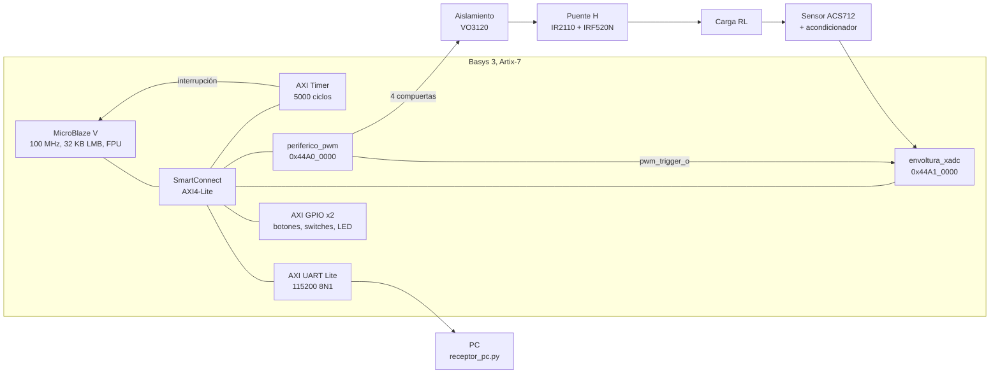

El MicroBlaze V corre sin caché, con 32 KB de BRAM local por dos LMB para programa y datos. La caché solo guarda lo que el procesador trae por AXI, y aquí todo se lee de la BRAM local en un ciclo, así que no tendría qué guardar. Es una desviación deliberada de la letra del enunciado y está justificada en el documento de diseño. Lleva multiplicación, división y unidad de punto flotante de precisión simple, porque el PR hace seis multiplicaciones por muestra y la FPU las baja de cientos de ciclos a decenas.

El Timer interrumpe al procesador sin controlador de interrupciones. Con un solo origen de interrupción, el controlador solo agregaría lógica y latencia.

### 4.2 Decisiones de diseño que más pesaron

- Frecuencia de conmutación y de muestreo iguales, 20 kHz, una conversión por período de portadora. Con la bobina de 2 mH con que empezó el diseño el piso lo ponía el rizado, 5,6 kHz con 18 V y 0,20 A, y con los 30 mH vigentes baja a 375 Hz y deja de mandar. El techo lo ponen el tiempo muerto de 1 µs y la recarga del bootstrap, que a 40 kHz bajan el índice máximo a 0,84 y hacen saturar el PR en los ensayos de escalón. A 10 kHz el retardo extra de 75 µs baja el margen de ganancia a 4,6 dB, debajo del mínimo de 6 dB.
- Un solo `duty_ref` con signo y no dos registros. La pierna B compara contra `-duty_ref`, así que el software escribe un único valor Q2.14.
- Saturación y registros sombra dentro del núcleo del PWM y no en el software. Lo que se escribe a mitad de período entra recién en el valle siguiente, y nunca sale un período con el `MAX` de una frecuencia y la referencia de otra.
- Lectura sin corrección de `duty_ref`. La interfaz devuelve los 16 bits que se escribieron, aunque estén fuera de rango. El núcleo usa la versión saturada.
- Transmisión por UART fuera de la interrupción. El lazo principal mete bytes mientras haya espacio en la FIFO de 16 bytes y retorna, y el buffer se congela mientras se exporta.
- Un solo lazo cerrado a 20 kHz. `control_principal` solo deja habilitar el control con `freq_sel = 01`. Las otras frecuencias sirven para mostrar el PWM y para el testbench.

### 4.3 Reparto

Jefferson, núcleo del PWM y puente H. Carlos, interfaz AXI4-Lite, testbench y simulación temporizada. Nicolás, Block Design, XADC y sensor de corriente. Mattio, software en C, UART, script de la PC y el PR completo. La carga RL y el sensor los diseñó Jefferson, el modelo en PLECS y la frecuencia de conmutación Nicolás.

## 5. Descripción formal de interfaces y registros

### 5.1 Mapa de direcciones

- `0x0000_0000`, memoria local, 32 KB.
- `0x4000_0000`, `axi_gpio_0`, 64 KB.
- `0x4001_0000`, `axi_gpio_1`, 64 KB.
- `0x4060_0000`, `axi_uartlite_0`, 64 KB.
- `0x41C0_0000`, `axi_timer_0`, 64 KB.
- `0x44A0_0000`, `periferico_pwm_0`, 4 KB.
- `0x44A1_0000`, `envoltura_xadc_0`, 4 KB.

Las bases de los periféricos propios se fijaron a mano, lejos de la memoria local. El MicroBlaze V manda por AXI todo acceso de datos fuera de la memoria local, y con el PWM pegado a la BRAM una escritura que se pasara del final de la memoria llegaría a su registro. Los dos periféricos propios decodifican 4 bits de dirección, así que sus registros se repiten cada 16 bytes dentro del segmento.

### 5.2 Registros del periférico PWM

Registro `0x00`, control y estado.

- Bit 0, `enable`, lectura y escritura, vale 0 tras el reset.
- Bits `[2:1]`, `freq_sel`, lectura y escritura, vale `01` tras el reset. La lectura inicial de `0x00` es `0x00000002`.
- Bit 3, `running`, solo lectura. Lo produce el núcleo y cambia en el valle, no cuando cambia `enable`. Escribir un 1 acá no hace nada.
- Bits `[31:4]`, reservados, se leen en 0.

Registro `0x04`, referencia.

- Bits `[15:0]`, `duty_ref`, lectura y escritura, complemento a dos en Q2.14 con escala 1/16384. El rango representable es de -2 a 2 menos un LSB y el admisible de -1 a +1. `0x2000` pide +0,5, `0xE000` pide -0,5, `0x4000` y `0xC000` son los límites.
- Bits `[31:16]`, reservados, se leen en 0.

`WSTRB[n]` habilita el byte `n` y los demás conservan su valor [18]. Un acceso a `0x08` o `0x0C` se lee en 0 y no escribe nada.

La tabla de `freq_sel` es la siguiente.

- `00`, 10 kHz, `MAX = 5000`.
- `01`, 20 kHz, `MAX = 2500`.
- `10`, 40 kHz, `MAX = 1250`.
- `11`, 20 kHz, `MAX = 2500`. El enunciado deja 2 bits y pide al menos tres frecuencias, y el cuarto código se resolvió repitiendo la nominal para que cualquier valor sea seguro.

### 5.3 Puertos del núcleo del PWM

Entradas.

- `clk` y `rst_n`, reloj de 100 MHz y reinicio activo en bajo.
- `enable`, `freq_sel[1:0]` y `duty_ref[15:0]` con signo, desde la interfaz AXI.

Salidas.

- `compuerta_a_alta`, `compuerta_a_baja`, `compuerta_b_alta` y `compuerta_b_baja`, activas en alto, todas directo de flip-flops para que no lleven glitches.
- `running`, hacia la interfaz.
- `pwm_trigger_o`, pulso de un ciclo en el valle hacia la envoltura del XADC.

Parámetros, fijados desde el Block Design.

- `DEAD_TIME_CICLOS = 100`, 1 µs.
- `PRECARGA_CICLOS = 7000`, 70 µs.
- `MAX_FREQ_00 = 5000`, `MAX_FREQ_01 = 2500`, `MAX_FREQ_10 = 1250` y `MAX_FREQ_11 = 2500`.

### 5.4 Registros de la envoltura del XADC

- `0x00`, control. Bit 0 `inicio`, escritura, autolimpiante, pide una conversión por software. Bit 1 `fuente`, lectura y escritura, 0 dispara por software y 1 por `pwm_trigger_o`.
- `0x04`, dato, solo lectura. Bits `[11:0]` la cuenta del ADC, bits `[13:12]` un contador de conversiones módulo 4 que el software compara entre lecturas para saber si hay muestra nueva.

### 5.5 GPIO y pines

- Canal 1 de `axi_gpio_0`, entradas. Bit 0 `BTN_HABILITAR` y bit 1 `BTN_EXPORTAR`, filtrados por un `debounce` de 21 bits cada uno. Bits 2 y 3, `SW[0]` y `SW[1]`.
- Canal 2 de `axi_gpio_0`, salidas. Bit 0 `led[0]`, control habilitado. Bit 1 `led[1]`, falla.
- `axi_gpio_1`, bit 0, `depuracion`, que sube al entrar a la interrupción y baja al salir, para medir período y jitter con el osciloscopio.
- Las cuatro compuertas salen por el Pmod JA, la corriente entra por el canal XA1 del JXADC y la UART usa el puente USB de la placa.

### 5.6 Trama de exportación

Todo en little-endian, el orden nativo del MicroBlaze V.

- Byte 0, `0xAA`, inicio.
- Bytes 1 a 2, `cantidad`, `uint16`, registros que siguen.
- Bytes 3 a 6, `frecuencia_muestreo_hz`, `uint32`.
- Bytes 7 a 18, `adc_offset_cuentas`, `amperes_por_cuenta` y `duty_escala`, tres `float32`.
- Byte 19, `duty_con_signo`.
- Bytes `20` a `19 + 6N`, los registros, 6 bytes cada uno, del más viejo al más nuevo.
- Los dos últimos bytes, `suma` de los bytes 1 a `19 + 6N` módulo 2^16.

Cada registro lleva la cuenta del ADC en 12 bits, cuatro banderas (`saturado`, `dato_ausente`, `habilitado`, `falla`) y el `duty_ref` escrito. Con 2048 registros la trama mide 12 310 bytes y a 115 200 baudios tarda 1,07 s.

## 6. Periférico PWM

El periférico se parte en dos módulos, `interfaz_axi_pwm` que traduce AXI4-Lite a tres campos de registro y devuelve `running`, y `nucleo_pwm` que hace toda la modulación. `periferico_pwm` solo los une, y es lo que se empaqueta como módulo de referencia del Block Design, según el flujo de empaquetado de IP de Vivado [20].

### 6.1 Interfaz AXI4-Lite

La interfaz guarda AW y W por separado y aplica una única escritura cuando tiene los dos, así que acepta direcciones y datos en cualquier orden, como permite la especificación [18]. No empieza otra escritura mientras la respuesta no haya sido aceptada. La lectura captura el valor al aceptar la dirección y lo mantiene aunque el registro cambie mientras `RREADY` siga en 0. Se permite una escritura y una lectura pendientes a la vez, pero no varias del mismo tipo, que es suficiente para configurar el PWM y escribir `duty_ref` una vez por período sin agregar colas.

### 6.2 Portadora y registros sombra

La portadora cuenta de 0 a `MAX` y baja de nuevo a 0, con un período de `2·MAX` ciclos y `f_sw = 100 MHz/(2·MAX)`. Corre desde el reinicio aunque `enable` esté en 0, para que el trigger siga llegando al ADC y el software pueda medir el offset del sensor con el puente apagado.

En el valle, que dura un ciclo por período, pasan cuatro cosas. `freq_sel` y `duty_ref` pasan a sus registros sombra, sale `pwm_trigger_o` registrado y `running` toma el valor de `enable`. Ningún período sale con valores mezclados.

Después de saturar `duty_ref` a ±16384, un solo multiplicador, que cabe en un DSP48E1, saca las dos referencias.

- `ref_a = (MAX · (16384 + duty_sat)) >> 15`
- `ref_b = MAX - ref_a`

La resta garantiza que `ref_a + ref_b = MAX` exacto y las dos piernas no tienen errores de redondeo distintos. Con `duty_ref = 0,5` y `MAX = 2500`, `ref_a = 1875` y `ref_b = 625`, que son los ciclos de trabajo de 75 % y 25 % de la pierna A y la B.

### 6.3 Tiempo muerto y precarga

Cada pierna tiene su propia máquina (sección 10.1). Apagar nunca se retrasa y encender solo ocurre después de `DEAD_TIME_CICLOS` ciclos con la comparación estable. Si la comparación cambia antes, la cuenta se reinicia y las dos compuertas siguen apagadas, así que un pulso más corto que el tiempo muerto desaparece sin glitch ni solapamiento. De ahí que el ciclo de trabajo máximo real sea `1 - (1 + DEAD_TIME_CICLOS)/(2·MAX)`, cerca de 98 % a 20 kHz.

Cada salida de `APAGADA` pasa por un estado de precarga en que la compuerta baja conduce `PRECARGA_CICLOS` ciclos y la alta está apagada. Las dos bajas encendidas dejan los dos extremos de la carga en tierra, sin camino de `Vdc` a tierra, y cargan el capacitor del bootstrap. Los 70 µs salen de 5τ en el peor caso de tolerancias del RC, con 22 Ω y 470 nF más 20 % de capacitancia.

El valor de 1 µs sale de sumar los peores retardos de la cadena. El PN2222A aporta 250 ns, la diferencia entre dos VO3120 0,3 µs, el IR2110 125 ns y el IRF520N unos 138 ns, 813 ns en total. El margen de 187 ns, 23 %, cubre un tiempo de almacenamiento del transistor más largo que el de la hoja y el cableado.

### 6.4 Apagado y trigger

Al bajar `enable`, `running` baja en el valle siguiente, así que el último pulso sale completo. `pwm_trigger_o` sale en el valle, donde las dos piernas están en el mismo estado y la corriente pasa por su promedio, y llega registrado un ciclo después. La envoltura lo registra otra vez, de modo que `CONVST` sube 20 ns después del valle. Los 0,1 a 0,91 µs que atrasa la cadena de compuertas respecto de la portadora quedan dentro de la tolerancia de unos pocos cientos de nanosegundos que mostró la simulación de aliasing.

## 7. Interfaz del ADC

La envoltura del XADC es un esclavo AXI4-Lite propio con una máquina que atiende una conversión a la vez. Genera `CONVST` desde `pwm_trigger_o` o desde el bit `inicio`, según `fuente`, y solo escucha la fuente elegida, de modo que con el lazo corriendo un inicio por software de más no mueve el instante de captura. Cuando termina la conversión lee el dato por el DRP del wizard y lo deja en `0x04`. El contador módulo 4 se incrementa por conversión y es la bandera de dato nuevo.

El wizard está en modo por eventos, canal único VAUX6, entrada unipolar y `DCLK` de 100 MHz con divisor 4, 25 MHz para el reloj del ADC, bajo el máximo de 26 MHz. Cada conversión y su asentamiento llevan 26 ciclos de ese reloj, 1,04 µs. Un `CONVST` que llega con el XADC ocupado, por ejemplo calibrando al salir del reinicio, se ignora, para que la máquina no quede esperando un fin de conversión que no corresponde a ninguno propio.

En el software, `drivers` desplaza el dato de `[11:0]` y lo entrega a `lazo_control`, que calcula `corriente = (cuenta - 2048)·ADC_AMPERES_POR_CUENTA` con 8,138e-4 A por cuenta. Ese valor supone 0,3 V/A en todo el camino del sensor, no coincide con los 0,24 V/A del acondicionador diseñado y es provisional hasta calibrar (sección 9.4).

## 8. Software de control

### 8.1 Organización

El software se divide en módulos con una sola responsabilidad. `drivers` es lo único que toca registros y lo único que no compila en la PC. Todo lo demás se prueba con gcc sustituyendo `drivers` por una versión que escribe en variables.

- `drivers`, acceso a los periféricos, Timer, interrupción y GPIO.
- `control_principal`, arranque y lazo principal, fuera de la interrupción.
- `lazo_control`, la interrupción de 20 kHz.
- `pr_discreto`, la ley de control con saturación y anti-windup.
- `ref_senoidal`, la referencia de 50 Hz desde una tabla de 257 entradas.
- `supervisor_falla`, las condiciones de falla y su enclavamiento.
- `buffer_muestras`, `exportador_uart` y `receptor_pc`, el camino del histórico hasta la PC.
- `generar_pr_params.m`, que escribe los coeficientes en `pr_params.h` desde Octave.

### 8.2 Interrupción de 20 kHz

En cada interrupción del Timer, siempre en este orden, `lazo_control` hace lo siguiente.

1. Sube el pin de depuración y lee una vez el registro del ADC.
2. Si el contador módulo 4 cambió, hay muestra nueva. Calcula la corriente y llama a `supervisor_falla`. Si no cambió, conserva la corriente anterior y cuenta la ausencia.
3. Si el control está habilitado y sin falla, rampea la amplitud, saca `i_ref` de la tabla senoidal, ejecuta el PR y escribe `duty_ref`.
4. Guarda el registro en el buffer circular y baja el pin.

Con 5000 ciclos de reloj por iteración sobra tiempo incluso con las seis multiplicaciones en `float`. La duración real de la interrupción está pendiente de medir (sección 12.8).

El primer dato se espera con un sondeo acotado antes de arrancar el Timer. Si no llega, queda el LED de falla y el Timer detenido, y con el Pmod al aire la cuenta del ADC cae fuera de 16 a 4079 y la falla se enclava en la primera interrupción.

### 8.3 Regulador

Los coeficientes vigentes salen de `Kp = 188,88 V/A`, dividido entre `Vdc = 18 V` para que la salida sea índice de modulación.

- `KP = 10,4932`
- `B0 = 4,1665e-3`, `B1 = 0`, `B2 = -4,1665e-3`
- `A1 = -1,99975`, `A2 = 1`
- `PR_U_MAX = 0,92`

La salida se recorta a ±0,92. Si hubo recorte, el estado del resonante se reajusta a `r = u - u_p`, lo que habría hecho caer la suma justo en el límite, y así el resonante no acumula energía mientras el puente está saturado.

### 8.4 Rampa de amplitud

El cambio de un switch mueve `amplitud_ref` de golpe. Con `Kp = 188,88` el error instantáneo del escalón de 0,2 a 1,0 A pide un índice de hasta 8,53 con 18 V, imposible de entregar. Por eso `lazo_control` rampea una amplitud interna a razón de `AMPLITUD_PASO_MAX = 0,0025 A` por muestra, 400 muestras (20 ms, un período) para llegar a 1,0 A. Se probó contra el código real compilado con planta simulada, no contra el modelo de Octave, y con 200 muestras no alcanza, como se detalla en la sección 14.

### 8.5 Falla

`supervisor_falla` enclava la falla con tres condiciones y no la libera hasta el reinicio. La sobrecorriente a 1,3 A, la cuenta del ADC fuera de 16 a 4079 (sensor desconectado o saturado), y más de tres iteraciones consecutivas sin dato nuevo. Al enclavar baja `enable` por única vez y enciende `led[1]`. La falla nunca rearma sola, y desde que la corriente cruza el umbral hasta que las compuertas quedan en bajo pasan hasta dos períodos, 100 µs a 20 kHz.

### 8.6 Control principal y exportación

`control_principal` arranca en un orden seguro y después atiende botones, switches y LED. El botón de habilitar alterna el control y solo lo habilita si `freq_sel` vale `01` y no hay falla, el de exportar congela el buffer y arma la trama, y `SW[1:0]` elige la amplitud de la referencia, 0, 0,2, 0,5 o 1,0 A. Al deshabilitar o fallar deja `duty_ref` y `saturado` en cero, y al arrancar no cuenta como flanco un botón que ya estaba apretado.

`receptor_pc.py` valida la suma, convierte las cuentas a amperes y calcula la fundamental de la corriente y de la referencia sobre los últimos períodos enteros de 50 Hz, proyectando sobre un seno y un coseno por mínimos cuadrados. Informa el error de amplitud, el desfase, el error del fasor y el residuo de baja frecuencia, y avisa si la ventana tiene iteraciones deshabilitadas o en falla. El rizado de conmutación no se ve en el histórico porque se muestrea una vez por período, y se mide con el osciloscopio.

## 9. Etapa de potencia, carga y sensor

### 9.1 Puente H y compuertas

Cuatro MOSFET IRF520N (100 V, 9,7 A) forman el puente, cada pierna con un IR2110 y bootstrap de 470 nF con diodo 1N4148 y 22 Ω. Las cuatro compuertas cruzan la barrera de aislamiento con un VO3120 cada una, y los LED se manejan con un PN2222A desde el Pmod de la Basys 3. La polaridad deja la compuerta apagada ante un pin en alta impedancia, un cable suelto o la placa sin alimentar, porque una falla del lado de la FPGA no puede encender las cuatro y cortocircuitar las piernas.

Las protecciones se dimensionan para 24 V aunque se opera con 18 V. Un electrolítico de 470 µF y 63 V más un poliéster de 100 nF por pierna, un fusible rápido de 630 mA a la entrada, y límite de corriente de la fuente de 0,52 A en los ensayos y de 0,1 A en la primera energización. No hay apagado por hardware a partir de una medición de corriente, la desconexión la hace el software. El caso de un cortocircuito en la carga no queda cubierto para los MOSFET, porque el pico de 60 A de la descarga del electrolítico dura más que el tiempo de respuesta del software y la energía `I²t` de 0,34 A²s llega antes de que el fusible abra.

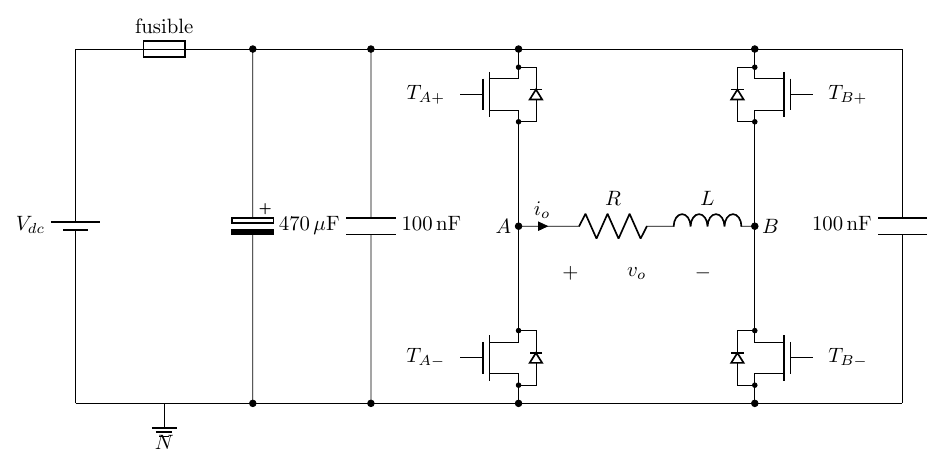

Figura 9.1. Esquema del puente H. A y B son los puntos medios de las dos piernas y `v_o` es la tensión sobre la carga.

### 9.2 Carga RL

La carga vigente es un transformador usado como inductor de 30 mH con 12 Ω de resistencia total, en reemplazo de la bobina de 2 mH y los 10 Ω con que empezó el diseño. A 50 Hz la impedancia es `|Z| = 15,26 Ω` con 38,1° de desfase, y con 18 V los índices de modulación que piden 0,2, 0,5 y 1,0 A son 0,170, 0,424 y 0,848. A 1,0 A pico la resistencia total disipa 6 W en promedio. Los valores son los nominales con que se armó el banco, y la medición de L y R queda pendiente.

### 9.3 Sensor y acondicionamiento

El sensor es un ACS712 de efecto Hall, bidireccional y con aislamiento propio. Su salida en reposo es `Vcc/2`, 2,5 V, fuera del rango del XADC, así que un amplificador restador quita ese cero, aplica ganancia y suma un offset de 0,5 V que centra la corriente alterna en el rango de 0 a 1 V. Sigue un RC antialias de 1 kΩ y 33 nF, con corte en 4823 Hz y retardo de 33 µs. El diseño del restador y la selección de ganancia están en `potencia/carga_RL-Sensor`, y su ganancia final se reconcilia con la constante del software en la sección 15.

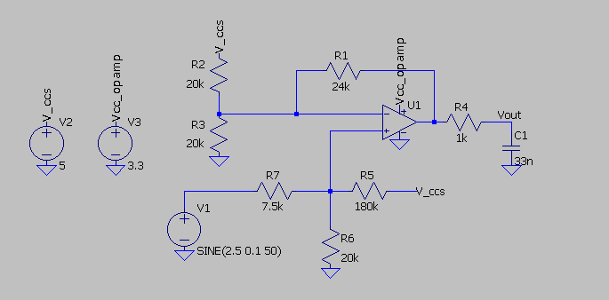

Figura 9.2. Acondicionador de señal del sensor en LTspice, con el RC antialias de 1 kΩ y 33 nF a la salida.

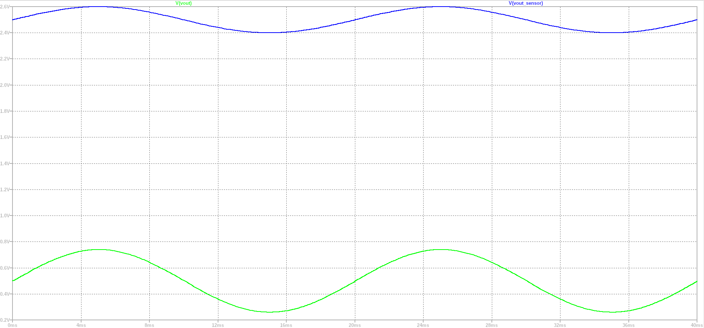

Figura 9.3. Simulación del acondicionador con una entrada de 2,5 V con 0,1 V de amplitud a 50 Hz (azul) y la salida (verde), centrada en 0,5 V con 0,24 V de amplitud. Esa relación de 0,24 V por cada 0,1 V de entrada es la ganancia de 2,4 que se analiza en la sección 9.4.

### 9.4 Ganancia de la cadena del sensor

La corriente llega al XADC por tres etapas en serie. El ACS712-20A entrega `Vs = 0,5·VCC + Sens·i`, con `Sens = 100 mV/A` típico (96 a 104 mV/A) y salida ratiométrica con la alimentación [10]. El restador de la sección 9.3 aplica ganancia y mueve el cero. El XADC cuantiza el rango de 0 a 1 V en 4096 cuentas de 244 µV [6].

En el restador, `R+ = R5‖R6 = 18 kΩ` y `R- = R2‖R3 = 10 kΩ`, y la entrada inversora recibe `VCC/2` del divisor de `R2` y `R3`. Con la condición `R+/R7 = R1/R- = k` la salida y la ganancia quedan [21]

$$V_o = \left(1+\frac{R_1}{R_-}\right)V_+ - \frac{R_1}{R_-}\cdot\frac{V_{CC}}{2}, \qquad A_v = \left(1+\frac{R_1}{R_-}\right)\frac{R_+}{R_+ + R_7} = k$$

Con `R1 = 24 kΩ` y `R7 = 7,5 kΩ`, `k = 2,4`. La salida en reposo es `0,1·VCC`, 0,5 V con 5 V, que es la cuenta 2048, y la sensibilidad de extremo a extremo es `Av·Sens = 0,24 V/A`, o sea `1 V/(4096·0,24 V/A) = 1,017e-3 A` por cuenta. Con 1,3 A la salida llega a 0,19 V y 0,81 V, dentro del rango, y el fondo de escala es ±2,08 A.

Hay tres valores de esa constante en el repositorio, y el análisis dice cuál corresponde a cada uno.

- El acondicionador diseñado, con 24 kΩ y 7,5 kΩ, que es el de la figura 9.2 y el que simuló la figura 9.3. Da 0,24 V/A y 1,017e-3 A por cuenta.
- El archivo `circuito_acondicionador.asc` de la rama `doc/sensor-carga`, con `R1 = 12 kΩ` y `R7 = 15 kΩ`, que difiere del documento de diseño. Da `k = 1,2`, 0,12 V/A y 2,035e-3 A por cuenta.
- El software, con 8,138e-4 A por cuenta, que corresponde a 0,3 V/A y no coincide con ninguno de los dos circuitos.

La diferencia tiene consecuencias de seguridad y no solo de exactitud, porque el lazo regula la corriente medida. Si el banco se armó con el diseño de 2,4, el software lee el 80 % de la corriente real y la amplitud real sale 1,25 veces la pedida, un error de +25 % contra el límite de 10 %. Si se armó con el archivo de LTspice, el software lee el 40 % y la corriente real sale 2,5 veces la pedida, con el umbral de falla de 1,3 A equivalente a 3,25 A reales, de modo que la falla por software ya no protegería y quedaría solo el fusible de 630 mA. Por eso `ADC_AMPERES_POR_CUENTA` tiene que pasar a 1,017e-3 antes de energizar, una vez confirmada la ganancia de 2,4 contra la sonda (sección 12.8). Esa actualización del software está pendiente.

Aun con la constante correcta, el sensor deja un presupuesto de error que conviene tener a la vista antes de medir.

- Sensibilidad. La tolerancia de ±4 % del ACS712 se suma a la de las resistencias del restador. Como el lazo cierra sobre la corriente medida, un error de ganancia pasa directo a la amplitud real y se come parte del 10 % del enunciado. Por eso la ganancia se calibra en un punto contra la sonda, y la incertidumbre de esa calibración se combina como indica la guía GUM [22].
- Cero. Como `Vo0 = 0,1·VCC`, una `VCC` que se corra ±5 % mueve la salida ±25 mV, unas ±102 cuentas o ±0,10 A. Esa continua no entra en el error de la fundamental, pero con `Kp/R` cerca de 15,7 a frecuencia cero el lazo la devuelve a la carga casi completa, un 94 % de su valor, y la corriente real queda con esa componente de continua. La cuenta de reposo se mide con el puente apagado, porque la portadora corre aunque `enable` esté en 0 (sección 6.2).
- Ruido. El ACS712-20A declara 11 mV pico a pico con 2 kHz de ancho de banda [10], que tras la ganancia son 26 mV, unas 108 cuentas o 0,11 A pico a pico referidos a la entrada. Es una cota de orden de magnitud, porque el ancho de banda real del sensor y del RC es otro, y pesa más en el ensayo de 0,2 A, de 0,4 A pico a pico.
- Cuantización y temperatura. Una cuenta vale 1,017 mA, 0,25 % de los 0,4 A pico a pico del caso chico. La deriva del cero, de -0,07 mV/°C entre 25 y 150 °C [10], son 0,7 cuentas por grado tras la ganancia y no pesan en ensayos de pocos minutos.

## 10. Diagramas de estado

### 10.1 Pierna del núcleo del PWM

Cada pierna tiene la misma máquina. Cualquier estado vuelve a `APAGADA` de inmediato cuando `running` baja, porque apagar las dos compuertas nunca causa un cortocircuito.

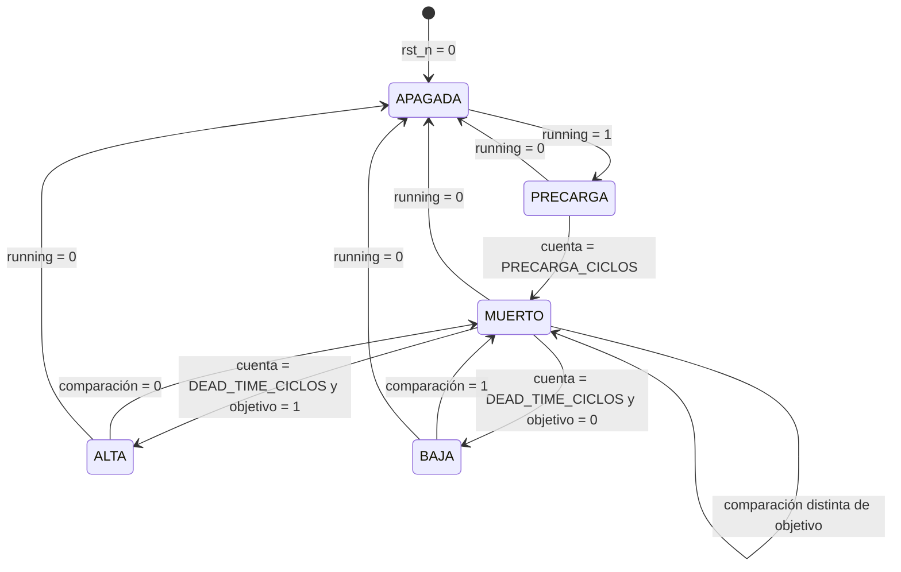

De `ALTA` a `BAJA`, o al revés, siempre se pasa por `MUERTO`, y ningún estado tiene las dos compuertas en 1.

### 10.2 Envoltura del XADC

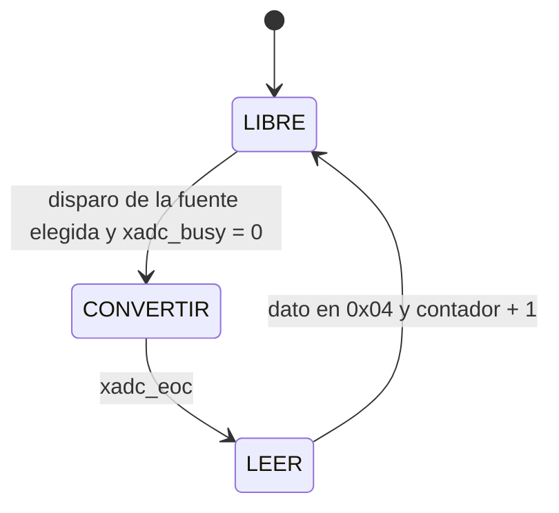

### 10.3 Lazo principal

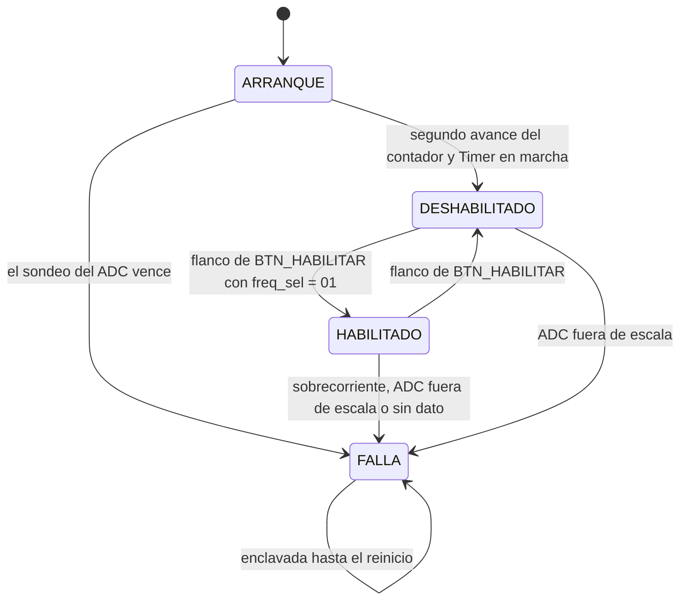

El pedido de exportación se atiende en cualquier estado sin tocar la interrupción.

## 11. Estrategia de validación

La validación va por etapas, y cada una descarta una causa antes de sumar la siguiente.

1. Simulación RTL de cada módulo propio con testbench autoverificable, con parámetros reescalados a valores chicos donde conviene.
2. Pruebas del software en la PC con gcc, sustituyendo `drivers` por una versión en variables, y pruebas de `receptor_pc` contra una trama generada por el exportador real.
3. Modelo de referencia del PR en Octave, que simula el lazo promedio con saturación y las esquinas de `L` y `R`, y modelo conmutado del puente en PLECS.
4. Síntesis, implementación y reportes de Vivado, regenerables desde `src/crear_proyecto.tcl`.
5. Pruebas en banco con la potencia apagada. Compuertas, tiempo muerto, trigger y fase de la interrupción con analizador lógico y osciloscopio.
6. Ensayos energizados por pasos, empezando en 12 V y 0,2 A, en el orden de lazo abierto, solo proporcional, PR completo, cambio de amplitud y cambio de `R`.

Los criterios de aprobación son los del enunciado, error de la fundamental menor a 10 % en al menos cinco períodos, rizado menor a 0,20 A pico a pico, y compuertas sin conducción simultánea con el tiempo muerto verificado antes de energizar. Qué se mide en cada etapa, con qué instrumento y con qué criterio está en `docs/guia_mediciones.md`, y la lista corta en `docs/pruebas_integracion.md`.

## 12. Resultados

### 12.1 Simulación del periférico PWM

`src/sim/tb_periferico_pwm.sv` es autoverificable y compara las compuertas contra un modelo de referencia ciclo a ciclo, con accesos AXI aleatorios y concurrentes con el PWM habilitado. Corrida del 16 de noviembre con Icarus Verilog.

- 23 grupos de prueba, todos con `PASS`.
- 101 554 comprobaciones y 0 errores.
- 242 escrituras en AW, 242 en W, 240 respuestas B, 323 lecturas en AR y 322 respuestas R.
- 264 triggers observados y 8 reinicios en situaciones distintas.

Los grupos cubren, entre otros, `running` y precarga exacta de ambas piernas, referencias con signo y saturación, deshabilitación durante la modulación y durante la precarga, cambios conjuntos de frecuencia y referencia, escrituras a dos, uno y cero ciclos del valle, pulsos menores al tiempo muerto, reinicio en varias fases con las compuertas activas, y la lectura de `running` retenida durante el apagado. El resumen termina en `PWM: APROBADO`.

### 12.2 Simulación de la envoltura del XADC

`src/sim/tb_envoltura_xadc.sv` modela el DRP y el XADC con 12 situaciones, entre ellas que `CONVST` suba 20 ns después del valle, que un valle durante una conversión se ignore, que el contador dé la vuelta módulo 4 con los datos `0x0fff`, `0x1fee`, `0x2fdd` y `0x3fcc`, y que el software pueda escribir `W` antes que `AW` y hacer dos inicios seguidos. Termina con `PASA: tb_envoltura_xadc sin errores`.

### 12.3 Pruebas del software

- Siete programas de prueba en C (`buffer_muestras`, `pr_discreto`, `ref_senoidal`, `supervisor_falla`, `lazo_control`, `exportador_uart` y `control_principal`), todos con 0 errores. `lazo_control` y `control_principal` corren con los módulos reales y un `drivers` simulado.
- `prueba_generar_pr_params.m` en Octave, con 0 errores, que revisa los coeficientes y que el polo quede en 50 Hz después de redondear `A1`.
- 12 pruebas de `receptor_pc` con pytest, que pasan.

### 12.4 Sintonización y márgenes del PR

Con `L = 30 mH`, `R = 12 Ω`, `Vdc = 18 V`, `Td = 75 µs`, cruce de diseño en 1 kHz y `Kr = 3000`, salida de `verificar_pr.m`. Los mínimos de 45° de margen de fase y 6 dB de margen de ganancia son los criterios usuales de robustez ante el retardo y la variación de la planta [23].

- Cruce en 1000 Hz con 66,5° de margen de fase y 10,5 dB de margen de ganancia.
- Con cruce en 500 Hz, 83,2° y 16,5 dB. Con 2000 Hz, 37,8° y 4,5 dB, por debajo del mínimo de 45° y 6 dB.
- `Kr = 1000`, 3000 y 5000 dan 66,6°, 66,5° y 66,4°, prácticamente iguales porque `Kp` domina el cruce.
- El polo del resonante queda en `|z| = 0,9996`, con constante de tiempo de 133,8 ms.

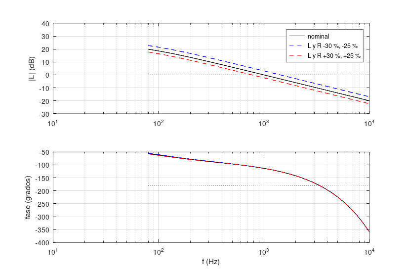

Figura 12.1. Bode del lazo abierto en el nominal (negro) y en las esquinas de `L` y `R` (azul y rojo), con la línea de 0 dB y la de -180° punteadas. Generada por `potencia/informe/figuras_informe.m`.

Esquinas de `L` (±30 %) y `R` (±25 %) con `Kp` sin retocar.

- `L = 21 mH`, `R = 9 Ω`, 54,0° y 7,5 dB.
- `L = 21 mH`, `R = 15 Ω`, 55,9° y 7,5 dB.
- `L = 39 mH`, `R = 9 Ω`, 71,8° y 12,8 dB.
- `L = 39 mH`, `R = 15 Ω`, 73,6° y 12,8 dB.

Las cuatro cumplen el mínimo de esquina de 30° y 3 dB.

Retardo adicional sobre los 75 µs del modelo.

- 2 µs, 65,8° y 10,3 dB.
- 25 µs, 57,5° y 8,1 dB.
- 50 µs, 48,5° y 6,2 dB.
- 75 µs, 39,5° y 4,6 dB.
- El margen de ganancia llega a 6 dB con 53 µs de más, el de fase a 45° con 60 µs, y el de ganancia se agota con 185 µs.

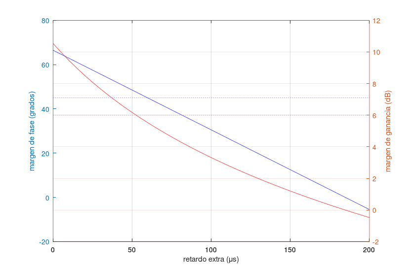

Figura 12.2. Margen de fase (azul, grados) y de ganancia (rojo, dB) contra el retardo adicional sobre los 75 µs del modelo. Las líneas punteadas marcan los mínimos de 45° y 6 dB.

Filtro del sensor, RC de primer orden, en el nominal y en la esquina de `L = 21 mH` y `R = 9 Ω`.

- 5 kHz, 56,0° y 8,6 dB nominal, 40,1° y 5,5 dB en la esquina.
- 3 kHz, 50,3° y 8,2 dB nominal, 33,9° y 5,1 dB en la esquina.
- 2 kHz, 44,8° y 7,9 dB nominal, 28,8° y 4,8 dB en la esquina, que ya no cumple.
- Butterworth de segundo orden a 5 kHz, 50,1° y 6,5 dB nominal, 30,5° y 3,4 dB en la esquina.

### 12.5 Error de la fundamental en simulación

Lazo discreto promedio con planta por retenedor de orden cero y un muestreo de retardo, error de amplitud de la fundamental `(|I1| - |R1|)/|R1|` en ventanas de un período, escalón aplicado en el cruce por cero de la referencia.

- Escalón de 0,2 a 1,0 A, error por período, con `Kr = 1000`, 5,8, 5,5, 5,2, 4,9 y 4,7 %. Con `Kr = 3000`, 5,3, 4,6, 3,9, 3,4 y 2,9 %. Con `Kr = 5000`, 5,0, 3,9, 3,0, 2,3 y 1,8 %.
- Escalón de 0,2 a 0,5 A, 5,2, 4,5 y 3,8 % en los tres primeros períodos. De 0,5 a 1,0 A, 5,1, 4,4 y 3,8 %.
- Cambio de `R` de 12 a 15 Ω (25 %) con 1,0 A, 1,4, 1,2 y 1,0 %.
- En las esquinas de `L` y `R`, el peor caso es 6,6 % en el primer período y 4,9 % en el segundo.
- Solo proporcional, error de 6,0 % con desfase de -2,8°.

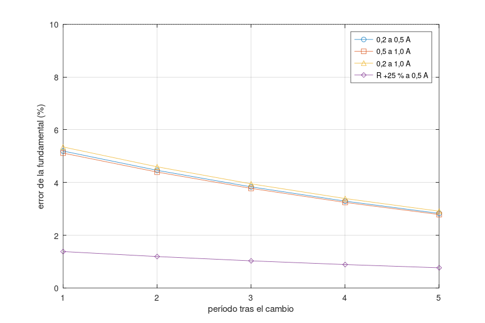

Figura 12.3. Error de amplitud de la fundamental en los cinco períodos que siguen a cada cambio, con `Kr = 3000`. Los tres escalones de amplitud y el cambio de `R` de 25 % quedan por debajo del 10 % desde el primer período.

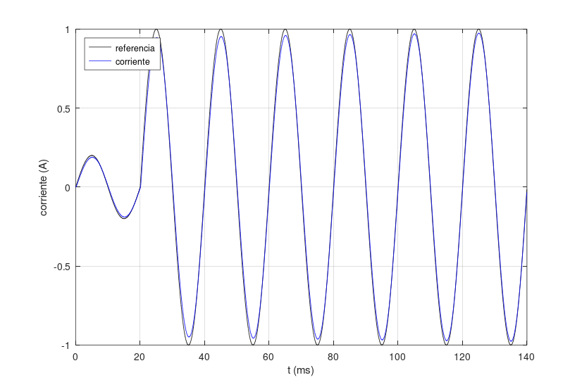

Figura 12.4. Referencia y corriente simuladas en un escalón de 0,2 a 1,0 A aplicado en el cruce por cero con el lazo discreto promedio de la sección 12.5. El caso con saturación, con el switch cayendo en otra fase, es el de la sección 12.6.

Efecto del tiempo muerto de 1 µs (0,72 V de pérdida y 0,92 V de fundamental) con los 0,4 Ω de `RDS(on)`, predicción de los ensayos 1 y 2.

- Lazo abierto, 0,146 A para 0,2 A pedidos (-27 %, -26,8°), 0,442 A para 0,5 A (-12 %, -33,1°) y 0,932 A para 1,0 A (-7 %, -35,2°).
- Solo proporcional, error de amplitud de 8,4 %, 7,1 % y 6,6 %, con desfase de -2,7° a -2,8°.

### 12.6 Escalón con saturación y rampa

El escalón de 0,2 a 1,0 A aplicado lejos de un cruce por cero es lo que pasa al mover un switch a mano, y con la carga vigente satura.

- Sin rampa, el índice que pediría el PR llega a 8,53 con 18 V y a 12,80 con 12 V, y el pico de corriente del modelo sin saturar a 1,105 A.
- Con saturación y anti-windup del código real y sin rampa, el error de la fundamental es 11,6 %, 36,9 % y 58,1 % en los tres primeros períodos en la peor fase, y ningún `Kr` entre 3000 y 30 000 baja el segundo período de 10 %.
- Con rampa de 200 muestras, 12,2 % en el segundo período y 10,6 % en el tercero en la fase en que el switch cae en el pico de la corriente.
- Con rampa de 400 muestras, el peor caso de 20 fases baja a 4,0 % en el segundo período y 3,5 % en el tercero, con pico de corriente de 0,979 A. Entre 350 y 480 muestras el resultado es parecido. Con 800 muestras el segundo período sube a 14,9 %, y con 1000 a 26,3 %.

### 12.7 Utilización y timing

Vivado 2026.1, diseño `sistema_wrapper` ruteado sobre `xc7a35tcpg236-1`, reportes del 11 de noviembre.

Utilización total.

- Slice LUT, 5567 de 20 800 (26,76 %). 5396 como lógica y 171 como memoria (128 de RAM distribuida y 43 registros de desplazamiento).
- Slice Registers, 3651 de 41 600 (8,78 %), todos flip-flops y ningún latch.
- Slices, 1776 de 8150 (21,79 %).
- Block RAM, 8 RAMB36 de 50 (16,00 %), que son los 32 KB de memoria local.
- DSP48E1, 7 de 90 (7,78 %).
- Bonded IOB, 16 de 106 (15,09 %).

Por bloque.

- `microblaze_riscv_0`, 4704 LUT y 2654 flip-flops.
- `periferico_pwm_0`, 151 LUT, 199 flip-flops y 1 DSP. La interfaz AXI usa 49 LUT y 64 flip-flops, y el núcleo 102 LUT, 135 flip-flops y el DSP.
- `axi_timer_0`, 194 LUT y 173 flip-flops. `mdm_1`, 143 LUT. `axi_smc`, 135 LUT. `axi_uartlite_0`, 87 LUT. `axi_gpio_0`, 45 LUT.

Timing, con el reloj `sys_clk_pin` de 10 ns (100 MHz).

- WNS 0,519 ns, TNS 0 ns, ningún endpoint de setup en falla de 10 835.
- WHS 0,052 ns, THS 0 ns, ningún endpoint de hold en falla.
- WPWS 3,750 ns, sin violaciones de ancho de pulso.
- El reporte dice `All user specified timing constraints are met`.

### 12.8 Mediciones en banco

Estas son las mediciones que piden el enunciado y la rúbrica y que todavía no se tomaron. Cada una queda atada a su criterio para completarla sin reescribir el análisis. Los valores esperados salen de las secciones 12.4 a 12.6.

- Período de cada compuerta a `freq_sel = 01`, esperado 50,0 µs. Medido, `PENDIENTE`.
- Tiempo muerto en los dos flancos de las dos piernas, con osciloscopio, esperado 1,00 µs. Medido, `PENDIENTE`.
- Conducción simultánea de alta y baja de una pierna, esperado ninguna en captura larga. Medido, `PENDIENTE`.
- Centro de los pulsos de A y B en el mismo instante, el valle. Medido, `PENDIENTE`.
- Período de la interrupción en el pin de depuración, esperado 50,0 µs, con jitter pico a pico. Medido, `PENDIENTE`.
- Duración de la interrupción con el PR corriendo y con la falla enclavada. Medido, `PENDIENTE`.
- Fase de la interrupción contra `pwm_trigger_o` en varios reinicios, esperado estable sin deriva. Medido, `PENDIENTE`.
- Retardo efectivo del lazo contra los 75 µs del modelo más `τF`, con margen de 53 µs antes de perder 6 dB. Medido, `PENDIENTE`.
- Cuenta del ADC con 0 A, esperado 2048 con `VCC = 5 V` y ±102 cuentas si `VCC` se corre ±5 %, y ganancia real del sensor contra la sonda, esperado 0,24 V/A (sección 9.4). Medido, `PENDIENTE`.
- Ensayo 1, lazo abierto a 18 V, esperado 0,146, 0,442 y 0,932 A con los desfases de la sección 12.5. Medido, `PENDIENTE`.
- Ensayo 2, solo proporcional, esperado 8,4, 7,1 y 6,6 %. Medido, `PENDIENTE`.
- Ensayo 3, PR completo con 0,2, 0,5 y 1,0 A, error de la fundamental menor a 10 % en cinco períodos y rizado menor a 0,20 A pico a pico. Medido, `PENDIENTE`.
- Ensayo 4, cambios de amplitud de 0,2 a 0,5 A y de 0,5 a 1,0 A. Medido, `PENDIENTE`.
- Ensayo 5, cambio de `R` de al menos 25 % con 0,5 A. Medido, `PENDIENTE`.
- Falla con carga, sobrecorriente real arriba de 1,3 A, esperado compuertas en bajo, LED encendido y sin rearme. Medido, `PENDIENTE`.
- Temperatura de los MOSFET, de la carga y de la fuente tras unos minutos a 1,0 A. Medido, `PENDIENTE`.

### 12.9 Modelo conmutado en PLECS

El modelo en PLECS reproduce el puente, la modulación unipolar del núcleo, el tiempo muerto con dos portadoras corridas `±2·f_sw·TM` y la carga RL, con todos los parámetros en un solo archivo de Octave. Se validó contra el análisis con la carga anterior de 10 Ω y 2 mH, `Vdc = 18 V`, y una referencia de 0,2 A, fundamental sobre cuatro períodos.

- Sin tiempo muerto ni `RDS(on)`, 0,2000 A y 3,60°, igual que el análisis.
- Solo `RDS(on)`, 0,1923 A y 3,46°, igual que el análisis.
- Solo tiempo muerto, 0,1104 A y 3,48° en el modelo, contra 0,1086 A y 1,95° del análisis de onda cuadrada.
- Los dos, 0,1062 A y 3,35° en el modelo, contra 0,1044 A y 1,88°.
- Con 0,5 y 1,0 A, 0,393 y 0,874 A, ambos con unos 3,4° de desfase, que coinciden con la predicción con tiempo muerto y `RDS(on)`.
- Rizado de conmutación en lazo abierto, 0,0149, 0,0408 y 0,0563 A para 0,2, 0,5 y 1,0 A, iguales a la fórmula evaluada en el `d` que llega a la carga.

Con la carga vigente de 12 Ω y 30 mH se repitió el ensayo de lazo abierto y el de rizado con `Vdc = 18 V`, 20 kHz y 1 µs de tiempo muerto, con `potencia/sim/validar.m` sobre el mismo modelo. Las tablas y una captura por caso están en `potencia/sim/resultados/`.

- Fundamental de la corriente, 0,1423, 0,4403 y 0,9314 A para 0,2, 0,5 y 1,0 A, contra 0,146, 0,442 y 0,932 A de la predicción de la sección 12.5. Las diferencias son -2,5 %, -0,4 % y -0,1 %.
- Desfase de la corriente respecto del índice, -28,90°, -33,32° y -35,22°, contra -26,8°, -33,1° y -35,2° de la predicción.
- Rizado pico a pico, 1,7, 3,6 y 4,0 mA, contra 1,7, 3,5 y 3,7 mA de la fórmula con la pérdida del tiempo muerto restada al índice. La diferencia es +0,0 %, +0,1 % y +6,8 %.

El máximo de 4,0 mA queda apenas sobre los 3,75 mA del rizado teórico máximo y unas 50 veces por debajo del límite de 0,20 A. No se investigó el origen de ese 6,8 % en el punto de 1,0 A, que en valor absoluto son 0,3 mA.

## 13. Análisis de resultados

### 13.1 Periférico y plataforma

Los 101 554 chequeos del testbench del PWM no solo cuentan por cantidad. El modelo de referencia es ciclo a ciclo, y los grupos de bordes (escrituras a cero, uno y dos ciclos del valle, pulsos menores al tiempo muerto, reinicio con las compuertas activas) son los que habrían mostrado un glitch o un solapamiento. Que ninguno aparezca respalda la propiedad que más importa antes de energizar, que ningún estado tiene las dos compuertas de una pierna en 1. No reemplaza la medición con osciloscopio, porque el testbench no ve los retardos de la cadena de compuertas.

El diseño usa un cuarto de las LUT y casi todas son del procesador, 4704 de 5567. El periférico PWM propio ocupa 151, menos del 3 %, así que la lógica propia no compite por recursos ni por timing. La holgura de setup es de 0,519 ns a 100 MHz, positiva y sin endpoints en falla.

### 13.2 Márgenes del lazo

El diseño nominal cumple 45° y 6 dB con 66,5° y 10,5 dB, pero con mucho menos aire que antes. Con la carga de 2 mH el margen de fase era 99,8°. La razón es que con 30 mH la carga ya aporta 38° a 50 Hz, y `Kp = 188,88` domina el cruce en vez de `R`. Eso tiene una consecuencia práctica. Los dos límites de retardo, 53 µs para el margen de ganancia y 60 µs para el de fase, quedan casi juntos, y entre el aislamiento de las compuertas y el filtro del sensor ya no sobra margen para cualquier valor. El RC de 2 kHz queda descartado por 0,2° en el nominal, y en la esquina baja de `L` y `R` el Butterworth pasa raspando con 30,5° contra el mínimo de 30°. El RC de 33 nF y 1 kΩ del sensor, con corte en 4823 Hz y 33 µs de retardo, cae dentro de lo aceptable, 56° y 8,6 dB nominal con el RC de 5 kHz como referencia más cercana.

### 13.3 Error de la fundamental

El error simulado, entre 6,6 % y 2,9 %, está bajo el 10 % desde el primer período, pero hay que leerlo con sus condiciones. Corresponde al lazo promedio, sin rizado de conmutación, sin cuantización del ADC, sin ruido del sensor y con un escalón aplicado en el cruce por cero. Dos de esos efectos ya se pudieron separar. El tiempo muerto y la `RDS(on)` explican por qué el ensayo en lazo abierto va a dar 27 % menos de lo pedido con 0,2 A y solo 7 % menos con 1,0 A, porque la pérdida es una tensión casi fija y pesa más cuanto menos tensión pide la referencia. Con solo proporcional, el error de 6 a 8 % en lugar del 43 a 57 % que daba la carga anterior no es una mejora del lazo. Es que `Kp` ahora es mucho mayor que `|Z|`, y la parte proporcional sola casi cierra el lazo.

`Kr = 3000` se eligió pese a que con esta carga hasta 1000 alcanza, para conservar el valor con que se sintonizó la carga anterior y tener margen si el `Kp` real resulta menor. Subir `Kr` no mueve el margen de fase, así que cuesta poco.

### 13.4 El escalón y la rampa

Es el hallazgo de diseño más importante de la parte de control. El PR sintonizado con el criterio habitual cumple los 10 % en el escalón idealizado, y falla de forma clara (58,1 % en el tercer período) cuando el escalón cae lejos del cruce por cero, porque `Kp` multiplica el error instantáneo y el puente se pega al tope de 0,92. El anti-windup evita que el resonante se descontrole, pero no puede hacer que el puente entregue más tensión. Subir `Kr` tampoco ayuda, porque el problema es de tensión disponible y no de velocidad de convergencia.

La salida fue limitar la velocidad de `amplitud_ref`, y la primera estimación tenía un error de método que vale la pena anotar. La simulación en Octave medía el error contra la referencia ya rampeada en lugar de contra la amplitud que pide el switch, lo que escondía el problema. Al repetir la medición con el código real de `lazo_control.c` compilado con planta simulada y la amplitud verdadera, 200 muestras fallaban con 12,2 %. La rampa no mejora de forma monótona, a 800 muestras el error del segundo período vuelve a 14,9 %, porque el sistema pasa demasiado tiempo en una amplitud intermedia. Hay un mínimo ancho alrededor de un período completo, entre 350 y 480 muestras, y 400 queda en medio con 4,0 %.

La consecuencia para el ensayo 4 es que el criterio de los 10 % se aplica a la amplitud rampeada, y el error en el primer período del cambio no es comparable con el de la tabla de la carga anterior (16,6 % y 15,0 %), que los documentos de pruebas citaban antes de corregirse.

### 13.5 Rizado y aliasing

El rizado teórico máximo de 3,75 mA con 18 V y 30 mH es 53 veces menor que el límite de 0,20 A. Con la carga de 2 mH eran 56 mA, y en PLECS salieron 0,0149, 0,0408 y 0,0563 A, iguales a la fórmula, así que el método de cálculo está validado y con la carga vigente no restringe el diseño. Con la carga de 30 mH, PLECS dio 1,7, 3,6 y 4,0 mA, y el máximo de 4,0 mA queda 6,8 % sobre la fórmula en el punto de 1,0 A, sin que el límite de 0,20 A llegue a estar cerca.

Eso arrastra al aliasing. `aliasing_pr.m` se corrió de nuevo con 12 Ω y 30 mH, `Kp = 188,88 V/A` y `Kr = 3000`, con el puente conmutado, la portadora de 2500 cuentas y la carga resuelta exacta entre flancos, sin tiempo muerto ni cuantización del ADC. El error de amplitud de la fundamental de la corriente verdadera queda así.

- Captura en el valle, -0,09 % con 1,0 A y con 0,2 A. Con ±200 ns de error en el instante, entre -0,08 % y -0,10 %, y con ±400 ns entre -0,07 % y -0,11 %.
- Captura en el pico de la portadora, -0,09 %, y con +200 ns -0,08 %.
- Captura adelantada 0,91 µs respecto del valle, por el retardo máximo de la cadena de compuertas, -0,13 % con 1,0 A y con 0,2 A. Con 0,1 µs, -0,09 %.
- Captura en el centro del pulso con ±200 ns, entre -0,09 % y -0,14 % con 1,0 A y 0,2 A, salvo -0,04 % con 0,2 A y -200 ns.
- Captura en el flanco del pulso, -0,01 %. Con una fase cualquiera, a 5, 7,8 y 20 µs del valle, 0,02 %, -0,01 % y -0,20 %.

Con la carga de 2 mH esos mismos puntos daban hasta 2,8 % en el flanco y entre -2,4 % y 2,6 % en fases cualquiera, y 0,93 % y -1,15 % en el centro del pulso con 0,2 A. Ahora ningún instante pasa de 0,20 %. El corrimiento común de unos -0,09 % no depende del instante de captura y viene de la discretización del lazo, no del rizado.

La conclusión práctica cambia de peso y no de sentido. Con 30 mH el rizado es tan chico que el instante de captura casi no importa para el error de amplitud, y `pwm_trigger_o` en el valle deja de ser una condición crítica para el aliasing del rizado. Sigue valiendo por otras razones, el ruido de conmutación sobre el sensor y la fase estable entre la interrupción y la portadora, que se miden en banco. El aliasing del ruido de banda ancha tampoco depende de la carga y lo sigue frenando el filtro del sensor.

### 13.6 Comparación entre predicción, simulación y medición

La Tabla 13.1 junta lo que ya se puede comparar y deja a la vista la columna que falta. La predicción sale del análisis de la sección 12.5 y de `verificar_pr.m`, la simulación del modelo conmutado de PLECS de la sección 12.9, y la medición de la sección 12.8.

Tabla 13.1. Magnitudes del proyecto con su predicción, su simulación en PLECS y su medición en banco. Carga de 12 Ω y 30 mH, `Vdc = 18 V`, 20 kHz y 1 µs de tiempo muerto.

| Magnitud | Condición | Predicción | PLECS | Medición |
|---|---|---|---|---|
| Fundamental de la corriente, lazo abierto (A) | 0,2 A pedidos | 0,146 | 0,1423 | pendiente |
| | 0,5 A pedidos | 0,442 | 0,4403 | pendiente |
| | 1,0 A pedidos | 0,932 | 0,9314 | pendiente |
| Desfase de la corriente, lazo abierto (°) | 0,2 A pedidos | -26,8 | -28,90 | pendiente |
| | 0,5 A pedidos | -33,1 | -33,32 | pendiente |
| | 1,0 A pedidos | -35,2 | -35,22 | pendiente |
| Rizado pico a pico (mA) | 0,2 A pedidos | 1,7 | 1,7 | pendiente |
| | 0,5 A pedidos | 3,5 | 3,6 | pendiente |
| | 1,0 A pedidos | 3,7 | 4,0 | pendiente |
| Error de la fundamental, solo proporcional (%) | 0,2, 0,5 y 1,0 A | 8,4, 7,1 y 6,6 | no corrido | pendiente |
| Error de la fundamental, PR, escalón de 0,2 a 1,0 A (%) | período 1 y período 5 | 5,3 y 2,9 | no corrido | pendiente |
| Márgenes del lazo nominal | fase y ganancia | 66,5° y 10,5 dB | no corrido | pendiente, por el retardo |
| Tiempo muerto (µs) | flancos de las dos piernas | 1,00 | 1,00 configurado | pendiente |
| Período de la interrupción (µs) | `freq_sel = 01` | 50,0 | no aplica | pendiente |
| Cuenta del ADC con 0 A | puente apagado | 2048 | no aplica | pendiente |
| Ganancia del sensor (V/A) | extremo a extremo | 0,24 | no aplica | pendiente |

Las diferencias entre predicción y PLECS son chicas salvo dos. La fundamental de 0,2 A sale 2,5 % abajo, que en valor absoluto son 3,7 mA, en el punto donde la pérdida del tiempo muerto pesa más y sin que se haya aislado la causa, y el rizado a 1,0 A sale 6,8 % arriba, 0,3 mA. Ninguna de las dos mueve una conclusión, y la segunda queda unas 50 veces bajo el límite. La columna de medición es la que deciden los ensayos energizados y el análisis de la sección 9.4 dice qué esperar de la ganancia y del cero antes de medirlos.

### 13.7 Qué queda sin contrastar

Con la evidencia actual no se puede afirmar nada sobre el rizado real, el retardo efectivo del lazo, el tiempo muerto medido ni el error en banco. La comparación teoría, simulación y medición que pide la rúbrica solo está completa entre las dos primeras, y las 16 mediciones de la sección 12.8 son las que cierran la tercera.

## 14. Problemas encontrados y su solución

- El Timer quedaba en modo captura y nunca interrumpía. `drivers.c` no ponía el bit de modo de generación. Se corrigió el modo del Timer en `drivers.c`.
- `drivers_pwm_habilitar` reactivaba las interrupciones dentro de su propia sección crítica. Se corrigió en `drivers.c`.
- Al deshabilitar o caer en falla, `duty_ref` y `saturado` conservaban el último valor, y al rehabilitar el primer período arrancaba con un escalón. `lazo_control` los deja en cero, con una prueba nueva para el caso.
- Un botón apretado al salir del reset contaba como flanco y habilitaba el control. `control_principal` inicializa el estado previo del botón con la lectura real.
- La rampa de amplitud de 200 muestras no alcanzaba. Se detectó al medir contra el código real, y quedó en 400 (sección 13.4).
- Al regenerar el Block Design se perdían `LD0` y `LD1` porque `sistema.tcl` no traía `C_IS_DUAL` en `axi_gpio_0` y el canal 2 no se creaba. Se agregó y el issue 61 quedó cerrado.
- La carga cambió de 10 Ω y 2 mH a 12 Ω y 30 mH a una semana de la entrega, y `Kp` subió casi doce veces (de 16,06 a 188,88 V/A), con lo que el escalón empezó a saturar. Es la causa de la rampa.
- El modelo de onda cuadrada del tiempo muerto acertaba la amplitud pero no el desfase (1,9° contra 3,4° en PLECS), por el tramo de corriente nula alrededor de los cruces que la onda cuadrada no ve. Se corrigió el documento para usar los valores del modelo conmutado.
- Los pasos 1 y 2 del plan de ensayo no contaban el tiempo muerto ni la `RDS(on)`. Se recalcularon con la fundamental de 0,92 V y 0,4 Ω (pull request 63).
- El flanco de `CONVST` de la envoltura queda dos ciclos después del valle y no uno, porque el trigger pasa por un registro en cada módulo. Se documentó y el testbench lo verifica a 20,0 ns.

## 15. Análisis crítico

### Logros

- El periférico PWM se verifica con un modelo de referencia ciclo a ciclo, con accesos aleatorios y bordes de cada situación peligrosa, y ocupa menos del 3 % de las LUT.
- El diseño completo se regenera desde `src/bd/sistema.tcl` y `src/crear_proyecto.tcl`, sin guardar el proyecto de Vivado en el repositorio.
- El software queda dividido de modo que todo, salvo los accesos a registros, se prueba en la PC, y la ruta del histórico hasta el error de la fundamental se probó de extremo a extremo con una trama real.
- Las decisiones de potencia (tiempo muerto, precarga, `PR_U_MAX`, rampa) están justificadas con cuentas y verificadas en lo que se puede verificar sin banco.

### Limitaciones

- No hay mediciones energizadas, y la rúbrica pide error y rizado medidos. Las 16 pendientes de la sección 12.8 son el trabajo que falta.
- La ganancia del sensor no está cerrada en el software. El análisis de la sección 9.4 reduce las tres cifras en conflicto a una. El acondicionador diseñado da 0,24 V/A (1,017e-3 A por cuenta), el archivo de LTspice de la rama `doc/sensor-carga` tiene resistencias que dan 0,12 V/A y el software usa 8,138e-4 A por cuenta, de 0,3 V/A. La constante `ADC_AMPERES_POR_CUENTA` sigue sin actualizarse y la ganancia del banco armado no está medida. Con la ganancia real hay que actualizar esa constante, el umbral de falla en cuentas y los límites de `supervisor_falla`. Con cualquiera de las tres el umbral de 1,3 A sigue cabiendo en la escala.
- La carga de 12 Ω y 30 mH ya está en el PR, el software, el diseño del puente con sus protecciones y el modelo de PLECS (pull requests 68 y 69). Queda con 10 Ω y 2 mH el documento de diseño de la carga y el sensor de Jefferson (`potencia/carga_RL-Sensor`, en LaTeX, rama `doc/sensor-carga`), que hay que rehacer con los valores vigentes. Con 12 Ω el techo de corriente ante una falla es de 1,84 A con 24 V y no de 2,21 A, y la energía que vuelve al bus sube a 28,1 V en el peor caso.
- Los valores de `L` y `R` no están medidos, y los márgenes de esquina cubren ±30 % y ±25 % pero no la saturación del transformador a 1,0 A.
- La caché de instrucciones de 8 KB que pide el enunciado no se habilitó, y se justificó por escrito. Con el programa en la BRAM local no tendría qué guardar.
- El cálculo del error de la fundamental supone que el histórico de 2048 registros cubre cinco períodos, y a 20 kHz cubre 5,12. Con menos margen que eso, un desfase de arranque de la ventana dejaría menos de cinco.
- La simulación post-implementación temporizada del periférico PWM, que el enunciado pide, no se corrió. Con Vivado se puede generar con `write_verilog -mode timesim` y `write_sdf`, y queda como siguiente paso.
- La transmisión de 12 310 bytes tarda 1,07 s, durante los que el buffer queda congelado y no se registran muestras nuevas, aunque el lazo sigue corriendo.

### Mejoras posibles

Una vez medido el retardo real del lazo se puede decidir si el PR resiste un filtro más lento o si conviene bajar el cruce, que es un cambio de `Kp` y de `PR_U_MAX` en `generar_pr_params.m`. Un doble buffer en el histórico permitiría seguir registrando mientras se exporta. Una cuarta frecuencia útil en `freq_sel = 11` quitaría el código repetido. Y una protección por hardware que baje las compuertas con una comparación de corriente, independiente del software, cubriría el caso de la carga en cortocircuito que hoy no está cubierto.

## 16. Conclusiones y aprendizaje obtenido

1. El periférico PWM cumple en simulación lo que más importa antes de energizar. En 101 554 comprobaciones ninguna pierna tuvo las dos compuertas encendidas, ninguna escritura a mitad de período partió un pulso y el apagado terminó siempre el pulso en curso. La propiedad se asegura por construcción, porque la máquina de la pierna no tiene un estado con las dos en 1, y el testbench la confirma en los bordes.
2. Con el MicroBlaze V el trabajo digital deja de estar en el procesador y se mueve a la frontera entre el procesador y las señales. El instante de captura (el valle), la fase de la interrupción contra la portadora y la manera de saber si hay un dato nuevo (un contador módulo 4) decidieron más que cualquier optimización de cómputo. La FPGA usa un cuarto de sus LUT y el lazo gasta una fracción chica de los 5000 ciclos disponibles.
3. Una sintonización que cumple en el lazo promedio puede fallar cuando entra la saturación. El PR cumplía los 10 % en el escalón idealizado, y recién al simular con el recorte y el anti-windup del código real apareció el 58 % en el tercer período. La enseñanza es probar siempre con el código que va a correr, y desconfiar de un resultado de simulación que mide contra una referencia ya filtrada.
4. Cambiar la carga cambia el diseño completo. Pasar de 2 a 30 mH multiplicó `Kp` por doce y quitó casi 33° de margen de fase, y el retardo que sobraba pasó a ser casi todo el presupuesto. Un parámetro de potencia que parecía solo una cuenta toca el filtro del sensor, la rampa y el umbral de falla.
5. Separar predicción de medición fue lo que permitió entregar un informe honesto antes del banco. Las cifras de los ensayos energizados están calculadas y atadas a su criterio, y la comparación con lo medido queda como el cierre del trabajo y no como una suposición.
6. La verificación temporizada del periférico y la medición del retardo real del lazo son los dos pasos que faltan para cerrar el ciclo de validación, de la simulación funcional al banco.

## 17. Referencias

[1] AMD, *MicroBlaze V Processor Reference Guide* y *AXI SmartConnect Product Guide (PG247)*, Vivado 2026.1.

[2] N. Mohan, T. M. Undeland y W. P. Robbins, *Power Electronics, Converters, Applications and Design*, 3.ª ed., Wiley, 2003. Secciones 7-7-2, 8-3-2-2, 8-3-2-6 y 8-5.

[3] R. Teodorescu, F. Blaabjerg, M. Liserre y P. C. Loh, "Proportional-resonant controllers and filters for grid-connected voltage-source converters", *IEE Proc. Electric Power Applications*, vol. 153, no. 5, pp. 750-762, 2006. DOI 10.1049/ip-epa:20060008.

[4] A. G. Yepes, F. D. Freijedo, J. Doval-Gandoy, O. López, J. Malvar y P. Fernández-Comesaña, "Effects of discretization methods on the performance of resonant controllers", *IEEE Trans. Power Electronics*, vol. 25, no. 7, pp. 1692-1712, 2010.

[5] D. W. Hart, *Power Electronics*, McGraw-Hill, 2011. Capítulo 8.

[6] AMD, *7 Series FPGAs and Zynq-7000 SoC XADC Dual 12-Bit 1 MSPS Analog-to-Digital Converter User Guide (UG480)*.

[7] AMD, *Artix-7 FPGAs Data Sheet, DC and AC Switching Characteristics (DS181)*, v1.27.1.

[8] Vishay Semiconductors, *VO3120 2.5 A Output Current IGBT and MOSFET Driver*, hoja de datos 81314 rev. 1.5.

[9] International Rectifier, *IR2110 High and Low Side Driver*, hoja de datos PD60147 rev. U, y *IRF520N HEXFET Power MOSFET*, PD-91339A.

[10] Allegro MicroSystems, *ACS712 Fully Integrated, Hall Effect-Based Linear Current Sensor IC*, hoja de datos ACS712-DS Rev. 22, 13 de febrero de 2024.

[11] Digilent, *Basys 3 FPGA Board Reference Manual*. https://digilent.com/reference/programmable-logic/basys-3/reference-manual

[12] J. González-Gómez, Y. Arias-Esquivel y R. Coto Calderón, *Proyecto 4, control de corriente con regulador PR sobre MicroBlaze V*, EL3313 y EL4201, II Semestre 2026. Enunciado oficial incluido en el repositorio.

[13] Equipo del proyecto, *Informe técnico, Proyecto 3, Batalla Naval*. Referencia de estructura y numeración. https://github.com/Taller-de-diseno-digital-GR01/Proyecto-3-Batalla-Naval

[14] D. N. Zmood y D. G. Holmes, "Stationary frame current regulation of PWM inverters with zero steady-state error", *IEEE Trans. Power Electronics*, vol. 18, no. 3, pp. 814-822, mayo de 2003.

[15] D. Leggate y R. J. Kerkman, "Pulse-based dead-time compensator for PWM voltage inverters", *IEEE Trans. Industrial Electronics*, vol. 44, no. 2, pp. 191-197, abril de 1997.

[16] A. V. Oppenheim y R. W. Schafer, *Discrete-Time Signal Processing*, 3.ª ed., Pearson, 2010. Capítulo 4.

[17] D. G. Holmes y T. A. Lipo, *Pulse Width Modulation for Power Converters, Principles and Practice*, IEEE Press y Wiley, 2003.

[18] Arm, *AMBA AXI and ACE Protocol Specification, AXI3, AXI4, AXI4-Lite, ACE and ACE-Lite*, IHI 0022E, 2013. https://documentation-service.arm.com/static/5f915b62f86e16515cdc3b1c

[19] AMD, *Vivado Design Suite AXI Reference Guide*, UG1037.

[20] AMD, *Vivado Design Suite User Guide, Creating and Packaging Custom IP*, UG1118.

[21] P. Horowitz y W. Hill, *The Art of Electronics*, 3.ª ed., Cambridge University Press, 2015.

[22] JCGM 100:2008, *Evaluation of measurement data, Guide to the expression of uncertainty in measurement*, BIPM.

[23] G. F. Franklin, J. D. Powell y A. Emami-Naeini, *Feedback Control of Dynamic Systems*, 7.ª ed., Pearson, 2015.

## 18. Anexo, evidencia y cómo reproducirla

Rutas dentro del repositorio.

- `docs/diseño.md` y `docs/diseño/modulos/`, el planteamiento de diseño y una ficha por módulo.
- `potencia/diseno_pr.md`, `potencia/diseno_puente_h.md` y `potencia/docs/modelo_planta.md`, el diseño del PR, del puente H y de la planta.
- `potencia/verificar_pr.m` y `potencia/aliasing_pr.m`, los cálculos del PR en Octave. `sw/generar_pr_params.m` escribe `sw/pr_params.h`.
- `potencia/sim/`, el modelo del inversor en PLECS con su archivo de parámetros, `validar.m` y, en `resultados/`, las tablas y capturas de la validación con 12 Ω y 30 mH. Hace falta la rama `doc/plecs-carga-nueva` (PR #68) fusionada.
- `src/design/`, el periférico PWM y la envoltura del XADC. `src/sim/`, los testbenches.
- `src/bd/sistema.tcl` y `src/crear_proyecto.tcl`, el Block Design y el script que regenera el proyecto.
- `docs/informe/reportes/`, los reportes de utilización y de timing de Vivado.
- `sw/` y `sw/pruebas/`, el software y sus pruebas.
- `docs/guia_mediciones.md`, qué medir y cómo en el laboratorio, y `docs/informe/mediciones/`, donde se guardan las capturas.

Simulaciones del periférico, desde la raíz del repositorio.

```
iverilog -g2012 -o pwm src/design/*.sv src/sim/tb_periferico_pwm.sv && vvp pwm
iverilog -g2012 -o xadc src/design/envoltura_xadc.sv src/sim/tb_envoltura_xadc.sv && vvp xadc
```

Pruebas del software, por ejemplo la del lazo.

```
gcc -std=c99 -Wall -I sw sw/lazo_control.c sw/buffer_muestras.c sw/pr_discreto.c sw/ref_senoidal.c sw/supervisor_falla.c sw/pruebas/prueba_lazo_control.c -lm -o prueba_lazo_control && ./prueba_lazo_control
python3 -m pytest sw/pruebas/test_receptor_pc.py
```

Cálculos del PR en Octave, desde `potencia/`.

```
octave --no-gui verificar_pr.m
```

Proyecto de Vivado, reportes y plataforma de Vitis.

```
vivado -mode batch -source src/crear_proyecto.tcl
```

Análisis de un ensayo energizado, con la placa conectada o con una trama guardada.

```
python3 sw/receptor_pc.py [puerto o trama.bin] -o muestras.csv
```
