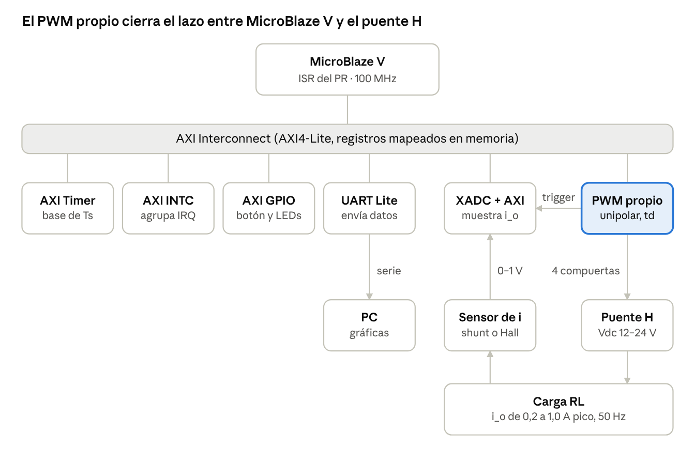

# Investigación previa — Proyecto 4: Control de corriente en un inversor monofásico con regulador PR discreto sobre MicroBlaze V

Oct 19, 2026 · @Jefferson

## Introducción

Este documento reúne la investigación previa de los 14 temas que pide la sección 3 del enunciado del Proyecto 4 (EL3313 Taller de Diseño Digital y EL4201 Procesamiento Electrónico de Potencia, II Semestre 2026). El sistema a construir regula la corriente de una carga RL alimentada por un inversor monofásico en puente H, con un regulador proporcional-resonante (PR) discreto que corre en un MicroBlaze V a 100 MHz.

En cada período de control el sistema muestrea la corriente con el XADC, calcula la ley PR en una rutina de interrupción disparada por el AXI Timer y escribe la nueva referencia en el periférico PWM personalizado. Ese periférico genera la modulación unipolar con tiempo muerto y la señal `pwm_trigger_o` que sincroniza el muestreo.

Los temas 1 a 9 cubren la plataforma digital (Taller) y los temas 10 a 14 la etapa de potencia y el control (PEDP). Las referencias numeradas entre corchetes [n] están al final.



*arquitectura del sistema · MicroBlaze V, periféricos AXI4-Lite y etapa de potencia*

El AXI Timer marca el período Ts y, a través del AXI INTC, dispara la ISR del PR en MicroBlaze V; el PWM propio dispara al XADC con `pwm_trigger_o` para muestrear la corriente en el pico de la portadora.

## 1. Procesador MicroBlaze V

MicroBlaze V es un procesador soft-core de AMD que implementa la arquitectura abierta RISC-V y se sintetiza en la lógica programable de cualquier FPGA o SoC adaptativo soportado por Vivado, sin costo de licencia [1]. Apareció en Vivado 2024.1 y es compatible a nivel de hardware con el MicroBlaze clásico, cuya arquitectura RISC propietaria data de 2002 [2][4].

**Soft-core vs. hard-core.** Un procesador hard es silicio fijo (por ejemplo, el ARM Cortex-A9 de un Zynq-7000). Un soft-core es una descripción de hardware que se implementa con LUTs, flip-flops y BRAM de la FPGA. Es configurable y se pueden instanciar varios, pero alcanza frecuencias menores (cientos de MHz) y consume recursos de la FPGA.

**Arquitectura y conjunto de instrucciones.** El núcleo sigue la especificación RISC-V [5]. La configuración de microcontrolador es de 32 bits con las extensiones RV32IMAFC [1]:

| Extensión | Contenido |
| --- | --- |
| I | Enteros base: aritmética, lógica, saltos, carga y almacenamiento |
| M | Multiplicación y división entera |
| A | Operaciones atómicas |
| F | Punto flotante de precisión simple (FPU) |
| C | Instrucciones comprimidas de 16 bits (código más pequeño) |

La extensión F es relevante para el proyecto: permite calcular la ecuación en diferencias del PR en float sin emular punto flotante por software. Hay que confirmar que la FPU quede habilitada en la configuración del IP.

**Configuraciones.** AMD ofrece tres presets [1][4]:

| Configuración | Manejo de memoria | Software típico | Estado |
| --- | --- | --- | --- |
| Microcontrolador | Ninguno (direcciones físicas) | Bare-metal | Producción |
| Tiempo real | MPU (protección de regiones) | RTOS | Acceso anticipado |
| Aplicaciones | MMU (memoria virtual) | Linux | En roadmap |

El proyecto usa la configuración de microcontrolador con programa bare-metal, que es la más simple y la más determinista.

**Modelo de programación.** El software ve un espacio de direcciones plano. La memoria local (LMB a BRAM, 32 KB en este proyecto) guarda código y datos, y los periféricos AXI aparecen como registros mapeados en memoria. El núcleo tiene 32 registros de propósito general (`x0` siempre vale 0), contador de programa y registros de control y estado (CSR) para interrupciones y excepciones [2].

**Capacidades de tiempo real.** Sin sistema operativo, sin MMU y con memoria local de latencia fija, el tiempo de ejecución de la ISR es predecible. La caché de instrucciones de 8 KB mejora el rendimiento, pero un fallo de caché agrega latencia variable. Si la ISR del PR cabe en la memoria local o en la caché, el jitter se mantiene bajo.

Configuración mínima del enunciado: 100 MHz, caché de instrucciones de 8 KB, 32 KB de BRAM local, maestro AXI4(-Lite), MDM para depuración y AXI Timer para la interrupción periódica.

## 2. Desarrollo con Vivado/Vitis

El flujo separa el hardware (Vivado) del software (Vitis): Vivado construye y sintetiza el sistema, exporta una descripción de la plataforma, y Vitis compila el programa en C sobre esa plataforma [3][13]. El enunciado fija la versión 2025.1 de ambas herramientas.

1. Crear el proyecto en Vivado con la FPGA o tarjeta Artix-7 que use el equipo.
2. Block Design (IP Integrator): agregar MicroBlaze V y correr Block Automation, que crea la memoria local (LMB + BRAM), el reset del sistema (Processor System Reset), el reloj (Clocking Wizard) y el MDM para depuración [3].
3. Agregar periféricos: AXI Timer, AXI INTC, AXI UART Lite, AXI GPIO, XADC Wizard y el IP PWM propio. Connection Automation los conecta al AXI Interconnect o SmartConnect.
4. Address Editor: asignar a cada esclavo una dirección base y un rango. Esto define el mapa de memoria que verá el software.
5. Validar el diseño (Validate Design) y generar el HDL wrapper del Block Design.
6. Restricciones (.xdc): asignar pines (PWM hacia los drivers, entradas analógicas, botones, LEDs, UART) y el reloj de entrada.
7. Síntesis, implementación y bitstream. Revisar el reporte de timing (WNS ≥ 0 a 100 MHz) y el de uso de recursos.
8. Exportar hardware: File → Export → Export Hardware, incluyendo el bitstream. Genera un archivo `.xsa`.
9. Vitis: crear una plataforma a partir del `.xsa` (dominio standalone para MicroBlaze V) y una aplicación en C. Vitis genera el BSP con los drivers de cada IP y el archivo `xparameters.h` con las direcciones base.
10. Programar y depurar: cargar bitstream y ejecutable por JTAG, con puntos de ruptura y lectura de memoria a través del MDM.

Cuando cambia el hardware (por ejemplo, un registro nuevo en el IP PWM) hay que repetir los pasos 5 a 9 y actualizar la plataforma en Vitis. La metodología incremental del enunciado (fases 1 a 5) sigue este mismo orden: primero un MicroBlaze V con UART y un "hola mundo", luego cada periférico por separado.

## 3. Protocolo AXI4(-Lite)

AXI4-Lite es el subconjunto simple del protocolo AXI de la familia AMBA de Arm: una transferencia de 32 o 64 bits por transacción, sin ráfagas, ideal para registros de control de periféricos [8][7]. MicroBlaze V lo usa como maestro para hablar con todos los periféricos del proyecto.

| Variante | Uso | Ráfagas | Direcciones |
| --- | --- | --- | --- |
| AXI4 | Memorias, DMA | Hasta 256 transferencias | Sí |
| AXI4-Lite | Registros de periféricos | No | Sí |
| AXI4-Stream | Flujos de datos (video, DSP) | Flujo continuo | No |

**Cinco canales independientes.** Lectura y escritura tienen canales separados, por lo que pueden ocurrir en paralelo:

| Canal | Envía | Señales principales | VALID lo maneja | READY lo maneja |
| --- | --- | --- | --- | --- |
| AW (dirección de escritura) | Maestro | `AWADDR`, `AWPROT` | Maestro | Esclavo |
| W (dato de escritura) | Maestro | `WDATA`, `WSTRB` | Maestro | Esclavo |
| B (respuesta de escritura) | Esclavo | `BRESP` | Esclavo | Maestro |
| AR (dirección de lectura) | Maestro | `ARADDR`, `ARPROT` | Maestro | Esclavo |
| R (dato de lectura) | Esclavo | `RDATA`, `RRESP` | Esclavo | Maestro |

**Handshake VALID/READY.** En cada canal, quien envía sube `VALID` cuando la información es válida y estable, y quien recibe sube `READY` cuando puede aceptarla. La transferencia ocurre en el flanco de reloj en que ambas están en alto [8]. Reglas clave:

- Quien envía no puede esperar a `READY` para subir `VALID` (evita bloqueos mutuos).
- Una vez arriba, `VALID` y los datos se mantienen hasta completar la transferencia.
- El receptor sí puede esperar a ver `VALID` antes de subir `READY`; así un esclavo ocupado frena al maestro.

**Escritura.** El maestro envía dirección (AW) y dato (W), que pueden ir en el mismo ciclo. Cuando el esclavo aceptó ambos y guardó el dato, responde por B con `BVALID` y `BRESP`. La respuesta confirma que la escritura terminó, no solo que fue aceptada.

**Lectura.** El maestro envía la dirección por AR; el esclavo devuelve el dato por R con `RVALID`, `RDATA` y `RRESP`.

Respuestas: 00 OKAY, 01 EXOKAY (no existe en AXI4-Lite), 10 SLVERR (error del esclavo), 11 DECERR (ninguna dirección coincide; lo genera el interconnect).

**Mapa de direcciones.** El interconnect usa los bits altos de la dirección para elegir el esclavo, y el esclavo usa los bits bajos (el offset) para elegir el registro. Con datos de 32 bits los registros van cada 4 bytes (`0x00`, `0x04`, `0x08`…), por lo que la plantilla de Vivado decodifica con `addr[n:2]`. Desde C, una escritura `Xil_Out32(BASE + 0x04, valor)` genera exactamente una transacción AW + W + B.

## 4. Diseño de periféricos IP

Un IP (Intellectual Property core) es un bloque de hardware verificado y empaquetado para reutilizarlo; el periférico PWM del proyecto es un IP propio con interfaz esclava AXI4-Lite que el procesador maneja como un bloque de registros [6].

Estructura de un periférico AXI4-Lite:

- **Interfaz AXI (esclavo):** handshakes de los cinco canales y decodificación de offsets. Vivado la genera.
- **Banco de registros:** el contrato entre software y hardware. Cada registro tiene offset, bits, tipo de acceso (R/W o solo lectura) y valor de reset.
- **Lógica de usuario:** el núcleo funcional (contador, comparadores, tiempo muerto), escrito como módulo independiente del bus para poder simularlo y reutilizarlo.
- **Puertos externos:** compuertas hacia el puente H y `pwm_trigger_o` hacia el ADC.

Flujo en Vivado [6]:

1. Tools → Create and Package New IP → Create a new AXI4 peripheral: tipo Lite, esclavo, 32 bits, número de registros.
2. Edit IP: Vivado genera el top (`<ip>_v1_0`) y la interfaz (`<ip>_v1_0_S00_AXI`). Se instancia el núcleo PWM dentro y se declaran los puertos externos en ambos niveles.
3. Conectar los registros: los de escritura alimentan al núcleo; los de solo lectura (como `running`) se conectan al multiplexor de lectura en lugar del registro interno.
4. Package IP → Re-Package, agregar el repositorio al proyecto principal e instanciarlo en el Block Design.

Mapa de registros sugerido por el enunciado:

| Offset | Bits | Campo | Acceso | Función |
| --- | --- | --- | --- | --- |
| `0x00` | 0 | `enable` | R/W | Habilita la generación PWM |
| `0x00` | 2:1 | `freq_sel` | R/W | Frecuencia de conmutación (≥ 3 valores válidos) |
| `0x00` | 3 | `running` | RO | Indica que el generador está activo |
| `0x04` | 15:0 | `duty_ref` | R/W | Referencia de modulación (formato definido por el equipo, por ejemplo Q1.15 con signo) |

El tiempo muerto configurable puede ir en un registro adicional (por ejemplo `0x08`, en ciclos de reloj), ya que el enunciado lo pide configurable pero no le asigna offset.

Requisitos de diseño a tener en cuenta:

- **Saturación:** una escritura de `duty_ref` fuera del rango admisible se recorta al límite en hardware, no en software.
- **Actualización sincronizada:** el valor escrito por AXI se copia a un registro de sombra y se aplica al inicio del siguiente período de la portadora. Así no aparecen pulsos truncados a mitad de período.
- **Reset:** con `S_AXI_ARESETN` (activo en bajo) todas las compuertas quedan apagadas.
- **Reloj:** el núcleo usa el mismo reloj `S_AXI_ACLK` (100 MHz) para evitar cruces de dominio.

Validación: testbench propio del núcleo y testbench del IP completo con tareas que emulan un maestro AXI4-Lite (ver tema 9). El enunciado exige además simulación post-implementación temporizada del periférico.

## 5. Temporización y tiempo real embebido

El lazo de control se ejecuta en una rutina de interrupción disparada periódicamente por el AXI Timer, de modo que el período de muestreo lo fija el hardware y no el software [9][10]. En tiempo real lo que importa es la predictibilidad: una respuesta correcta pero tardía es una respuesta incorrecta.

Conceptos:

| Término | Significado | Relevancia en el proyecto |
| --- | --- | --- |
| Período de muestreo Ts | Tiempo entre ejecuciones del lazo | Define la discretización del PR |
| Latencia | Retardo entre el evento (interrupción) y el inicio de la respuesta | Suma retardo al lazo y resta margen de fase |
| Jitter | Variación del período o de la latencia | Degrada el seguimiento; el enunciado pide medirlo |
| WCET | Peor tiempo de ejecución de la ISR | Debe ser bastante menor que Ts |
| Tiempo real duro | Perder un plazo es una falla | Caso del lazo de corriente |

**AXI Timer (PG079).** Contiene dos temporizadores de 32 bits que se pueden encadenar como uno de 64 bits [9]. Para una base de tiempo periódica se usa el modo generate con recarga automática: el contador se carga con el valor de `TLR0`, cuenta hasta el final y genera la interrupción, y se recarga solo. Registros principales: `TCSR0` (control/estado, offset `0x00`), `TLR0` (carga, `0x04`) y `TCR0` (cuenta actual, `0x08`). Según PG079, contando hacia abajo el período es (TLR0 + 2) × T_clk; con T_clk = 10 ns, un Ts de 50 µs requiere TLR0 = 4998.

**AXI INTC (PG099).** MicroBlaze tiene una sola entrada de interrupción, así que el AXI Interrupt Controller agrupa las fuentes (Timer, GPIO del botón, UART, XADC) en una salida [10]. La entrada `intr(0)` tiene la mayor prioridad; conviene conectar ahí el Timer del lazo.

**Polling vs. interrupciones:**

- **Polling:** el procesador pregunta en un ciclo si ocurrió el evento. Simple, pero la latencia depende del resto del ciclo.
- **Interrupción:** el periférico avisa por hardware y la ISR se ejecuta de inmediato. Es lo que exige el enunciado para el lazo.

**Reglas para la ISR del control:**

- Corta y siempre la misma secuencia: leer ADC, calcular PR, escribir `duty_ref`, guardar la muestra, limpiar la bandera del Timer.
- Sin `printf`, sin esperas ni ciclos de duración variable. La transmisión UART va en el ciclo principal.
- Variables compartidas entre ISR y main declaradas `volatile`.

**Elección de Ts.** Debe coordinarse con PEDP y con la frecuencia de conmutación. Una práctica común es Ts igual a un período de la portadora PWM (o a un múltiplo), con el muestreo en el punto medio del pulso. Como el Timer y el PWM son contadores distintos, puede aparecer una deriva lenta entre ambos; el `pwm_trigger_o` evita que esa deriva afecte el instante de muestreo.

**Medición del período y el jitter.** Una técnica simple: poner un pin GPIO en alto al entrar a la ISR y en bajo al salir. En el osciloscopio se mide el período real, su variación y el tiempo de ejecución (WCET observado). También se puede leer `TCR0` al inicio de la ISR para estimar la latencia.

## 6. Modulación PWM unipolar con tiempo muerto

En PWM unipolar cada pierna del puente H se modula por separado (pierna A con la referencia m, pierna B con −m), de modo que la tensión en la carga toma tres niveles (+Vdc, 0, −Vdc) y sus componentes de conmutación aparecen al doble de la frecuencia de conmutación de cada transistor [16][17].

**Principio.** Una portadora triangular de frecuencia f_sw se compara con la referencia normalizada m ∈ [−1, 1]:

- **Pierna A:** S1 encendido si m > portadora, S2 si no.
- **Pierna B:** S3 encendido si −m > portadora, S4 si no.
- **Tensión en la carga:** v_o = v_A − v_B. Su valor promedio en un período es m·Vdc (región lineal).

| Estado | S1 | S3 | v_A | v_B | v_o |
| --- | --- | --- | --- | --- | --- |
| 1 | ON | OFF | Vdc | 0 | +Vdc |
| 2 | OFF | ON | 0 | Vdc | −Vdc |
| 3 | ON | ON | Vdc | Vdc | 0 |
| 4 | OFF | OFF | 0 | 0 | 0 |

Frente a la PWM bipolar (salida entre +Vdc y −Vdc), la unipolar reduce a la mitad los saltos de tensión y mueve el primer grupo de armónicos a 2·f_sw, lo que reduce el rizado de corriente en la carga RL [16]. El enunciado advierte no confundir esa frecuencia aparente de la tensión diferencial con la de cada transistor.

**Frecuencia, resolución y ciclo de trabajo en hardware.** La portadora triangular se implementa con un contador ascendente/descendente de 0 a N_max. Con f_clk = 100 MHz:

$$
f_{sw} = \frac{f_{clk}}{2 N_{max}}, \qquad \text{resolución} \approx \log_2 N_{max} \text{ bits}
$$

| f_sw (ejemplo) | N_max | Resolución aproximada |
| --- | --- | --- |
| 10 kHz | 5000 | 12,3 bits |
| 20 kHz | 2500 | 11,3 bits |
| 40 kHz | 1250 | 10,3 bits |

A mayor frecuencia, menor rizado de corriente pero más pérdidas de conmutación y menos resolución. Los tres valores de `freq_sel` se eligen con PEDP según rizado, pérdidas y capacidad de los drivers. El comparador traduce `duty_ref` (por ejemplo Q1.15 con signo) a un umbral de cuenta: umbral = (m + 1)/2 · N_max para la pierna A y (1 − m)/2 · N_max para la pierna B.

**Tiempo muerto.** Los dos transistores de una pierna son complementarios, pero no se apagan instantáneamente. Si uno se enciende antes de que el otro termine de apagarse, se cortocircuita Vdc (shoot-through). El tiempo muerto t_d retrasa cada flanco de encendido: primero se apaga el que conducía y, t_d después, se enciende el complementario. Durante t_d la corriente inductiva circula por los diodos en antiparalelo.

- **En hardware:** N_dead = t_d · f_clk ciclos (500 ns → 50 ciclos). Por pierna, un detector de flancos y un contador generan las dos compuertas.
- **Dimensionamiento:** t_d mayor que el tiempo de apagado del transistor más el retardo del driver, con margen (cientos de ns en MOSFET), según hoja de datos.
- **Efectos:** error de tensión que depende del signo de la corriente, distorsión cerca de los cruces por cero y pérdida de pulsos más cortos que t_d [17]. Por eso se usa el mínimo seguro.

**Señal `pwm_trigger_o`.** Se genera en el pico o el valle de la portadora triangular. En ese instante los transistores están lejos de conmutar y, en régimen, la corriente instantánea coincide con su valor promedio del período: se evita el ruido de conmutación y se mide la componente que interesa al control [23].

## 7. Uso del ADC integrado en la Artix-7 (XADC)

El XADC es un bloque hard presente en todas las Artix-7, con dos ADC de 12 bits y 1 MSPS, entradas externas y sensores internos; en el proyecto mide la corriente de carga en el instante marcado por `pwm_trigger_o` [11].

Características relevantes [11][12]:

| Parámetro | Valor |
| --- | --- |
| Resolución y tasa | 12 bits, hasta 1 MSPS por ADC |
| Rango unipolar | 0 a 1 V (código = Vin / 1 V × 4096) |
| Rango bipolar (diferencial) | ±0,5 V, resultado en complemento a dos |
| LSB | ≈ 250 µV |
| Entradas externas | VP/VN dedicado y hasta 16 pares auxiliares VAUXP/VAUXN[15:0] |
| Interfaz de registros | DRP (dirección, dato, `DEN`, `DWE`, `DRDY`) |
| Señales de estado | `BUSY`, `EOC` (fin de conversión), `EOS` (fin de secuencia), `CHANNEL` |

Los resultados se guardan en registros de 16 bits justificados a la izquierda: el código útil es `registro >> 4`. Las direcciones DRP de las entradas auxiliares son `0x10 + n`; la entrada VP/VN es `0x03`.

**Inicio de conversión.** Dos modos de muestreo [11]:

- **Continuo:** el XADC convierte sin parar y el software lee el último valor. La edad del dato es incierta, por lo que no sirve para sincronizar con el PWM.
- **Por evento:** la conversión arranca con el flanco de subida de la entrada `CONVST` (o `CONVSTCLK`). Conectando `pwm_trigger_o` a `CONVST`, cada muestra se toma en el pico o valle de la portadora. Es el modo adecuado para este proyecto.

**Disponibilidad y lectura del dato.** Al terminar la conversión sube `EOC` y el resultado queda en el registro del canal. Dos maneras de exponerlo al MicroBlaze V:

1. **XADC Wizard con interfaz AXI4-Lite [12]:** los registros del XADC aparecen a partir del offset `0x200` (offset = 0x200 + 4 × dirección DRP). Vitis provee el driver `xsysmon`. El modo por evento se configura en el Wizard y `CONVST` se lleva como puerto externo.
2. **Envoltura AXI4-Lite propia sobre la DRP:** un pequeño periférico conecta `pwm_trigger_o` (o un bit de software) a `CONVST`, captura el dato en `EOC` y expone tres registros: control (inicio por software, habilitación del disparo por PWM), estado (bit `data_valid` que se limpia al leer) y dato. Cumple directamente lo que pide el enunciado (inicio por software y por disparo, bandera de disponibilidad y lectura).

**Sincronización con el lazo.** Secuencia típica por período: el PWM genera el disparo → el XADC convierte (≈ 1 µs) → la ISR del Timer verifica `data_valid`, lee el dato y calcula el PR. La ISR debe ejecutarse después de que el dato esté listo; si el Timer y el PWM no están sincronizados, la bandera `data_valid` evita leer un dato viejo.

**Acondicionamiento de la señal de corriente.** La corriente es alterna (±1 A pico), pero la entrada unipolar acepta 0 a 1 V. Opciones:

- Sensor (resistencia shunt con amplificador diferencial o sensor Hall) más un offset de 0,5 V, para que 0 A quede a mitad de escala.
- Modo bipolar diferencial (±0,5 V), que acepta la señal centrada en cero.

En ambos casos conviene un filtro antialiasing RC en la entrada y aprovechar el rango completo: ±1 A debería cubrir casi ±0,5 V. Revisar el manual de la tarjeta para saber qué canales VAUX llegan al conector analógico y qué atenuación traen.

## 8. Programación embebida en C

El software corre bare-metal (sin sistema operativo) sobre el BSP standalone que genera Vitis: una inicialización, una ISR periódica para el control y un ciclo principal para las tareas no críticas como la exportación por UART [13].

**Acceso a periféricos.** Cada periférico es un conjunto de registros mapeados en memoria. Las direcciones base vienen en `xparameters.h`; el acceso se hace con los drivers de Xilinx (`XTmrCtr`, `XIntc`, `XUartLite`, `XGpio`, `XSysMon`) o con lectura/escritura directa:

```c
#define PWM_BASE  XPAR_PWM_CTRL_0_BASEADDR
#define PWM_CTRL  0x00
#define PWM_DUTY  0x04

Xil_Out32(PWM_BASE + PWM_DUTY, (u32)(u16)duty_q15);
u32 running = (Xil_In32(PWM_BASE + PWM_CTRL) >> 3) & 1;
```

Para el periférico propio conviene escribir un driver mínimo (`pwm_init`, `pwm_set_freq`, `pwm_set_duty`, `pwm_is_running`) que encapsule los offsets y el formato del dato.

**Manejo de interrupciones (MicroBlaze V + AXI INTC).** Secuencia de configuración [10][13]:

1. Inicializar el INTC y conectar la ISR del Timer a su canal (`XIntc_Connect`).
2. Iniciar el INTC en modo real (`XIntc_Start`) y habilitar el canal (`XIntc_Enable`).
3. Registrar el manejador del INTC en la tabla de excepciones del procesador y habilitar las excepciones.
4. Configurar el Timer (carga, recarga automática, interrupción habilitada) y arrancarlo.

En la ISR siempre se limpia la bandera de interrupción del Timer; si no, la interrupción se vuelve a disparar al salir.

**Estructura de la aplicación de control:**

- `main`: inicializa periféricos y estado, luego un `while(1)` que atiende el botón y la transmisión UART.
- ISR del Timer: lee el ADC, calcula el PR, escribe `duty_ref`, guarda la muestra en el buffer circular.
- Comunicación ISR → main por variables `volatile` (índice del buffer, banderas).

**Gestión de estado.** Una máquina de estados simple da orden y seguridad:

| Estado | Qué hace | Transición |
| --- | --- | --- |
| INIT | Configura periféricos, PWM deshabilitado | → IDLE al terminar |
| IDLE | Espera habilitación (botón o switch) | → RUN |
| RUN | Lazo PR activo en la ISR | → FAULT por sobrecorriente; → IDLE al deshabilitar |
| EXPORT | Envía el buffer por UART (el lazo sigue corriendo) | → RUN al terminar |
| FAULT | PWM deshabilitado, LED de falla | → IDLE con reinicio manual |

**Buffer circular.** Arreglo de tamaño fijo con índice que avanza módulo N. Con 32 KB de BRAM compartidos con el programa, el tamaño se limita: por ejemplo, 2048 muestras de 16 bits ocupan 4 KB y cubren 2048 · Ts (a Ts = 50 µs, unos 100 ms o 5 ciclos de 50 Hz, justo lo que pide el criterio de validación). Para exportar sin afectar el lazo, main copia o congela una ventana del buffer y la envía; la ISR nunca espera a la UART.

**Aritmética.** Si la FPU está habilitada, el PR se calcula en `float`. Sin FPU, se usa punto fijo (Q15/Q31) con cuidado de saturación y desbordamiento. En ambos casos se mide el tiempo de ejecución de la ISR.

## 9. Metodologías de validación

La validación avanza de abajo hacia arriba: cada módulo se prueba solo con un testbench autoverificable, luego el IP completo por su interfaz AXI, después el sistema en la FPGA y por último con la etapa de potencia [14][15].

| Nivel | Qué se verifica | Herramienta |
| --- | --- | --- |
| Unidad | Núcleo PWM: contador, comparadores, tiempo muerto, trigger | Testbench SystemVerilog (simulación de comportamiento) |
| IP | Lectura/escritura AXI4-Lite, registros, saturación | Testbench con tareas de maestro AXI |
| Post-implementación | El IP con retardos reales de la implementación | Simulación post-implementación temporizada en Vivado |
| Sistema | Software ↔ periféricos en la FPGA | Vitis + osciloscopio + UART |
| Integración | Lazo PR con el puente H y la carga | Ensayos de la sección 4.3 del enunciado |

**Testbench autoverificable.** El testbench decide solo si el diseño pasa o falla, sin inspeccionar formas de onda a mano. Elementos:

- **Estímulo:** tareas reutilizables `axi_write(addr, data)` y `axi_read(addr, data)` que respetan el handshake VALID/READY.
- **Modelo de referencia:** calcula lo esperado (por ejemplo, el ancho de pulso para un `duty_ref` dado o el valor saturado).
- **Comparación y reporte:** `assert` o comparaciones con contadores de aciertos y fallos, y un mensaje final PASS/FAIL.
- **Aserciones SVA** para propiedades que deben cumplirse siempre [15], por ejemplo nunca encender los dos transistores de una pierna:

```systemverilog
assert property (@(posedge clk) disable iff (!rst_n) !(gate_a_hi && gate_a_lo))
    else $error("Shoot-through en pierna A");
```

**Casos de borde que pide la rúbrica:**

- **Tiempo muerto:** medir en simulación el intervalo con ambas compuertas apagadas en cada flanco y comparar con N_dead.
- **Saturación:** escribir valores por encima y por debajo del rango y leer el registro o medir el ciclo resultante.
- **Cambio de frecuencia:** cambiar `freq_sel` en marcha y verificar el nuevo período y que no aparezcan pulsos truncados.
- **`enable` y `running`:** compuertas apagadas con `enable` en 0 y lectura correcta del bit `running`.
- **`pwm_trigger_o`:** un pulso por período, en el pico o valle de la portadora.

**Simulación en Vivado.** El simulador integrado (XSim) permite simulación de comportamiento, post-síntesis y post-implementación (funcional y temporizada) [14]. La temporizada usa los retardos del diseño ya ubicado y ruteado, y es un entregable explícito del proyecto.

**Pruebas en hardware.** Antes de energizar el puente H, verificar compuertas y tiempo muerto con el osciloscopio (condición explícita del enunciado). Medir el período y el jitter del lazo con un pin GPIO, y validar la cadena ADC → software con una fuente conocida antes de cerrar el lazo.

## 10. Inversor monofásico en puente H y modulación PWM

El puente H usa cuatro interruptores en dos piernas para aplicar +Vdc, 0 o −Vdc a la carga; modulando el tiempo en cada estado se sintetiza una tensión promedio senoidal a partir de la fuente DC de 12 a 24 V [16][17].

**Topología.** Pierna A: S1 (arriba) y S2 (abajo). Pierna B: S3 y S4. La carga RL va entre los puntos medios A y B. Cada interruptor es un MOSFET con su diodo en antiparalelo (el diodo de cuerpo o uno externo rápido), que conduce cuando la corriente inductiva tiene sentido contrario al que impone el estado.

**Estados y caminos de corriente (con PWM unipolar):**

| Estado | Conducen | v_o | Corriente i_o > 0 circula por | Efecto en i_o |
| --- | --- | --- | --- | --- |
| Activo positivo | S1, S4 | +Vdc | S1 → carga → S4 | Crece |
| Activo negativo | S2, S3 | −Vdc | Diodos de S2 y S3 (devuelve energía a la fuente) | Decrece rápido |
| Rueda libre superior | S1, S3 | 0 | S1 → carga → diodo de S3 | Decrece lento |
| Rueda libre inferior | S2, S4 | 0 | Diodo de S2 → carga → S4 | Decrece lento |

Con i_o < 0 los papeles de transistores y diodos se intercambian. En PWM unipolar, durante el semiciclo positivo el puente alterna entre +Vdc y 0, y en el negativo entre −Vdc y 0.

**Relación modulación–tensión.** Con índice de modulación m_a = V̂_ref/V̂_portadora ≤ 1, la componente fundamental de v_o tiene amplitud m_a · Vdc [16]. Para m_a > 1 hay sobremodulación: la relación deja de ser lineal y aparecen armónicos de baja frecuencia, por lo que se evita.

**Accionamiento de compuertas.** Los MOSFET superiores necesitan un driver con alimentación flotante (bootstrap o aislada). Los circuitos half-bridge integrados manejan ambos transistores de una pierna; algunos incluyen tiempo muerto mínimo propio, que se suma al configurado en la FPGA. Las salidas de 3,3 V de la FPGA requieren aislamiento o adaptación de nivel según el driver.

**Selección de semiconductores.** Criterios: tensión de bloqueo con margen sobre 24 V más sobretensiones, corriente con margen sobre 1 A pico más rizado, R_DS(on) bajo (pérdidas de conducción ≈ I_rms² · R_DS(on)) y carga de compuerta compatible con el driver a la f_sw elegida (pérdidas de conmutación proporcionales a f_sw).

**Protecciones.** El enunciado exige documentar la limitación de corriente y la desconexión ante fallas: fusible o limitación en la fuente, umbral de sobrecorriente por software (estado FAULT) y deshabilitación del PWM por hardware ante falla.

## 11. Modelado y respuesta dinámica de cargas RL

La carga RL es un sistema de primer orden: la corriente sigue a la tensión promedio aplicada con constante de tiempo τ = L/R, y en régimen senoidal su amplitud queda fijada por la impedancia |Z| = √(R² + (ωL)²) [16].

**Modelo en tiempo continuo.**

$$
L\frac{di}{dt} + R\,i = v_o \quad\Rightarrow\quad G(s) = \frac{I(s)}{V_o(s)} = \frac{1}{Ls + R} = \frac{1/R}{\tau s + 1}, \qquad \tau = \frac{L}{R}
$$

Con modelo promediado del inversor (v_o ≈ m · Vdc en cada período de conmutación), la planta vista por el controlador es G(s) · Vdc, más los retardos digitales (tema 13).

**Régimen senoidal a 50 Hz.**

$$
\hat{I} = \frac{\hat{V}}{\sqrt{R^2 + (\omega L)^2}}, \qquad \varphi = -\arctan\frac{\omega L}{R}, \qquad \omega = 2\pi \cdot 50\ \text{rad/s}
$$

**Margen de tensión.** Para seguir 1,0 A pico hace falta V̂ = 1 A · |Z| ≤ m_a,max · Vdc, dejando margen para el transitorio, la caída en los MOSFET y el tiempo muerto. Ejemplo ilustrativo: R = 10 Ω y L = 10 mH dan ωL ≈ 3,14 Ω y |Z| ≈ 10,5 Ω; 1 A pico requiere unos 10,5 V, o sea m_a ≈ 0,44 con Vdc = 24 V. Los valores reales salen de la caracterización de R (incluida la del devanado) y de L efectiva.

**Disipación.** P_R = I_rms² · R = (β/2) · R. En el ejemplo, a 1 A pico: 0,5 · 10 = 5 W, por lo que una resistencia de 5 W no tiene margen (el enunciado lo advierte expresamente).

**Rizado de conmutación (PWM unipolar).** Con período de portadora T_sw = 1/f_sw y ciclo de trabajo d en el semiciclo, el rizado pico a pico es:

$$
\Delta i_{pp} = \frac{V_{dc}\, d\,(1-d)}{2 L f_{sw}} \quad\Rightarrow\quad \Delta i_{pp,max} = \frac{V_{dc}}{8 L f_{sw}} \ \ (d = 0{,}5)
$$

En el ejemplo, con Vdc = 24 V y f_sw = 20 kHz: Δi_pp,max ≈ 15 mA, muy por debajo del límite de 0,20 A. La comparación con la bipolar (máximo Vdc/(2 L f_sw), cuatro veces mayor) muestra la ventaja de la unipolar. Si la inductancia se satura a 1 A, L cae y el rizado crece: hay que verificar L bajo corriente.

**Modelo discreto.** Discretizando G(s) con retenedor de orden cero (la tensión PWM se mantiene constante durante Ts):

$$
G(z) = \frac{1 - a}{R}\,\frac{z^{-1}}{1 - a z^{-1}}, \qquad a = e^{-R T_s / L}
$$

**Validación en PLECS.** El modelo conmutado del puente H con la carga RL permite contrastar la amplitud, el desfase y el rizado calculados con los simulados, y luego con las mediciones.

## 12. Control proporcional-resonante (PR)

El controlador PR tiene ganancia (idealmente infinita) justo a la frecuencia de la referencia, 50 Hz; por el principio del modelo interno, esto elimina el error de régimen permanente al seguir una senoidal, algo que un PI en marco estacionario no logra [18][19].

**Por qué no basta un PI.** Un PI tiene ganancia infinita solo en DC. Con referencia senoidal deja un error de amplitud y fase en régimen. La solución clásica en sistemas trifásicos es transformar a un marco síncrono (dq), donde la señal es constante. Zmood y Holmes mostraron que un PI en el marco síncrono equivale a un controlador resonante en el marco estacionario, lo que permite obtener error nulo en un sistema monofásico sin transformaciones [18].

**Estructuras.**

$$
G_{PR}(s) = K_p + \frac{2 K_i\, s}{s^2 + \omega_0^2} \qquad \text{(ideal)}
$$

$$
G_{PR}(s) = K_p + \frac{2 K_i\, \omega_c\, s}{s^2 + 2\omega_c s + \omega_0^2} \qquad \text{(no ideal o cuasi-resonante)}
$$

| Parámetro | Efecto |
| --- | --- |
| ω0 = 2π · 50 rad/s | Frecuencia de resonancia: donde la ganancia es máxima |
| K_p | Fija el ancho de banda del lazo, la respuesta dinámica y los márgenes de estabilidad |
| K_i | Altura del pico resonante; controla qué tan rápido se anula el error de amplitud |
| ω_c (no ideal) | Ensancha el pico: tolera desviaciones de frecuencia y numéricas, a cambio de ganancia finita en ω0 |

La forma ideal tiene ganancia infinita pero un pico muy angosto; en implementación digital, la precisión numérica y la discretización pueden correr ese pico. La forma no ideal es más robusta y es la más usada en la práctica [19][20].

**Criterios de sintonización** (procedimiento a justificar con la bibliografía):

1. **K_p primero.** A frecuencias altas la planta es ≈ Vdc/(L s), así que el cruce del lazo está cerca de ω_bw ≈ K_p · Vdc / L. Se elige ω_bw bastante menor que la frecuencia de muestreo (por ejemplo, una décima parte o menos) para dejar margen de fase frente a los retardos del tema 13.
2. **K_i después.** Se aumenta hasta obtener el tiempo de establecimiento deseado de la amplitud (unos pocos ciclos de 50 Hz) sin degradar el margen de fase cerca del cruce.
3. **ω_c**, en la forma no ideal, en el orden de unos pocos rad/s a decenas de rad/s, según la tolerancia a variación de frecuencia [19].
4. Verificar márgenes de ganancia y fase con el modelo discreto, incluidos los retardos, y validar en PLECS.

**Detalles de implementación:**

- **Saturación y anti-windup:** la salida se limita al rango de modulación (|m| ≤ 1); si satura, el término resonante sigue acumulando y conviene limitar o congelar su estado.
- **Compensadores de armónicos opcionales:** se agregan términos resonantes en 3ω0, 5ω0… si la distorsión (tiempo muerto, no linealidades) lo justifica [19].
- **Retroalimentación de la tensión de entrada:** normalizar por Vdc (m = v*/Vdc) mantiene la ganancia del lazo constante si Vdc cambia.

## 13. Discretización, estabilidad y efectos del muestreo y los retardos

El método de discretización decide si el pico resonante del PR queda exactamente en 50 Hz, y el retardo digital (cálculo más actualización del PWM) es lo que más limita el ancho de banda y la estabilidad del lazo de corriente [21][22][23].

**Métodos de discretización.** Yepes et al. compararon los métodos habituales aplicados a controladores resonantes [21]:

| Método | Comentario para el PR |
| --- | --- |
| Euler (adelante o atrás) | Simple, pero desplaza o amortigua el pico resonante |
| Tustin (bilineal) | Conserva la estabilidad, pero desplaza la frecuencia de resonancia (warping) |
| Tustin con prewarping en ω0 | Coloca el pico exactamente en ω0; muy usado |
| ZOH, invariante al impulso y otros | Ubican bien la resonancia; difieren en la fase alrededor de ω0 |
| Dos integradores discretos | Implementación robusta que facilita compensar el retardo [22] |

El error de ubicación del pico crece cuando ω0 se acerca a la frecuencia de Nyquist; con 50 Hz y muestreo de decenas de kHz el efecto es pequeño, pero un pico mal ubicado en una forma ideal anula la ventaja de ganancia infinita.

**Ejemplo: resonante ideal con Tustin y prewarping.** Sustituyendo s = (ω0 / tan(ω0Ts/2)) · (z − 1)/(z + 1) en el término 2K_i s/(s² + ω0²) se obtiene:

$$
R(z) = \frac{K_i \sin(\omega_0 T_s)}{\omega_0} \cdot \frac{1 - z^{-2}}{1 - 2\cos(\omega_0 T_s)\, z^{-1} + z^{-2}}
$$

Y la ecuación en diferencias, con e[k] el error de corriente:

$$
y[k] = 2\cos(\omega_0 T_s)\, y[k-1] - y[k-2] + \frac{K_i \sin(\omega_0 T_s)}{\omega_0}\,\big(e[k] - e[k-2]\big), \qquad u[k] = K_p\, e[k] + y[k]
$$

Los polos quedan sobre el círculo unitario exactamente en ±ω0Ts. Es un ejemplo de la forma ideal; el equipo debe derivar la de la estructura que elija (por ejemplo, la no ideal).

**Precisión numérica.** Con Ts pequeño, cos(ω0Ts) es muy cercano a 1 (con Ts = 50 µs, ≈ 0,99988), y pequeños errores de redondeo en los coeficientes mueven los polos. En `float` de 32 bits la precisión es suficiente para este caso, pero en punto fijo hay que revisar cuántos bits fraccionarios se usan; las formas de dos integradores reducen esta sensibilidad [22].

**Retardos del lazo digital.** En un período típico [23]:

- **Retardo de cómputo:** la muestra tomada en k produce un nuevo `duty_ref` que se aplica al inicio del período siguiente (actualización sincronizada): 1 · Ts.
- **Retenedor del PWM:** la modulación mantiene la tensión durante el período, lo que equivale a unos 0,5 · Ts adicionales.
- **Total:** ≈ 1,5 · Ts, que aporta un atraso de fase φ = −360° · 1,5 · f · Ts a la frecuencia f.

Ese atraso reduce el margen de fase en la frecuencia de cruce: por eso el ancho de banda del lazo se elige bastante menor que la frecuencia de muestreo. También desplaza la fase del término resonante cerca de ω0; algunas implementaciones agregan una compensación de fase en el resonante [21][22].

**Estabilidad.** Se analiza el lazo cerrado discreto completo: G_PR(z) · G_planta(z) · z^(−1), con la planta discretizada por ZOH (tema 11). Herramientas: polos del lazo cerrado dentro del círculo unitario, márgenes de ganancia y fase en el diagrama de Bode discreto, y lugar de las raíces variando K_p. Se recomienda repetir el análisis con R ±25 % (el ensayo de cambio de carga del enunciado).

**Efectos del muestreo.** Muestrear en el pico o valle de la portadora evita el ruido de conmutación y entrega el valor promedio de la corriente en ese período (sin aliasing del rizado). Si se muestrea en un instante arbitrario, el rizado de conmutación aparece en la medición como ruido o como una componente de baja frecuencia falsa.

## 14. Estrategias de medición y validación experimental

La validación cuantitativa separa dos indicadores: el error de amplitud de la componente fundamental de 50 Hz (≤ 10 %, en una ventana de al menos 5 ciclos) y el rizado de conmutación pico a pico (≤ 0,20 A), y ambos deben compararse con la simulación en PLECS.

**Instrumentación.**

- **Corriente:** sonda de corriente en el osciloscopio como referencia independiente, además del sensor que alimenta al XADC. Comparar ambas valida la cadena de adquisición.
- **Tensión en la carga:** sonda diferencial (v_o no está referida a tierra).
- **Señales PWM:** las cuatro compuertas y el tiempo muerto medidos con el puente desenergizado antes de cualquier ensayo con potencia (condición del enunciado).
- **Datos internos:** el buffer exportado por UART da la corriente tal como la ve el controlador, a la tasa Ts.

**Extracción de la fundamental.** Con N muestras que cubran un número entero de ciclos de 50 Hz, la amplitud de la fundamental se obtiene con la proyección sobre seno y coseno (equivalente a un bin de la DFT):

$$
a = \frac{2}{N}\sum_{k=0}^{N-1} i[k]\cos(\omega_0 k T_s), \qquad b = \frac{2}{N}\sum_{k=0}^{N-1} i[k]\sin(\omega_0 k T_s), \qquad \hat{I}_1 = \sqrt{a^2 + b^2}
$$

$$
\text{error relativo} = \frac{|\hat{I}_1 - \hat{I}_{ref}|}{\hat{I}_{ref}} \times 100\ \%
$$

Si la ventana no cubre ciclos enteros, aparece fuga espectral; se corrige ajustando N o aplicando una ventana (Hann, por ejemplo) y documentándolo. Una alternativa equivalente es un ajuste por mínimos cuadrados de una senoidal de 50 Hz.

**Separación del rizado de conmutación.** El rizado se mide respecto a la componente de baja frecuencia:

1. Obtener la componente lenta con un filtro pasabajos (corte entre 50 Hz y la frecuencia de conmutación) o reconstruyendo fundamental y armónicos bajos.
2. Restarla de la corriente medida a alta tasa en el osciloscopio.
3. Medir el pico a pico del residuo en una ventana local representativa (por ejemplo, cerca del cruce y del pico de la corriente, donde el ciclo de trabajo cambia).

El buffer del XADC no sirve para medir rizado si se muestrea en el pico de la portadora, porque esa muestra es justamente el valor promedio. El rizado se mide con el osciloscopio.

**Ensayos y qué registrar:**

| Ensayo | Condición | Qué se reporta |
| --- | --- | --- |
| Seguimiento nominal | 0,2, 0,5 y 1,0 A pico a 50 Hz | Error de amplitud fundamental, rizado pp, i_ref, i_o, v_o, PWM |
| Cambio de amplitud | 0,2 → 0,5 y 0,5 → 1,0 A pico | Transitorio, tiempo de establecimiento, límites respetados |
| Cambio de carga | R ±25 % a 0,5 A pico | Transitorio y error en el nuevo régimen |
| Temporización | Operación extendida | Período real del lazo y jitter |

Siempre se distinguen valores pico y RMS (Î = √2 · I_rms en una senoidal pura).

**Comparación simulación–medición.** Mismas condiciones en PLECS y en el laboratorio (R y L medidas, Vdc real, f_sw, Ts, tiempo muerto). Las diferencias típicas se explican por la caída en los MOSFET, el tiempo muerto, la variación de L con la corriente, el retardo real del lazo y el error del sensor; el informe debe cuantificarlas y justificarlas.

## Referencias

### Documentación de AMD/Xilinx y estándares

1. AMD, "AMD MicroBlaze V Processor," página del producto.
2. AMD, *MicroBlaze V Processor Reference Guide* (UG1629), v2024.1, 2024.
3. AMD, *MicroBlaze V Embedded Design Tutorial* (UG1711).
4. AMD, "MicroBlaze and MicroBlaze V," Xilinx Wiki.
5. RISC-V International, *The RISC-V Instruction Set Manual, Volume I: Unprivileged ISA* y *Volume II: Privileged Architecture*, riscv.org.
6. AMD, *Vivado Design Suite User Guide: Creating and Packaging Custom IP* (UG1118).
7. AMD, *Vivado Design Suite: AXI Reference Guide* (UG1037).
8. Arm, *AMBA AXI Protocol Specification* (IHI 0022).
9. AMD, *AXI Timer LogiCORE IP Product Guide* (PG079), v2.0, 2025.
10. AMD, *AXI Interrupt Controller (INTC) Product Guide* (PG099), v4.1, 2021.
11. AMD, *7 Series FPGAs and Zynq-7000 SoC XADC Dual 12-Bit 1 MSPS Analog-to-Digital Converter User Guide* (UG480), v1.11, 2022.
12. AMD, *XADC Wizard LogiCORE IP Product Guide* (PG091).
13. AMD, *Vitis Unified Software Platform Documentation* (UG1416).
14. AMD, *Vivado Design Suite User Guide: Logic Simulation* (UG900).
15. IEEE, *IEEE Standard for SystemVerilog — Unified Hardware Design, Specification, and Verification Language*, IEEE Std 1800-2023.

### Electrónica de potencia y control

16. N. Mohan, T. M. Undeland y W. P. Robbins, *Power Electronics: Converters, Applications, and Design*, 3.ª ed. Hoboken, NJ: Wiley, 2003.
17. D. G. Holmes y T. A. Lipo, *Pulse Width Modulation for Power Converters: Principles and Practice*. Piscataway, NJ: IEEE Press / Wiley, 2003.
18. D. N. Zmood y D. G. Holmes, "Stationary frame current regulation of PWM inverters with zero steady-state error," *IEEE Trans. Power Electron.*, vol. 18, no. 3, pp. 814–822, 2003, doi: 10.1109/TPEL.2003.810852.
19. R. Teodorescu, F. Blaabjerg, M. Liserre y P. C. Loh, "Proportional-resonant controllers and filters for grid-connected voltage-source converters," *IEE Proc. Electric Power Applications*, vol. 153, no. 5, pp. 750–762, 2006, doi: 10.1049/ip-epa:20060008.
20. R. Teodorescu, M. Liserre y P. Rodríguez, *Grid Converters for Photovoltaic and Wind Power Systems*. Chichester: Wiley, 2011 (cap. 12 y apéndice C, controlador resonante).
21. A. G. Yepes, F. D. Freijedo, J. Doval-Gandoy, Ó. López, J. Malvar y P. Fernández-Comesaña, "Effects of discretization methods on the performance of resonant controllers," *IEEE Trans. Power Electron.*, vol. 25, no. 7, pp. 1692–1712, 2010.
22. A. G. Yepes, F. D. Freijedo, Ó. López y J. Doval-Gandoy, "High-performance digital resonant controllers implemented with two integrators," *IEEE Trans. Power Electron.*, vol. 26, no. 2, pp. 563–576, 2011, doi: 10.1109/TPEL.2010.2066290 (acceso abierto: Investigo, Univ. de Vigo).
23. S. Buso y P. Mattavelli, *Digital Control in Power Electronics*, 2.ª ed. Morgan & Claypool, 2015.

Las referencias 1 a 4, 6, 7 y 13 coinciden con el material de apoyo del enunciado. Antes de entregar, conviene confirmar que las versiones de las guías de AMD correspondan a Vivado/Vitis 2025.1.
