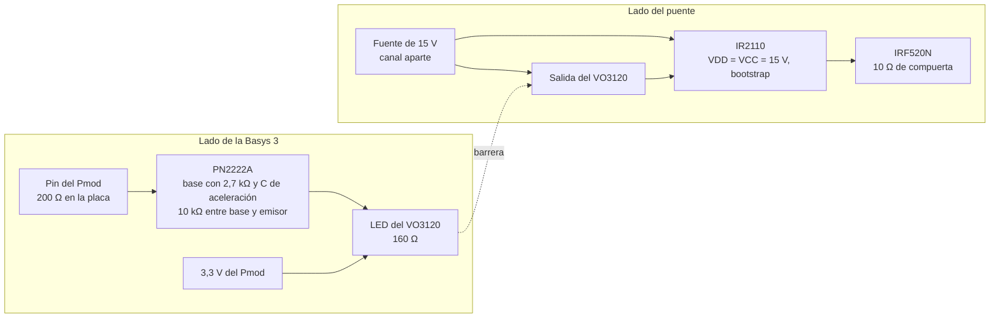

# Diseño del puente H, decisiones y justificación

Este documento reúne las decisiones de diseño del puente H de la etapa de potencia (#16) y la razón de cada una. Cubre el aislamiento entre la Basys 3 y el puente (#21), el MOSFET, el driver y el bootstrap de las compuertas (#17) y el tiempo muerto (#18).

## Qué cruza el aislamiento

La tierra del puente es propia del lado de potencia (`nivel01.md`). Toda señal entre la Basys 3 y el puente necesita su propio camino a través de la barrera.

- Las cuatro compuertas, digitales de 3,3 V, de la Basys 3 hacia el puente. Son el tema de este documento.
- La medición de corriente, analógica, del sensor hacia el JXADC. Si el sensor queda referido a la tierra de potencia y su salida entra directo al JXADC, las dos tierras se unen por ese cable y el aislamiento de las compuertas deja de servir. Su cruce se trata en el diseño del sensor (#30).

## Método de aislamiento

Las compuertas cruzan la barrera con un VO3120 por compuerta, un optoacoplador con una etapa de salida push-pull de 2,5 A [1]. El criterio es el retardo y, sobre todo, la diferencia entre el apagado de una compuerta y el encendido de la otra, que tiene que caber en el tiempo muerto. En el VO3120 `tPHL` y `tPLH` van de 0,1 a 0,4 µs [1, p. 4], así que entre dos unidades esa diferencia llega a 0,3 µs, por debajo del tiempo muerto de 1 µs y muy por debajo del semiperíodo de 25 µs a 20 kHz. Pasa niveles fijos, así que sostiene la compuerta con `duty_ref` cerca de ±1 o con el puente detenido.

Su inmunidad a modo común es de 25 kV/µs como mínimo [1, p. 5]. El nodo de cada pierna salta unos 24 V en unos 11 ns, cerca de 2 kV/µs.

## MOSFET

Las cuatro llaves son MOSFET de canal N IRF520N en TO-220 [8].

### Tensión y corriente

En cada pierna, con un MOSFET encendido el otro queda apagado con Vdc entre drenador y source, y el encendido lleva toda la corriente de la carga.

- Tensión. Con Vdc de hasta 24 V se pide `VDS` de al menos 40 V, 1,67 veces el bus. El margen cubre el sobrepico `L·di/dt` que la inductancia parásita entre el bus y la pierna suma a Vdc al apagar, y la energía que la carga inductiva devuelve al bus en parte de cada período, que una fuente de laboratorio no absorbe y que sube la tensión de sus capacitores.
- Corriente. El peor caso no es el 1 A pico de la referencia. La sobrecorriente la detecta el software con una muestra por período. En una falla con casi todo Vdc sobre la inductancia de la carga, la corriente sube `Vdc / L` = 24 V / 1 mH = 24 A/ms, es decir 1,2 A en los 50 µs entre muestras a 20 kHz (L de `diseno_pr.md`). Desde el umbral de 1,3 A de `supervisor_falla.md` puede llegar a unos 2,5 a 3 A antes de que el software apague las compuertas.

El IRF520N da 100 V, 9,7 A continuos y 38 A pulsados, con `VGS` de ±20 V como máximo [8, p. 1]. Las compuertas llegan a unos 15 V.

### Pérdidas

Con esos límites casi cualquier MOSFET en TO-220 sirve, así que la elección la deciden las pérdidas y la carga de compuerta. La estimación es por transistor, con Vdc = 24 V y 1 A pico.

- Conducción. Con 0,707 A eficaces y `RDS(on)` de 0,20 Ω máximos con `VGS` = 10 V [8, p. 2], `I²·RDS(on)` da 0,1 W. Es una cota, porque en unipolar ningún transistor conduce el período completo y con 15 V de compuerta la resistencia es menor.
- Conmutación. Durante cada cruce la tensión y la corriente coexisten en el transistor, y `½ · Vdc · I · (tr + tf) · f_sw` con 100 ns de cruce total da 24 mW a 20 kHz y 48 mW a 40 kHz. El cruce que sale de la resistencia de compuerta es de unos 33 ns, así que la cota queda del lado seguro.
- Recuperación inversa del diodo de cuerpo. Durante el tiempo muerto los dos MOSFET de la pierna están apagados y la corriente de la carga sigue por el diodo de cuerpo. Cuando el MOSFET complementario se enciende, la carga almacenada en el diodo (`Qrr`) sale como un pico de corriente inversa por ese MOSFET, con casi todo Vdc encima. `Qrr · Vdc · f_sw` con 390 nC típicos [8, p. 2] da 187 mW a 20 kHz y 374 mW a 40 kHz. `Qrr` está medido con 5,7 A y 100 A/µs, y con 1 A es menor, así que también es una cota.

La recuperación es el término más grande, y por eso el MOSFET se elige por `Qrr` bajo, junto con `Qg` bajo por el driver y el bootstrap. Sumando los tres términos, cada transistor disipa cerca de 0,5 W a 40 kHz. Con `RθJA` de 62 °C/W [8, p. 1] la unión queda unos 32 °C sobre el ambiente, sin disipador. Las pérdidas no limitan la frecuencia de 40 kHz de la tabla de `freq_sel`.

### Resistencia de compuerta

Cada salida del IR2110 llega a su MOSFET por una resistencia de 10 Ω. El pico de corriente de compuerta es `VCC / Rg` = 15 V / 10 Ω = 1,5 A, por debajo de los 2 A mínimos que el IR2110 garantiza en `IO+` e `IO−` [4, p. 3].

El cruce de tensión ocurre en la meseta de Miller, donde la compuerta queda fija en `V_plateau` mientras se carga o descarga `Qgd`. Con `Qgd` de 11 nC máximos [8, p. 2] y la meseta cerca de 5 V (Fig. 6, [8, p. 4]), los dos cruces quedan así.

```
encendido:  t ≈ Qgd · Rg / (VCC − V_plateau) = 11 nC · 10 Ω / 10 V ≈ 11 ns
apagado:    t ≈ Qgd · Rg / V_plateau        = 11 nC · 10 Ω / 5 V  ≈ 22 ns
```

Una resistencia menor acorta el cruce pero sube `di/dt` y `dv/dt`, con más sobrepico sobre la inductancia parásita y más acople al resto del circuito. Una mayor alarga el cruce, las pérdidas y el retardo que se come el tiempo muerto.

## Compuertas altas con bootstrap

Un MOSFET de canal N se enciende con la tensión entre compuerta y source. En las compuertas altas el source está en el nodo de salida de la pierna, que salta entre 0 y Vdc. Una señal referida a la tierra de potencia lo empieza a encender con el nodo en 0 V, pero a medida que el nodo sube `VGS` baja y el MOSFET queda en zona lineal sin llegar a Vdc. Para tenerlo encendido con el source en Vdc, la compuerta tiene que estar unos 10 V por encima de Vdc.

Esa tensión sale de un bootstrap [2], [3], con un driver de medio puente IR2110 por pierna. Las cuatro entradas quedan referidas a la tierra de potencia y el lado del puente no necesita ninguna fuente aislada.

El capacitor de bootstrap de cada pierna se carga desde `VCC` a través de un diodo mientras conduce el MOSFET bajo de esa pierna, con el nodo en 0 V, y se descarga mientras conduce el alto. El IR2110 pide entre `VB` y `VS` de 10 a 20 V [4, p. 2] y bloquea la salida alta mientras esa tensión esté por debajo de su umbral de subtensión (`VBSUV−`, de 9,4 V como máximo, [4, p. 3]).

### Capacitor

Mientras la compuerta alta está encendida el diodo queda en inversa y el capacitor es la única fuente del lado flotante. Entrega la carga de la compuerta y alimenta todo ese tiempo la corriente quiescente del lado flotante (`IQBS`, 230 µA máximos) y la fuga del desplazador de nivel (`ILK`, 50 µA máximos) [4, p. 3]. El peor caso es 10 kHz con la compuerta alta encendida casi todo el período de 100 µs.

La hoja del IRF520N da `Qg` de 25 nC máximos con `VGS` = 10 V [8, p. 2]. La compuerta llega a unos 15 V, y en la Fig. 6 [8, p. 4] pasar de 10 a 15 V suma unos 6 nC típicos. Con ese tramo escalado por la relación entre el máximo y el típico a 10 V, se toman 35 nC.

```
Q = Qg + (IQBS + ILK) · t_on = 35 nC + 280 µA · 100 µs = 63 nC
```

Con una caída de 0,5 V, `C ≥ Q / ΔV` = 126 nF. El capacitor es de 470 nF, unas 3,7 veces el mínimo, cerámico X7R o de película para que conserve la capacitancia con la tensión continua encima y entregue el pico de corriente de la compuerta con baja ESR. Como flota con `VS`, entre sus terminales solo ve `VCC` menos la caída del diodo, unos 14 a 15 V, así que basta con 25 V nominales.

### Diodo y resistencia

El diodo es un 1N4148 con 22 Ω en serie. Al arrancar el capacitor está en 0 V, y sin resistencia la primera carga solo queda limitada por la resistencia del diodo, la `RDS(on)` del MOSFET bajo y el cableado, con un pico de unos 14 A si suman 1 Ω. El 1N4148 aguanta 4 A solo durante 1 µs, 1 A durante 1 ms y 450 mA repetitivos [9, p. 2]. Con 22 Ω el pico baja a (15 − 0,7) V / 22 Ω ≈ 0,65 A, una vez por arranque y por debajo del valor de 1 ms. La constante de tiempo queda en `τ = R·C` = 22 Ω · 470 nF ≈ 10,3 µs.

Con la compuerta alta encendida el diodo queda en inversa con Vdc encima, 24 V más los sobrepicos, dentro de los 75 V de `VRRM` [9, p. 2].

### Recarga en cada período

Con la portadora de `nucleo_pwm.md`, la compuerta baja de la pierna A conduce

`MAX · (1 − duty_ref) − DEAD_TIME_CICLOS` ciclos por período.

La pierna B sigue la misma expresión con `−duty_ref`. A 20 kHz (`MAX = 2500`) y con `DEAD_TIME_CICLOS = 100`, eso da 24 µs con `duty_ref = 0`, 11,5 µs con `duty_ref = 0,5` y nada con `duty_ref = 0,96`. Desde `duty_ref = 1 − DEAD_TIME_CICLOS / MAX` el capacitor de A deja de recargarse, y con `duty_ref` hacia −1 le pasa lo mismo al de B.

El capacitor no necesita recuperarse entero en cada período. En un tiempo `t` de recarga, el RC recupera la fracción `1 − e^(−t/τ)` de lo que le falta para llegar a la tensión final, así que se asienta en el valor donde lo repuesto iguala a lo que pierde en cada período. Si al empezar la recarga le faltan `D` voltios,

```
D · (1 − e^(−t/τ)) = Q / C
```

A 20 kHz la carga por período es 35 nC + 280 µA · 50 µs = 49 nC, y `Q / C` = 0,10 V. Con `duty_ref = 0,9` la compuerta baja conduce 150 ciclos (1,5 µs), `D` da 0,77 V y la compuerta alta arranca cerca de 13,5 V y termina cerca de 13,4 V.

El mínimo aceptado al final del encendido es 10 V, la tensión a la que el IRF520N tiene especificada la `RDS(on)` [8, p. 2] y el mínimo de `VB − VS` del IR2110 [4, p. 2]. Partiendo de unos 14,3 V, eso deja `D ≤ 14,3 − 10 − 0,10` = 4,2 V, que pide `1 − e^(−t/τ) ≥ 0,025` y `t ≥ 0,26 µs`. Con margen por la tolerancia de R, C y la caída del diodo, la compuerta baja tiene que conducir al menos 100 ciclos por período.

En operación normal el límite no aparece, porque 1 A pico pide `duty_ref` cerca de 0,11 con los valores de `diseno_pr.md`. Sí aparece si el PR satura. Por eso `PR_U_MAX` de `pr_discreto.md` queda por debajo de

`1 − (DEAD_TIME_CICLOS + 100) / MAX`,

que da 0,92 a 20 kHz con `DEAD_TIME_CICLOS = 100`.

### Precarga en el arranque

Al pasar `running` a 1, lo primero que encienden las dos piernas son las compuertas altas (tabla de eventos de `nucleo_pwm.md`). Si el puente estuvo detenido, los capacitores están descargados y el IR2110 no las enciende, así que el primer período sale distorsionado. Lo mismo pasa al reanudar después de una falla.

Por eso el núcleo del PWM lleva un estado de precarga. Al pasar `running` a 1, cada pierna enciende su compuerta baja durante `PRECARGA_CICLOS`, un `parameter` como `DEAD_TIME_CICLOS`, y después sigue por `MUERTO` como hasta ahora. Las dos bajas encendidas dejan los dos extremos de la carga en la tierra de potencia, la carga ve 0 V y no hay camino de Vdc a tierra. Va en el núcleo porque es parte de la secuencia de las compuertas y no decide nada del control, y porque el software solo escribe `enable` y `duty_ref`. El reset y `DETENIDO` siguen con las cuatro apagadas.

Partiendo de 0 V, el capacitor pasa del 99 % de su carga final en 5τ, unos 52 µs con los valores nominales. El peor caso de τ sale con los 22 Ω en +5 % (banda dorada), 1 Ω más en serie por el diodo, la `RDS(on)` del MOSFET bajo y el cableado, y el capacitor en +20 %, la tolerancia más amplia de un cerámico. Eso da τ = 24,1 Ω · 564 nF ≈ 13,6 µs y 5τ ≈ 68 µs, así que `PRECARGA_CICLOS` = 7000, 70 µs. La caída de capacitancia de un X7R con la tensión continua encima acorta τ, así que no empeora el caso. Como se cuenta en ciclos de `clk`, el valor sirve en las tres frecuencias.

`VCC` no cambia τ, solo la tensión final, unos 0,7 V por debajo de `VCC` por la caída del diodo. Con 70 µs y τ en el peor caso el capacitor queda sobre el 99,4 % de esa tensión, unos 14,2 V, y la compuerta alta termina su primer encendido sobre 14 V aun a 10 kHz (`Q / C` = 63 nC / 470 nF ≈ 0,13 V).

En cada arranque la carga ve 0 V durante esos 70 µs, 1,4 períodos a 20 kHz y un 0,35 % de un ciclo de 50 Hz.

## Cadena de cada compuerta



1. Pin de un Pmod de la Basys 3 (JA, JB o JC), activo alto. Los Pmod traen 200 Ω en serie en la placa [10, hoja 1]. Las compuertas quedan lejos del JXADC para no meter flancos de 3,3 V junto a la entrada analógica del sensor.
2. PN2222A como interruptor bajo del LED. La base lleva 2,7 kΩ con un capacitor de aceleración en paralelo y un pull-down de 10 kΩ entre base y emisor. El LED se alimenta de los 3,3 V del Pmod (pines 6 y 12, con tierra en 5 y 11) a través de 160 Ω. Esos pines entregan hasta 1 A [5], y los cuatro LED piden 60 mA como mucho.
3. VO3120, con el LED entre los pines 2 (ánodo) y 3 (cátodo) e `IF` de 7 a 16 mA [1, p. 2]. Los pines 1 y 4 van al común del LED, la tierra de la Basys 3, como en la prueba de inmunidad a modo común [1, p. 5]. Del lado del puente, `VCC` (pin 8) va a 15 V y `VEE` (pin 5) a la tierra de potencia, con un cerámico de 0,1 µF entre los pines 8 y 5 como en los circuitos de prueba [1, p. 4]. La salida (pines 6 y 7) va directo a la entrada del IR2110.
4. IR2110 con `VDD` y `VCC` en los mismos 15 V (`VDD` acepta de 3 a 20 V sobre `VSS` y `VCC` de 10 a 20 V, [4, p. 2]), con `VSS` y `COM` en la tierra de potencia. Con 15 V lee un bajo por debajo de 6,0 V y un alto desde 9,5 V [4, p. 3]. El VO3120 da 0,5 V máximos en bajo y al menos `VCC − 4` = 11 V en alto, los dos con 100 mA [1, p. 3], y con los 40 µA que pide la entrada del IR2110 (`IIN+`, [4, p. 3]) el alto queda cerca de `VCC` [1, p. 3]. Como la salida del VO3120 y `VDD` salen de la misma tensión, la entrada no pasa el máximo de `VDD + 0,3 V` [4, p. 2]. El consumo es bajo, con 340 µA máximos de `IQCC` y 30 µA de `IQDD` [4, p. 3] más la carga de compuerta de dos MOSFET, unos 3 mA a 40 kHz.
5. IRF520N, con 10 Ω entre cada salida del IR2110 y su compuerta.
6. Los 15 V del lado del puente salen de un canal aparte de la fuente de banco, con el negativo en la tierra de potencia. Es el mínimo de la alimentación recomendada del VO3120, de 15 a 32 V [1, p. 2], y queda 1,5 V sobre su umbral de subtensión al subir, de 13,5 V como máximo [1, p. 3]. Vdc no sirve como alimentación porque va de 12 a 24 V. Cada VO3120 consume 2,5 mA como máximo [1, p. 3], así que el canal entrega unos 17 mA con los dos IR2110. Toda la cadena funciona con Vdc apagado, así que las compuertas y el tiempo muerto se revisan en el osciloscopio sin energizar el bus.

### Entrada del aislamiento

El LED alimentado directo desde el pin queda con los 200 Ω de la placa en serie y no admite otra resistencia. Con `VF` máximo de 1,6 V [1, p. 3] la corriente da (3,3 − 1,6) / 200 = 8,5 mA con el pin en 3,3 V, y `VOH` del pin baja con la carga. Con 0,3 V menos la corriente ya cae a los 7 mA mínimos. Con el transistor, el pin solo maneja la corriente de base y la del LED la fija una resistencia propia.

Para la base se toman unos 10 mA en el LED, `VBE` cerca de 0,7 V y una β forzada de 10, es decir 1 mA de base. El total queda en (3,3 − 0,7) / 1 mA = 2,6 kΩ, y sin los 200 Ω de la placa son 2,4 kΩ. Con 2,7 kΩ la base queda en unos 0,9 mA, una β forzada cerca de 11. La `hFE` mínima con `IC` = 10 mA es 75, y 35 a −55 °C [7, p. 3], así que el transistor queda saturado con margen.

La resistencia del LED es de 160 Ω. Con el transistor saturado, los 3,3 V se reparten entre la resistencia, el LED y el transistor, así que `IF = (3,3 − VF − VCE(sat)) / R`. La corriente tiene que quedar entre 7 y 16 mA [1, p. 2] en los dos extremos, con `VF` de 1,0 a 1,6 V [1, p. 3], `VCE(sat)` de 0 a 0,3 V [7, p. 3] y la resistencia en ±5 %. El máximo pide `R ≥ (3,3 − 1,0) / (0,95 · 16 mA)` = 151 Ω y el mínimo `R ≤ (3,3 − 1,6 − 0,3) / (1,05 · 7 mA)` = 190 Ω. Con 160 Ω la corriente va de 8,3 a 15,1 mA. La `VCE(sat)` de la hoja está medida con 150 mA [7, p. 3], así que con 15 mA es una cota. Disipa 38 mW como máximo.

El pull-down entre base y emisor es de 10 kΩ. Con el pin en alto se lleva `0,7 V / 10 kΩ` = 70 µA, menos del 10 % de la corriente de base, y a la base le quedan 0,83 mA. Con la corriente de LED más alta, 15,1 mA, la β forzada queda en 18, muy por debajo de la `hFE` mínima. Con el pin en alta impedancia, la fuga del pin de la FPGA (15 µA máximos, [11, Tabla 3, p. 3]) y la del colector a la base del PN2222A (`ICBO`, 10 µA máximos a 125 °C, [7, p. 3]) salen por el pull-down y dejan la base en 0,25 V como mucho, menos de la mitad del `VBE(sat)` mínimo de 0,6 V [7, p. 3]. El transistor no conduce y el LED queda dentro de la condición de apagado del VO3120, `VF(OFF)` de 0,8 V como máximo [1, p. 2].

El capacitor de aceleración solo actúa en los flancos. Al encender da un pico de corriente de base y al apagar tira la base hacia negativo y barre la carga almacenada, lo que acorta el tiempo de almacenamiento. En régimen estable no conduce, así que la saturación la sigue fijando la resistencia. Los 200 Ω de la placa limitan ese pico a unos 16 mA. Su valor se elige midiendo `ts` con la potencia apagada.

### Estado sin señal

Cada eslabón tiene que dejar la compuerta apagada cuando no recibe señal. Mientras se configura la FPGA los pines quedan en alta impedancia sin pull-ups, porque en la Basys 3 el pin `PUDC_B` (E18) va a 3,3 V por 1 kΩ, con la resistencia a tierra sin montar [10, hoja 5], y con `PUDC_B` en alto la FPGA deja los pull-ups desactivados durante la configuración [6]. Con el cable del Pmod suelto o la Basys 3 apagada, el LED se queda sin alimentación. En todos esos casos el LED queda apagado, así que la cadena tiene que traducir LED apagado en compuerta apagada.

- LED apagado. La salida del VO3120 queda en bajo (tabla de verdad, [1, p. 2]) y el IR2110 apaga la compuerta.
- Pin en 1. El transistor conduce, el LED se enciende, la salida del VO3120 sube a `VCC` y la compuerta se enciende.
- Mientras se configura la FPGA, el pull-down de la base mantiene el transistor cortado.
- Mientras sube la alimentación de 15 V, la salida del VO3120 queda en bajo aunque el LED esté encendido, hasta que `VCC − VEE` pasa de 11 a 13,5 V. Al bajar vuelve a bajo entre 12 y 9,5 V [1, p. 2].

La polaridad importa porque el IR2110 maneja `HIN` y `LIN` por separado y no impide que estén en alto a la vez. Si LED apagado fuera compuerta encendida, una falla del lado de la Basys 3 encendería las cuatro compuertas y cortocircuitaría las dos piernas.

## Tiempo muerto

Al conmutar una pierna, la FPGA baja la compuerta que se apaga en `t = 0` y sube la complementaria `TM` después, con `TM = DEAD_TIME_CICLOS · 10 ns`. Cada orden recorre su propia cadena, así que el MOSFET que se apaga deja de conducir en `t_off` y el que se enciende empieza a conducir en `TM + t_on`. Para que los dos no conduzcan a la vez,

`TM > t_off − t_on`

El retardo que comparten los dos flancos se cancela en la resta y no cambia el tiempo muerto. Solo suma al retardo del lazo, que en `diseno_pr.md` se toma de hasta 2 µs. El peor caso usa `t_off` máximo y `t_on` mínimo en cada eslabón, y cuando la hoja no da el mínimo de `t_on` se toma 0. Las dos compuertas de una pierna pasan por eslabones distintos (dos PN2222A, dos VO3120, los canales HO y LO del IR2110 y dos MOSFET), así que la diferencia se toma entre dos unidades y no dentro de una misma.

- PN2222A. El corte del transistor apaga el LED y eso apaga la compuerta, así que en el apagado entra `toff`, de 250 ns máximos (`ts` de 200 ns y `tf` de 60 ns) [7, p. 3]. `ton` tiene 35 ns máximos y no tiene mínimo. Aporta 250 ns. La hoja mide estos tiempos con `IC` = 150 mA, 15 mA de base al encender y −15 mA al apagar. En este circuito la corriente inversa de base sale solo del capacitor de aceleración, así que `ts` puede ser más largo que el de la hoja.
- VO3120. `tPHL` y `tPLH` van de 0,1 a 0,4 µs [1, p. 4], medidos con 10 Ω y 10 nF de carga. Con `tPHL` máximo en una unidad y `tPLH` mínimo en la otra aporta 0,3 µs. La distorsión de ancho de pulso, de 0,2 µs como máximo, es `|tPHL − tPLH|` dentro de una misma unidad [1, p. 4, nota 2] y no acota la diferencia entre dos. La nota 3 de esa tabla define la diferencia entre dos unidades, pero ninguna fila le da un valor.
- IR2110 con 15 V. En una pierna se cruzan el apagado de HO con el encendido de LO, o al revés. `toff` vale 125 ns máximos y `ton` no tiene mínimo [4, p. 3], así que aporta 125 ns. El "delay matching" de 10 ns [4, p. 3] compara el mismo flanco en los dos canales y no acota esta diferencia.
- IRF520N. Deja de conducir al final de `td(off) + tf` y empieza a conducir al final de `td(on)`, que la hoja da solo como típico, así que `t_on` se toma 0. Los tiempos de la tabla son típicos y están medidos con `RG` = 22 Ω e `ID` = 5,7 A [8, p. 2], así que para este circuito se estiman con la carga de compuerta.

Para el IRF520N la resistencia de compuerta es la de 10 Ω más la salida del IR2110. `IO−` es de 2,0 A como mínimo con la salida en 15 V [4, p. 3], así que esa salida equivale como mucho a 7,5 Ω y `RG_total` queda en 17,5 Ω. Durante `td(off)` el MOSFET todavía conduce, con `VDS` = 1,3 A · 0,20 Ω ≈ 0,26 V, fuera del rango de la Fig. 5. La capacidad de entrada en esa zona sale del tramo de la Fig. 6 posterior a la meseta, de 11 a 23 nC entre unos 5 y 15 V, es decir 1,2 nF [8, p. 4], más del doble de los 520 pF que marca la Fig. 5 con 1 V. Con 1,3 A la meseta queda cerca del umbral. La Fig. 3 [8, p. 3] marca unos 4 V para esa corriente y `VGS(th)` va de 2,0 a 4,0 V [8, p. 2], así que se toma `Vp` = 2 V, el valor que más alarga el apagado. Con la compuerta descargándose como un RC desde 15 V hasta `Vp`, y después a corriente `Vp / RG_total` durante la meseta,

```
td(off) = RG_total · C · ln(VCC / Vp) = 17,5 Ω · 1,2 nF · ln(15 / 2) ≈ 42 ns
tf ≈ Qgd · RG_total / Vp = 11 nC · 17,5 Ω / 2 V ≈ 96 ns
```

El IRF520N aporta unos 138 ns, contra los 55 ns típicos de la hoja. `Qgd` de 11 nC está medido con 80 V, y con Vdc de hasta 24 V la meseta de la Fig. 6 es más angosta, así que `tf` queda del lado seguro.

```
t_off − t_on = 250 + 300 + 125 + 138 ≈ 813 ns
```

`DEAD_TIME_CICLOS = 100`, 1 µs con el reloj de 100 MHz. El margen de 187 ns, un 23 %, cubre un `ts` del PN2222A más largo que el de la hoja y el cableado. Con ese valor el límite del bootstrap queda en 0,92 a 20 kHz.

El flanco más lento de la cadena es el apagado, con unos 250 + 400 + 125 + 138 ≈ 0,91 µs entre el pin y el corte del MOSFET, dentro de los 2 µs de `diseno_pr.md`.

## Referencias

[1] Vishay Semiconductors, "VO3120 2.5 A Output Current IGBT and MOSFET Driver", hoja de datos 81314 rev. 1.5, 9 dic. 2025.

[2] International Rectifier, "HV Floating MOS-Gate Driver ICs", nota de aplicación AN-978.

[3] L. Balogh, "Fundamentals of MOSFET and IGBT Gate Driver Circuits", Texas Instruments, nota de aplicación SLUA618.

[4] International Rectifier, "IR2110(-1-2)(S)PbF/IR2113(-1-2)(S)PbF High and Low Side Driver", hoja de datos PD60147 rev. U.

[5] Digilent, "Basys 3 Reference Manual", sección de los puertos Pmod. <https://digilent.com/reference/programmable-logic/basys-3/reference-manual>

[6] AMD Xilinx, "7 Series FPGAs Configuration User Guide", UG470.

[7] Philips Semiconductors, "PN2222A NPN switching transistor", hoja de datos, 21 may. 1999.

[8] International Rectifier, "IRF520N HEXFET Power MOSFET", hoja de datos PD-91339A, 13 may. 1998.

[9] Philips Semiconductors, "1N4148; 1N4448 High-speed diodes", hoja de datos, 25 may. 1999.

[10] Digilent, "Basys 3", esquemático, documento 500-183, rev. D.1, 2021.

[11] AMD, "Artix 7 FPGAs Data Sheet: DC and AC Switching Characteristics", DS181 v1.27.1, 3 jul. 2024.
