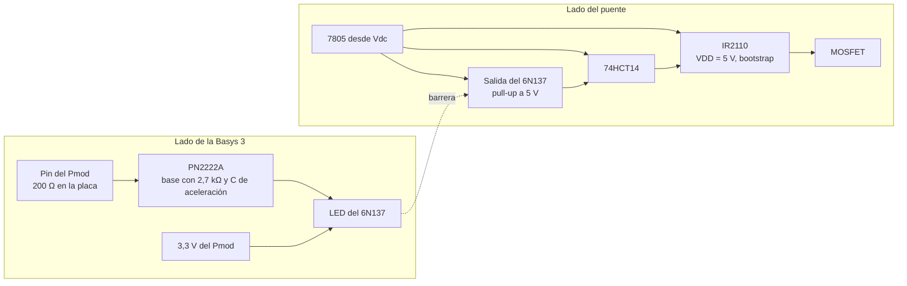

# Diseño del puente H, decisiones y justificación

Este documento reúne las decisiones de diseño del puente H de la etapa de potencia (#16) y la razón de cada una. Cubre el aislamiento entre la Basys 3 y el puente (#21) y el manejo de las compuertas que sale de él.

## Qué cruza el aislamiento

La tierra del puente es propia del lado de potencia (`nivel01.md`). Toda señal entre la Basys 3 y el puente necesita su propio camino a través de la barrera.

- Las cuatro compuertas, digitales de 3,3 V, de la Basys 3 hacia el puente. Son el tema de este documento.
- La medición de corriente, analógica, del sensor hacia el JXADC. Si el sensor queda referido a la tierra de potencia y su salida entra directo al JXADC, las dos tierras se unen por ese cable y el aislamiento de las compuertas deja de servir. Su cruce se trata en el diseño del sensor (#30).

## Método de aislamiento

Las compuertas cruzan la barrera con un optoacoplador de salida lógica 6N137 por compuerta. El criterio es el retardo y, sobre todo, la diferencia de retardo entre los dos flancos, que se resta del tiempo muerto. En el 6N137 `tPLH` y `tPHL` valen 60 ns típicos y 75 ns máximos, con flancos de 30 ns [1, p. 4], muy por debajo del semiperíodo de 25 µs a 20 kHz y del tiempo muerto de 1 µs que usa hoy `nucleo_pwm.md`. Además pasa niveles fijos, así que sostiene la compuerta con `duty_ref` cerca de ±1 o con el puente detenido.

## Compuertas altas con bootstrap

Un MOSFET de canal N se enciende con la tensión entre compuerta y source. En las compuertas altas el source está en el nodo de salida de la pierna, que salta entre 0 y Vdc. Una señal de 0 a 5 V referida a la tierra de potencia lo empieza a encender con el nodo en 0 V, pero a medida que el nodo sube `VGS` baja y el MOSFET queda en zona lineal sin llegar a Vdc. Para tenerlo encendido con el source en Vdc, la compuerta tiene que estar unos 10 V por encima de Vdc.

Esa tensión sale de un bootstrap [2], [3], con un driver de medio puente IR2110 por pierna. Las cuatro entradas quedan referidas a la tierra de potencia y el lado del puente no necesita ninguna fuente aislada.

El capacitor de bootstrap de cada pierna se carga mientras conduce el MOSFET bajo de esa pierna, con el nodo en 0 V, y se descarga mientras conduce el alto. El IR2110 bloquea la salida alta mientras la alimentación flotante esté por debajo de su umbral de subtensión (`VBSUV`, [4, p. 3]).

### Recarga en cada período

Con la portadora de `nucleo_pwm.md`, la compuerta baja de la pierna A conduce

`MAX · (1 − duty_ref) − DEAD_TIME_CICLOS` ciclos por período.

La pierna B sigue la misma expresión con `−duty_ref`. A 20 kHz (`MAX = 2500`) y con `DEAD_TIME_CICLOS = 100`, eso da 24 µs con `duty_ref = 0`, 11,5 µs con `duty_ref = 0,5` y nada con `duty_ref = 0,96`. Desde `duty_ref = 1 − DEAD_TIME_CICLOS / MAX` el capacitor de A deja de recargarse, y con `duty_ref` hacia −1 le pasa lo mismo al de B.

En operación normal no aparece, porque 1 A pico pide `duty_ref` cerca de 0,11 con los valores de `diseno_pr.md`. Sí aparece si el PR satura. Por eso `PR_U_MAX` de `pr_discreto.md` tiene que quedar por debajo de `1 − (DEAD_TIME_CICLOS + ciclos mínimos de recarga) / MAX`, con el mínimo de recarga del driver.

### Precarga en el arranque

Al pasar `running` a 1, lo primero que encienden las dos piernas son las compuertas altas (tabla de eventos de `nucleo_pwm.md`). Si el puente estuvo detenido, los capacitores están descargados y el IR2110 no las enciende, así que el primer período sale distorsionado. Lo mismo pasa al reanudar después de una falla.

Por eso el núcleo del PWM lleva un estado de precarga. Al pasar `running` a 1, cada pierna enciende su compuerta baja durante `PRECARGA_CICLOS`, un `parameter` como `DEAD_TIME_CICLOS`, y después sigue por `MUERTO` como hasta ahora. Las dos bajas encendidas dejan los dos extremos de la carga en la tierra de potencia, la carga ve 0 V y no hay camino de Vdc a tierra. Va en el núcleo porque es parte de la secuencia de las compuertas y no decide nada del control, y porque el software solo escribe `enable` y `duty_ref`. El reset y `DETENIDO` siguen con las cuatro apagadas. `PRECARGA_CICLOS` se fija con el tiempo mínimo de recarga del driver.

## Cadena de cada compuerta

1. Pin de un Pmod de la Basys 3 (JA, JB o JC), activo alto. Los Pmod traen 200 Ω en serie en la placa [5]. Las compuertas quedan lejos del JXADC para no meter flancos de 3,3 V junto a la entrada analógica del sensor.
2. PN2222A como interruptor bajo del LED. La base lleva 2,7 kΩ con un capacitor de aceleración en paralelo y un pull-down entre base y emisor. El LED se alimenta de los 3,3 V del Pmod (pines 6 y 12, con tierra en 5 y 11) a través de su propia resistencia. Esos pines entregan hasta 1 A [5], y los cuatro LED piden unos 40 mA.
3. 6N137, con `VCC` de 4,5 a 5,5 V, un cerámico de 100 nF entre los pines 8 y 5 a menos de 1 cm, y `IFH` entre 7 y 20 mA [1, p. 2]. Su salida de colector abierto lleva un pull-up a 5 V.
4. 74HCT14, alimentado con los mismos 5 V. Invierte la salida del 6N137 y limpia el flanco. Su entrada tiene umbrales TTL y la salida del 6N137 va de 0 a 5 V.
5. IR2110 con `VDD` = 5 V (acepta de 3 a 20 V sobre `VSS`, [4, p. 2]), con `VSS` y `COM` en la tierra de potencia. Con `VDD` = 5 V, `VIH` máximo ronda 3,2 V y `VIL` mínimo 1,9 V (Fig. 12B y 13B, [4, p. 9], lectura aproximada de la curva), y el 74HCT14 pasa los dos umbrales con margen.
6. Los 5 V del lado del puente salen de un L7805 alimentado desde Vdc. Hace falta una tensión regulada porque el 6N137 consume 7 mA típicos con la salida en alto y 12 mA con la salida en bajo (`ICCH` e `ICCL`, [1, p. 3]), y el consumo cambia con cada flanco.

### Entrada del aislamiento

El LED alimentado directo desde el pin queda con los 200 Ω de la placa en serie y no admite otra resistencia. Con `VF` de 1,65 V típicos y 1,75 V máximos [1, p. 3], la corriente da (3,3 − 1,65) / 200 = 8,25 mA, o 7,75 mA con `VF` máximo. Apenas pasa el mínimo de 7 mA, antes de contar que `VOH` del pin baja con la carga. Con el transistor, el pin solo maneja la corriente de base y la del LED la fija una resistencia propia.

Para la base se toman unos 10 mA en el LED, `VBE` cerca de 0,7 V y una β forzada de 10, es decir 1 mA de base. El total queda en (3,3 − 0,7) / 1 mA = 2,6 kΩ, y sin los 200 Ω de la placa son 2,4 kΩ. Con 2,7 kΩ la base queda en unos 0,9 mA, una β forzada cerca de 11. La `hFE` mínima con `IC` = 10 mA es 75, y 35 a −55 °C [7, p. 3], así que el transistor queda saturado con margen.

El capacitor de aceleración solo actúa en los flancos. Al encender da un pico de corriente de base y al apagar tira la base hacia negativo y barre la carga almacenada, lo que acorta el tiempo de almacenamiento. En régimen estable no conduce, así que la saturación la sigue fijando la resistencia. Los 200 Ω de la placa limitan ese pico a unos 16 mA. Su valor se elige midiendo `ts` con la potencia apagada.

### Estado sin señal

Cada eslabón tiene que dejar la compuerta apagada cuando no recibe señal. Mientras se configura la FPGA los pines quedan en alta impedancia sin pull-ups, porque la Basys 3 tiene `PUDC_B` en alto [6]. Con el cable del Pmod suelto o la Basys 3 apagada, el LED se queda sin alimentación. En todos esos casos el LED queda apagado, así que la cadena tiene que traducir LED apagado en compuerta apagada.

- LED apagado. La salida del 6N137 sube por el pull-up, el 74HCT14 la baja y el IR2110 apaga la compuerta.
- Pin en 1. El transistor conduce, el LED se enciende, el 6N137 baja su salida (tabla de verdad, [1, p. 1]), el 74HCT14 sube y la compuerta se enciende.
- Mientras se configura la FPGA, el pull-down de la base mantiene el transistor cortado.

Sin el 74HCT14, LED apagado sería compuerta encendida. Como el IR2110 maneja `HIN` y `LIN` por separado y no impide que estén en alto a la vez, una falla del lado de la Basys 3 encendería las cuatro compuertas y cortocircuitaría las dos piernas.

## Retardo y asimetría

El retardo de la cadena, si fuera igual en los dos flancos, no cambia el tiempo muerto. Solo suma al retardo del lazo, que en `diseno_pr.md` se toma de hasta 2 µs. Lo que entra al tiempo muerto es la diferencia entre flancos. En cada eslabón, si apagar tarda más que encender, la diferencia se resta del tiempo muerto, y si es al revés se suma.

- PN2222A. El corte del transistor apaga el LED y eso apaga la compuerta, así que su flanco lento, `ts + tf`, cae en el apagado y se resta. La hoja da `ton` de 35 ns máximos (`td` de 15 ns y `tr` de 20 ns) y `toff` de 250 ns máximos (`ts` de 200 ns y `tf` de 60 ns) [7, p. 3], así que la diferencia llega a unos 215 ns. Esos tiempos se miden con `IC` = 150 mA, 15 mA de base al encender y −15 mA al apagar. En este circuito la corriente inversa de base sale solo del capacitor de aceleración, así que `ts` puede ser más largo que el de la hoja.
- 6N137. `tPLH` y `tPHL` valen 60 ns típicos y 75 ns máximos cada uno [1, p. 4]. La hoja no da la diferencia entre los dos, así que la cota es 75 ns.
- 74HCT14. `tPHL` y `tPLH` valen 20 ns típicos y 34 ns máximos con `VCC` = 4,5 V, 50 pF de carga y 25 °C, con transiciones de 7 ns típicos y 15 ns máximos [8, p. 13]. La hoja no da la diferencia entre los dos, así que la cota es 34 ns.
- IR2110 con `VDD` = 5 V. `ton` ronda 140 ns típicos y 170 ns máximos (Fig. 7C) y `toff` 145 ns típicos y 180 ns máximos (Fig. 8C) [4, p. 7], lecturas aproximadas de la curva. La diferencia, de 5 a 10 ns, se resta. Las dos curvas son muy empinadas cerca de 5 V, así que la tolerancia del 7805 las mueve. La diferencia entre el canal alto y el bajo es de 10 ns máximos, con `VDD` = 15 V [4, p. 3].

El PN2222A es el término más grande. La suma de todas, más la del MOSFET y un margen, fija el mínimo de `DEAD_TIME_CICLOS` (#18).

## Referencias

[1] Toshiba, "6N137 Photocoupler GaAlAs IRED & Photo IC", hoja de datos, 27 feb. 1998.

[2] International Rectifier, "HV Floating MOS-Gate Driver ICs", nota de aplicación AN-978.

[3] L. Balogh, "Fundamentals of MOSFET and IGBT Gate Driver Circuits", Texas Instruments, nota de aplicación SLUA618.

[4] International Rectifier, "IR2110(-1-2)(S)PbF/IR2113(-1-2)(S)PbF High and Low Side Driver", hoja de datos PD60147 rev. U.

[5] Digilent, "Basys 3 Reference Manual", sección de los puertos Pmod. https://digilent.com/reference/programmable-logic/basys-3/reference-manual

[6] AMD Xilinx, "7 Series FPGAs Configuration User Guide", UG470.

[7] Philips Semiconductors, "PN2222A NPN switching transistor", hoja de datos, 21 may. 1999.

[8] Philips Semiconductors, "74HC14; 74HCT14 Hex inverting Schmitt trigger", hoja de datos, 30 oct. 2003.
