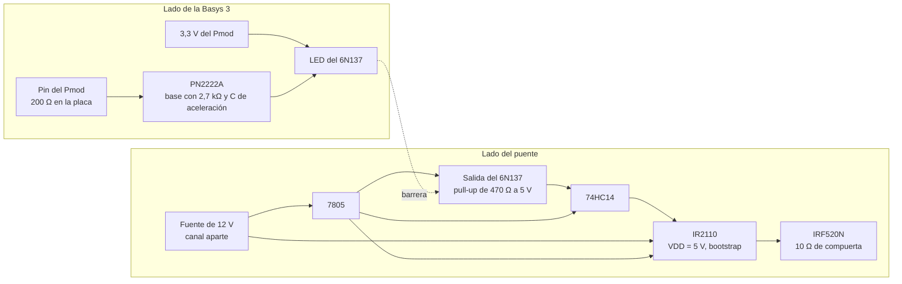

# Diseño del puente H, decisiones y justificación

Este documento reúne las decisiones de diseño del puente H de la etapa de potencia (#16) y la razón de cada una. Cubre el aislamiento entre la Basys 3 y el puente (#21), y el MOSFET, el driver y el bootstrap de las compuertas (#17).

## Qué cruza el aislamiento

La tierra del puente es propia del lado de potencia (`nivel01.md`). Toda señal entre la Basys 3 y el puente necesita su propio camino a través de la barrera.

- Las cuatro compuertas, digitales de 3,3 V, de la Basys 3 hacia el puente. Son el tema de este documento.
- La medición de corriente, analógica, del sensor hacia el JXADC. Si el sensor queda referido a la tierra de potencia y su salida entra directo al JXADC, las dos tierras se unen por ese cable y el aislamiento de las compuertas deja de servir. Su cruce se trata en el diseño del sensor (#30).

## Método de aislamiento

Las compuertas cruzan la barrera con un optoacoplador de salida lógica 6N137 por compuerta. El criterio es el retardo y, sobre todo, la diferencia de retardo entre los dos flancos, que se resta del tiempo muerto. En el 6N137 `tPLH` y `tPHL` valen 60 ns típicos y 75 ns máximos, con flancos de 30 ns [1, p. 4], muy por debajo del semiperíodo de 25 µs a 20 kHz y del tiempo muerto de 1 µs que usa hoy `nucleo_pwm.md`. Además pasa niveles fijos, así que sostiene la compuerta con `duty_ref` cerca de ±1 o con el puente detenido.

## MOSFET

Las cuatro llaves son MOSFET de canal N IRF520N en TO-220 [9].

### Tensión y corriente

En cada pierna, con un MOSFET encendido el otro queda apagado con Vdc entre drenador y source, y el encendido lleva toda la corriente de la carga.

- Tensión. Con Vdc de hasta 24 V se pide `VDS` de al menos 40 V, 1,67 veces el bus. El margen cubre el sobrepico `L·di/dt` que la inductancia parásita entre el bus y la pierna suma a Vdc al apagar, y la energía que la carga inductiva devuelve al bus en parte de cada período, que una fuente de laboratorio no absorbe y que sube la tensión de sus capacitores.
- Corriente. El peor caso no es el 1 A pico de la referencia. La sobrecorriente la detecta el software con una muestra por período. En una falla con casi todo Vdc sobre la inductancia de la carga, la corriente sube `Vdc / L` = 24 V / 1 mH = 24 A/ms, es decir 1,2 A en los 50 µs entre muestras a 20 kHz (L de `diseno_pr.md`). Desde el umbral de 1,3 A de `supervisor_falla.md` puede llegar a unos 2,5 a 3 A antes de que el software apague las compuertas.

El IRF520N da 100 V, 9,7 A continuos y 38 A pulsados [9, p. 1].

### Pérdidas

Con esos límites casi cualquier MOSFET en TO-220 sirve, así que la elección la deciden las pérdidas y la carga de compuerta. La estimación es por transistor, con Vdc = 24 V y 1 A pico.

- Conducción. Con 0,707 A eficaces y `RDS(on)` de 0,20 Ω máximos con `VGS` = 10 V [9, p. 2], `I²·RDS(on)` da 0,1 W. Es una cota, porque en unipolar ningún transistor conduce el período completo.
- Conmutación. Durante cada cruce la tensión y la corriente coexisten en el transistor, y `½ · Vdc · I · (tr + tf) · f_sw` con 100 ns de cruce total da 24 mW a 20 kHz y 48 mW a 40 kHz. El cruce que sale de la resistencia de compuerta es de unos 38 ns, así que la cota queda del lado seguro.
- Recuperación inversa del diodo de cuerpo. Durante el tiempo muerto los dos MOSFET de la pierna están apagados y la corriente de la carga sigue por el diodo de cuerpo. Cuando el MOSFET complementario se enciende, la carga almacenada en el diodo (`Qrr`) sale como un pico de corriente inversa por ese MOSFET, con casi todo Vdc encima. `Qrr · Vdc · f_sw` con 390 nC típicos [9, p. 2] da 187 mW a 20 kHz y 374 mW a 40 kHz. `Qrr` está medido con 5,7 A y 100 A/µs, y con 1 A es menor, así que también es una cota.

La recuperación es el término más grande, y por eso el MOSFET se elige por `Qrr` bajo, junto con `Qg` bajo por el driver y el bootstrap. Sumando los tres términos, cada transistor disipa cerca de 0,5 W a 40 kHz. Con `RθJA` de 62 °C/W [9, p. 1] la unión queda unos 32 °C sobre el ambiente, sin disipador. Las pérdidas no limitan la frecuencia de 40 kHz de la tabla de `freq_sel`.

### Resistencia de compuerta

Cada salida del IR2110 llega a su MOSFET por una resistencia de 10 Ω. El pico de corriente de compuerta es `VCC / Rg` = 1,2 A, por debajo de los 2 A mínimos que el IR2110 garantiza en `IO+` e `IO−` [4, p. 3].

El cruce de tensión ocurre en la meseta de Miller, donde la compuerta queda fija en `V_plateau` mientras se carga o descarga `Qgd`. Con `Qgd` de 11 nC máximos [9, p. 2] y la meseta cerca de 5 V (Fig. 6, [9, p. 4]), los dos cruces quedan así.

```
encendido:  t ≈ Qgd · Rg / (VCC − V_plateau) = 11 nC · 10 Ω / 7 V ≈ 16 ns
apagado:    t ≈ Qgd · Rg / V_plateau        = 11 nC · 10 Ω / 5 V ≈ 22 ns
```

Una resistencia menor acorta el cruce pero sube `di/dt` y `dv/dt`, con más sobrepico sobre la inductancia parásita y más acople al resto del circuito. Una mayor alarga el cruce, las pérdidas y el retardo que se come el tiempo muerto.

## Compuertas altas con bootstrap

Un MOSFET de canal N se enciende con la tensión entre compuerta y source. En las compuertas altas el source está en el nodo de salida de la pierna, que salta entre 0 y Vdc. Una señal de 0 a 5 V referida a la tierra de potencia lo empieza a encender con el nodo en 0 V, pero a medida que el nodo sube `VGS` baja y el MOSFET queda en zona lineal sin llegar a Vdc. Para tenerlo encendido con el source en Vdc, la compuerta tiene que estar unos 10 V por encima de Vdc.

Esa tensión sale de un bootstrap [2], [3], con un driver de medio puente IR2110 por pierna. Las cuatro entradas quedan referidas a la tierra de potencia y el lado del puente no necesita ninguna fuente aislada.

El capacitor de bootstrap de cada pierna se carga desde `VCC` a través de un diodo mientras conduce el MOSFET bajo de esa pierna, con el nodo en 0 V, y se descarga mientras conduce el alto. El IR2110 pide entre `VB` y `VS` de 10 a 20 V [4, p. 2] y bloquea la salida alta mientras esa tensión esté por debajo de su umbral de subtensión (`VBSUV−`, de 9,4 V como máximo, [4, p. 3]).

### Capacitor

Mientras la compuerta alta está encendida el diodo queda en inversa y el capacitor es la única fuente del lado flotante. Entrega la carga de la compuerta (`Qg`, 25 nC máximos, [9, p. 2]) y alimenta todo ese tiempo la corriente quiescente del lado flotante (`IQBS`, 230 µA máximos) y la fuga del desplazador de nivel (`ILK`, 50 µA máximos) [4, p. 3]. El peor caso es 10 kHz con la compuerta alta encendida casi todo el período de 100 µs.

```
Q = Qg + (IQBS + ILK) · t_on = 25 nC + 280 µA · 100 µs = 53 nC
```

Con una caída de 0,5 V, `C ≥ Q / ΔV` = 106 nF. El capacitor es de 470 nF, unas 4,4 veces el mínimo, cerámico X7R o de película para que conserve la capacitancia con la tensión continua encima y entregue el pico de corriente de la compuerta con baja ESR. Como flota con `VS`, entre sus terminales solo ve `VCC` menos la caída del diodo, unos 11 a 12 V, así que basta con 25 V nominales.

### Diodo y resistencia

El diodo es un 1N4148 con 22 Ω en serie. Al arrancar el capacitor está en 0 V, y sin resistencia la primera carga solo queda limitada por la resistencia del diodo, la `RDS(on)` del MOSFET bajo y el cableado, con un pico de unos 12 A si suman 1 Ω. El 1N4148 aguanta 4 A solo durante 1 µs, 1 A durante 1 ms y 450 mA repetitivos [10, p. 2]. Con 22 Ω el pico baja a (12 − 0,7) V / 22 Ω ≈ 0,51 A, una vez por arranque y por debajo del valor de 1 ms. La constante de tiempo queda en `τ = R·C` = 22 Ω · 470 nF ≈ 10,3 µs.

Con la compuerta alta encendida el diodo queda en inversa con Vdc encima, 24 V más los sobrepicos, dentro de los 75 V de `VRRM` [10, p. 2].

### Recarga en cada período

Con la portadora de `nucleo_pwm.md`, la compuerta baja de la pierna A conduce

`MAX · (1 − duty_ref) − DEAD_TIME_CICLOS` ciclos por período.

La pierna B sigue la misma expresión con `−duty_ref`. A 20 kHz (`MAX = 2500`) y con `DEAD_TIME_CICLOS = 100`, eso da 24 µs con `duty_ref = 0`, 11,5 µs con `duty_ref = 0,5` y nada con `duty_ref = 0,96`. Desde `duty_ref = 1 − DEAD_TIME_CICLOS / MAX` el capacitor de A deja de recargarse, y con `duty_ref` hacia −1 le pasa lo mismo al de B.

El capacitor no necesita recuperarse entero en cada período. En un tiempo `t` de recarga, el RC recupera la fracción `1 − e^(−t/τ)` de lo que le falta para llegar a la tensión final, así que se asienta en el valor donde lo repuesto iguala a lo que pierde en cada período. Si al empezar la recarga le faltan `D` voltios,

```
D · (1 − e^(−t/τ)) = Q / C
```

A 20 kHz la carga por período es 25 nC + 280 µA · 50 µs = 39 nC, y `Q / C` = 0,083 V. Con `duty_ref = 0,9` la compuerta baja conduce 150 ciclos (1,5 µs), `D` da 0,61 V y la compuerta alta arranca cerca de 10,7 V y termina cerca de 10,6 V.

El mínimo aceptado al final del encendido es 10 V, la tensión a la que el IRF520N tiene especificada la `RDS(on)` [9, p. 2] y el mínimo de `VB − VS` del IR2110 [4, p. 2]. Partiendo de unos 11,3 V, eso deja `D ≤ 11,3 − 10 − 0,083` = 1,22 V, que pide `1 − e^(−t/τ) ≥ 0,068` y `t ≥ 0,73 µs`. Con margen por la tolerancia de R, C, `VCC` y la caída del diodo, la compuerta baja tiene que conducir al menos 100 ciclos por período.

En operación normal el límite no aparece, porque 1 A pico pide `duty_ref` cerca de 0,11 con los valores de `diseno_pr.md`. Sí aparece si el PR satura. Por eso `PR_U_MAX` de `pr_discreto.md` queda por debajo de

`1 − (DEAD_TIME_CICLOS + 100) / MAX`,

que da 0,92 a 20 kHz con `DEAD_TIME_CICLOS = 100`.

### Precarga en el arranque

Al pasar `running` a 1, lo primero que encienden las dos piernas son las compuertas altas (tabla de eventos de `nucleo_pwm.md`). Si el puente estuvo detenido, los capacitores están descargados y el IR2110 no las enciende, así que el primer período sale distorsionado. Lo mismo pasa al reanudar después de una falla.

Por eso el núcleo del PWM lleva un estado de precarga. Al pasar `running` a 1, cada pierna enciende su compuerta baja durante `PRECARGA_CICLOS`, un `parameter` como `DEAD_TIME_CICLOS`, y después sigue por `MUERTO` como hasta ahora. Las dos bajas encendidas dejan los dos extremos de la carga en la tierra de potencia, la carga ve 0 V y no hay camino de Vdc a tierra. Va en el núcleo porque es parte de la secuencia de las compuertas y no decide nada del control, y porque el software solo escribe `enable` y `duty_ref`. El reset y `DETENIDO` siguen con las cuatro apagadas.

Partiendo de 0 V, el capacitor pasa del 99 % de su carga final en 5τ, unos 52 µs con los valores nominales. El peor caso de τ sale con los 22 Ω en +5 %, 1 Ω más en serie por el diodo, la `RDS(on)` del MOSFET bajo y el cableado, y el capacitor en +20 %, la tolerancia más amplia de un cerámico. Eso da τ = 24,1 Ω · 564 nF ≈ 13,6 µs y 5τ ≈ 68 µs, así que `PRECARGA_CICLOS` = 7000, 70 µs. La caída de capacitancia de un X7R con la tensión continua encima acorta τ, así que no empeora el caso. Como se cuenta en ciclos de `clk`, el valor sirve en las tres frecuencias.

`VCC` no cambia τ, solo la tensión final, unos 0,7 V por debajo de `VCC` por la caída del diodo. Con 70 µs y τ en el peor caso el capacitor queda sobre el 99,4 % de esa tensión, y la compuerta alta termina su primer encendido sobre 10 V aun a 10 kHz (`Q / C` = 53 nC / 470 nF ≈ 0,11 V) mientras `VCC` no baje de unos 10,9 V.

En cada arranque la carga ve 0 V durante esos 70 µs, 1,4 períodos a 20 kHz y un 0,35 % de un ciclo de 50 Hz.

## Cadena de cada compuerta



1. Pin de un Pmod de la Basys 3 (JA, JB o JC), activo alto. Los Pmod traen 200 Ω en serie en la placa [11, hoja 1]. Las compuertas quedan lejos del JXADC para no meter flancos de 3,3 V junto a la entrada analógica del sensor.
2. PN2222A como interruptor bajo del LED. La base lleva 2,7 kΩ con un capacitor de aceleración en paralelo y un pull-down de 10 kΩ entre base y emisor. El LED se alimenta de los 3,3 V del Pmod (pines 6 y 12, con tierra en 5 y 11) a través de 130 Ω. Esos pines entregan hasta 1 A [5], y los cuatro LED piden unos 40 mA.
3. 6N137, con `VCC` de 4,5 a 5,5 V, un cerámico de 100 nF entre los pines 8 y 5 a menos de 1 cm, y `IFH` entre 7 y 20 mA [1, p. 2]. Su salida de colector abierto lleva un pull-up de 470 Ω a 5 V.
4. 74HC14, alimentado con los mismos 5 V. Invierte la salida del 6N137 y limpia el flanco.
5. IR2110 con `VDD` = 5 V (acepta de 3 a 20 V sobre `VSS`, [4, p. 2]), con `VSS` y `COM` en la tierra de potencia. Con `VDD` = 5 V, `VIH` máximo ronda 3,2 V y `VIL` mínimo 1,9 V (Fig. 12B y 13B, [4, p. 9], lectura aproximada de la curva), y el 74HC14 pasa los dos umbrales con margen, con `VOH` de 3,84 V mínimos y `VOL` de 0,33 V máximos con 4 mA y `VCC` de 4,5 V [8, p. 7]. Su `VCC` es de 12 V, dentro del rango de 10 a 20 V [4, p. 2], y sale de un canal aparte de la fuente de banco con el negativo en la tierra de potencia. Vdc no sirve como `VCC` porque llega a 24 V. El consumo es bajo, con 340 µA máximos de `IQCC` [4, p. 3] más la carga de compuerta de dos MOSFET, unos 2 mA a 40 kHz.
6. IRF520N, con 10 Ω entre cada salida del IR2110 y su compuerta.
7. Los 5 V del lado del puente salen de un L7805 alimentado desde los 12 V. Hace falta una tensión regulada porque el 6N137 consume 7 mA típicos con la salida en alto y 12 mA con la salida en bajo (`ICCH` e `ICCL`, [1, p. 3]), y el consumo cambia con cada flanco. Desde los 12 V el 7805 disipa `(12 − 5)·I`, y toda la cadena funciona con Vdc apagado, así que las compuertas y el tiempo muerto se revisan en el osciloscopio sin energizar el bus.

### Entrada del aislamiento

El LED alimentado directo desde el pin queda con los 200 Ω de la placa en serie y no admite otra resistencia. Con `VF` de 1,65 V típicos y 1,75 V máximos [1, p. 3], la corriente da (3,3 − 1,65) / 200 = 8,25 mA, o 7,75 mA con `VF` máximo. Apenas pasa el mínimo de 7 mA, antes de contar que `VOH` del pin baja con la carga. Con el transistor, el pin solo maneja la corriente de base y la del LED la fija una resistencia propia.

Para la base se toman unos 10 mA en el LED, `VBE` cerca de 0,7 V y una β forzada de 10, es decir 1 mA de base. El total queda en (3,3 − 0,7) / 1 mA = 2,6 kΩ, y sin los 200 Ω de la placa son 2,4 kΩ. Con 2,7 kΩ la base queda en unos 0,9 mA, una β forzada cerca de 11. La `hFE` mínima con `IC` = 10 mA es 75, y 35 a −55 °C [7, p. 3], así que el transistor queda saturado con margen.

La resistencia del LED es de 130 Ω. Con el transistor saturado, los 3,3 V se reparten entre la resistencia, el LED y el transistor, así que `R = (3,3 − VF − VCE(sat)) / IF`. Con 10 mA, `VF` máximo de 1,75 V [1, p. 3] y `VCE(sat)` de 0,3 V da 125 Ω, y se usa el valor normalizado siguiente. La `VCE(sat)` de la hoja está medida con 150 mA [7, p. 3], así que con 10 mA es una cota. Los 10 mA quedan sobre el mínimo de 7 mA de `IFH` y cerca de los 7,5 mA con que se miden los retardos [1, p. 4]. Con la resistencia en +5 % y las caídas máximas la corriente da 9,2 mA, y para bajar a 7 mA el riel de 3,3 V tendría que caer a 3,0 V. Con la resistencia en −5 % y el transistor en 0 V, llegar a los 20 mA máximos pediría una `VF` de 0,83 V, muy por debajo de los 1,65 V típicos. Disipa 13 mW.

El pull-down entre base y emisor es de 10 kΩ. Con el pin en alto se lleva `0,7 V / 10 kΩ` = 70 µA, menos del 10 % de la corriente de base, y a la base le quedan 0,83 mA. Con la corriente de LED más alta, 13,4 mA, la β forzada queda en 16, muy por debajo de la `hFE` mínima. Con el pin en alta impedancia, la fuga del pin de la FPGA (15 µA máximos, [12, Tabla 3, p. 3]) y la del colector a la base del PN2222A (`ICBO`, 10 µA máximos a 125 °C, [7, p. 3]) salen por el pull-down y dejan la base en 0,25 V como mucho, menos de la mitad del `VBE(sat)` mínimo de 0,6 V [7, p. 3]. Aunque pasara algo de corriente por el LED, el 6N137 mantiene la salida en alto con hasta 250 µA (`IFL`, [1, p. 2]).

El capacitor de aceleración solo actúa en los flancos. Al encender da un pico de corriente de base y al apagar tira la base hacia negativo y barre la carga almacenada, lo que acorta el tiempo de almacenamiento. En régimen estable no conduce, así que la saturación la sigue fijando la resistencia. Los 200 Ω de la placa limitan ese pico a unos 16 mA. Su valor se elige midiendo `ts` con la potencia apagada.

### Salida del aislamiento

La salida del 6N137 es de colector abierto y lleva un pull-up de 470 Ω a 5 V. El valor queda entre dos límites. Con la salida en bajo, `VOL` está garantizado en 0,6 V como máximo solo hasta 13 mA [1, p. 3], lo que pide al menos `(5,5 − 0,6) / 13 mA` = 377 Ω con `VCC` en 5,5 V. Con la salida en alto, la fuga `IOH` llega a 250 µA [1, p. 3] y baja la línea a `VCC − IOH · R`. Con 470 Ω entran 10,4 mA en bajo y la línea alta cae 0,12 V. Una resistencia mayor alarga el flanco de subida, que corresponde al apagado de la compuerta, y los retardos de la hoja están medidos con 350 Ω y 15 pF [1, p. 4], así que el valor se mantiene cerca de ese.

El inversor es un 74HC14, de umbrales proporcionales a `VCC`. Con 4,5 V, `VT−` mínimo es 0,9 V y `VT+` máximo 3,15 V [8, p. 10], así que el nivel bajo del 6N137 queda 0,3 V por debajo de un umbral y el alto, 4,38 V en el peor caso, 1,2 V por encima del otro. Con 6,0 V `VT+` máximo es 4,2 V [8, p. 10], que acota el valor con 5,5 V, y ahí la línea alta queda en 5,38 V.

### Estado sin señal

Cada eslabón tiene que dejar la compuerta apagada cuando no recibe señal. Mientras se configura la FPGA los pines quedan en alta impedancia sin pull-ups, porque en la Basys 3 el pin `PUDC_B` (E18) va a 3,3 V por 1 kΩ, con la resistencia a tierra sin montar [11, hoja 5], y con `PUDC_B` en alto la FPGA deja los pull-ups desactivados durante la configuración [6]. Con el cable del Pmod suelto o la Basys 3 apagada, el LED se queda sin alimentación. En todos esos casos el LED queda apagado, así que la cadena tiene que traducir LED apagado en compuerta apagada.

- LED apagado. La salida del 6N137 sube por el pull-up, el 74HC14 la baja y el IR2110 apaga la compuerta.
- Pin en 1. El transistor conduce, el LED se enciende, el 6N137 baja su salida (tabla de verdad, [1, p. 1]), el 74HC14 sube y la compuerta se enciende.
- Mientras se configura la FPGA, el pull-down de la base mantiene el transistor cortado.

Sin el 74HC14, LED apagado sería compuerta encendida. Como el IR2110 maneja `HIN` y `LIN` por separado y no impide que estén en alto a la vez, una falla del lado de la Basys 3 encendería las cuatro compuertas y cortocircuitaría las dos piernas.

## Retardo y asimetría

El retardo de la cadena, si fuera igual en los dos flancos, no cambia el tiempo muerto. Solo suma al retardo del lazo, que en `diseno_pr.md` se toma de hasta 2 µs. Lo que entra al tiempo muerto es la diferencia entre flancos. En cada eslabón, si apagar tarda más que encender, la diferencia se resta del tiempo muerto, y si es al revés se suma.

- PN2222A. El corte del transistor apaga el LED y eso apaga la compuerta, así que su flanco lento, `ts + tf`, cae en el apagado y se resta. La hoja da `ton` de 35 ns máximos (`td` de 15 ns y `tr` de 20 ns) y `toff` de 250 ns máximos (`ts` de 200 ns y `tf` de 60 ns) [7, p. 3], así que la diferencia llega a unos 215 ns. Esos tiempos se miden con `IC` = 150 mA, 15 mA de base al encender y −15 mA al apagar. En este circuito la corriente inversa de base sale solo del capacitor de aceleración, así que `ts` puede ser más largo que el de la hoja.
- 6N137. `tPLH` y `tPHL` valen 60 ns típicos y 75 ns máximos cada uno, con 350 Ω de carga [1, p. 4]. La hoja no da la diferencia entre los dos, así que la cota es 75 ns. Con los 470 Ω del pull-up el flanco de subida, que es el del apagado, se alarga un par de nanosegundos.
- 74HC14. `tPHL` y `tPLH` valen 15 ns típicos y 25 ns máximos con `VCC` = 4,5 V, 50 pF de carga y 25 °C, con transiciones de 7 ns típicos y 15 ns máximos [8, p. 12]. La hoja no da la diferencia entre los dos, así que la cota es 25 ns.
- IR2110 con `VDD` = 5 V. `ton` ronda 140 ns típicos y 170 ns máximos (Fig. 7C) y `toff` 145 ns típicos y 180 ns máximos (Fig. 8C) [4, p. 7], lecturas aproximadas de la curva. La diferencia, de 5 a 10 ns, se resta. Las dos curvas son muy empinadas cerca de 5 V, así que la tolerancia del 7805 las mueve. La diferencia entre el canal alto y el bajo es de 10 ns máximos, con `VDD` = 15 V [4, p. 3].
- IRF520N con 10 Ω de compuerta. El cruce de Miller dura unos 16 ns al encender y 22 ns al apagar, porque la compuerta se descarga con los 5 V de la meseta y se carga con 7 V. Antes del cruce, el apagado baja la compuerta desde 12 V hasta la meseta, y el encendido solo la sube hasta el umbral, de 2 a 4 V [9, p. 2], así que el apagado es el flanco lento y la diferencia se resta. La resistencia de salida del IR2110 queda en serie con los 10 Ω y alarga los dos flancos.

El PN2222A es el término más grande. La suma de todas más un margen fija el mínimo de `DEAD_TIME_CICLOS` (#18).

## Referencias

[1] Toshiba, "6N137 Photocoupler GaAlAs IRED & Photo IC", hoja de datos, 27 feb. 1998.

[2] International Rectifier, "HV Floating MOS-Gate Driver ICs", nota de aplicación AN-978.

[3] L. Balogh, "Fundamentals of MOSFET and IGBT Gate Driver Circuits", Texas Instruments, nota de aplicación SLUA618.

[4] International Rectifier, "IR2110(-1-2)(S)PbF/IR2113(-1-2)(S)PbF High and Low Side Driver", hoja de datos PD60147 rev. U.

[5] Digilent, "Basys 3 Reference Manual", sección de los puertos Pmod. <https://digilent.com/reference/programmable-logic/basys-3/reference-manual>

[6] AMD Xilinx, "7 Series FPGAs Configuration User Guide", UG470.

[7] Philips Semiconductors, "PN2222A NPN switching transistor", hoja de datos, 21 may. 1999.

[8] Philips Semiconductors, "74HC14; 74HCT14 Hex inverting Schmitt trigger", hoja de datos, 30 oct. 2003.

[9] International Rectifier, "IRF520N HEXFET Power MOSFET", hoja de datos PD-91339A, 13 may. 1998.

[10] Philips Semiconductors, "1N4148; 1N4448 High-speed diodes", hoja de datos, 25 may. 1999.

[11] Digilent, "Basys 3", esquemático, documento 500-183, rev. D.1, 2021.

[12] AMD, "Artix 7 FPGAs Data Sheet: DC and AC Switching Characteristics", DS181 v1.27.1, 3 jul. 2024.
